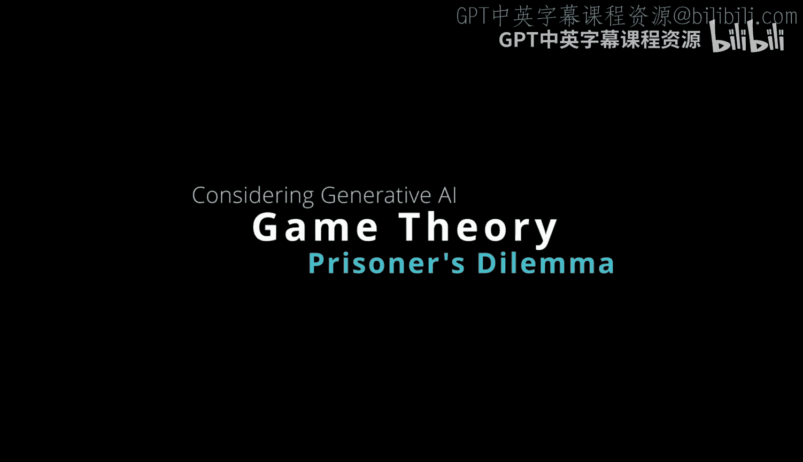
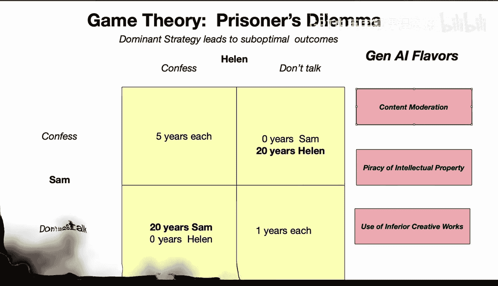

# 机器学习运维：第54章：生成式AI博弈论 🎲

在本节课中，我们将学习博弈论的基本概念，并探讨如何将其应用于理解生成式AI（如大型语言模型）可能引发的系统性风险。我们将通过经典的“囚徒困境”模型，来分析在缺乏合作与迭代策略的情况下，各方如何可能陷入“逐底竞争”的恶性循环。

---

## 博弈论简介

博弈论是一个数学框架，用于研究具有玩家、策略和收益的互动游戏，旨在找出最优策略，或分析在特定情境（如囚徒困境）中导致次优结果的“主导策略”。

上一节我们介绍了博弈论的基本定义，本节中我们来看看其最经典的案例。

## 囚徒困境

囚徒困境是经典的博弈论问题。在这个问题中，自私的主导策略将导致对所有人而言的次优结果。

想象你是一名检察官，你逮捕了涉嫌犯罪的Sam和Helen，但缺乏定罪两人的证据。唯一获取所需证据的方法是让他们互相揭发。

以下是收益矩阵的分析：

*   **双方都保持沉默**：每人仅被判入狱1年。
*   **一方坦白，另一方沉默**：坦白者将获释（0年），而沉默者将入狱20年。
*   **双方都坦白**：每人将入狱5年。

检察官通过分别向两人提供激励，促使他们坦白。即使双方合作保持沉默（总刑期2年）是最优结果，但由于彼此不信任，理性的个体都会选择坦白以避免最坏情况（20年）。最终，双方都选择了坦白这一“主导策略”，导致每人入狱5年，比合作结果多坐了4年牢。

这个案例展示了当系统设置导致所有人受损时，我们可以从博弈论的角度进行思考。接下来，我们将此视角应用于生成式AI领域。

## 生成式AI中的博弈论风险

在生成式AI的背景下，类似的博弈动态可能导致“逐底竞争”，即各方为短期利益采取行动，最终损害整个生态系统的长期健康。以下是几个潜在场景：

### 1. 内容审核的放松

假设未来所有内容审核都由某个AI系统完成。平台有强烈的经济激励来确保用户参与度，因为参与度低会导致公司收入减少。

因此，即使平台上充斥着低质量的生成式AI内容，平台也可能选择放松审核标准，因为这直接影响其利润底线。一旦竞争对手也开始因此亏损，双方都会调整内容审核策略。

以下是可能发生的连锁反应：
1.  平台A为保收入，降低审核标准。
2.  平台B发现用户流向A，被迫跟进，也降低标准。
3.  双方审核标准越来越宽松。
4.  最终，平台可能充斥低质量、甚至有毒的生成式AI内容。

这个过程可被称为 **`“逐底竞争”`**。

### 2. 知识产权盗用的恶性循环

在生成式AI领域，可能陷入一种假设性困境：假设竞争对手或他国政府将盗用知识产权。

出于这种预期，你感到自己也不得不盗用相同的知识产权以保持竞争力。结果如下：
1.  一方因担心对方盗用，率先放弃尊重知识产权。
2.  另一方作为回应，也开始盗用。
3.  最终，知识产权概念可能被彻底侵蚀。

这同样是一种 **`“逐底竞争”`**，因为行动是基于对他人将做坏事的预期。

### 3. 创意作品质量的下降

此场景直接映射囚徒困境。假设你感觉竞争对手可能开始使用由简单提示生成的劣质AI作品。

你的应对策略可能是：
1.  竞争对手为降低成本/提高产量，使用劣质AI生成内容。
2.  你为保持市场竞争力，被迫采取相同策略。
3.  双方作品质量越来越差。
4.  最终，市场上充斥低质量“艺术”。

结果是所有人皆输：客户得不到好作品，真正的艺术家失业，最终可能再无优质艺术产生。

---

## 总结与启示

本节课中，我们一起学习了博弈论的核心思想，并通过囚徒困境模型，分析了生成式AI可能引发的三种“逐底竞争”风险：内容审核失效、知识产权体系崩溃以及创意质量下降。

关键启示在于：如果只从追求单次博弈的“主导策略”角度思考，而不进行多轮迭代与合作，就可能导致对所有参与者而言的次优结局。

因此，在考虑像生成式AI这样的新技术时，一个非常重要的问题是：它的潜在影响是什么？以及我们如何能**创建一种迭代的合作策略**，以避免陷入“逐底竞争”的陷阱？这需要开发者、企业、政策制定者等多方建立长期视野与协作机制。