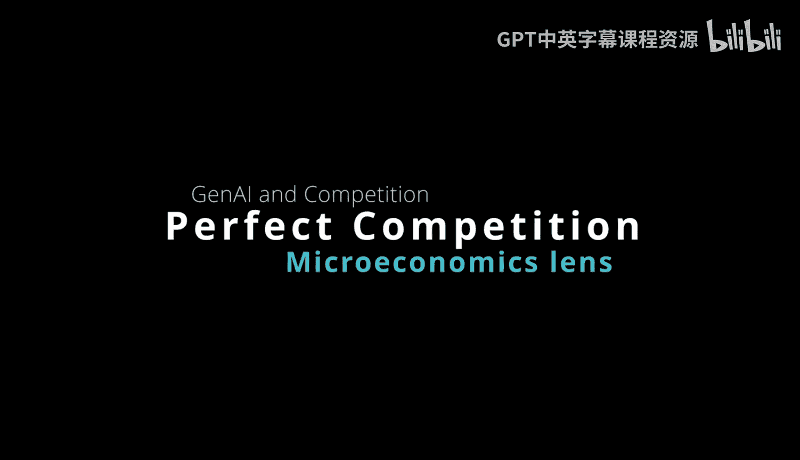
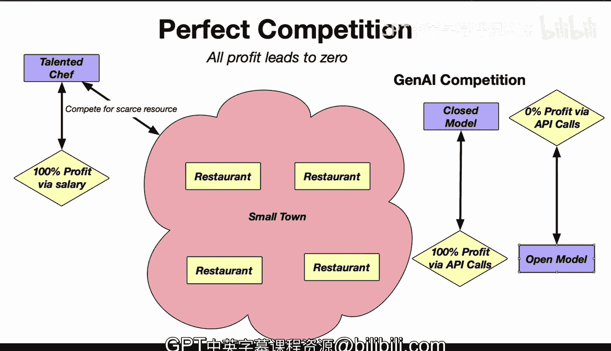
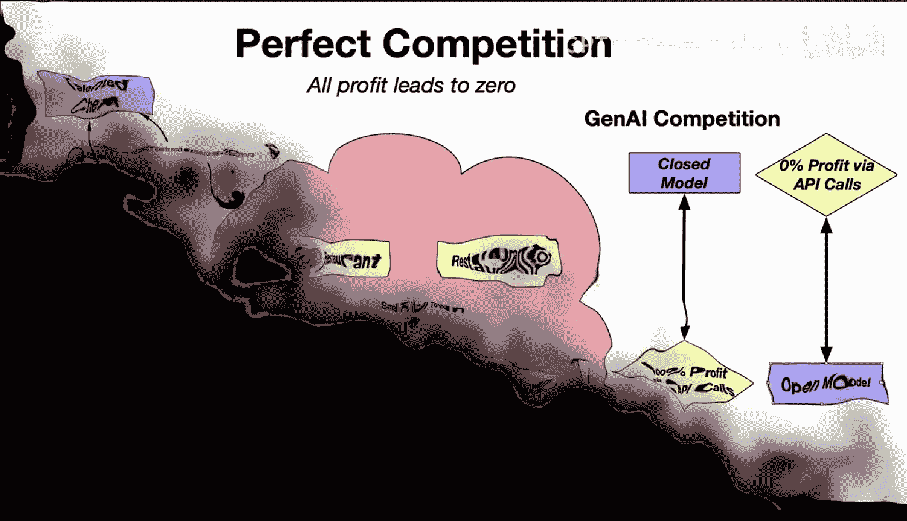

# 杜克大学｜机器学习运维｜DevOps⧸DataOps、Azure、MLFlow和抱脸｜MLOps ｜ Machine Learning Operations p196 55_04_08_完全竞争市场.zh_en -BV1yE421c7uA_p196-

In perfect competition， all profit leads to0。 But what does this really mean， Well。

 we can look at this from the perspective of a small town that has many restaurants。

 Let's say there are four restaurants in town。And there's no real way to compete against another restaurant until a talented chef comes into town。

 Now， everybody in the restaurant has to compete for this scarcee resource to be the chef because they're so talented。

 They bring in all of the customers to the restaurant。

 So what they do is they keep out competinging each other and paying more and more salary until eventually the chef takes all of the profit because the chef is a limited or scarcee resource。

 So this chef has rare and indemand skills。 There are many restaurants that are bidding for the chef service。

 and then eventually the chef will negotiate a very high salary and they'll capture all of the economic profit。

 So what does this mean economic profit it means that the total revenue minus the total economic costs。

 So this is the normal profit margin and then no normal profit is the costs of attracting investment and then the economic profit is the above normal profit。

 so。Essentially。This perfect competition could lead to eventual bankruptcy because whoever actually is employing the chef has to give all the profit to the chef。

 And there is no way to compete。 Likewise， we can look at a gen AI example where a similar thing could occur。

 Let， Let's say that there is a closed model。And that everybody has to use this closed model because it has superior performance。

 Well， there is no competitive advantage now， just like the chef。

 everybody has to use the same closed model， all the profit of these companies will go to the API calls just like the chef in the restaurant example on the flip side we could see another scenario where if all of the models are open there is no way to make a profit。

 Because you can equally use any model And so the companies that are training models will eventually go out of business because there's no way to make money。

 So this is a hypothetical situation， But it is important to think about this from an economics perspective when you're evaluating what your AI strategy is。

 Do you think that going all in on closed model is going to give you a competitive advantage or do you think in the future if there's a essentially unlimited amount of models。

Will eventually the models become like Linux， where it's a commodity， it's free。

 and you'll have to compete on some other form of technology。

