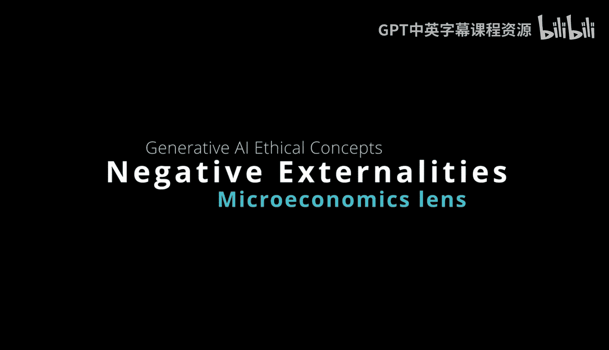
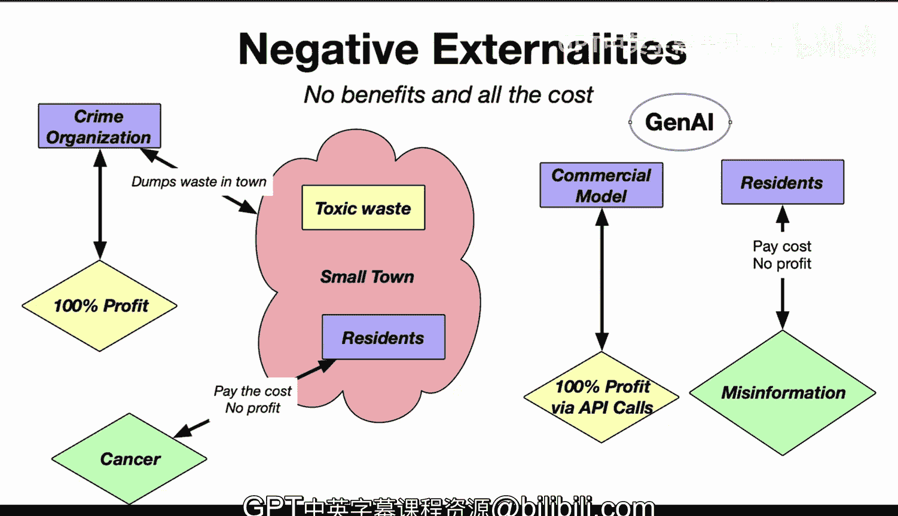

# 机器学习运维：P197：负外部性

## 概述

在本节课中，我们将要学习一个重要的经济学概念——**负外部性**，并探讨其在技术领域，特别是生成式人工智能（AI）中的应用与影响。理解负外部性有助于我们以更负责任的方式开发和部署技术解决方案。

## 什么是负外部性？🤔

负外部性是指某些行为或决策产生的**成本**或**负面影响**，不由行为发起者承担，而是转移给了未从中获益的第三方。

用公式可以表示为：
**社会成本 = 私人成本 + 外部成本**

其中，**外部成本**就是负外部性，它没有被包含在行为者的决策考量中。

## 一个现实世界的例子

为了更好地理解这个概念，我们可以看一个基于真实事件的极端例子。

假设有一个犯罪组织，受某公司雇佣，将核废料或其他有毒化学农药非法倾倒在某个小镇上。

以下是这个例子中的利益与成本分配：
*   **犯罪组织**：获得了处理废物的全部**利润**。
*   **小镇居民**：没有从倾倒行为中获得任何利益，却要承担全部**成本**。这些成本可能表现为癌症、疾病、土地污染导致无法耕种等健康与环境问题。

这个例子清晰地展示了利润与成本承担者的分离。犯罪行动带来了所有的负外部性，并由无辜的第三方承受。

## 生成式AI中的负外部性

上一节我们介绍了一个极端的负外部性案例，本节中我们来看看这个概念如何应用于更贴近我们的技术领域——生成式人工智能。

考虑一个商业公司发布了一个生成式AI模型，并通过API调用获利。公司获得了100%的利润，这看起来是成功的商业模式。

然而，我们需要思考：是否存在潜在的负外部性？那些没有获得利润的人，是否会为AI产生的内容付出代价？

以下是生成式AI可能产生的一些负外部性场景：
*   **制造虚假信息**：生成模仿著名政治人物声音的内容，可能影响选举结果。
*   **损害个人声誉**：生成关于特定个人的不实信息，对其公司或声誉造成伤害。
*   **引发健康问题**：传播错误的医疗健康信息，可能导致人们采取有害的行动。

理论上，这些都可能因生成式AI的不负责任使用而发生。商业公司获得了所有利润，而承受代价（即负外部性）的却是公众或特定群体。

## 如何负责任地思考？💡

负外部性的概念为我们提供了一个重要的思考框架。它并不意味着所有技术方案都会产生极端的负面影响，但强调我们在提出技术解决方案时，不能只关注利润。

在评估一个AI解决方案时，负外部性框架要求我们同时审视以下两点：
1.  **利润**：解决方案能带来什么收益？
2.  **负外部性**：解决方案会产生什么影响？即使是无意的，你实施的技术对社会的真实影响是什么？

这是一种负责任地思考部署AI解决方案的方式。它促使开发者和公司在追求经济效益的同时，也必须考量其技术可能对社会、环境和个人造成的潜在成本。

## 总结

本节课中，我们一起学习了**负外部性**的概念。我们通过一个非法倾倒有毒废物的例子理解了其核心含义，即**收益与成本承担的分离**。接着，我们将这一概念应用于生成式AI领域，探讨了AI模型可能产生的社会成本，如虚假信息和声誉损害。最后，我们强调，以负外部性的框架审视技术方案，关注利润之外的社会影响，是进行负责任AI开发与部署的关键一步。

