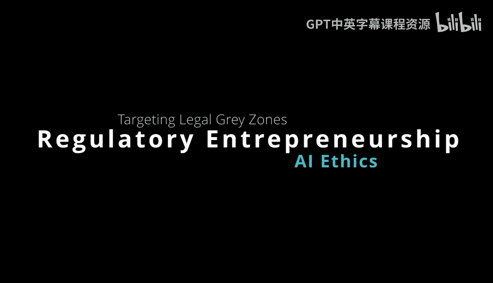
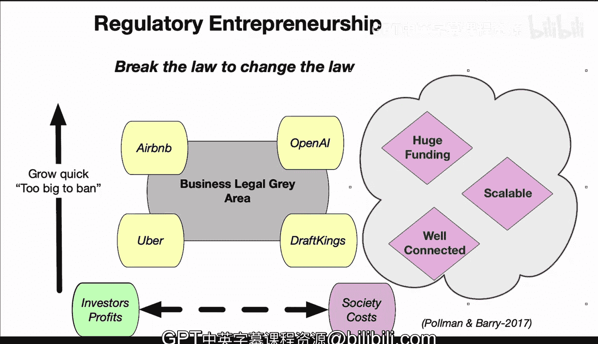

# 杜克大学｜机器学习运维｜DevOps⧸DataOps、Azure、MLFlow和抱脸｜MLOps ｜ Machine Learning Operations p198 57_04_10_监管创业.zh_en -BV1yE421c7uA_p198-

Yeah。Regulatory entrepreneurship is a term coined by Paulllman and Barry in 2017， and in essence。

 it means that by breaking the law。In creating a company in a legal gray area。

 you then later can change a law。 So if we take a look at some of the companies involved。

 we can see Airbnb， Uber， Tesla， draftafkings， these are blurring the lines between business and changing the laws and regulations and there are tactics that are used And so some of the key tactics are to identify any legal gray areas to grow very quickly so that you can't ban them so we call this too big to ban。

Also mobilize the users for political support or get on social media。

 get people to back your product。 and so some of the factors that enable this are well funded。

 scalable startups that are appealing to the public。

We also can think of targeting state and local laws instead of national right because it could be much more difficult to go against a national law and then litigation is more political than it is legal and so some of the implications are there are lower participation costs for these companies there also are you know some policies that will be changed very quickly。

 but they could。Diveverge from the public interest。

 And so these are some of the key questions are how do these factors play into these companies。

 So if we take a look here at what's going on with these four companies， Airbnb。

 Open AI Uber draftings。 we can see these same patterns and these apply to things like generative AI as well。

 Airbnb， obviously the company has profits and billions in valuation。

 And so they've returned something for their founders and investors。

 but society has to pay for the loss and the loss is a loss of affordable rental housing units globally。

 And so that's a negative externality。 Uber， we can look at the $50 billion valuation and the Vcs we're able to get their money。

 but in terms of a loss society。 and if we take a look at San Francisco in particular。

 you can see that there's increased traffic congestion and emissions right so not only is global warming increased from the exhaust。

But also the emissions harm the local residents who are going to ingest that pollution and the congestion as well is a negative externality the society has to pay for。

 nobody is compensated for that Likewise we can see draft kings you know there's a multibillion dollar fantasy industry but now we have more people addicted to gambling there's more personal bankruptcy and so society has to also pay the fees for that So for example。

 if somebody is able to spend their money。Gambling， and they can't afford to pay their mortgage。

 Then their family is thrown on the streets。 right。

 That's the negative externality in in a very extreme scenario。

 And society has to pay the burden for that。 Likewise， with companies like Open AI and generative AI。

 Obviously， there's some great things that are happening in terms of the advancements of generative AI。

 But and there's also profit， but there's also a loss potentially。

 So the AI could be used for destructive things。 Also。

 the artists who are being their works are being used in a copyrighted fashion to train the model。

 they also have some concerns as well。 And so the the cost of。

Of basically training on copyrighted data is a loss that society has to pay for so regulatory entrepreneurship has actually been around for quite some time。

 you see this really as a pattern with venture capital and it's really a TBD in terms of what will the future hold or will there be more regulation will there be less regulation but you can see these patterns are typically there。

 grow quick to big demand， huge funding scalable well connectednected people that can lobby Congress these are the patterns of regulatory entrepreneurship。

