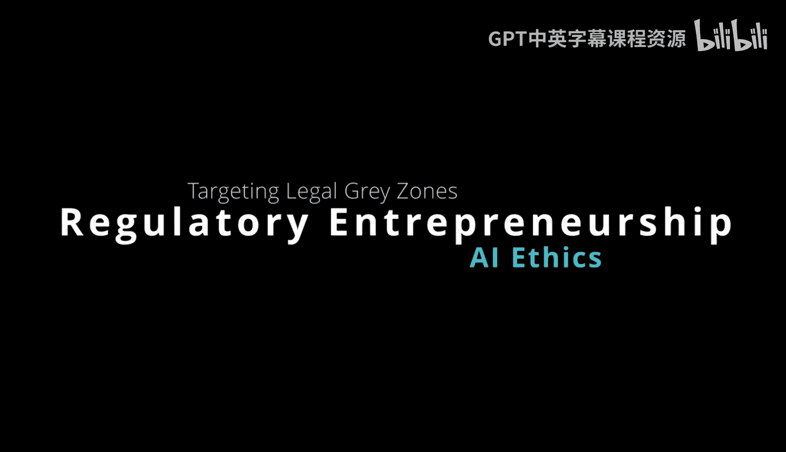
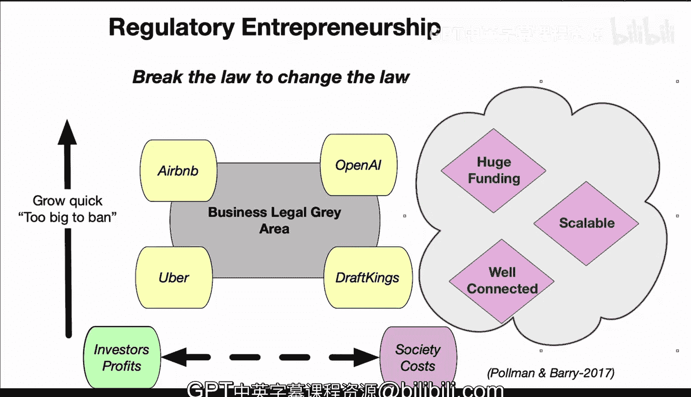

# 机器学习运维：第57章：监管创业 🏛️

在本节课中，我们将学习“监管创业”这一概念。这个概念由Paulllman和Barry于2017年提出，它描述了初创公司如何通过游走在法律灰色地带，最终推动法律本身发生改变的商业策略。我们将探讨其核心定义、常见策略、促成因素、社会影响，并通过具体案例进行分析。

## 概述

监管创业的核心含义是：通过**在法律灰色地带创立公司甚至违反现有法律**，使公司快速成长到“大到无法禁止”的规模，从而最终**改变法律或法规**。

上一节我们介绍了机器学习运维的宏观背景，本节中我们来看看一种与之相关的、影响深远的商业策略。

## 关键策略与促成因素

以下是监管创业公司常用的一些关键策略：

*   **识别法律灰色地带**：寻找现有法规模糊或未明确覆盖的业务领域。
*   **快速规模化**：以极快的速度扩张用户和市场规模，达到“大到无法禁止”的程度。
*   **动员用户获取政治支持**：利用社交媒体和公众舆论，让用户为自己的产品辩护，形成政治压力。

促成这种策略成功的因素包括：

*   资金充足、可快速扩张的初创公司。
*   产品或服务对公众有吸引力。
*   倾向于挑战州或地方法律，而非国家法律，因为前者难度更低。
*   诉讼过程本身带有政治色彩，而不仅仅是法律问题。

## 社会影响与外部性

监管创业带来了显著的社会影响。其直接结果是降低了这些公司进入市场的参与成本，并可能促使政策快速改变。然而，这些改变有时可能偏离公共利益，产生需要社会共同承担的“负外部性”。

负外部性是指企业行为对社会或他人造成的、未计入其自身成本的负面影响。其公式可以简化为：
**社会总成本 = 企业私人成本 + 外部成本（负外部性）**

接下来，我们将通过几个具体公司案例，来观察这些模式和影响是如何体现的。

## 案例分析

以下是四家公司的案例分析，这些模式同样适用于生成式AI等领域。

*   **Airbnb**：公司获得了巨额利润和估值，为创始人和投资者带来了回报。但社会需要承担**可负担租赁住房单元全球性减少**的损失，这是一种负外部性。
*   **Uber**：公司获得了高估值，风险投资获得了回报。但社会需要承担损失，例如在旧金山，**交通拥堵和尾气排放增加**。这不仅加剧全球变暖，当地居民吸入污染空气以及拥堵本身，都是社会需要承担且无人获得补偿的负外部性。
*   **DraftKings**：创造了一个价值数十亿美元的梦幻体育产业。但导致了**更多人赌博成瘾和个人破产**。例如，若有人将钱用于赌博而无力支付房贷，其家庭可能流落街头，这种极端情况下的负担也由社会承担。
*   **OpenAI与生成式AI**：在推动技术进步和创造利润的同时，也存在潜在损失。AI可能被用于破坏性用途，并且使用受版权保护的数据训练模型，引发了艺术家的担忧。**训练模型所涉及的版权数据成本**，也是一种社会需要承担的外部成本。

## 总结

本节课中我们一起学习了“监管创业”的概念。它并非新现象，而是风险投资中一种长期存在的模式。其典型模式包括：快速成长至规模巨大、需求庞大、资金雄厚、以及拥有能够游说国会的人脉。监管创业的未来尚不确定，可能会有更多或更少的法规出台，但这些行为模式值得我们持续关注。理解这一概念，有助于我们在技术创新的同时，更全面地思考其社会与法律影响。