# 杜克大学｜机器学习运维｜DevOps⧸DataOps、Azure、MLFlow和抱脸｜MLOps ｜ Machine Learning Operations p20 27_02_02_聚类算法在机器学习与AI中的实践.zh_en -BV1yE421c7uA_p20-

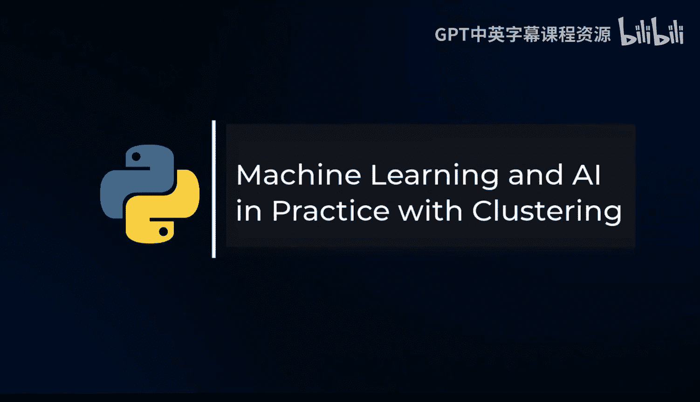

Hi， my name is Noah Gi and I'm going to talk to you today about Ka means clustering all the way from the theory。

 what is it， what are some of the techniques that you need to know to the algorithm itself。

 how to write it， and then how to implement it in production and then also how to use scaling to get higher performance for your Ka means algorithms by running it in parallel Okay。

 let's go and get started。

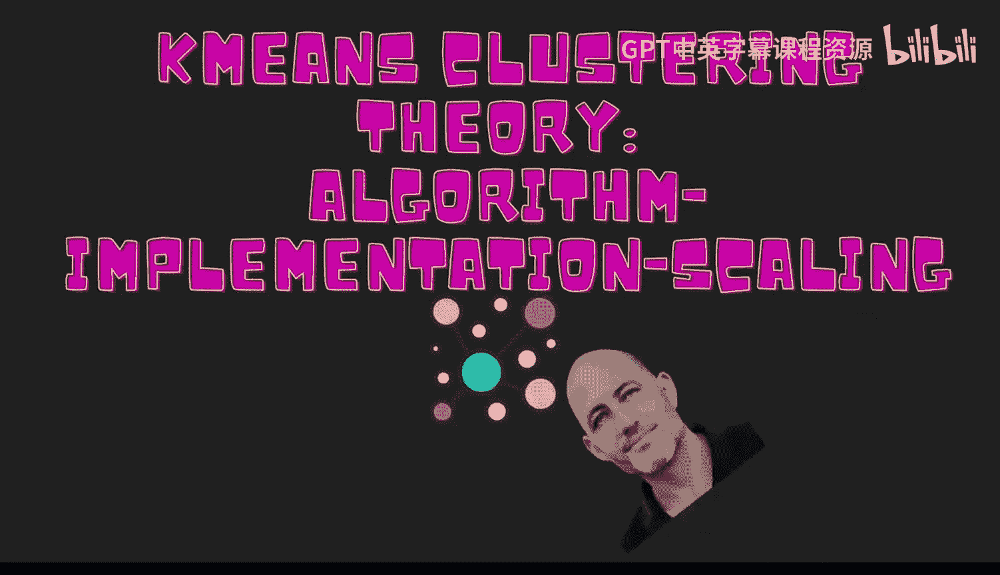

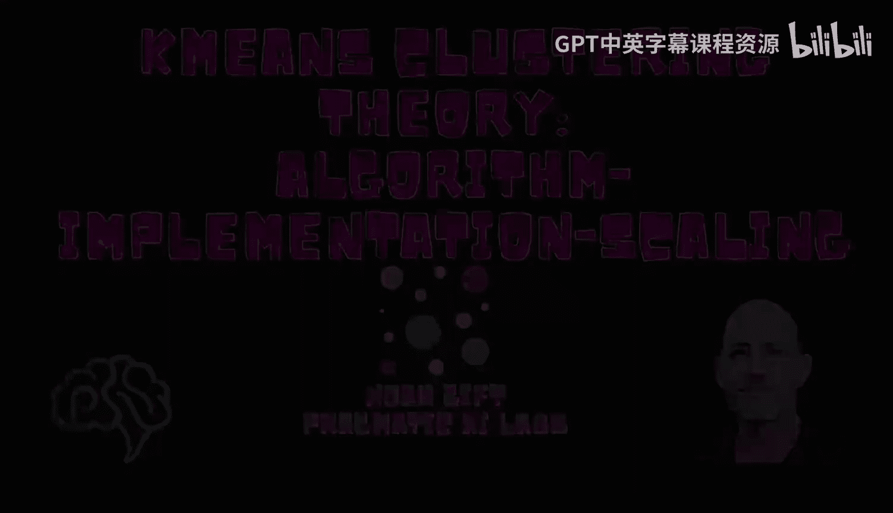

And in particular， I think it's important to talk a little bit about。What machine learning is。

 why it's useful， how you can use it to solve problems， and so to start with。

 I think a good place to begin would be to think about machine learning，And just describe。

Some of the things you can do with machine learning and actually what it is， so to start with。

 we have the area of supervised machine learning。So we can build this out。And then we have。

 we have unsupervised。We say unsupervised。And in the case of supervised。

 the idea here is you have historical data。And this historical data。

Is could be anything that's labeled but a good example potentially could be， let's say stock prices。

 this could be a good example and inside of the stock prices we have maybe some dates could be one field and then another one is the actual price and so what you would do in this scenario is you would learn from the correct answers in the past and then you would produce some kind of a prediction。

 so that's really the idea here with supervised machine learning。

Is that you're able to take data where there is a label。And it has a correct value。

And once you have those two things， then you're able to create a prediction model for the future and so that kind of machine learning is used a lot for and we've seen this recently the home flipping problem with Zillow the real estate company they went through and they trained the model to figure out what price to buy a house and then they put a value on a house so this is another example of supervised now unsupervised is a very different form of machine learning because you don't know what the label is with unsupervised machine learning and so this makes it a different technique in that what you're trying to do is you're trying to discover the label and so in this particular scenario here by discovering the label you can find out new things。

And once you're able to find out these new things， then you could maybe solve a problem with that particular technique and so you'll see unsupervised machine learning a lot。

 when you're dealing with let's say discovering relationships between things。

 so it could be like different kinds of customers， you could have a customer that is spends a lot of money。

 could be one cluster and then you could have another group of customers that only spend a little bit and this could be cluster number one。

 and this could be cluster number two， so you'll see people use these clustering algorithms quite a bit。

To discover new information about their business and so in particular。

 unsupervised machine learning can be a very good technique for business analytics， for data mining。

And in particular， one of the examples that I think would be a good one to show you is to go over to another project I have and we can take a look at this。

 So what I'm going to do is I'm going to pull up。

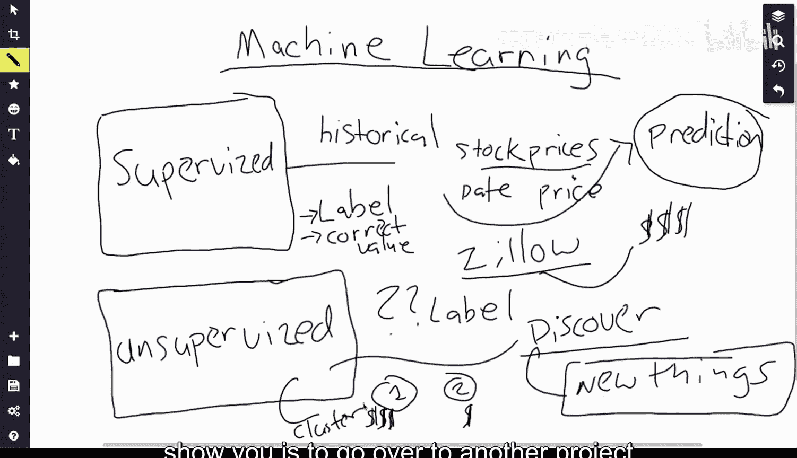

Insteadside of here。A。A project， course stats and data science。And inside of here。

 I'm going to start with this lesson here， which is cluster analysis。And in particular。

 when I open this up， let's take a look at some of the things that are important about cholesterol analysis。

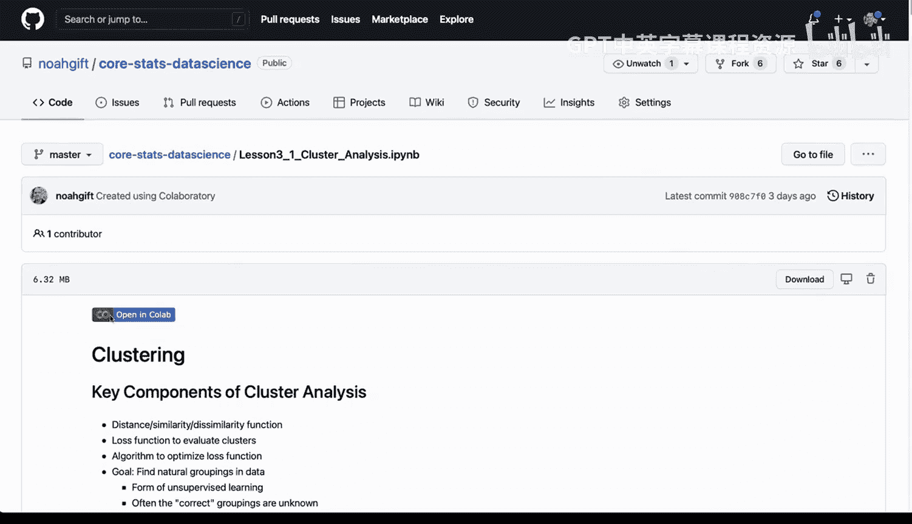

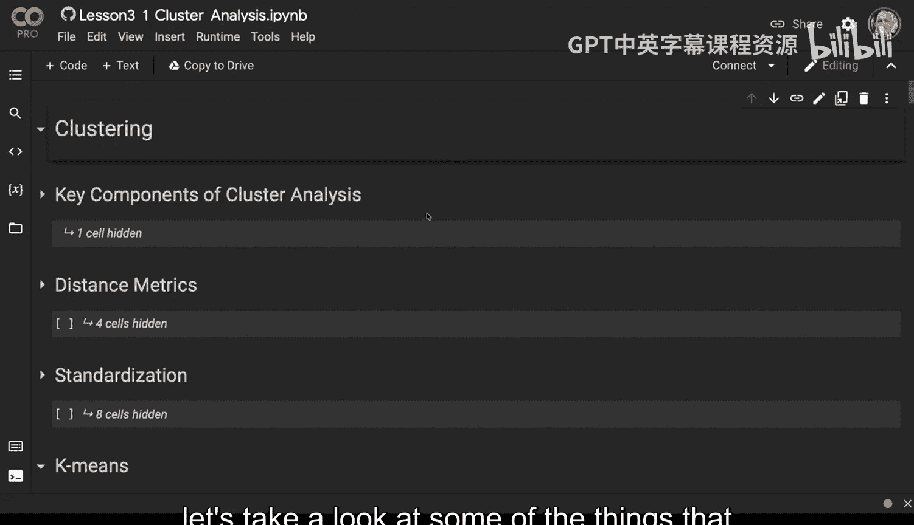

And in particular， actually let me just share this with other people that may want to see this repo。

 In fact， you can see the whole repo right here， there's a few different notebooks that I'm going to cover。

 but I'm going to start with。This particular notebook， which is lesson one cluster analysis。

And when we start with this， the main thing to be aware of with cluster analysis is that it is a form of supervised unsupervised machine learning and it's a distance similarity。

 dissimilarity function and so really its idea is to let you figure out the relationships between different different things and there's a loss function to evaluate a cluster and there's an algorithm to optimize the loss function。

 so the goal is to find natural groupings in data。And it's a form of unsupervised machine learning often you don't know what the correct grouping is and that's what's so powerful about it and samples within a group should be more similar than samples in a different group so that's really the key kind of intuition behind it and so if you look at things like a distance metric here you can see what you're trying to do is use one of these distance metrics like Euclidean for example and within multi-dimensional space figure out where all these attributes are very。

 very similar and so in this particular example you know if I wanted to go through and look at this data where I had the NBA teams and there's。

Those different metrics here， if I wanted to write my own Euclidean distance function。

 I could do that， and so what I could do is I could say from psytLarn dot metrics， do pairwise。

 import Euclidean distances， import NumpI as NPP from PsytLarn do preprocessing。

 import standard Scalar， and then what I do is I grab a 2D array， right here。

And then I grabbed the first row of the 2D array and then the second row and then I figure out the Euclidean distance。

 So basically you know in multidimensional space， you know where is everybody that's really the idea so it's really like a finding where someone is at in multidimensional space So if I run this we can go ahead and see this so you could do this yourself with any data right you could do a similar thing。

Now， the next thing to be aware of is that we have to know that。

Almost all machine learning requires some form of standardization and the reason for this is that it will help the clusters be equally influenced by each feature or dimension right so if you had a data set where one column was in miles and one column was in inches。

 those are different dimensions，or different measurements and so they would potentially not work the same and so this is where the standardization works is that it makes everything between let's say0 and1 and as a result then that you're much better able to see the trends in the data when you do a distance measurement where you're trying to find the multidimensional space now。

You can do this very nicely with a library in Python called preprocessing in psyitLarn。

 and so if we go through here， we say from psytLarn dot preprocessing， import standard Scalar。

 this would be the scalar， then I say from PsytLarn dot pipeline import pipeline from psyitLarn dot cluster import K means。

 and then I would say load data set right here。And then I could actually make a pipeline on top and so this pipeline what I would do is I would use the scalar that scales things makes everything the same。

 and then I would perform the Ka means clustering operation and I would tell it how many clusters to create and so in this particular example。

 here we go， we have cameens clustering and then if I do this。

 we can say withoutsic learn pipeline we could see this that it's just more code if you don't do the scaling operation。

So really the takeaway is I think it can be really convenient to use the pipeline with Kaian's clustering because it makes the code more basically more compact Now let's take a little bit more of a look。

At K means， So K means is one of the most popular forms of clustering， again。

 a unsupervised machine learning technique。 And if you look at the diagnostics here。

 we have an elbow plot， a silhouette analysis and an inter cluster distance map。

 these are some of the diagnostic tools that you can use。 And so in this particular example。

 we have yellow brick elbowpl， we say from yellow brick dot cluster import K elbow visualizer。

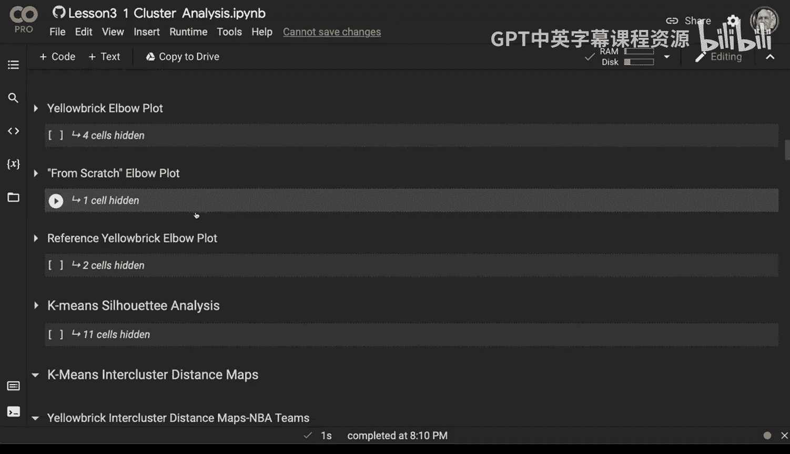

Here's the model K means， here's the elbow visualizer， visualizer fit， visualizer proof。

 right you can go through here and you can figure out where is the proper place to build the number of clusters and we could say well maybe this is it right here。

 elbow at K4 right this could tell us the number of clusters to create you could also scale this if we do yellow brick cluster import visualizer and it says elbow at4 so it's telling us that potentially we could have a K means cluster value of four but you also can build your own diagnostic tools that do similar things so here's an example where I say let's go through here and let's make an elbow plot。

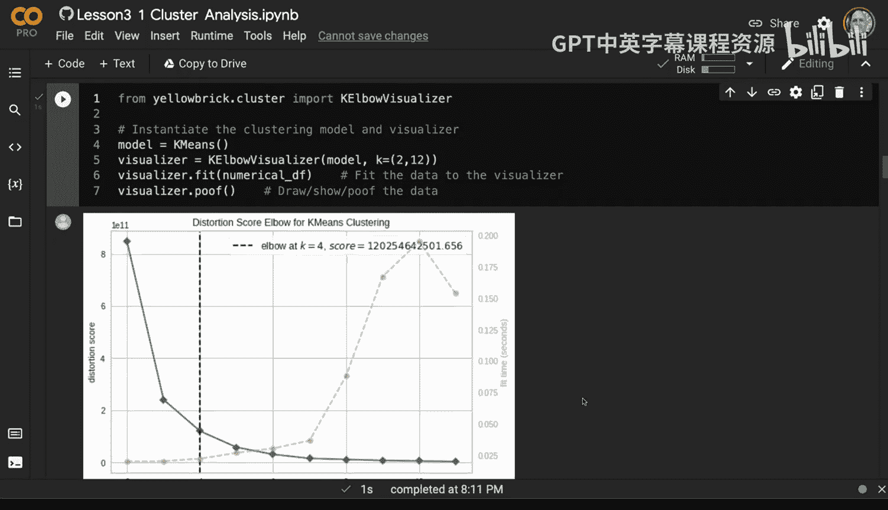

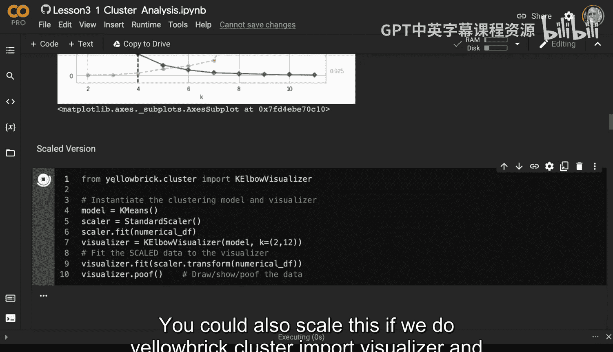

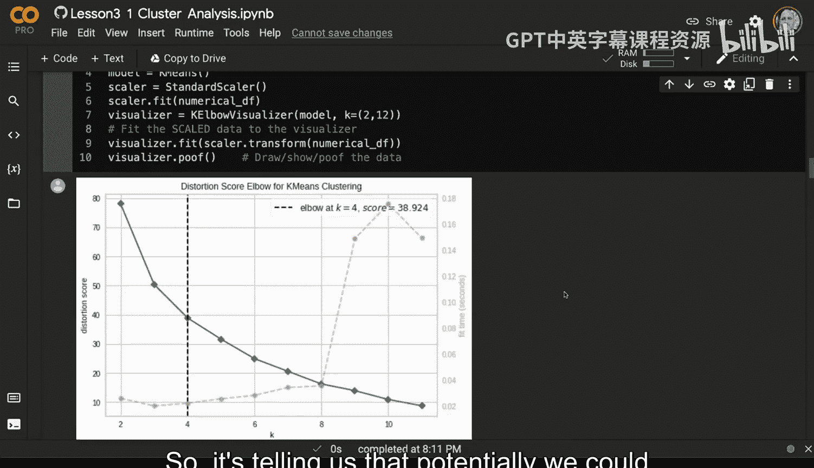

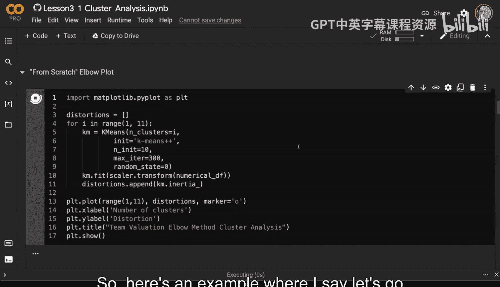

And really， again， the idea here would be like either this or this。

 you have right where the distortion curves， you can figure out the correct number of clusters so I would say between three and four clusters here is a good number of clusters so you could do this diagnostic on any data set that you're dealing with。

Now let's go ahead and take a look at maybe a reference。

 so if you wanted to just make like a simulation for Ka means's clustering and I would recommend playing around with this。

 this is a good way to do this is you can say you know from psyt learn do datas， import， make blobs。

 create synthetic data with eight random clusters。

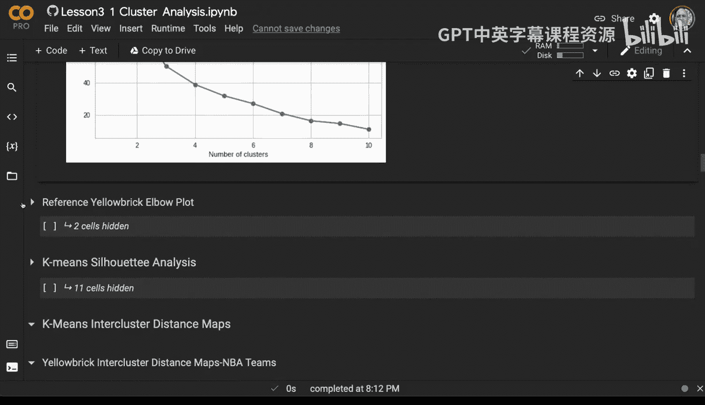

You would say X Y make blobs centers8 and features 12 shuffle true random state。

 I can make theses learnar data sets and then I can also say froms learn doc cluster import k meanss and we could actually go through here and fit this particular model and so this is another way to do this is you can actually just use the default you know data set withsL and this is a great way to learn how to work with the diagnostic tools or any other you capability that you wanted to test out so because you know what the right answer is this one says look create a synthetic data with8 random we can see that look it gives us a pretty good answer like it's either going to be seven or eight that we would get the analysis now you can also do something called k means。

Wet analysis。And here's an example of me doing this with NBAA data and the idea here when you do a silhouette plot is that essentially in this particular silhouette plot。

 it's showing you that essentially these clusters should all be over this particular value and so the idea is that you want to build clusters that are able to extend past this silhouette plot。

 so that's another visualization type diagnostic to use for your dataset。

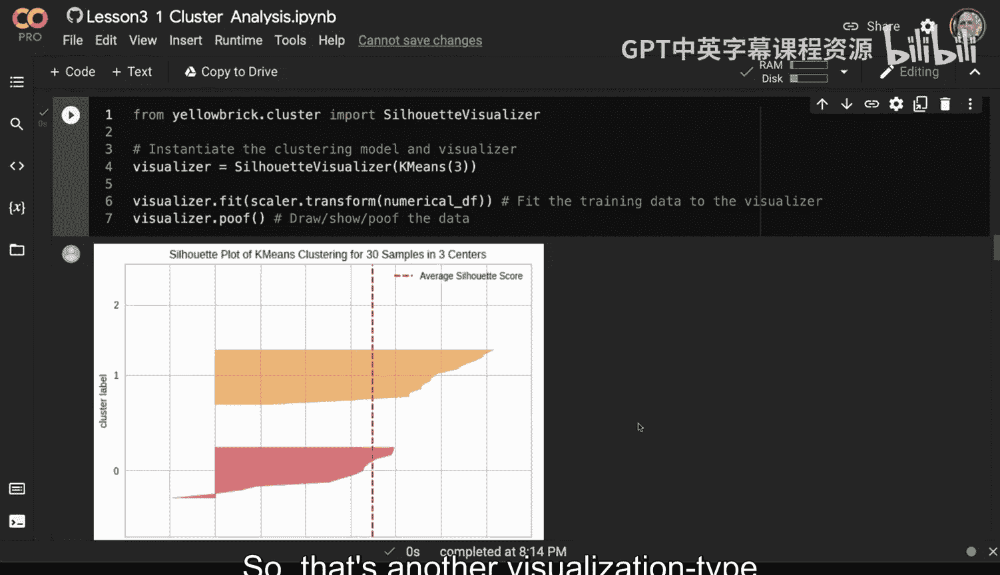

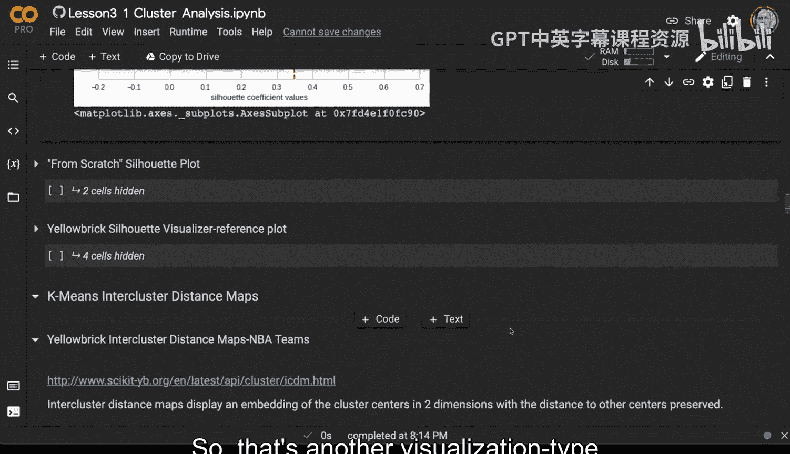

You can also build it from scratch， so if we went through here。

 you could go through here and you can run this。

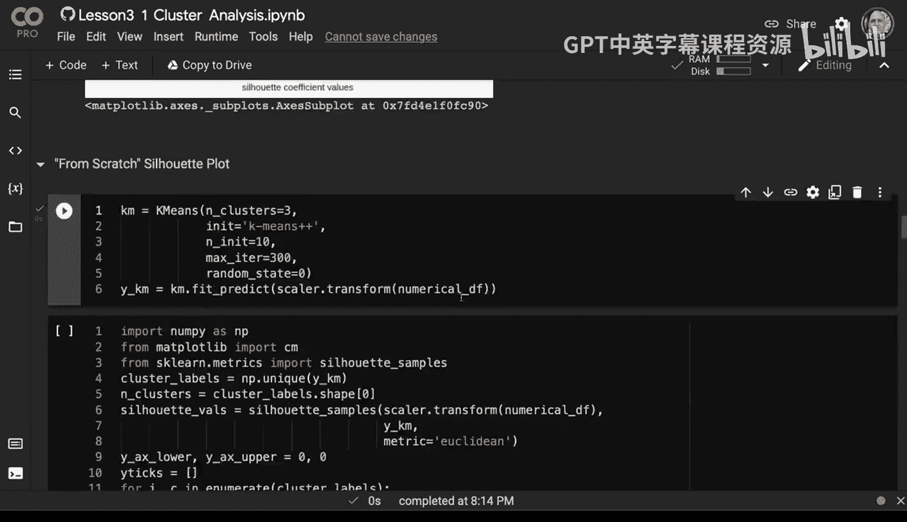

And then it would give you a silhouette plot as well that shows you like。

 this particular cluster here doesn't appear to be maybe maybe it's a little unusual。

 but these two clusters appear to be okay， so maybe it needs two sets。

 maybe it's only two clusters would be a better cluster for this particular data set。

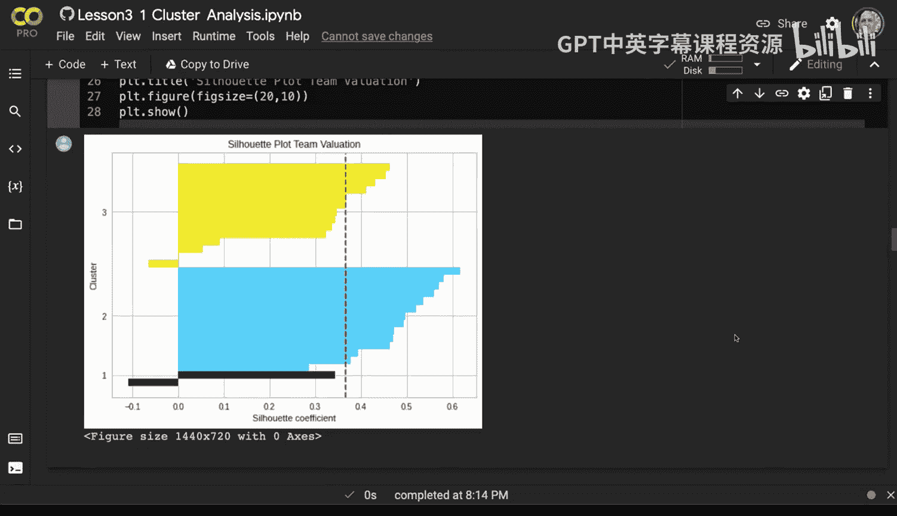

And again， you can do the same reference plot。

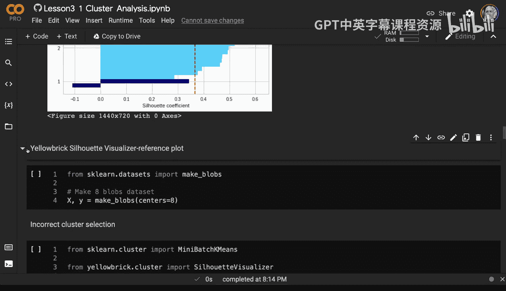

You can do the blobs。Imported and if you look at this silhouette plot。

 you can see that it shows you how， for the most part。

 with with eight centers that that most of the clusters go over that silhouette line So the idea again。

 is that this isn't a perfect diagnostic tool， but it can help you make a choice about you have some data。

 you don't really know anything about it， how do you actually pick what are the correct number of clusters。

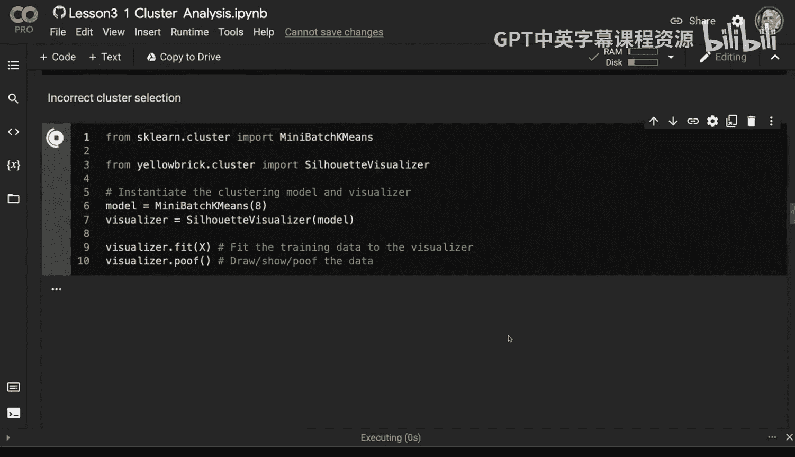

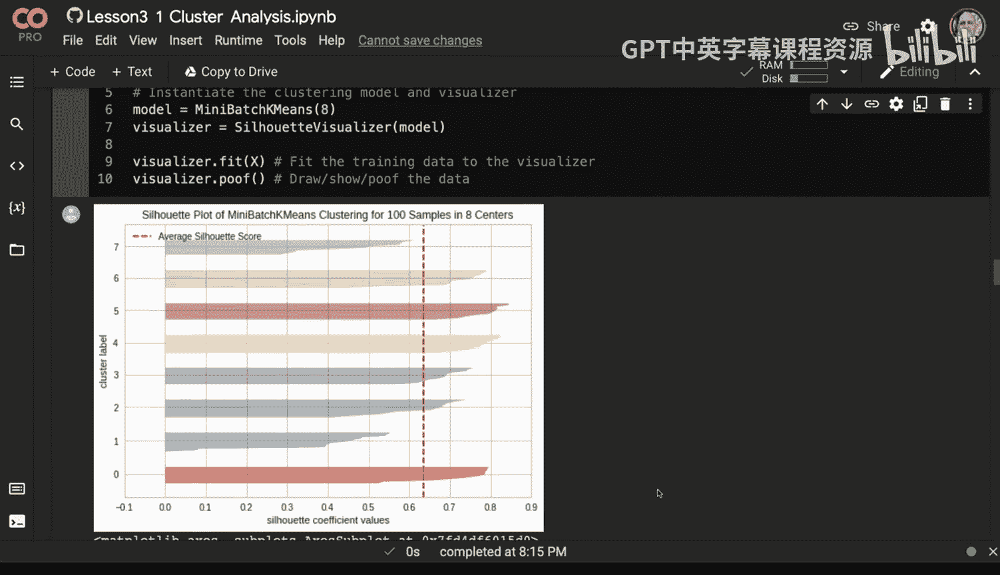

And then again， this is another one with let's say a different kind of clustering mini batch k means you can see the same thing So what else can we do with k means clustering to help us understand it。

 well another thing we can do is we can say k means intercluster distance maps and we can say intercluster distance maps displays in embedded embedding of the cluster centers in two dimensions with the distance to the other centers preserved and so if I go here and I say from yellow bricks do cluster import intercluster distance and I say visualizer equals intercluster。

Distance k means， this will fit the different clusters as well。

 and so this will give us the ability to make a diagnosis and say， okay。

 well if I did have three clusters what would happen， where would things be in a map？

You can also do the same thing with the reference data set again。

 this is a great way to try a new technique out is to use the reference data set。

And then pass it into a diagnostics tool in this case。

 this diagnostics tool will show us the different clusters and we can see here how they're all equally spaced out here and we can see that that looks like a pretty good fit for the data like they're all clean clusters that were created。

Now， a couple other things to be aware of when you're doing things like unsupervised machine learning。

 one is that it can be very computationally expensive， and so with K means computational challenges。

 one thing to be aware of is that things will perform differently on multico machines and also diskcao will become a factor as well as CPU。

AndSo here's a good example of a serial 25 k means clustering operation and what I do is I first import Ps learn and then I import the caine means again。

 and then I say do cameine so basically create a cluster on a generated data set， so I I think 100。

000 samples， I say there's three centers， I have 10 features。

 and then I have a random state here and then I want to create three cluster。

That will then get run via this function here because it runs the du means here。

 but this will run 25 of them and a'll run them in serial so basically this is going to run 25。

K means clustering commands。One by one right so it's a very heavy operation now why would you need to know about this Well this is in the real world。

 especially dealing with business type intelligence that you'll need to do maybe an analysis on lots of data sets at the same time and so maybe one thing you do is you initially just spin up a bunch of clustering jobs to see you know if there's any new information you can learn from the clustering operation so we can see。

That this one took a little bit of time， though it took like 23 seconds。

 So if it was a huge data set， maybe it would take a long time。

 So one of the things that you can do if you have computationally expensive operations is that you can actually go through and do in parallel。

25 key means clustering operations。And so if I say import multipro， multiprocessing。cpU count。

 we can see that there are four CPUs that are available。And I say from multi processing import pool。

 froms learnarn。 datas， import， make blobs， froms learnarn。t cluster import K means。

 and I do the same thing， but the difference here，Is that I say with I go through here and I say with pool。

Do map and basically I do each of these operations in a separate process。

 and so if I go through here and I run this。We can go through here and run this in parallel and basically it'll spin up a bunch of processes and each of those processes can execute separately this code so we can see here it's forking these processes and we can just wait wait here for to run。

And we'll see what it does。So this one might actually take a little bit of time。Because。

Of the fact that。A lot of times when you do parallel computing。

It can actually be more time if it's a smaller job than if it's a bigger job。

 and there may be limits to this environment as well。I don't know if this particular environment is。

Is going to work and maybe it's going to hang。But we can easily fix this because I can run this code in another environment。

Whi if it doesn't finish in a second， maybe that's what I'll do。Yeah， let's， I don't know。

 this one's taking a long time to run。And so。I can stop No， is it finishing， is it finishing yet？No。

 so many， so I'm going to stop this。This code。 and what I'm going to do is I'm going to open up another environment here。

 and I'm going to run it in a powerful environment。 So what I can do is go to my console。

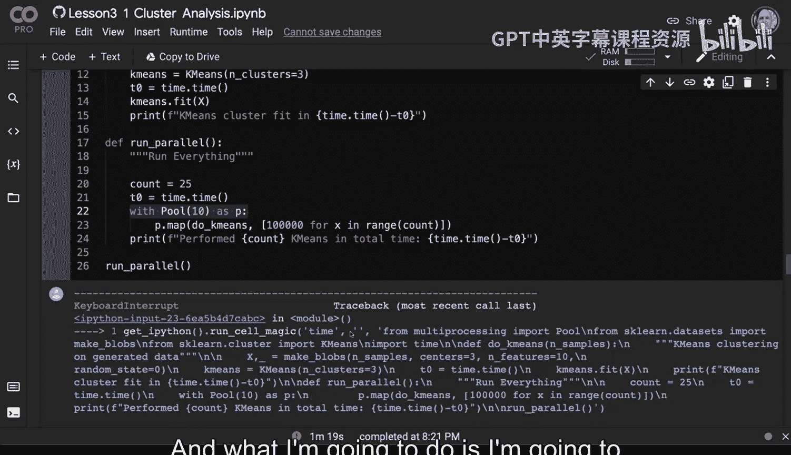

In AWS。Saign in。And then do authentication code。Good they're here and just say off。Let's see here do。

4，9，5，86，5。There we go。And I will open up a。

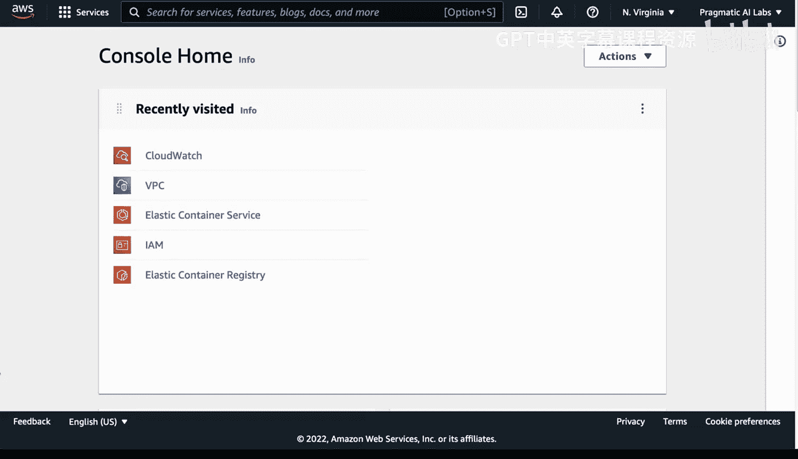

Cloud9 environments。

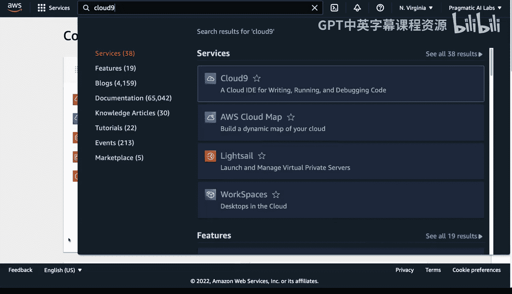

Here we go。And I will go through and say create environment。

 and I'm going to create like a very powerful environment that can run lots of processes。

 So we'll call this big environment。Big environments。And say this。Is a。This is in environment。

With mini cores。And so the idea here would be that I would have more computational power to run Ka mean so what I can do is instead of using a small one。

 I'm going to select a very large environment。If we scroll through here and we go to。

We have let's see a maybe a 32 core machine， like a very powerful machine with 128 gigs of Ram。

 let's go ahead and try that out。

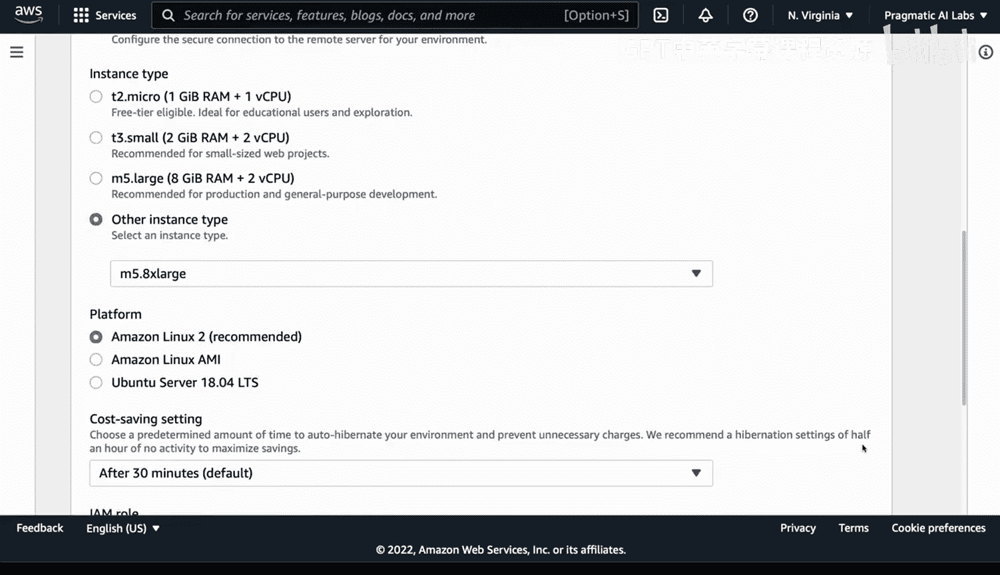

And we'll go to next step， I'll say create environments。Okay， let this thing wake up。

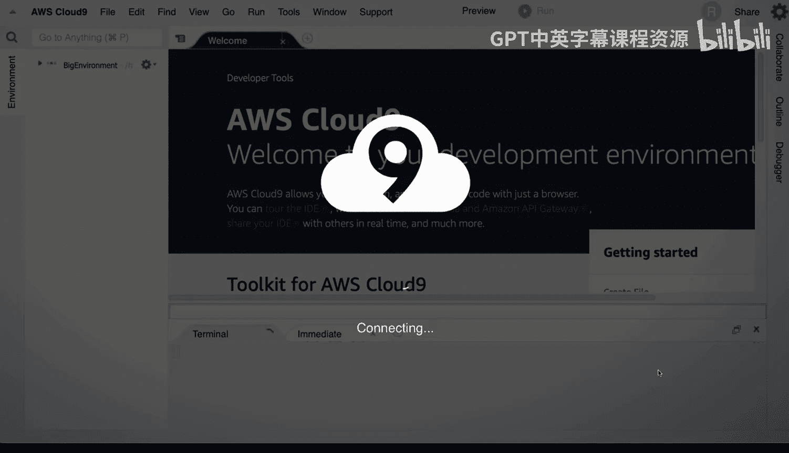

And so a couple things that I'll do to start with is that I will first create a Python virtual environment。

 That's what I typically do。 So I'll say Python 3 M。B E and V， and we'll say。For environment。

And we'll do this。And activate。And next， what I can do is。I can look at the code I had earlier。

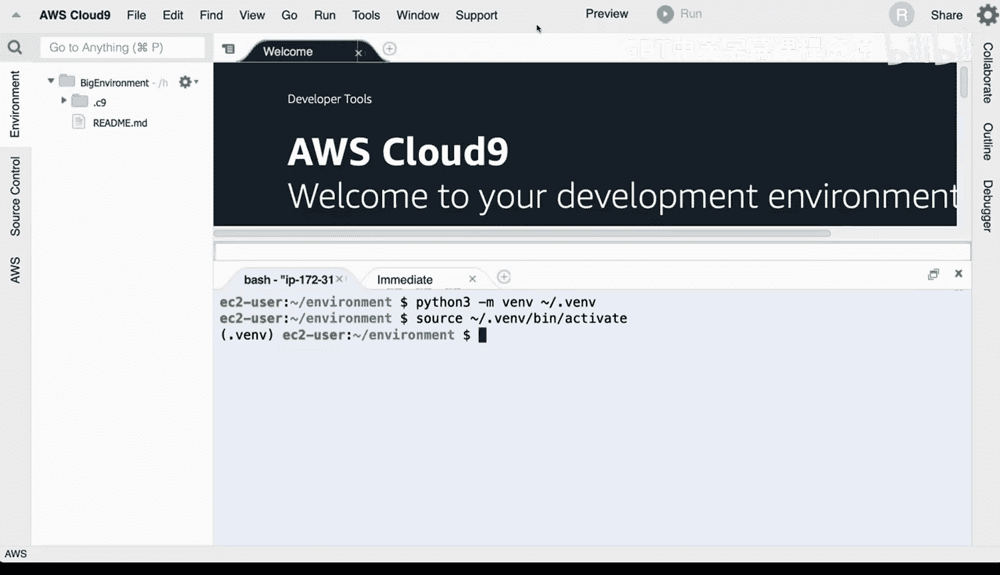

Which should be pretty easy to。To get an example of， let's see here， if I say。

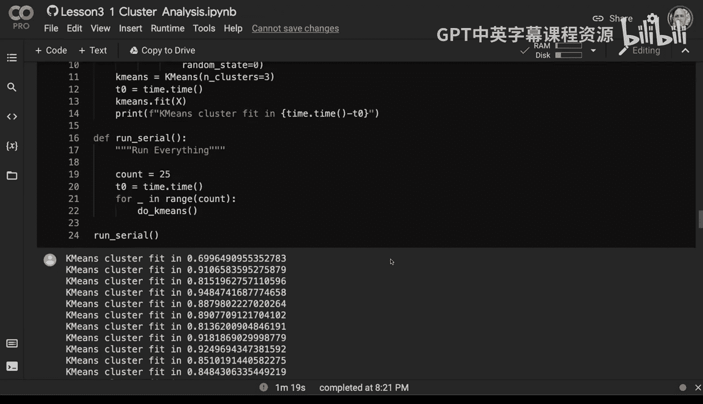

Yeah， this code right here will show us how many cores are available， so I'm going to just。

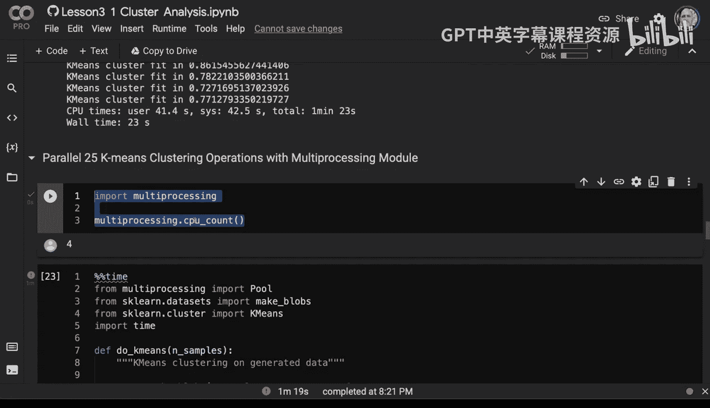

We'll call this profile。pyY credit a profile scripts。And then， inside。I will paste this in。

What this will do is tell us if I just print this。We'll call this is count。Is equal to。This。

 and I can print。Counts like that。And this will tell me how many cores I have available。

 so I'll say Python profile。There we go and we see 32 cores， right， so huge， huge。You know。

 amount of core available。 So now we can try this script here， we can we can do。

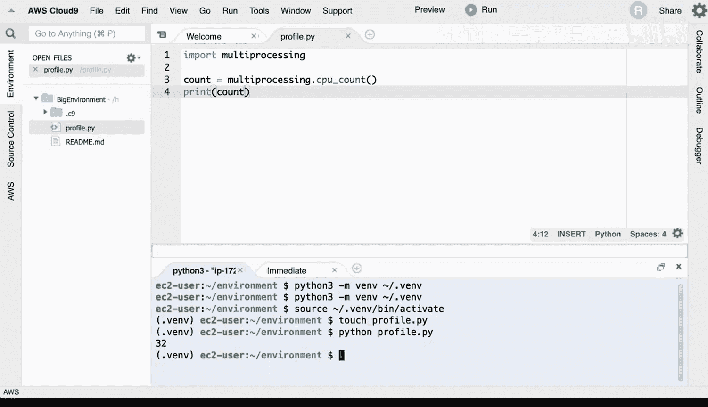

This parallel script， because we have a very， very big machine， So I'm going to grab this here。

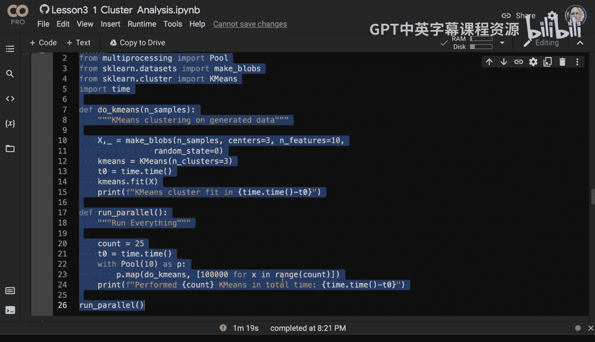

And then I'm going to create。key means。Lge， something like this。

And then I'll just paste this code inside。Now keep in mind， there's a couple things to be aware of。

 One is that I'm going to need to import psyA learn so I can just do a PIip install。

 We can just do a PIip install。SK learn。Like that。And if I scroll here。There we go。

 and we can just do。嗯。It looks like it's ready and now if I just run this， if I just say Python。

Key means large notice that it will then spin up a lot of processes and how would I know this where I could go to new terminal。

And I could type in the top command。And it should。Should show us that there's lots of Python processes see this。

We have all these Python processes running。These are basically。

 even though this is a very powerful machine， there's tons and tons of Ka means cluster jobs that are running。

 and so what's great about this is that it gives us the ability to run lots of Ka means clustering jobs in parallel。

That's one takeaway I guess， is that you can definitely use parallel processing to do lots of machine learning jobs all in parallel using a technique like we just used here。

 which is by using this multiproces module and Python， it goes to all of the core on your machine。

 so there's lots of really interesting techniques if you were going to process lots of data including doing parallelization。

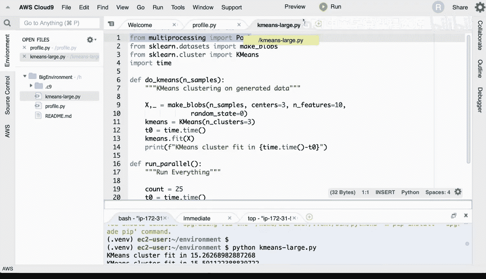

So I'm going to go back here now。

