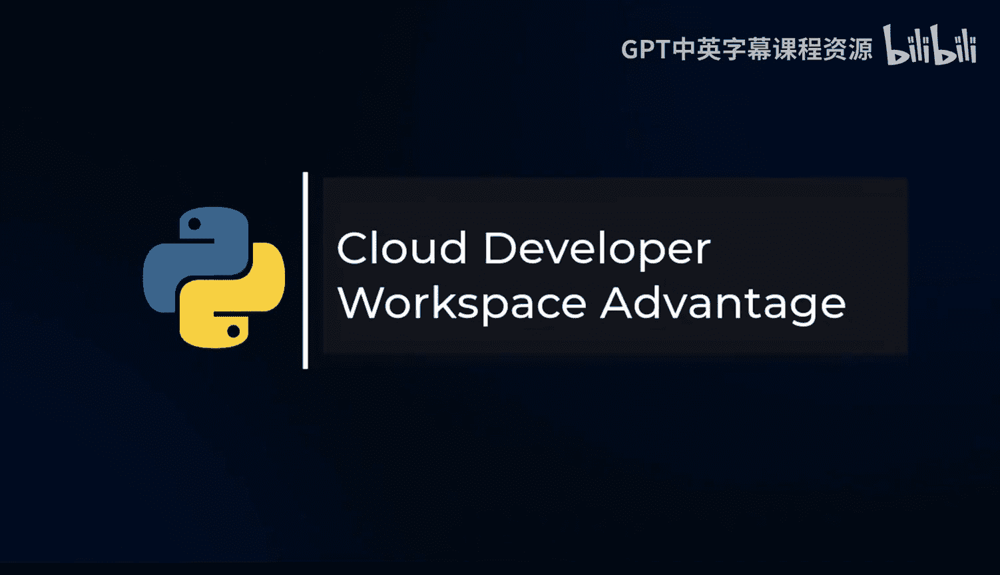
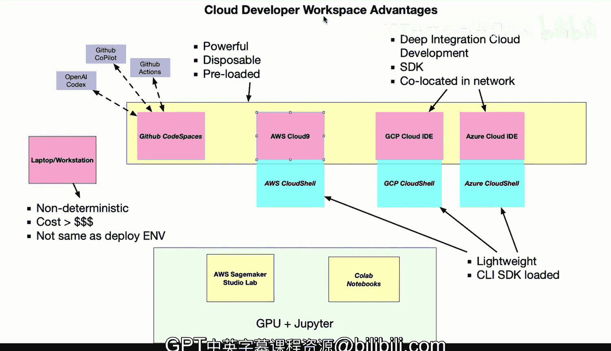

# 杜克大学｜机器学习运维｜DevOps⧸DataOps、Azure、MLFlow和抱脸｜MLOps ｜ Machine Learning Operations p21 28_03_02_云开发者工作空间优势.zh_en -BV1yE421c7uA_p21-

Let's take a look at this cloud developer workspace advantage。

 It's one of the more interesting new trends that we're seeing in many fields， software engineering。

 data engineering， data science， machine learning engineering。

 Also machine learning operations in some sense， if you're not using a cloudbased developer environment。

 you're really missing out on many new features that are not available on your laptop。 First。

 let's take a look at a laptop。 In this case， we have a laptop or workstation and you can see that it's nondeterministic。

 there is no guaranteed environment。 there could be packages that are installed that you don't want。

 It could also be very costly to get GPus。 and to have let's say a solid state drive that is large and this is not going to be the same as where your current deployment environment is running if you're running in the cloud。

 It's not going to be the same as your laptop。 with some exceptions。

You can work around that with containers Now if we go to the cloud here and we take a look at some of these cloudbased environments and really we can see that Github code spaces。

 AWS cloud 9 GCP cloud IDde Azure cloud IDde all of these have many things in common and that there is typically an IDdeE that's customized for development in the case of Github code spaces。

 the unique features are that it does have easy integration with Github actions which is the continuous integration system it also has easy integration with Github copit which allows you to write code where the open AI codex is essentially telling you what to write and also this whole integration is very tightly coupled with GiHub so this is one of the favorite environments that I have。

 I think it's a great environment to develop in。And if we go down to the bottom here。

 we also see that there are these notebookbased environments。 We have coab notebooks。

 the coabab notebooks allow you to build in the cloud Jupiter compatible systems that use GPUs。

 you can even use a pro version。 There's also AWS SageMaker Studio lab。

 which allows people to go through and run Jupyter notebooks using GPUs that are free that are provided by the AWS platform。

 So these are really good options for notebook friendly workflows and these up here in the yellow are options that are more suited towards software engineering。

 machine learning operations， machine learning engineering。If we take a look at cloud 9 here。

 it's got customized features， including rollbased privileges so you don't have to put your API key inside and it also has tight integration with other services like for example。

 AWS cloud Lambda AWS S3 API gateway， those kinds of services that allow you to build serverless applications but there's a lighter weight version which is called AWS Cloudhell and this also is a good environment for even doing very minor software engineering and also you can switch between bash Zhell or Powerhell if you go into other clouds。

 they're very similar in that GCP has its own cloud editor and also has a cloudhell。

 Azure has its own cloud editor and also has a cloud shellll。

 So one thing that you'll start to notice is that the world is moving towards these powerful disposable preloaded environments that have deep integration with cloud that have SDKs installed in their。

Lated in the same location。 So if you're in a coffee shop somewhere and you want to work with terabyteta data。

 well， you're out of luck if you have to copy that data back and forth。

 but if the data is already in the cloud and you submit up a cloudbased development environment。

 you're colocated directly with that data。 So really the future is a cloud developer workspace advantage and it's something that I would recommend people dive into。

