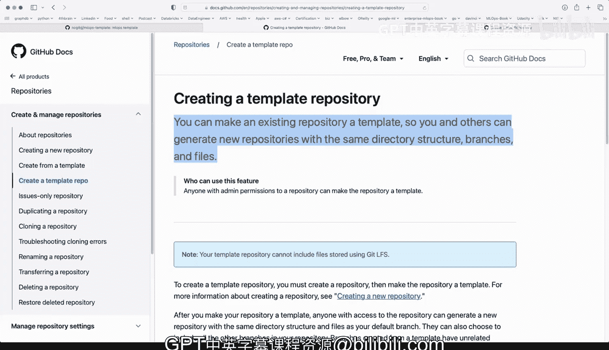

# 杜克大学｜机器学习运维｜DevOps⧸DataOps、Azure、MLFlow和抱脸｜MLOps ｜ Machine Learning Operations p23 30_03_04_使用GitHub模板.zh_en -BV1yE421c7uA_p23-

Let's go ahead and create a new repository for Github based on a template。 In this case。

 I'm going to look at the Microsoft codespaces Tea template Pi。

 and you can see here this is a public template。 What's nice about this is that it means that I could actually customize my own workflow based on this template。

 So what do I need to do to get started here。 Well I could just go ahead and click use this template and then select my repo here and it would copy all of the files into this repository。

 Let's go ahead and do that。 Let's call this amops template because I'm going to use this to create my own template。

And we can say MLlos template。And then I can go to public。

And then we can also include any branches if we wanted to， in this case， the main is just fine。Now。

 one of the things that I like to do when I'm creating my own scaffolding for a project is I like to use make files and so one of the things that I would probably do to modify this is I would go through here and add a few different files and we can even do this real quick。

 we can actually create them right from this interface if I go through here and I say create make file。

This could be one of the things that I added to the project and the other thing I could do as well is if I wanted to customize the dev container and enhance it or make some changes to it。

 I could also do that as well。 Now what I'm going to do is I'm going to go to my settings now and make this a template for other people。

 So I'll go ahead and click settings And now if I go down here。

And I go to the settings for this repository。 I can say template repository。

 What's nice about this is that I can then give this to students or I could give this to other people in my my workplace and now they're going to be able to use this as well。

 And so if we go back here， you can see that it says public。

And now if I wanted to create a new project based on this template in the future。

 I would just select use this template， there's some additional documentation from GitHub called creating a template repository and you can actually use this in the future to make changes if you'd like to when you're making your own repository。

