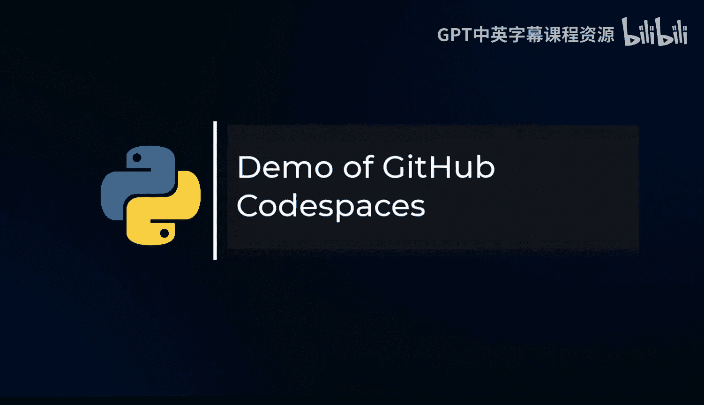
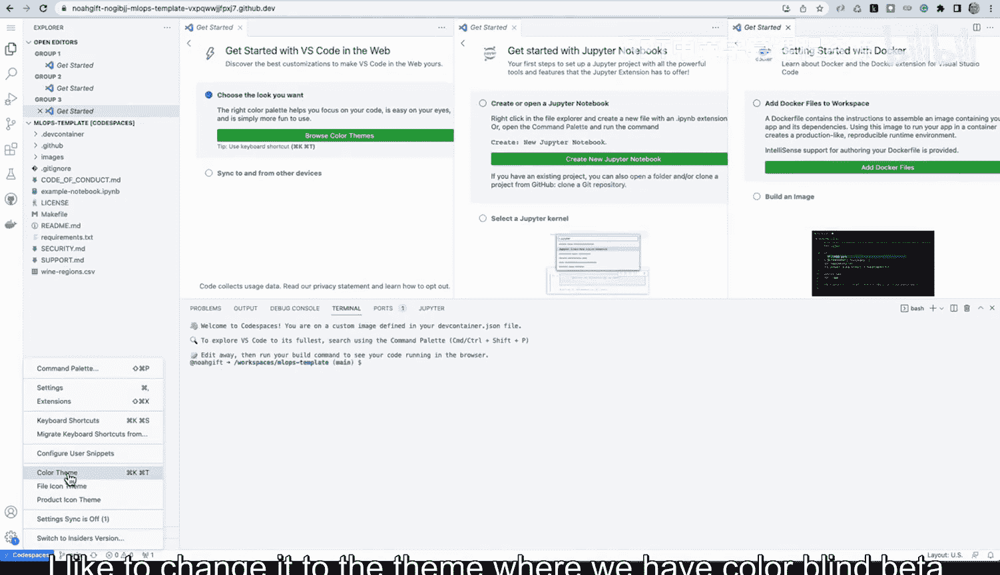
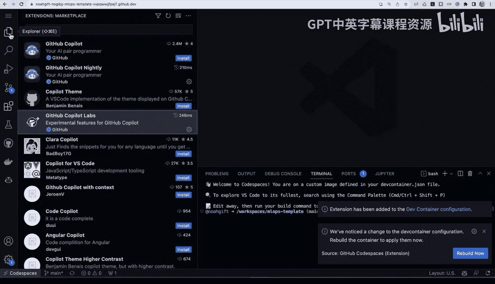
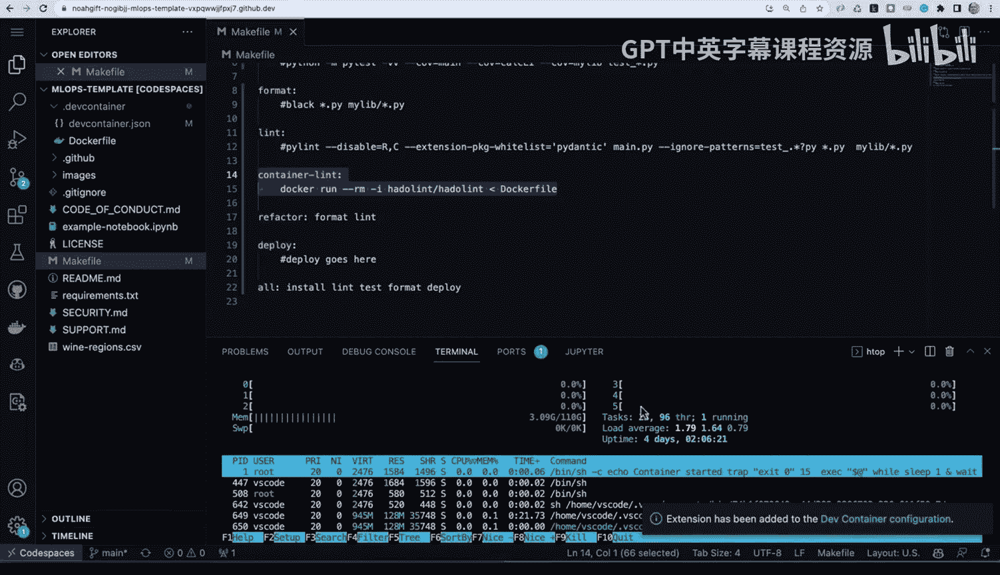
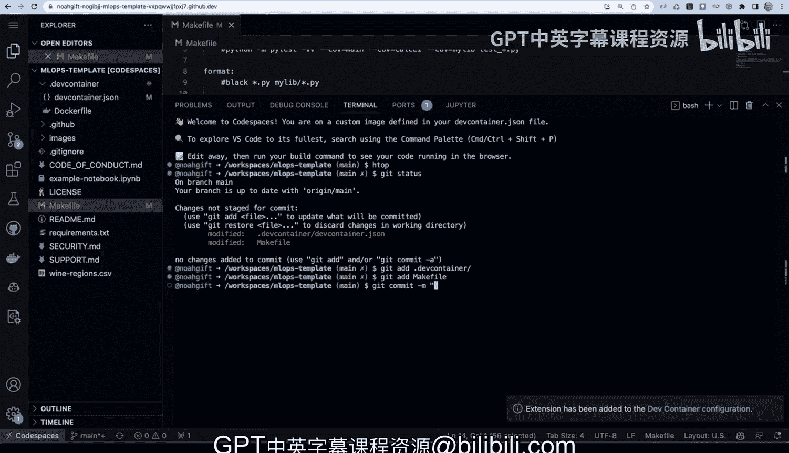
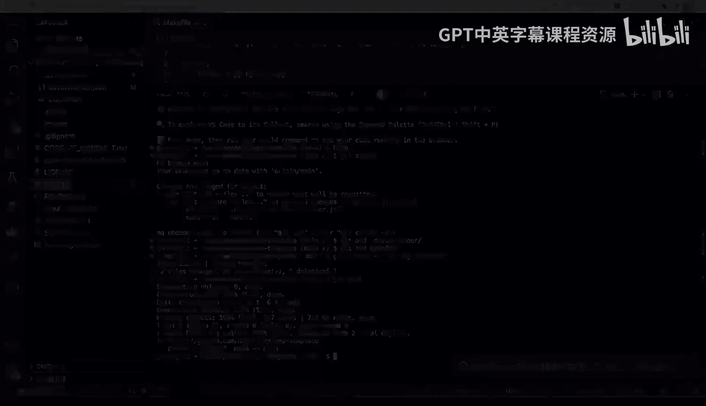

# 机器学习运维：P24：GitHub Codespaces 演示 🚀



在本节课中，我们将学习如何使用 GitHub Codespaces 来定制一个公开的仓库模板，以满足个人或团队特定的开发环境需求。我们将涵盖从创建 Codespace、选择硬件配置、使用预构建容器，到安装扩展和自定义开发环境的完整流程。

---

## 概述

GitHub Codespaces 提供了一个完全配置的云端开发环境。本节演示将展示如何从一个公共模板仓库开始，通过 Codespaces 快速启动一个开发环境，并对其进行个性化定制，例如安装扩展、修改配置文件，最终生成一个可供他人使用的增强版模板。

---

## 启动与配置 Codespace

首先，我拥有一个作为公共模板的仓库。该仓库内部包含一些配置项，例如用于配置 Codespaces 的开发容器配置文件，以及一些 GitHub Actions 工作流。

为了满足我的特定需求并修改此模板，以便其他人能从中获得更多功能，我将使用 Codespaces。

我们进入 Codespaces 界面，选择“在云中编辑”。默认情况下，我可以选择默认配置。此外，在配置菜单中，我实际上可以从多种机器类型中进行选择。选择取决于我的任务性质。

例如，如果我教授需要多核处理的概念课程，我会选择 16 核的机器。如果我要进行 GPU 相关的工作，例如微调一个 Hugging Face 模型，我则会选择 GPU 机型。

现在，我们选择这个 GPU 机型，然后点击“创建 Codespace”。

---

## 加速启动：预构建容器

启动过程需要一些时间。我们可以通过使用预构建容器功能来加速这一过程，这是一个非常实用的小功能。

一旦 Codespace 启动，我可以展示如何返回设置。在 Codespaces 设置中，我可以选择使用预构建配置选项。

我将启用此选项。它的作用是允许环境自动为我们构建。我可以选择主分支，并设置每次推送代码时都重新构建此 Codespace。

创建此选项后，未来的启动速度将显著提升。

---

## 环境初始化与连接

当 Codespace 启动时，我们可以看到它正在执行各种操作来配置开发环境。

一旦开发环境设置完成，我就可以开始定制模板了。这个过程只需要片刻。

关于这个特定环境，需要注意的一点是，我也可以通过进入 Codespaces 的开发容器环境并修改 `devcontainer.json` 文件来自行调整它，而这正是我接下来要做的。

我们可以看到容器已启动，现在正在连接，稍等片刻即可准备就绪。

---

## 个性化环境设置

连接成功后，我首先喜欢配置的是 Codespace 的设置。我会进入颜色主题设置，将其更改为“Colorblind Beta”主题。这个主题对比度高，且具有良好的可访问性。

让我们进行更改，并适当调大字体。

此外，我注意到已经有人为我构建了这个开发容器，这很不错。它基于 Bullseye 系统，并安装了一些软件。



但我希望在其中添加更多内容，进行一些个性化定制。

---

## 安装扩展

接下来，我将安装一些扩展。我转到环境中的扩展面板。

首先，我会安装 **Codium**。我选择安装 Nightly 版本，以获取最新功能。

其次，我喜欢安装 **GitHub Copilot Labs** 扩展，它可以帮助进行代码翻译等功能。

安装后，我可以右键点击这些扩展，选择“添加到开发容器”。这样做的优点是，将来当我把这个环境提供给其他人时，他们也能直接获得这些功能。

---

## 自定义 Makefile

另一个我喜欢做的定制是修改 `Makefile`，并在其中添加一些配置安装步骤，同时为 Makefile 安装一个语法扩展。

我们右键点击 `Makefile`，选择“添加到开发容器”。

现在所有设置都已完成，最后一步是回到我的文件，打开 `Makefile`，并粘贴一些预设内容进去。



我们可以粘贴内容，并组合成一个小模板。例如，我们可以添加一个 `deploy` 目标，并可能为使用者添加一些注释说明。

这样，我就可以为他们提供关于如何安装软件、测试软件、格式化代码以及检查项目链接的建议。所有这些都封装在一个模板化的环境中。

---

## 验证环境功能

此外，如果我们运行 `htop` 命令，可以看到这个环境确实拥有高内存配置。

如果我们输入 `nvidia-smi` 查询命令，也可以查看 GPU 是否正在运行。

至此，所有必需的配置都已完成。

---

## 保存与共享定制

最后一步是保存我们的更改。我们运行 `git status` 查看更改。

然后，我们将修改添加到 Git 暂存区：
```bash
git add .devcontainer
git add Makefile
```

现在，其他人就可以使用这个经过修复和增强的模板了。



---

## 总结





本节课中，我们一起学习了如何利用 GitHub Codespaces 快速定制一个开发环境模板。我们从选择硬件配置、启用预构建加速，到安装个性化扩展、修改核心配置文件，最终保存并分享了我们的定制成果。这个过程展示了如何高效地创建可复现、可共享且功能强大的云端开发环境。