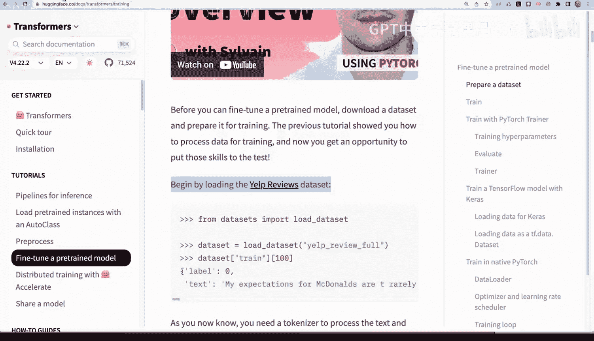
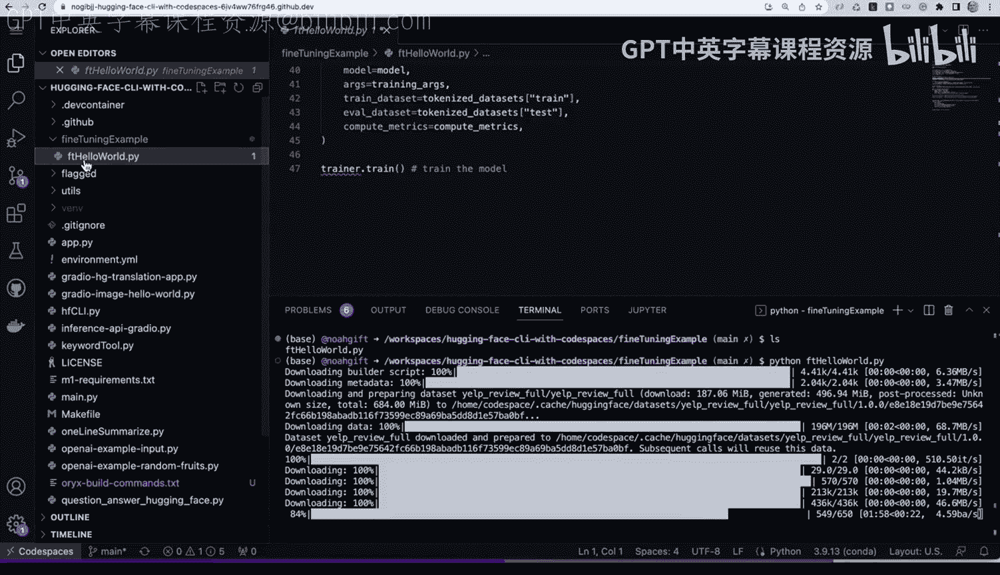
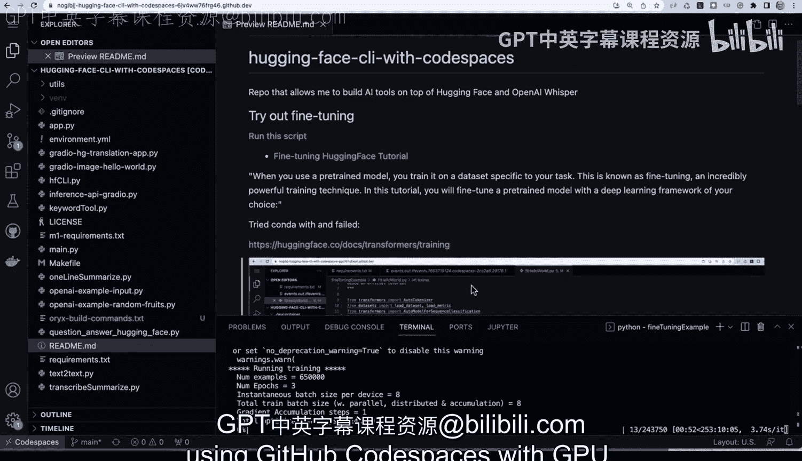

# 杜克大学｜机器学习运维｜DevOps⧸DataOps、Azure、MLFlow和抱脸｜MLOps ｜ Machine Learning Operations p26 33_03_07_Hugging-Face微调实践.zh_en -BV1yE421c7uA_p26-

Let's take a look at hugging face of popular model hosting service。

 There really are three key features to hugging face。 There's models。Data sets in spaces。

 models are for pretrain models。 If we go ahead and we look at this。

 You can see that there are 75000 models and counting， just rapidly growing here。

 And there are different tasks associated with these models， summarization。

 classification for tokens， Que answering， and all these can be played around with by looking at the particular models。

 So in this case， if I go to summarization。And I go to Google， the Pegasus model here。

 We can run this example and take a look at it and play around with it。 Here we go。

 The Eiffel Towers and is a landmark in Paris。 So this is a great service that many people are using for both production and for experimentation。

😊，And so what we can do is go over to this tutorial here where they talk about how to do find tune pretraining。

 so essentially the concept here is that you download a pretrain model and finet it according to your particular needs and so if we go through here you can download a dataset that's also hosted on hugging face and then tune it inside of your Github codespace with GPU enabled so if I go through here and I go over to my code I have an example of this right here and if we scroll right into this repo we can see from transformformers import auto tokenizer from datas import the load data。

 the load metric， the auto model for sequence classification and a couple other imports and what this does is it allows us first to load the dataset。

Then we go through here and we say let's tokenize the functions we then take a pretrain model that we're going to tune and then I build out a accuracy function in this case this would be our accuracy function and then finally what I will do is go through here and actually finet this model and so if we want to just fine tune this。

 we just say trainer do train and you can see this is actually running this inside。

 So depending on whether I have a GP enabled or CPU enabled。

 it'll go much differently And I also could， if I wanted to look at in fact。

 a GPU training load and and see what it looks like and in fact。

 I have an example of this and we can go to preview。

And you can see a screenshot of basically a longrun fine tuning job where I use NviIDdia SMI to take a look at it and actually get access to the utilization in this case it was using 94% of the GPU So the fine tuning with Huging face is something you can do and it's a fairly straightforward process using Gitthub codespaces with GPU。

