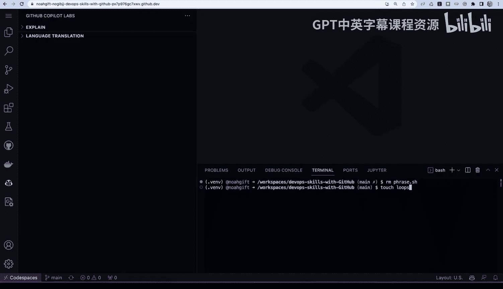
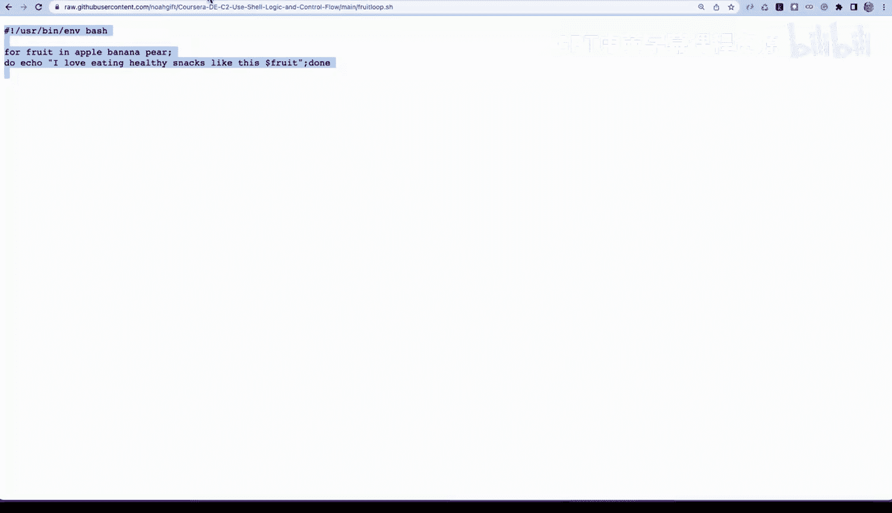
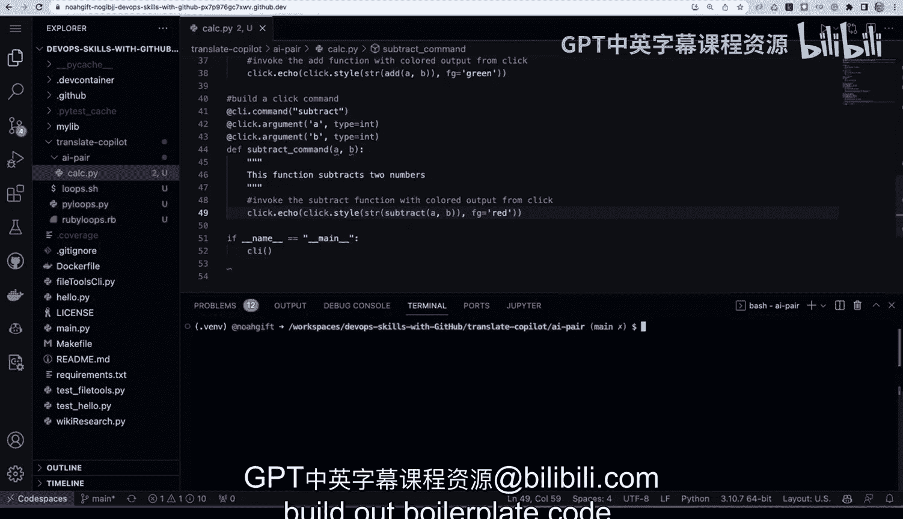

# 机器学习运维：P27：GitHub Copilot 演示 🚀


在本节课中，我们将学习如何使用 GitHub Copilot 来辅助编程。我们将探索其代码翻译功能，并体验如何通过自然语言提示与 Copilot 进行“结对编程”，快速生成和修改代码。

## 启用 GitHub Copilot

首先，我进入了一个已启用 Copilot 功能的代码仓库。要使用 Copilot，需要安装相应的扩展。

在 VS Code 的扩展面板中，我们可以找到两个相关扩展：**GitHub Copilot** 和 **GitHub Copilot Labs**。后者提供了一些实验性功能，例如代码翻译。我已经安装了最新版本，接下来我们将尝试这两个扩展。



## 使用 Copilot Labs 翻译代码

上一节我们介绍了如何启用 Copilot，本节中我们来看看如何使用 Copilot Labs 的代码翻译功能。这个功能可以帮助我们将一种编程语言的代码转换成另一种语言。



以下是开始操作的步骤：
1.  点击 Copilot Labs 面板中的 “Translate code” 功能。
2.  在代码编辑器中选中想要翻译的代码片段。
3.  在翻译面板中选择目标语言，即可看到翻译后的代码。

为了演示，我创建了一个名为 `loops` 的文件，并从另一个仓库复制了一段 Bash 脚本代码粘贴进去。

```bash
#!/bin/bash
fruits=("apple" "banana" "cherry")
for fruit in "${fruits[@]}"
do
    echo "I love eating healthy snacks like this $fruit"
done
```

这段代码可以正常运行。现在，如果我想理解这段代码在 Python 中如何实现，我可以使用翻译功能。

在 Copilot Labs 中，选择将代码翻译成 **Python**。这是一个很好的学习新语言的方式，尤其当你已经熟悉另一种语言时，它能让你快速上手。

我创建了一个 `translate_copilot` 目录来存放翻译后的代码，并将 `loops` 文件移入。然后，在该目录下创建一个 Python 文件 `py_loops.py`。Copilot 给出了翻译建议，生成如下代码：

```python
fruits = ["apple", "banana", "cherry"]
for fruit in fruits:
    print(f"I love eating healthy snacks like this {fruit}")
```

运行 `python py_loops.py`，我们得到了相同的输出。这确实是一种非常高效的学习方法。

我们不仅可以翻译成 Python，还可以快速尝试其他语言。例如，将同一段 Bash 代码翻译成 **Ruby**：

```ruby
fruits = ["apple", "banana", "cherry"]
fruits.each do |fruit|
  puts "I love eating healthy snacks like this #{fruit}"
end
```

整个过程非常直观，在不同语言间进行翻译的体验很棒。

## 与 Copilot 结对编程

在体验了代码翻译后，接下来我们看看如何通过与 Copilot 进行“结对编程”来构建更复杂的工作流。其核心思想是将 Copilot 视为另一位开发伙伴。

我创建了一个名为 `ai_pair` 的目录，并在其中创建一个 `calc` 文件。我们将通过编写提示（Prompt）来引导 Copilot 帮助我们生成代码。

首先，在文件顶部，我通过注释描述了模块的用途，这有助于 Copilot 理解我们的意图：

```python
# This module is used to create calculation functions such as addition, subtraction.
```

然后，我添加了 `#!/usr/bin/env python3` 这一行，表明这最终将是一个可执行脚本。Copilot 非常智能，它已经能推测出我想要做什么。这类似于向另一位人类开发者描述需求。

基于这个提示，Copilot 开始生成加法函数 `add` 的框架。接着，我继续引导它生成减法函数 `subtract`。

为了将这个模块变成一个命令行工具，我进一步提示它：“This module will also be invoked as a command script, using click.” 并添加 `import click`。

现在，我需要构建一个 Click 命令组。我只需告诉 Copilot：“build a click group”，它就会为我生成所有样板代码，甚至帮我写出建议的命令结构。

```python
import click

@click.group()
def calculator():
    """Calculator App."""
    pass

@calculator.command()
@click.argument(‘a‘, type=int)
@click.argument(‘b‘, type=int)
def add(a, b):
    """Add two numbers."""
    result = a + b
    click.echo(f"The sum is {result}")

@calculator.command()
@click.argument(‘a‘, type=int)
@click.argument(‘b‘, type=int)
def subtract(a, b):
    """Subtract two numbers."""
    result = a - b
    click.echo(f"The difference is {result}")

if __name__ == ‘__main__‘:
    calculator()
```

代码生成后，我可以通过命令行来调用它。运行 `python calc.py --help` 可以看到帮助信息。测试加法 `python calc.py add 2 2` 和减法 `python calc.py subtract 5 3`，一切工作正常。

如果想让输出更美观，我可以继续提示 Copilot。例如，我说：“invoke the add function with colored output from click.” Copilot 便理解了意图，并修改代码使用 `click.style` 来输出彩色文本。

```python
@calculator.command()
@click.argument(‘a‘, type=int)
@click.argument(‘b‘, type=int)
def add(a, b):
    """Add two numbers."""
    result = a + b
    click.echo(click.style(f"The sum is {result}", fg=‘green‘))
```

通过这种温和提示的方式，让 Copilot 为我们构建代码，可以非常快速地完成大量样板代码的编写，这个计算器工具就是一个很好的例子。

## 总结



本节课中我们一起学习了 GitHub Copilot 的两个强大应用。首先，我们利用 **Copilot Labs** 的代码翻译功能，轻松地在 Bash、Python 和 Ruby 等语言间转换代码，这为学习新语言提供了极大便利。接着，我们体验了与 Copilot 进行 **“结对编程”**，通过编写清晰的注释和提示，引导它帮助我们生成完整的命令行工具代码，包括使用 Click 库和添加彩色输出等进阶功能。这展示了 Copilot 如何显著提升开发效率，尤其是在处理重复性样板代码时。