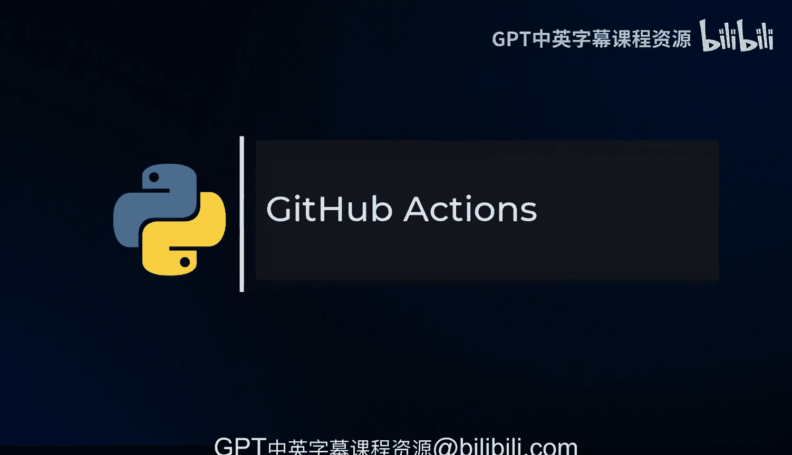
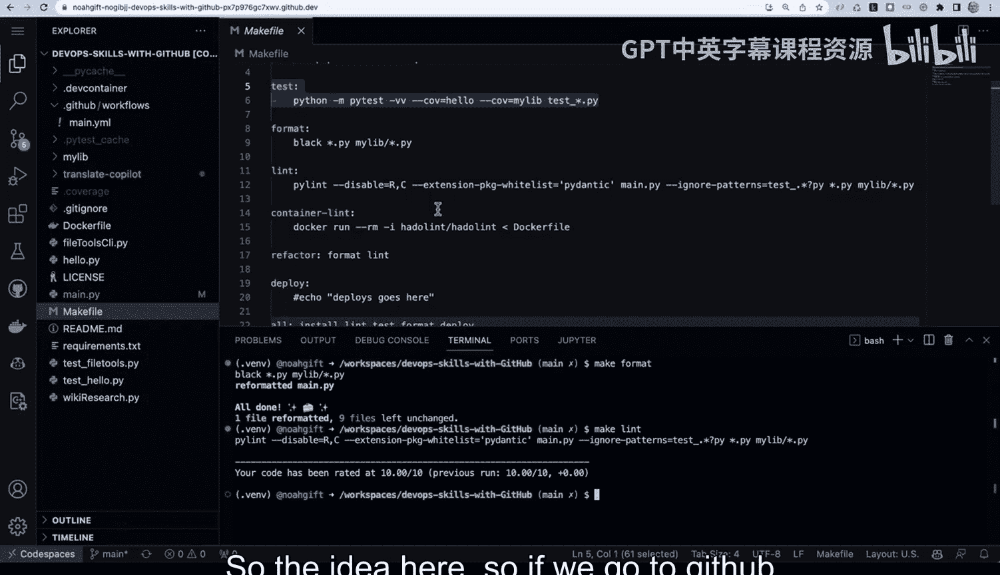
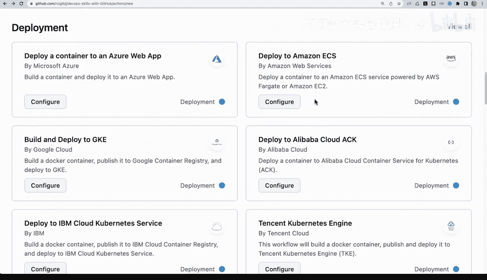
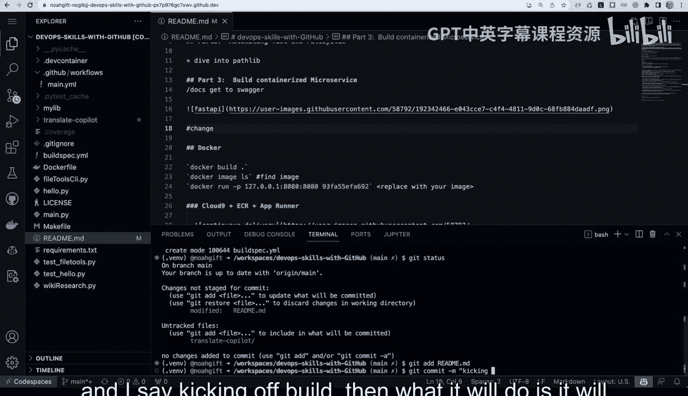
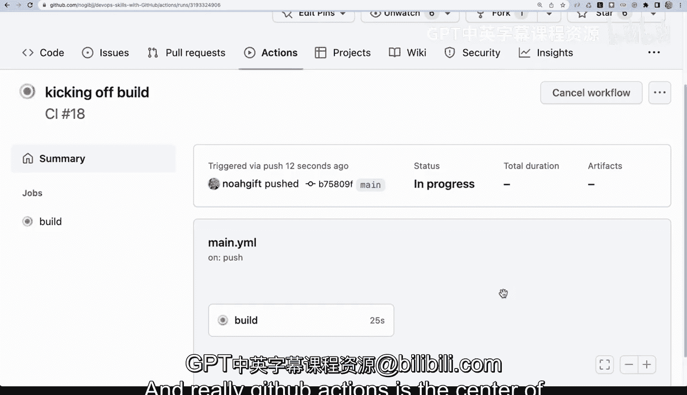

# 机器学习运维：第28章：GitHub Actions 实战指南 🚀



在本节课中，我们将学习如何在实际项目中启用和使用 GitHub Actions，了解其核心概念，并通过一个具体的例子来观察自动化工作流的运行过程。

## 概述

GitHub Actions 是一个强大的持续集成和持续交付平台，允许你自动化软件工作流程。本节我们将通过一个已启用 Actions 的项目，学习其配置文件结构、如何与本地开发流程对应，以及如何触发和监控自动化构建。

## 项目结构与配置文件

让我们先来看一个已启用 GitHub Actions 的项目。任何配置了 Actions 的项目都会在 `.github/workflows/` 目录下包含一个或多个 YAML 配置文件。


在这个目录中，可以看到我定义了一个在 `ubuntu-latest` 环境上运行的作业。它也可以运行在我选择的、受 GitHub Actions 支持的任何容器上，甚至是我自定义的容器或开发环境中。

在作业内部，我为每个步骤定义了名称。例如：

```yaml
- name: Install and Lint
  run: make install-lint
- name: Lint
  run: make lint
- name: Test
  run: make test
- name: Format
  run: make format
```

## 链接 Makefile 实现本地与云端一致

现在，让我们看看与上述 Actions 配置对应的 `Makefile` 文件。


你可以看到，这里定义了我构建过程中的每一个步骤。这种将 `Makefile` 直接链接到 GitHub Actions 配置文件的方法非常棒，因为你无需思考在云端运行什么命令，只需运行与本地相同的命令即可。

例如，如果我想在本地运行 `make format`，它会格式化我项目中的所有代码。同样，如果我想运行 `make lint`，它会检查项目中所有代码的规范性。当这些命令在 GitHub Actions 环境中运行时，会发生完全相同的事情。



这样设计的核心理念是：**保持本地开发与云端自动化流程的一致性**。

## 创建工作流与使用模板

如果我们回到 GitHub 界面，可以通过点击 “Actions” 来创建一个新的工作流。


系统会提供几个不同的选项。一种是自己从头开始设置，它会提供一个模板。这对于初学者来说是一个不错的起点，你可以直接在模板中填入任何你想运行的命令，甚至是运行我们刚才提到的构建脚本。

不过，我认为使用 `Makefile` 是更好的方法，因为它能确保与你本地或 GitHub Codespace 中的操作保持一致。

另一个需要注意的地方是，GitHub 提供了许多建议的示例工作流供你参考。例如，“发布 Python 包”的示例。


查看这些示例是如何实际工作的，能为你提供许多关于最佳实践的良好指导。因此，GitHub Actions 是一个可用于部署等众多场景的绝佳服务，这也是它在 DevOps 中如此强大的原因。

## 实战：触发与观察工作流运行

接下来，让我们实际操作并观察它的工作过程。假设我想测试项目中发生的一些更改。





我可以先使用 `git stash` 将当前的修改暂存起来。然后，我可以在某个脚本中进行一个小修改。


修改完成后，我可以使用 `git status` 查看状态，并将这些更改提交。





当我添加（`git add`）并提交（`git commit`）这些更改后，例如提交信息为 “Kicking off build”，它会立即触发一个新的 GitHub Actions 构建任务。


这就是 GitHub Actions 的便利之处：我可以逐步查看我在 YAML 文件中定义的每个步骤的执行情况。

## 推荐的部署流程

虽然具体测试内容取决于每个用户的需求，但我推荐在部署流程中按顺序执行以下步骤：
1.  `make install` - 安装依赖
2.  `make lint` - 代码规范性检查
3.  `make test` - 运行测试
4.  `make deploy` - 执行部署

最后一步可以将应用推送到生产环境。GitHub Actions 确实是构建非常专业的 DevOps 工作流的核心。





## 总结


本节课中，我们一起学习了 GitHub Actions 的核心应用。我们了解了其配置文件（YAML）的结构，探讨了通过 `Makefile` 保持本地与云端命令一致性的最佳实践，并实际操作了如何通过代码提交触发自动化工作流。GitHub Actions 通过提供丰富的模板和强大的自定义能力，成为实现高效、专业 DevOps 流程的关键工具。