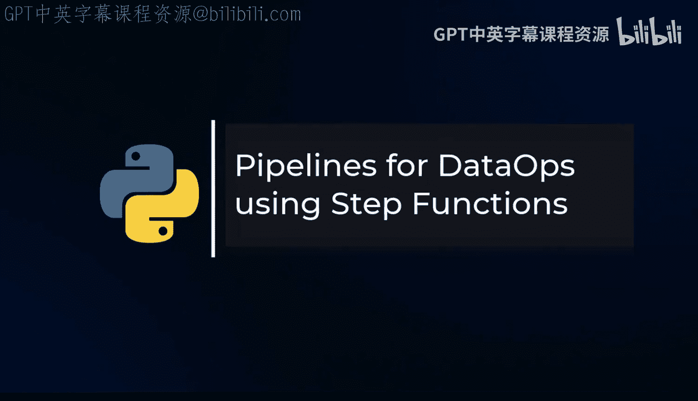
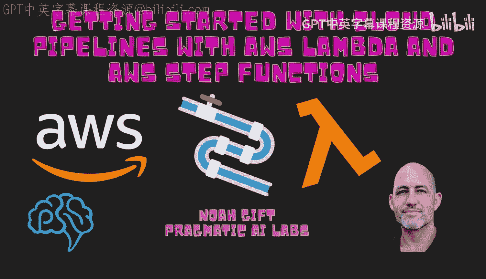
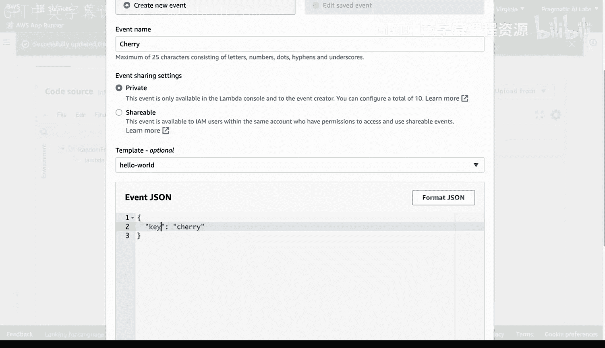
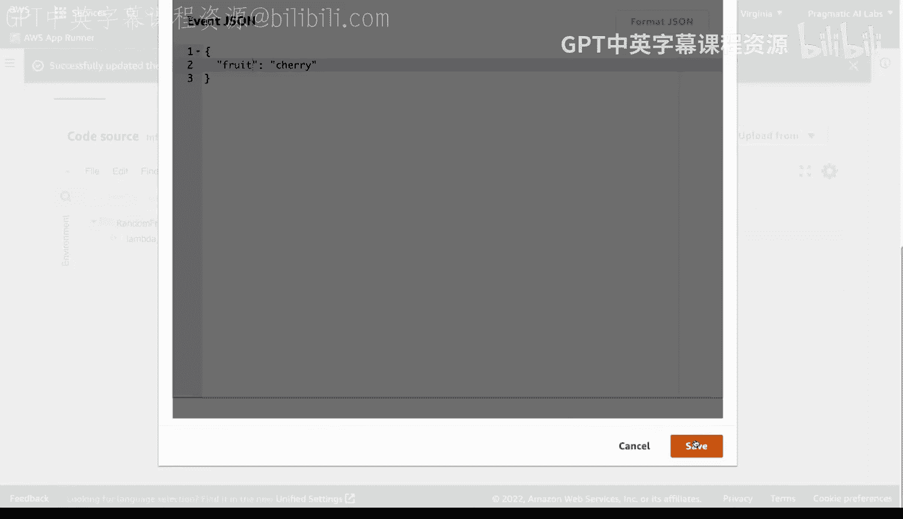
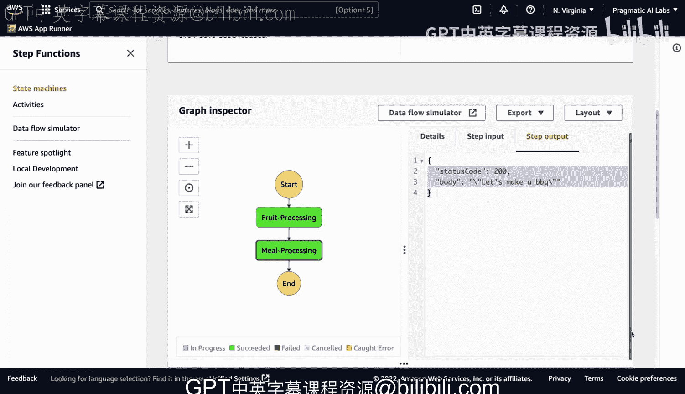

# 杜克大学｜机器学习运维｜DevOps⧸DataOps、Azure、MLFlow和抱脸｜MLOps ｜ Machine Learning Operations p29 36_03_02_使用Step-Functions构建DataOps管道.zh_en -BV1yE421c7uA_p29-

Hi， my name is Noah Gift and I'm going to help you master AWS Lambda functions in Python and then use these Lambda functions inside of AWS step functions to build pipelines really one of the most powerful things you can do with just a little bit of code and for the most part。

 it's a no code low code solution All right， let's go and get started。

And I'm going to go to AWS Lambda， which is right here。And I'm going to create a new function。

And so a Lambda function， there's really not much to it if you understand how to write a Python function。

 you can write a Lambda function， I'm going to just say author from scratch here。

 I'm going to pick the runtime would be Python 39。And we'll call this function name here。

 we'll call this， let's just call this one random fruit as well。That'll be kind of fun。

And we can now later， if I wanted to integrate with other parts of AWS。

 you could change permissions and things like that。

 but basically if you just want to build a simple lambda function。

You just need to select the runtime and name it， that's it。So let's go ahead and try this out。Okay。

 so the random fruit here。Notice that there's a trigger and a destination。

 so if it really fulfills that same concept， right input。Unit of work return。In our case。

 we can just focus on the unit of work here first and a Lambda function， they'll just give you this。

 they'll give you a structure like here we go Lambda handler and the event is the input to the Lambda handler so we can actually easily build out a function here that does some work so what I could do is let's do the same thing let's kind of take our code that we did from before。

And actually build out something similar， so I'll say from random import choices like this。

And inside of this。I can can process the events and so the event would be。Maybe。

Let's call this fruit， so we'll put in a fruit event。Is equal to。 and so we'll say。Fruits。

Is equal to event fruit。 So basically， I'm going to look for the word fruit in the event。And then。

 I'll say。Basically， if the fruits。Is equal to。Let's say cherry。Then I will say。Return。

And we we'll actually just take， we'll just borrow this code that they already gave me here。

 I can just do this， I can say if it's a cherry。Then。

Let's go through here and let's dump out something like。呃。F string。I love。I love。Something like that。

 there we go， so we can put this F string in there。

I'll put the single quotes to keep things the same。And then， we can say。Basically， otherwise。

 we'll do a different return statement。And we can just take this code here。And we can say。嗯。

Something like new thanks。OrLet's do F string as well。No， thanks。No thanks。I don't like。

I guess I do need to do a double quote here。Like this。 No things I don't like。Fruit。

 something like that。Okay， so we've got， we basically have a function that accepts an event。

We are going to look for the word cherry， if it's cherry， I said， I love this fruit。Otherwise。

 the default value will be able return back that I don't like this， this fruit。

 So I need to build basically。嗯。Really almost nothing now because all I need to do is take a test payload here to make this work。

 So I'm going to click on deploy this will deploy the function。Then I'll click on test。

And I'll create a new event and we'll call this。X I don't even if I go back here。

 I don't even need random。Choices here， because we're not even going to do a random choice。

 We're going to do a manual choice。 I'm going to redeploy this。

I'm going to go to test and we'll call this cherry。And。Will， will go through here。

 and will call this。Let's do this。Let's say， fruit。And we'll call this cherry。

And we'll put this called this fruit。

So let's go ahead and format this looks good， let's save it。

Now， if I test this， it should return back。This message。

I might even actually add one more thing to here just that gives us a little bit of debugging information that says like。

You know。This。Is the event， something like that so that I can see what's actually passed in。

As the events which can be handy。 So we'll deploy one more time。 Okay， now we've got that。

 let's test it。 There we go。 So we see that this is the event that was passed in and it says， look。

 body， I love chrry。And now if I want to make another test event。And we make one quite a new one。

And we'll call this one。Pair。What we'll do is we'll add this。It'll add pair。We'll save it。

And we can see that they'll get a different result this time。 if I， if I test pair。

No thanks I don't like pair right so this is this concept of something comes in， you do some work。

 you return it is really fundamental to all software engineering to distribute computing to community tools and the reason why I think this is really goes in well with what we're going cover with cha tools is it' kind of a similar concept。

And what you can do actually。Is you can chain these things together and you can actually build you know multiple lambda functions that work together。

 So similarly with kmean tools， right， you can chain things together and build multiple things。

 So let's build a now that we've got random fruit working， let's build another function。

And we'll call this one like the chef， and so this will be the cook that is going to cook things or the chef that's going to cook things together。

And so。What we can say。Here。😔，Is。We could basically process。That。

 that that event that we had before earlier。 And so we could basically say instead of this thing like。

嗯。We，We can。Called this like the meal is equal to events。And I think。

We need to just be able to process。What actually comes back from the event。

 I think it could just be the whole event， actually。So let's just make the meal the event。

And we can say， if。If， yes。Or I think it was if。Yeah， we'll just say if。Likeake。Actually。

 let's double check， let's just save this for a second and I'm going to go back to my other function to make sure I understand what it returned。

It was， we have fruit。Here。😔，Where was it random fruit。So if I go to this， what is it returning。

 I love， so we'll say if love。Yeah， so if。And it returns back in the body here。This， I guess I could。

I can make it a little bit more structured， but let's just keep it simple here and we'll say if love。

Is in the meal。Then we can return back some other payload。Right， so we can do this and we can say。

Basically。嗯。Let's。Let's do this。Let's make a salad。There we go。Otherwise。We can return back。

Basically S。A different option， so we can say。Return。Here。And we can do。

Make this come back a little bit。There we go。 And we can say， let's make。A barbecue。

Right so we have two different options like if someone says， hey， I like this fruit。

 then they make a salad， otherwise they make a barbecue。And we could deploy this。

And we could test it out because we can just do。 so if if I test this thing again。嗯。

Let's test it with the positive events。We， we can assume that the payload will look like this。

 so I can， I can literally。Put that into my test function so I can configure test function。

And just do this like that。Format。And let's see what happens if I run this。If I say。Oh。

 we'll call this meal。Or salad or whatever。 we'll test this。LetLet's make a， in this case。

We need to parse the body。 So that's what we need to do。 So let's go。

 We'll say if the vent would be body。Bdi。If and now let's go ahead and deploy it， let's test it。

The function oh whip let's test it again。 There we go。 Let's make a salad， right。

 so basically we were able to to interpret that payload。

 do some stuff with it and then do one operation。 now if I want to do the second the negative。

So we want to create a new one， we can say what happens if I say。

What's the second thing that we do here so if I want to test against the pair， no things？

So let's just take this。Payload。With this in here。And we'll call this one。嗯。Event name would be。

Barbecue。We save it。We tested。 There we go。 Let's make a barbecue。 right。

 so we have a couple different cases。 So we can kind of chain these things together。 Now。

 all I need to do to to put these things together would be to go to。

The step function service of Amazon。Which coordinates basically state operations。

And we can say design your workflow visually， this is what we want。

And what this is really cool is that in a sense， you're kind of a low code or no code coder。

 and so we can put a comment that says like。You know， this simulates。What a chef would do。

And so we can grab a function right here。And then we can say after that function。

 we want another function that goes like this， and so this first one will be the fruit processing。

And then。The next one will be the meal processing。There we go， meal processing。Processing。

 and what's， what's， what's awesome about this is how。

Explicit all these steps are and how easy it is。To， to process， you know。

 a pipeline like this because of this concept of function with inputs， outputs， all that。

 So what do we do is we just go here and we go to we need to find the function。Right here。

 and we can go the one we just did， which was called random fruit， I think。Which is called random。

 yeah， random fruit right there。And we want to use the state input as the payload。

So we basically are going to accept something from the user。And then。

The next state will be the meal processing。 So now we go to meal processing。 And what do we do。

 We pick the the chef here。 So let's go ahead and pick this。 There we go Che latest。

And then we can actually go through here。And we've got that all working。And we've got it。

 so we've got actually all of this code is all set up for us。

And we can even check that in if we wanted to into our project later。But for now。

 we'll just click this， here's my state machine。We'll just call this meal generator。And saying。

You can even log it if you want， We'll say all logging。 That looks good。 Great steep machine。Perfect。

 this looks good。 It's creating it。Now it's pretty easy to test。Because。For this random fruit。

 if I go to the the， I just grab something like this。

If you remember the pear or the fruit now to execute it。

 I click on start execution and I just put in the same payload right so it could be what do I need to pass its so if I pass in pair it should start a chain reaction。

 let's go ahead and do that。There we go。Here we see it' processing， awesome， it's succeeded。

 look we can see what the input is。And we can see what the output is， no things I don't like pi。

 Now it's processing this。Input says I don't like pair step output。 let's make a barbecue。

 so pretty cool， pretty cool concept of right as chaining things together。

 That really is how Linux works， or how the Linux command line works the same thing as as you have inputs processing and you chain it to other things。

 a lot of Linux command line tools work that way like you touch or make or you know Ls or all these things you basically chain them together。

