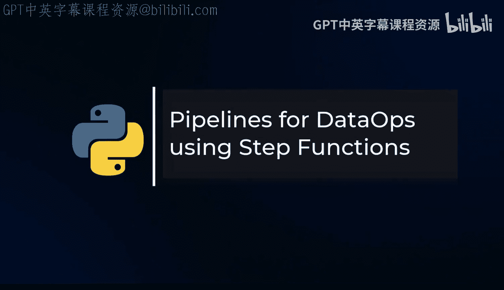
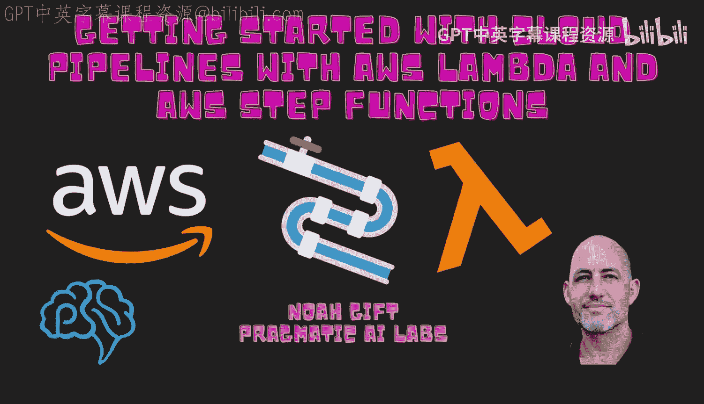
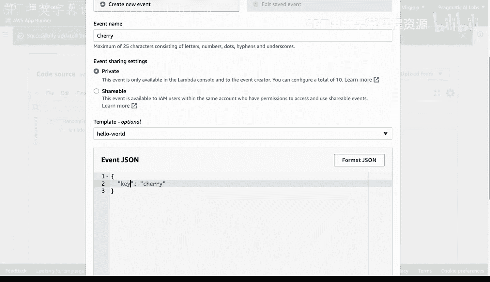
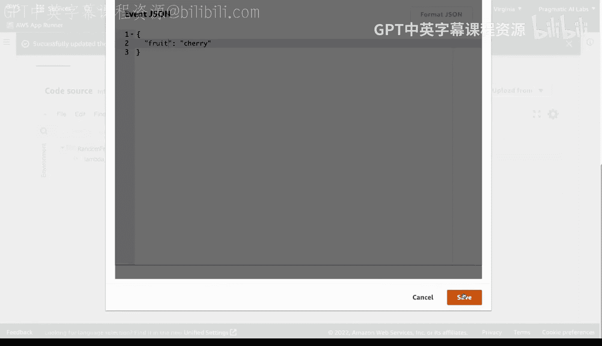
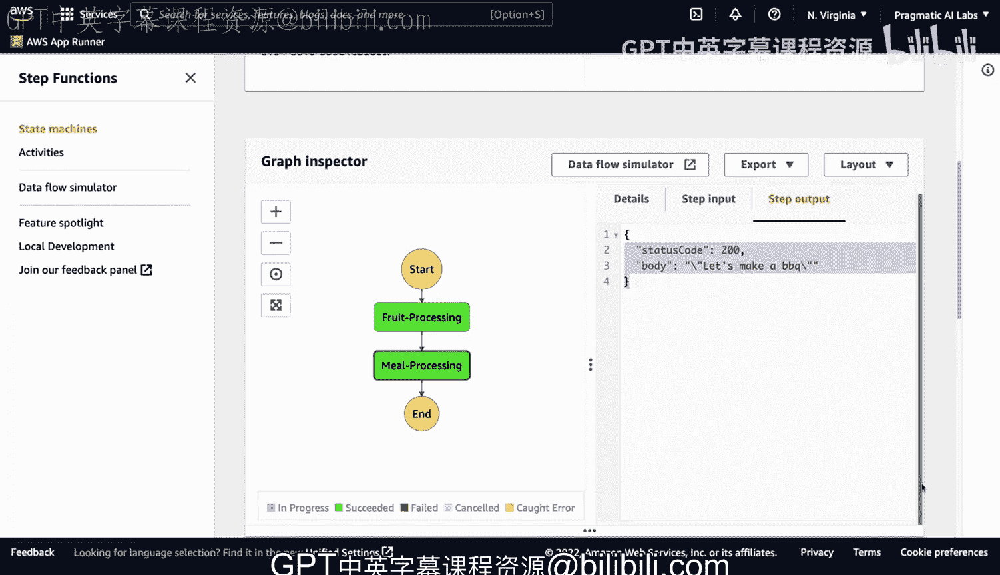

# 杜克大学｜机器学习运维｜MLOps：29：使用Step-Functions构建DataOps管道 🚀



在本节课中，我们将学习如何使用AWS Lambda函数和AWS Step Functions来构建一个简单的数据处理管道。我们将从编写一个基础的Lambda函数开始，然后将其与另一个函数串联起来，最终在Step Functions中创建一个可视化的工作流。整个过程将展示如何用少量代码实现强大的自动化流程。



---

## 创建第一个Lambda函数 🛠️

首先，我们需要创建一个AWS Lambda函数。Lambda函数的核心概念非常简单：它接收一个输入（事件），执行一些工作，然后返回一个输出。如果你会写Python函数，你就会写Lambda函数。

以下是创建Lambda函数的步骤：

1.  在AWS控制台中找到并进入Lambda服务。
2.  点击“创建函数”。
3.  选择“从头开始创作”。
4.  为运行时选择“Python 3.9”。
5.  将函数命名为“random_fruit”。
6.  保持其他默认设置，然后点击“创建函数”。

创建完成后，你会看到一个代码编辑器。系统已经提供了一个基本的函数结构，其中`lambda_handler`是入口点，`event`参数就是函数的输入。

现在，让我们编写函数逻辑。我们将创建一个函数，根据输入的水果名称返回不同的消息。

```python
def lambda_handler(event, context):
    # 从输入事件中获取‘fruit’字段的值
    fruit = event.get('fruit', '')

    # 判断水果类型并返回相应消息
    if fruit == 'cherry':
        return {
            'statusCode': 200,
            'body': f'I love {fruit}.'
        }
    else:
        return {
            'statusCode': 200,
            'body': f'No thanks, I don\'t like {fruit}.'
        }
```

编写完代码后，点击“部署”按钮保存。为了测试函数，我们需要创建一个测试事件。

1.  点击“测试”选项卡。
2.  点击“创建新事件”。
3.  将事件命名为“cherry_test”。
4.  在事件JSON中，输入：`{"fruit": "cherry"}`。
5.  点击“保存”，然后点击“测试”。

如果一切正常，你将看到返回结果：`{"statusCode": 200, "body": "I love cherry."}`。你可以再创建一个名为“pear_test”的测试事件，输入`{"fruit": "pear"}`，测试会返回`"No thanks, I don't like pear."`。

这个“输入-处理-输出”的模式是软件工程和分布式计算的基础。接下来，我们将创建第二个函数，并将其与第一个函数串联起来。



---



## 创建第二个Lambda函数：厨师处理 🧑‍🍳

上一节我们创建了一个处理水果偏好的函数。本节中，我们将创建第二个函数，它根据第一个函数的输出结果来决定制作什么餐点。

这个新函数将扮演“厨师”的角色。它的逻辑是：如果收到的消息中包含“love”这个词，就决定做沙拉；否则，就决定做烧烤。

以下是创建第二个函数的步骤：

1.  返回Lambda服务主页，再次点击“创建函数”。
2.  同样选择“从头开始创作”和“Python 3.9”运行时。
3.  将函数命名为“chef”。
4.  点击“创建函数”。

在新函数的代码编辑器中，输入以下逻辑：

```python
def lambda_handler(event, context):
    # 从上一个函数的输出中获取消息体
    # 注意：Step Functions中，上一个状态的输出会成为下一个状态的输入
    previous_output = event
    # 通常输出在‘body’字段中，但我们需要根据实际结构调整
    message_body = previous_output.get('body', '')

    # 判断并决定餐点
    if 'love' in message_body:
        meal = 'salad'
    else:
        meal = 'barbecue'

    return {
        'statusCode': 200,
        'body': f'Let\'s make a {meal}.'
    }
```

部署这个函数后，我们也需要测试它。由于这个函数的输入是第一个函数的输出，我们的测试事件需要模拟这种结构。

1.  点击“测试”选项卡，创建一个新事件。
2.  命名为“salad_test”。
3.  输入模拟第一个函数成功响应的JSON：`{"statusCode": 200, "body": "I love cherry."}`
4.  保存并测试，应该返回`"Let‘s make a salad."`。
5.  再创建一个名为“barbecue_test”的事件，输入`{"statusCode": 200, "body": "No thanks, I don‘t like pear."}`进行测试，应返回`"Let‘s make a barbecue."`。

现在，我们有了两个可以独立工作的函数。它们遵循相同的模式：接收输入，进行处理，产生输出。这种模块化设计是构建复杂管道的关键。接下来，我们将使用AWS Step Functions把这两个函数像链条一样连接起来。

---

## 使用Step Functions构建工作流 ⛓️

我们已经有了两个独立的Lambda函数。本节中，我们将使用AWS Step Functions服务将它们组合成一个有序的工作流。Step Functions允许你以可视化的方式设计和管理多个AWS服务之间的工作流程，本质上是一种低代码/无代码的编排工具。

以下是构建工作流的步骤：

1.  在AWS控制台中，找到并进入“Step Functions”服务。
2.  点击“创建状态机”。
3.  选择“使用可视化设计器编写工作流”，然后点击“下一步”。
4.  你将会看到一个画布。从左侧的“操作”面板中，拖拽一个“Lambda：调用函数”的节点到画布上。
5.  点击这个节点进行配置：
    *   在“API参数”下的“函数名称”中，选择我们之前创建的`random_fruit`函数。
    *   “有效负载”选择“状态输入”，这意味着工作流启动时传入的数据会直接作为这个Lambda函数的输入。
6.  从第一个节点的右侧拉出一条线，再拖拽第二个“Lambda：调用函数”节点到画布上，与第一个节点连接。
7.  配置第二个节点：
    *   在“函数名称”中，选择我们创建的`chef`函数。
    *   “有效负载”同样选择“状态输入”。在Step Functions中，上一个节点的输出会自动成为下一个节点的输入。

现在，你的工作流看起来应该是：`Start -> random_fruit Lambda -> chef Lambda -> End`。

8.  点击“下一步”，为这个状态机命名，例如“Meal_Generator”。
9.  权限设置保持默认（Step Functions会自动创建一个具有必要权限的执行角色）。
10. 点击“创建状态机”。

状态机创建成功后，我们就可以执行它了。这就像运行一个程序。

1.  在新创建的状态机详情页，点击“开始执行”。
2.  在输入框中，提供启动工作流所需的数据。例如，输入：`{"fruit": "pear"}`。
3.  点击“开始执行”。

执行开始后，你可以直观地看到流程的进行。每个步骤（状态）会高亮显示。执行完成后，你可以查看每个步骤的详细输入和输出。

*   **第一步 (`random_fruit`)** 的输入是 `{"fruit": "pear"}`，输出是 `{"statusCode": 200, "body": "No thanks, I don‘t like pear."}`。
*   这个输出自动成为**第二步 (`chef`)** 的输入。`chef`函数处理后会输出 `{"statusCode": 200, "body": "Let‘s make a barbecue."}`。

整个工作流的最终输出就是最后一个步骤的结果。通过这种方式，我们成功地将两个独立的函数串联成了一个自动化的数据处理管道。

---

## 总结 📝

本节课中，我们一起学习了如何使用AWS的核心服务构建一个简单的DataOps管道。

1.  我们首先创建了**AWS Lambda函数**，它遵循“事件输入、执行工作、返回结果”的基本模式。我们编写了一个判断水果喜好的函数。
2.  接着，我们创建了第二个Lambda函数作为“厨师”，它根据第一个函数的结果决定制作什么餐点。这展示了函数的**模块化**和**可重用性**。
3.  最后，我们使用**AWS Step Functions**将这两个函数可视化的连接起来，创建了一个完整的工作流。Step Functions负责管理状态、传递数据和处理错误，使我们能够以低代码的方式构建复杂的管道。



这个“链式”处理的概念非常强大，它不仅存在于AWS中，也同样是Linux命令行工具（如通过管道符 `|` 连接 `grep`, `sort`, `awk`）和现代CI/CD工具的核心思想。通过将小型、专注的任务（函数）组合起来，你可以构建出灵活、强大且易于维护的自动化系统。