# 杜克大学｜机器学习运维｜DevOps⧸DataOps、Azure、MLFlow和抱脸｜MLOps ｜ Machine Learning Operations p30 37_03_03_查询Databricks管道.zh_en -BV1yE421c7uA_p30-

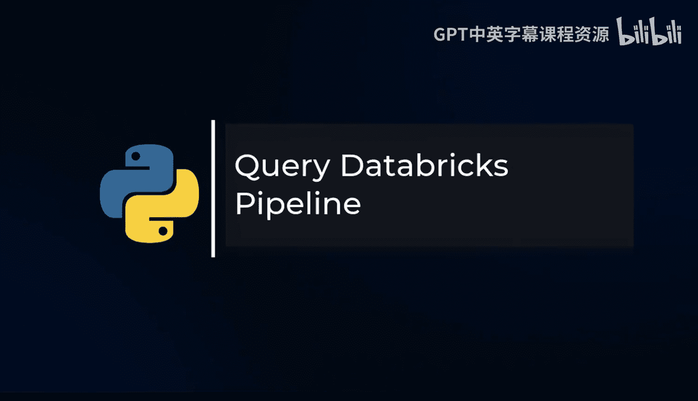

说。All right， so I have some stuff here to cover with Databricks， which I think should be pretty fun。

 and I'm going to dive right into it。And the idea here， again。

 with this live stream is to get deeper and deeper into doing things with databricks and and get mastery of how that platform works。

 So I'm going to go ahead， and I'm going to。Share my screen。

And so the first thing that I'll start off with is just going to Azure and logging into it because I'm going to need to use the Databricks Azure connection。

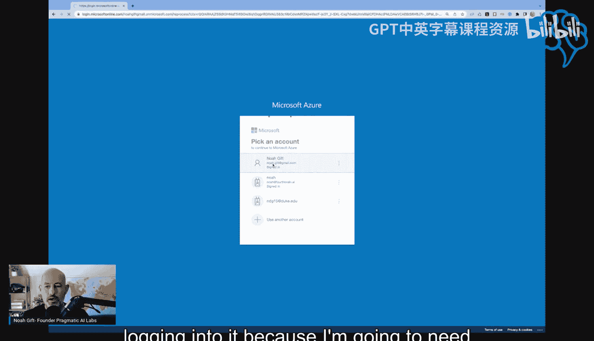

And the way I do that is I have it set up here right here in Databricks。And we can go to this one。

 which is the one I want。And I'm going to launch my my Azure environment。Perfect。Now。

 the big thing to point out with Azure is that if you do want to start to wire things up and talk back and forth with databricks in your own development environment。

 one of the things you'll have to do，Is make sure that you have a cluster running so I'm going to first go to compute and say oh look single node cluster data engineering cluster。

 I need to actually click start， get that thing， cooking few things to point out about this is that it's running the Databricks runtime version of 10。

4 and it'll take just a few minutes to actually get this thing to run So as this thing is spinning up。

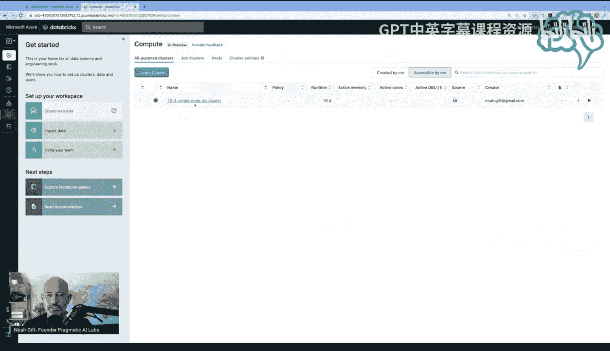

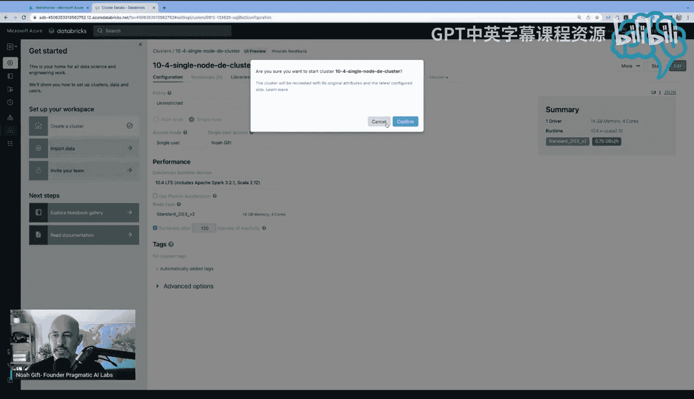

A couple other things I'll point out are that if you go to advanced options here。

 this is very common for people to be confused about is that。

That you'll need to know the server host name， which again shows up on our advanced JDBC， ODBC。

And also the HP path so that you can actually use all that to authenticate to this environment。

 you also need to have an off token set up as well。

 and so if we go through and I go to my environments here，And I go to where is it？😔，嗯。这吃。

Let's get rid of that。Let's go to Re。Iose。Let's just go back and forth here to see my。

 I don't know why my。Don't show again， There we go。That menu options expand。Something。Yeah， anyway。

 there's a section that's escaping me for some reason。嗯。That you can configure your off token。

 they must have changed the UI recently。 but， but in nutshell， the main thing to be aware of。

Is you need to have this thing running。 So now I'm going to go over to GiHub。

And I'm going to go to an environment that I've got set up。

That will have databricks integration and I'll walk through how that would work。 So go to Databricks。

Get it bricks。Here， as Data bricks。WhatWhat I've got set up here is a high level overview of what I'm going to cover。

 So first， we have the Databricks environment where I would have a workspace。I'm sorry， a。

 a cluster setup so that I could actually communicate with Databricks。

I would then be able to communicate to the management API， which is helpful to do things like。

 you know， is there a job running or， you know， can I get some you know。

 some some data back and forth to the file system， that kind of stuff。

And then the other one that's interesting to set up is to talk directly to your cluster and just run commands if you don't want to run it directly into Databricks。

 like let's say you have a GiHub codespaces environment and you're using GitHub codespaces and I don't know you want to use coppilot to help you write code and all that kind of stuff。

So the only thing you would need to do in that particular environment。

Is to actually go to GitHub codespace secrets。And then put in these values， database host。

 Databricks， HttP path， Databricks server host name， Databricks token。

 right we could go through here and hook all that stuff into our particular environment that and that would allow us to to synchronize and actually build out。

The integration。 And so if I go back to this environment here。

 you can see I have a bunch of code examples， and I'll show you where those settings are。

 So if I go to settings here。And I go down to secrets， and I go to codespaces。

Notice here that I have set up repository secrets。 Now， I think this is a pretty good process。

 which is that I go through here and I say Databricks host， and I just put in that host name。

 I put in the databricks HP path。 I put in the server host name。

 So these are not necessarily things that are that big of a deal to be publicly exposed。

 but it doesn't hurt to put them into the repository secrets。 and then this is actually secret。

 This is my off token， and so I can use all of these resources when I launch my codespace。

So if I go back here。And I click on。Code， and we go to psychic space memory。And we launch it。

 this will actually open up the codespace environment and I can actually start to do this communication pathway back with Databricks。

And what's really nice about this workflow is that I can actually essentially do all of my software engineering tasks。

 data engineering tasks directly inside of databricks without needing to go to my environment now one thing I'm actually going to do real quick that in this particular environment。

 it says unexpected error occurred。

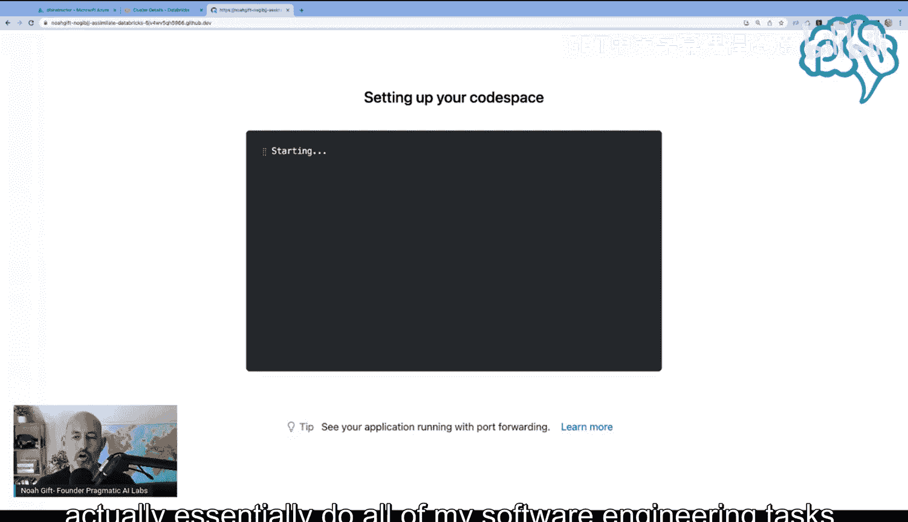

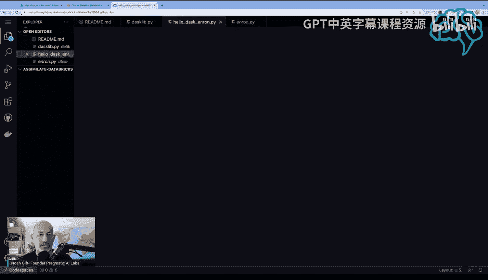

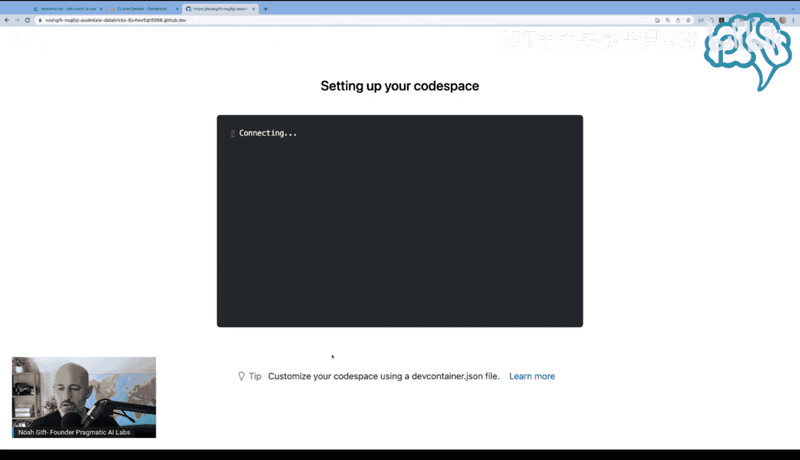

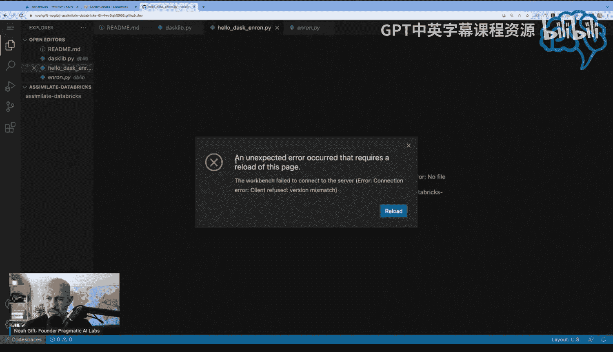

I don't know why that thing's freaking out。But I'm actually going to make one change actually。

 which I don't know if this this is going to matter here is that。If you go to。Code space right here。

Look at this。 This is a really cool concept is because I have some customization in this project。

 I'm going to select pre build configuration and what this will do is it will pre build the code space so that basically it launches instantly So I'm going to go ahead and say set up pre build I'm going to say for main and every time I do a push it's going to actually go ahead and prebu it。

😊，And so if I go ahead and say C。It's going to go through and it's going to get cud。And in fact。

I can actually look at the logs。

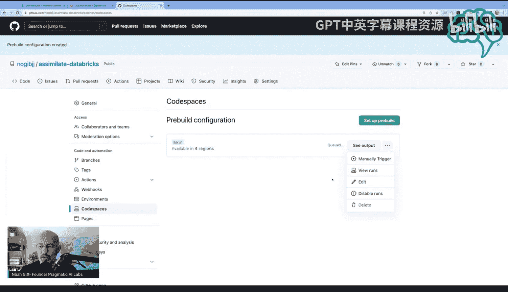

As it's actually working， so it's it's similar in a sense to like code spaces。

I'm sorry to Gi up actions where you would go through and run a job in this case the job is actually going to be go ahead and configure my environment and then if there are issues with your environment like you know for whatever reason。

 you also could get that fixed as well。So we'll go ahead and check this out。

 let's go ahead and see everything that it's doing。Okay， it's， it's building our environment here。

 Now， again， once I've done this now that I have pre buildil set up， it'll always。

Have a fresh environment that's ready to go each time I want to launch it。

 which if I have a lot of complex stuff in a customized environment， this really is pretty awesome。

 So here we go you can see it's it's going to save me whatever a one minute and 30 seconds or one minute and a couple minutes every time I launch my environment it looks like it's almost done。

So it's on create template right here。I guess while this is finishing up here。

 I'll show what this is。

Get upub Codespaces is an environment that allows you to configure it。

And what I put inside of here was some customization。

 so I have a Docker file that shows me what version of Python I'm using。

It also has a dev container that allows me to put。Extensions， in this case。

 these would be like copis， dotnet tools， whatever it is I'm going to put inside of this environment。

And if we go back to。你。😔，Settings here。 and I go to。😔，Code spaces。

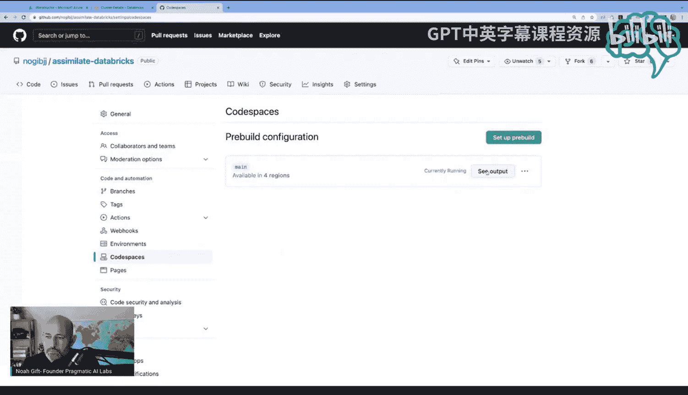

Currently running。I believe that。 this should be。Almost done。 It's just adding the last package。

 So so some of the stuff is kind of complex right， like if if you have a lot of software to install like why not automatically get it get it working in your environments so that you don't have to actually do installations or updates when you're running your your new environment。

 I mean that really is a pretty cool concept to actually get set up so。Let this thing。Go， it's。

 it's been running for three minutes。 Looks like it's almost set up。 Now， obviously， this would run。

Automatically。Every time you make a change， which is which is I think。

 is the way to go so that you don't have to wait for it to to do all this loading so this is really again saving us the minutes it would take。

If I was going to launch this from scratch， it would take me this long to actually run the environment。

So it's probably。It's probably almost done。Let it go for a little bit longer。 Uping the template。

Anything you can do to save time up front a is a huge win。 and again the the。

That this prebu is a cool concept。Okay。Create the template。😔，This template was created， that's good。

Prebiil template， deployed。Regististering pre buildil template， Uping pre build template。

So I'm assuming this is very， very close to being done。 It is interesting that shows you each step。

How long it took， so I guess the creation took about three minutes。

 the uploading took about two minutes。And it's going through the final phase here。

Of uploading that template。And once it's uploaded， in theory。

 I should be able to just launch this environment and。Would be good to go。And again。

 the the goal for go back here is to get this wired up。 So I already have Azure running。

 in effect fact。 I might as well just go back here and double check that the cluster is running。

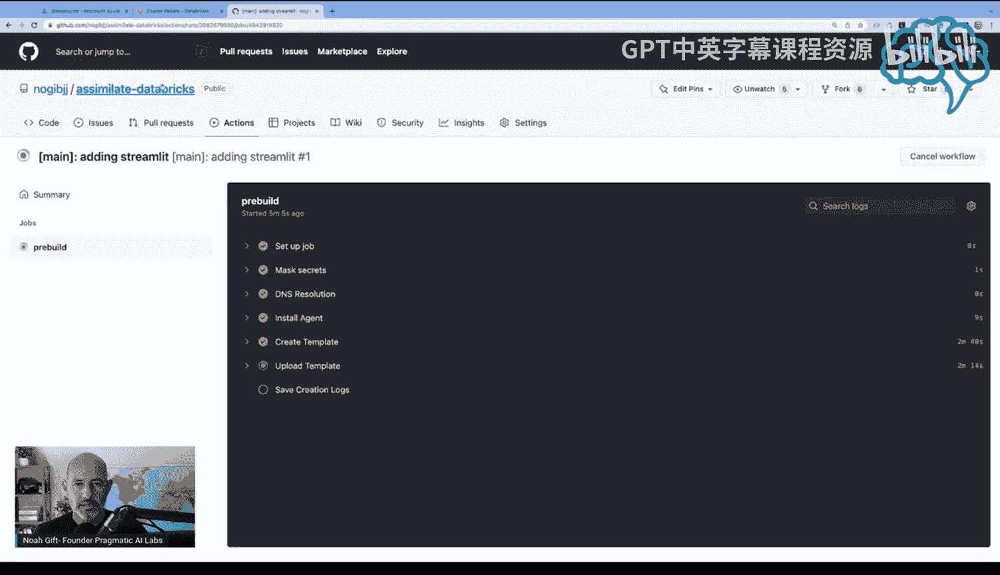

Because that's going to be necessary。 Yeah， there you go。 So I got the cluster running。

You can see I have 14 gigs of Ram。 we have 14 cores， we have。It all set up right here。

And I'm going to then communicate with this thing remotely because this can serve out the file system for me。

 So if we go to Databs file system， right， I can actually interact with this file system。

Grab tables that are located right here all from the integration from the API keys that I set up。

Right here and and the correct variables。Again， if we go back to here， we go to codespaces。

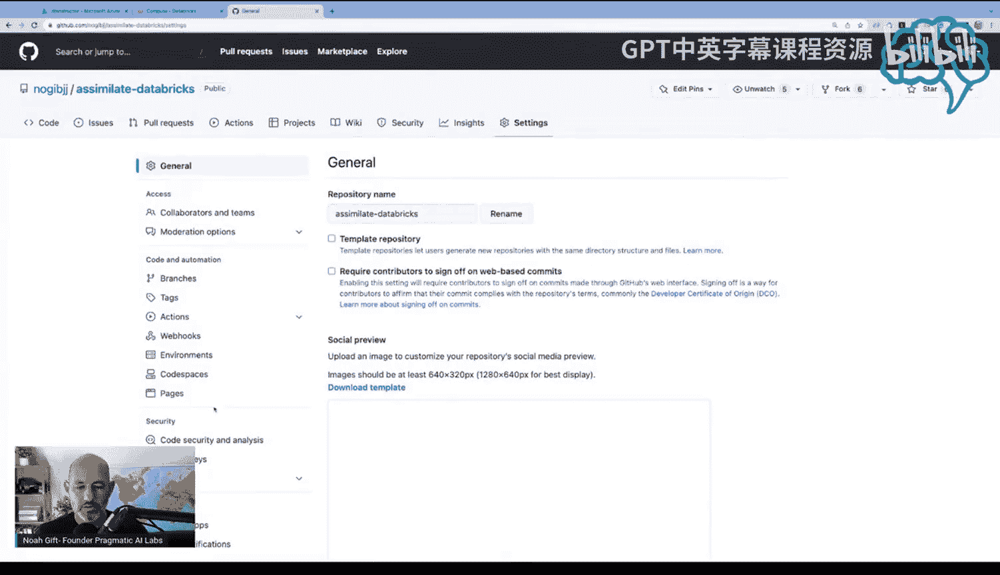

It looks like is it done？

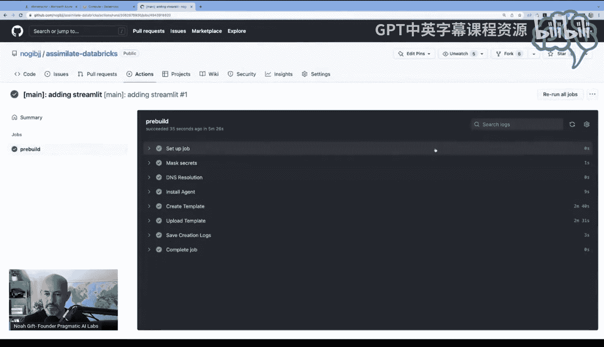

Yeah， there we go。 So it's done。 So so now now it should be trivial going forward in the future。

 anytime I want to use this codespace， it should be instant launch， no， no weird stuff。

 Let's go ahead and see if this works。

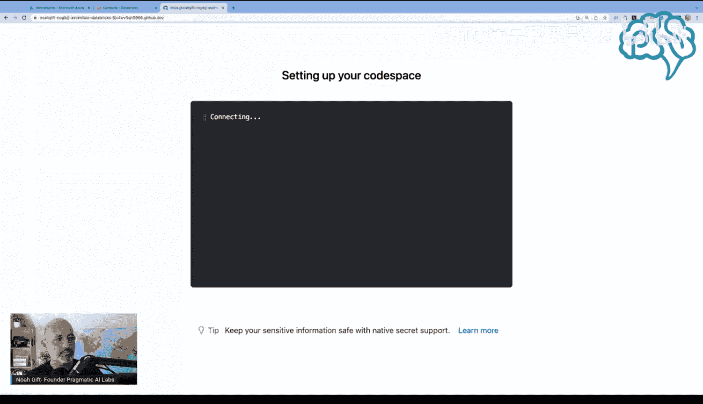

Perfect， wow， very， very fast。And if I go back to a new terminal。

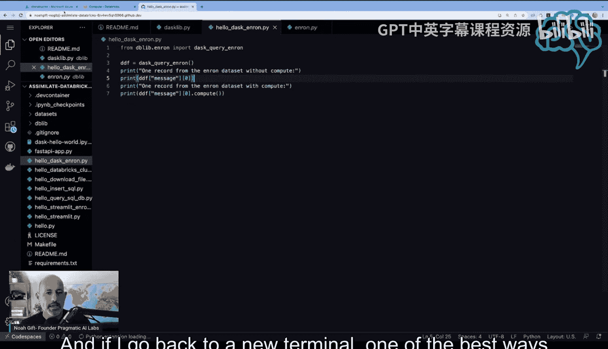

One of the best ways to kick the tires here if I go back to the top here would be to play around with the CLI right so this is how I would recommend if if you're wanting to test out your integration and you set all the correct variables up here。

 what you would want to do is just run this first command and say Databricks clusters list。嗯白。

This we'll go through and list the the clusters。 Yep， there we go。

 So we can see that I'm able to connect to the cluster， which is a good sign。

 And I also can communicate with the Databrick file system。

 So that would be the next thing that we would want to do。😊，There we go。

 Databricks file system perfect， and I could even drill down right I could go through here and say。

 okay， well what's on the file store？Say look， right， oh， there we go， look， I have a stack overflow。

Survey from 2011， maybe I want to do some data engineering tasks with that or train a machine learning model right I can interact with this and so I don't have to be wed to wherever databricks is located I can I can essentially use it as a。

As a location for doing interrogation。And actually think of it more as like a system for data management versus a developmental platform。

 it really depends on what the organizational goals are。

And I could also go through here and look at Databricks jobs， for example， here's another one。Okay。

Now， the next thing that I would do。That would be to scroll down here and say， well， okay。

 now that I got that working， how can we actually write some code that communicates with Databricks？

I would say the first thing。To do would be to think about the from a management perspective。

 how could I write some Python code that allows me to use those secrets that I' had set up before。

 which are Databricks host and Databricks token。And and go through here and use use those to actually。

Do a similar thing to what the commandmeion tool does。 Well。

 fortunately pretty easy to do in this case， you can see I've already got this stuff installed。

 If we go to requirements file， you can see I have got Databricks installed Databricks CI and then also Databricks SQL connector and what this does。

Is it allows me to write more like management level Python code， not necessarily query things。

 but like manage the things， so if I go and I see Python。Llow data bricks cluster。Hello。Pon hello。

 Egypt。Lastkedure。There we go， we can see that it's actually got that cluster information set in of there and then the other thing that we can do is if we wanted to we could actually convert this into like a command line tool which could be kind kind of fun so how would we do this？

I would say。We could actually move the logic of this into a library。 So let's go ahead and do that。

 So I'm going I'm going to grab the entire thing here。And I'm going to go like this。

 and I'm going to go to Db Lib， which is a directory I have for doing things。

 and Im to I'm going to make a new file in here called touch Db Lib。And we'll call this manage。

Eita bricks。Mat。I'll paste this inside of here。 and and the next thing that I would recommend doing is turning this more into a to a function that actually is something I can reuse。

 And so what I'll do is I'll just put this into。A like a client here and so we can say。

Let's make a function here that says。You know， list list the clusters right。

 and we can actually just take this entire thing。And move it over， I always forget if it's shift。

V or something like that or。I forget what the command is to shift my code over。

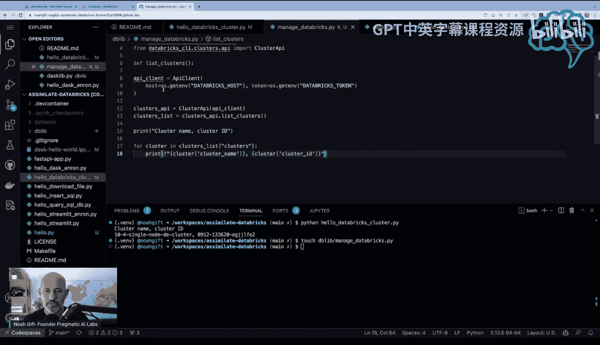

We can we can Google it， say。Youll studio code。Shift。Right。It would be to move the code。

 it would be edit shift， right。😔，And it just right。

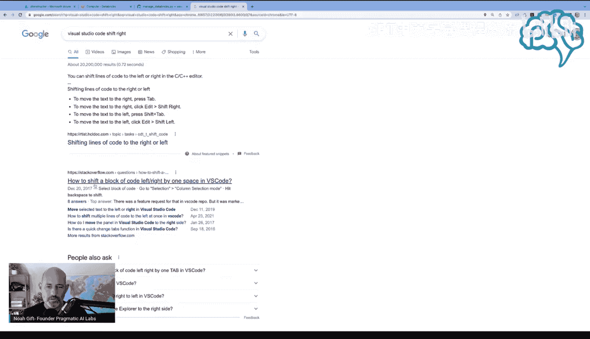

Let's see here。But is marked as。Control， Oh， I see。Control to。😔，Control square bracket。

 Let's try that。Here we go。😔，So， control。Itn't work for me， unfortunately， but。

I can just ship this over a little bit。Com here， come here。Here。

What what will put this here across your name。😔，And be this。Sa forecast。In clusters list。😔。

Something like this， we can say。In fact。This looks pretty good。

And we'll just say return clusters list。嗯。And so now we have some kind of a library code。

 so let's say make status。Oh。嗯。that。Yeah， looks good formatted that a little bit。

 Now all need to do is import this into a chamean tool。 So if I say touch。And I say。T lie， manage。

Say C I manage。😔，Itterrics。Go ahead and launch this and say from he B。Ats。

And as dataabrics import less clusters。And then I can also import click。And I could build a。

 I could say。Build click group。Here。😔，And we can say manages。Any Databs。You can build a command。

All this one。List clusters。And list cluster's command。And that looks good。

 and now we can just run it。Perfect， right， so I'm getting a lot of help from。Pt here。

And I can also do a chiing line。Here。Vir band， EMV， Python。And I'll it，Let's x， see I manage。

 let's knit。We see the help menu says that there's a comm called list clusters。

And we could even put some help menu pull in here and say example。And I'm going to say Python。

We can do this， we can say got slash because that's exactly what I'm going to run and let's run it。

With through here and say。This cluster is perfect。We're able text to go through on list list clusters right so I can even build you know more more tools very。

 very quickly， and I can commit this so say get status。Ooh， got a lot of code， get added。

Adding Db Databricks。CLI manage code， so I don't even have to use their CLI I can just write my own。

Which is kind of cool。 So that's the to talk to databs itself。 But what if we want to query it， well。

 pretty easy to do。😊，One of the things that we can look at is some code here that says query Db and let's take a look at what this does So it says from Databricks import SQL so there's a SQL connector that will query existing tables right so if we go back here and we see that there is tables here like diamond squares right these are tables that are available I can actually just do a select on it and this could be a huge data right it could be a massive a data set here if I if and notice here I'm using all of those tokens and I'm just returning back the result。

 but but I have the ability to swap out the query。

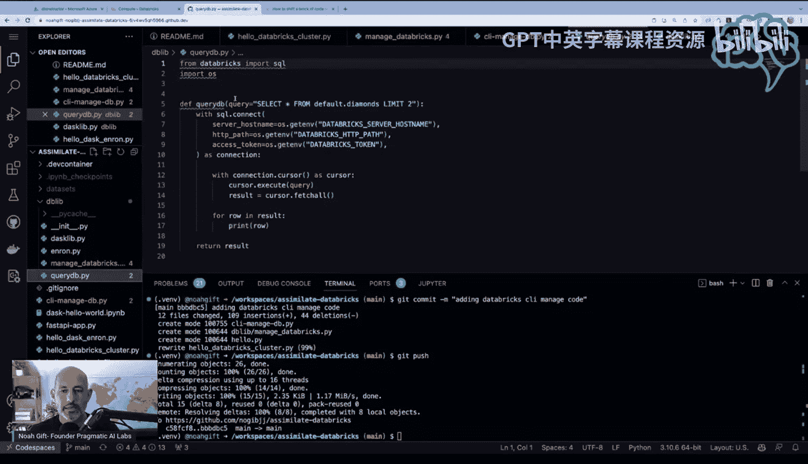

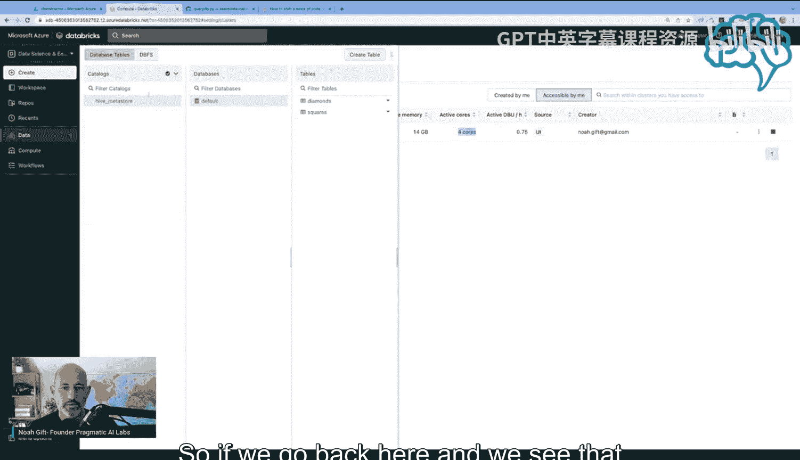

And so now all I need to do is go to a Kamean tool I wrote earlier。Which I believe is that this one。

 No， it's going to be。This one。 So hello query SQL D B。 And so what I did is I imported the query Db。

 and then I built a query command， right， so we can actually put in our own query。

 So let's go ahead and run this thing。 So I'm gonna go dot slash Ho query D B help first。

 It's gonna say， okay， look， you can execute SQL queries。Great， let's go ahead and do that。

And I'm going to say CI query， and I'm going to first do the default here， so let's just just run it。

And you'll see that it's able to actually talk to that table in Databricks and then query it。Perfect。

 now， what if I want to do more， right， Like， what if I want to query more things inside of the。

A bit of bricks。 well， fortunately， I wrote a reusable tool。 So if I go through here and I say query。

And I say， select star from default diamonds。mWe could actually say limit and do a bigger limit right I can say limits。

 what about 100， let's grab 100 rows。And oh， it says。Oh， I need to put a， I think I need to put a。

Puts on this。Or else it would be very difficult for it to read There we go we quote it it's going to now send a new command there we go we got 100 rows directly from databricks I could even do 200 rows right and if I wanted to I could even be super tricky pi this into word count right I could start piping in。

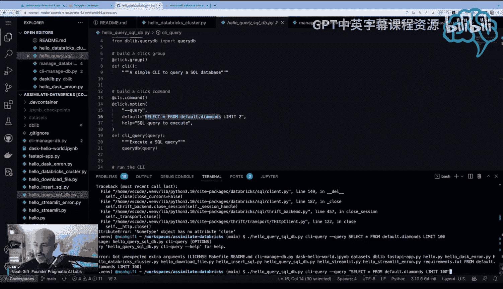

Unux tools。And start doing other things with whatever it is I wanted to do with Databricks so there's a lot you can do if you if you're able to set up the integration which I did with this Databricks environment and getub code spaces and that's good for today and thank you for showing up and I'll see you next week and we can continue to talk about the Databricks。

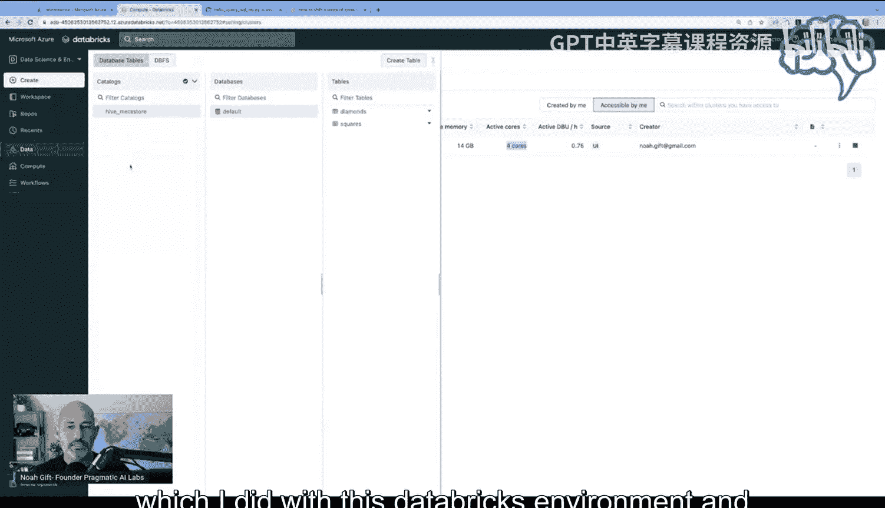

Machine learning engineering certification。