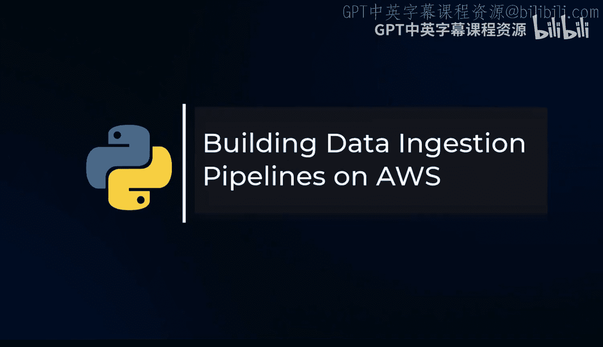
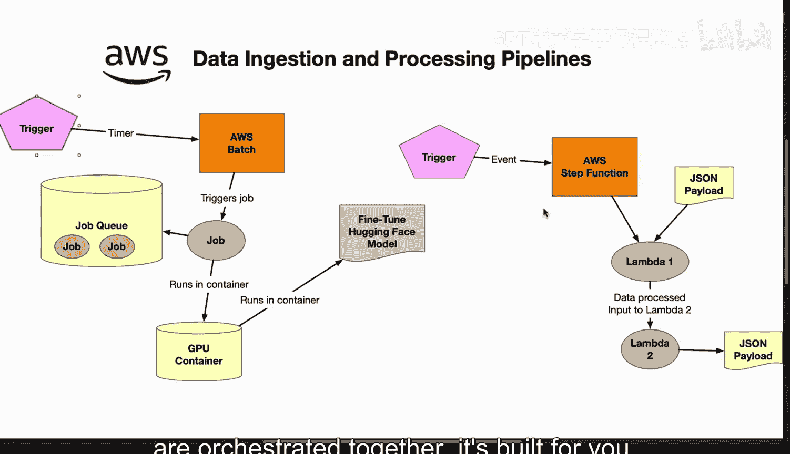

# 杜克大学｜机器学习运维｜DevOps⧸DataOps、Azure、MLFlow和抱脸｜MLOps ｜ Machine Learning Operations p31 38_03_04_AWS上构建数据摄取管道.zh_en -BV1yE421c7uA_p31-

AWS data ingestion and processing pipelines solve complex problems by using services that are managed for you。

 A good example is AWS batch。 It takes many complex parts of solving reoccurring jobs and puts them together in pieces So for example。

 you have a trigger and it could be on a timer or it could be called via code or some other event but in this particular scenario。

 let's say it's called at some interval a new job is then created and the job is put into the job queue the job queue could have thousands of jobs inside of their and they get process according to how many processes you allow AWS batch to create for you。

 so it could be， let's say 200 different containers are launched that are all let's say GPUs and you could do things like finet huggingface models based on some event schedule in your organ。

ization。So really AWs batchche's general purpose， but it works very well for machine learning。

 especially for doing things like GPU fine tuning。 a second process would be using AWS st functions。

 As step functions is also a serverless technology so it's managed for you and if there's an event that pops in it could be an API call or it could be a trigger on some data coming somewhere what would happen is you could pipe together multiple Lada functions and those Lada functions would take a payload process whatever occurs inside of that payload and then ultimately at the very end of the pipeline。

 it would actually give you your results and what's really nice about step functions is it has a great amount of orchestration in between so that you can see the logs you can see how long things took and so you don't have to build this ecosystem to build things that are orchestrated together。

 It's built for you， you just have to put。

The logic together。