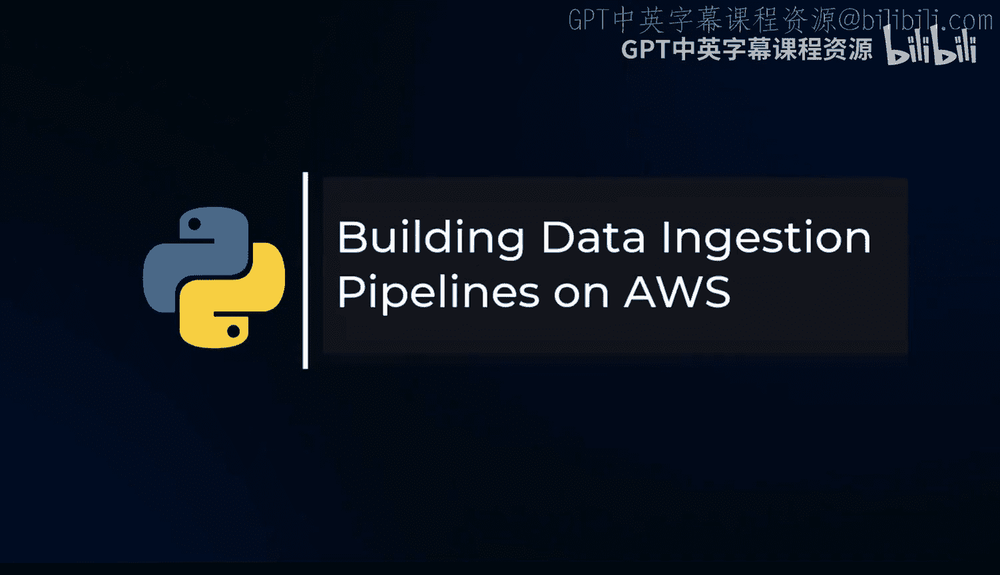
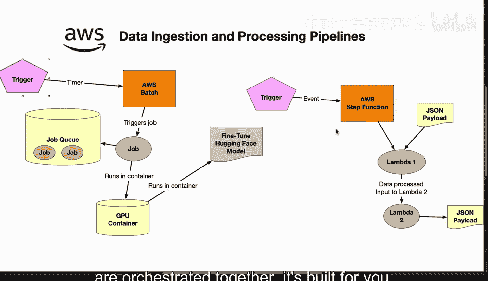

# 机器学习运维：第31章：在AWS上构建数据摄取管道

在本节课中，我们将学习如何在AWS云平台上构建数据摄取与处理管道。我们将重点介绍两种核心的托管服务：AWS Batch和AWS Step Functions，并解释它们如何简化复杂任务的编排与执行。

## 概述

AWS的数据摄取和处理管道通过使用托管服务来解决复杂问题。这意味着AWS负责管理底层的基础设施，如服务器、网络和扩展，而开发者可以专注于业务逻辑的实现。接下来，我们将深入探讨两种关键服务。

## AWS Batch：托管批处理作业服务

上一节我们了解了AWS托管服务的优势，本节中我们来看看AWS Batch。AWS Batch将解决周期性作业的许多复杂部分整合在一起。

其工作流程如下：
1.  **触发器**：作业可以由定时器、代码调用或其他事件触发。
2.  **创建作业**：触发器激活后，会创建一个新的作业。
3.  **作业队列**：新作业被放入作业队列中。队列中可以容纳成千上万个作业。
4.  **作业处理**：作业根据您为AWS Batch设置的并发进程数进行处理。例如，您可以启动200个不同的容器（例如，全部配备GPU）来并行处理作业。

AWS Batch用途广泛，尤其适用于机器学习任务，例如基于组织内的事件计划对Hugging Face模型进行GPU微调。

## AWS Step Functions：无服务器工作流编排

了解了批处理作业后，我们再来看看事件驱动的流程编排。AWS Step Functions是另一种无服务器技术，同样由AWS托管。

以下是其典型工作流程：
1.  **事件触发**：流程可由API调用或数据到达某处等事件触发。
2.  **串联Lambda函数**：您可以串联多个AWS Lambda函数。
3.  **负载处理**：每个Lambda函数接收一个负载（payload），并执行其中定义的处理逻辑。
4.  **输出结果**：在管道的最终阶段，您将获得处理结果。

AWS Step Functions的突出优势在于其强大的内置编排能力。您可以查看日志、监控各步骤耗时，而无需自行构建整个编排生态系统。该服务已为您构建好，您只需组合业务逻辑即可。

## 总结

本节课中我们一起学习了在AWS上构建数据摄取管道的两种核心方法。我们介绍了**AWS Batch**，它擅长管理大规模的周期性批处理作业，特别适合机器学习中的模型微调等任务。接着，我们探讨了**AWS Step Functions**，它是一种强大的无服务器工作流编排服务，能够以可视化的方式轻松串联和监控多个处理步骤。利用这些托管服务，开发者可以更高效地构建可靠、可扩展的数据处理管道。