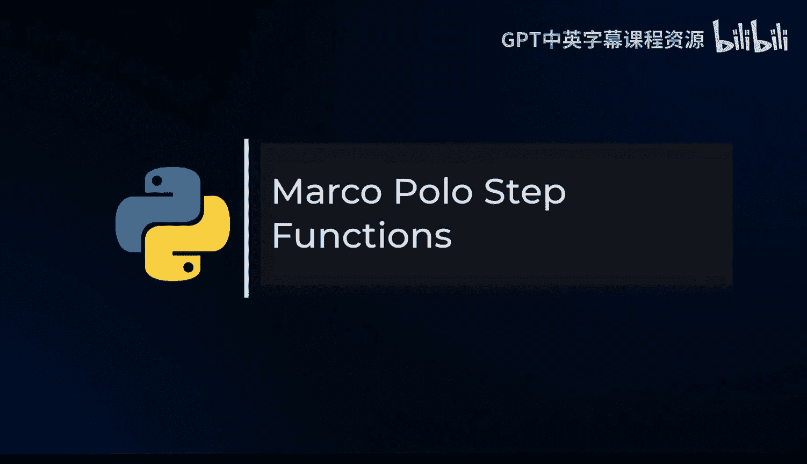
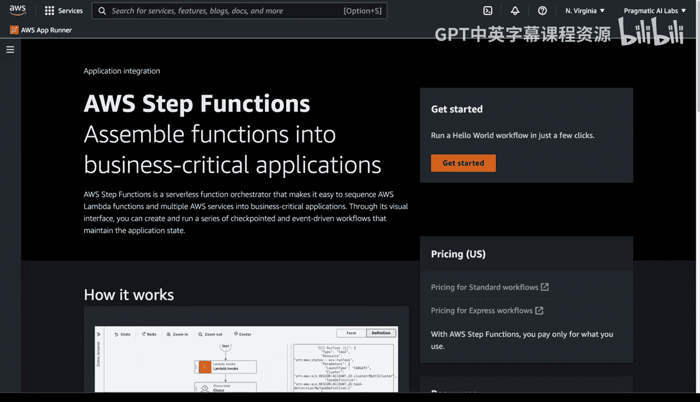
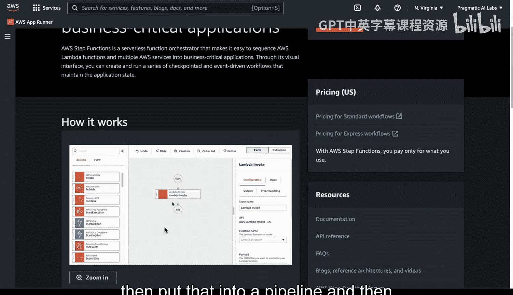
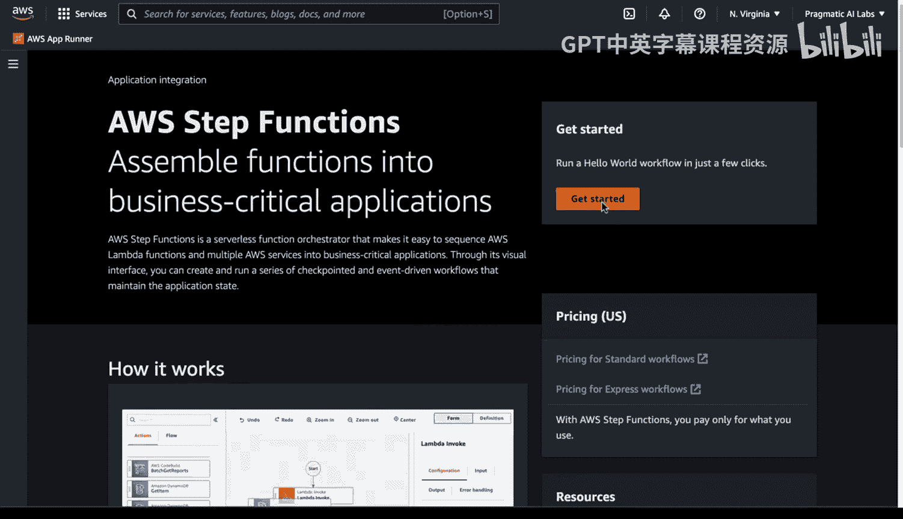
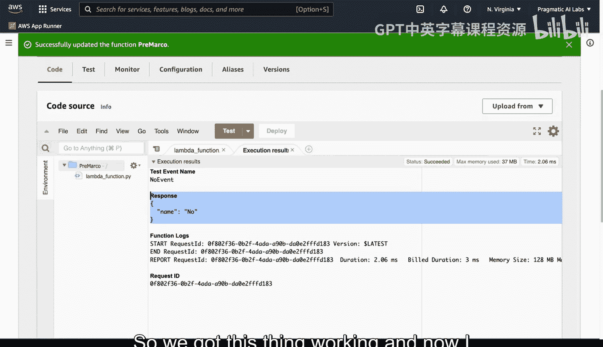
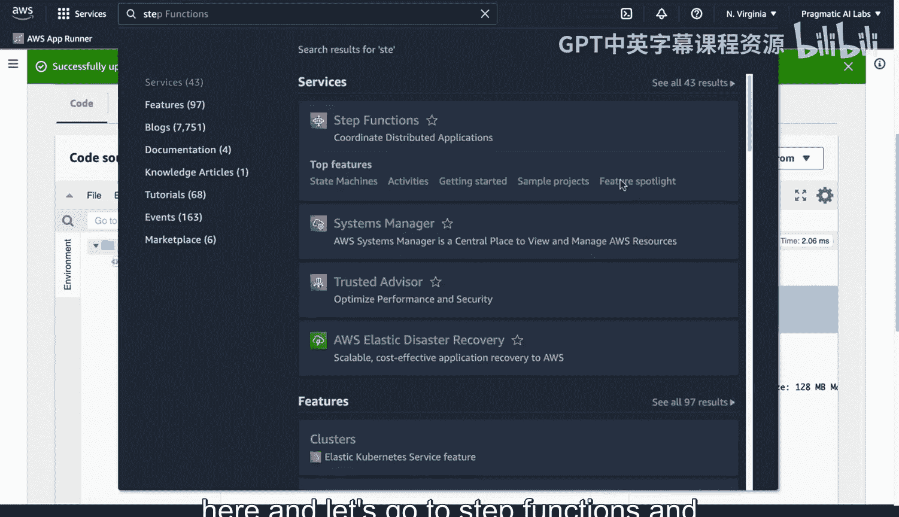
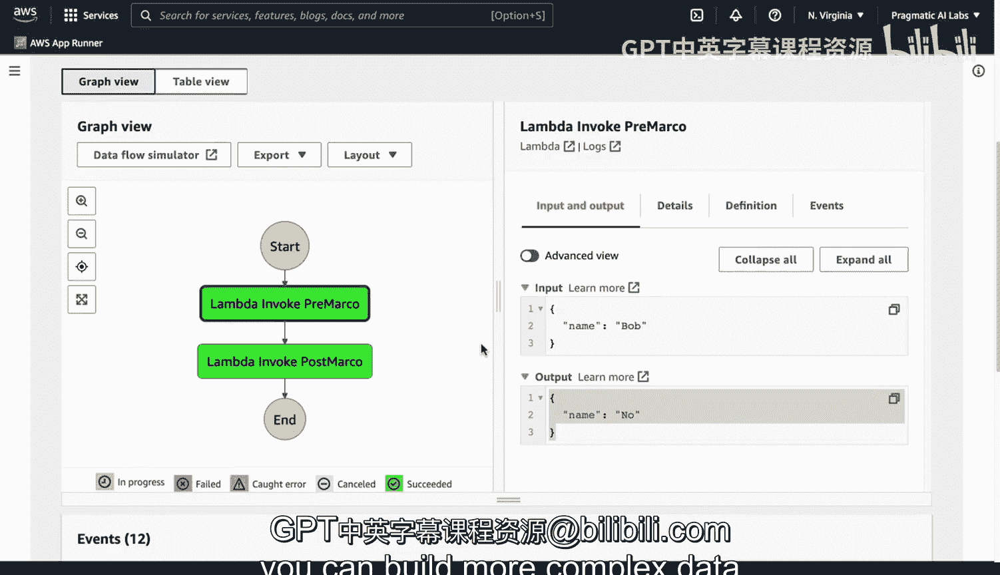

# 机器学习运维：第32讲：AWS Step Functions 实践 🚀



在本节课中，我们将学习如何使用 AWS Step Functions 来编排和协调多个 AWS Lambda 函数，从而构建一个简单的数据处理工作流。我们将通过一个“Marco Polo”的示例，直观地理解 Step Functions 的工作原理和优势。





---

AWS Step Functions 非常适合用于编排任务，特别是协调 AWS 中许多不同的组件。你可以直观地设计一系列决策步骤，将其放入一个管道中运行，并获得出色的执行过程监控。




一个很好的入门方法是点击“入门指南”。它会提供一个“Hello World”示例。在这个示例中，你可以看到它实际上就是一段 JSON 代码。在这段代码内部，你可以看到不同的“状态”。


它从一个“Pass”状态开始。然后执行“Hello World”示例，等待三秒钟，执行“Hello World”操作，最后进入结束状态。如果我们直接运行这个示例，过程非常直观。我们可以创建状态机并运行它。它会详细展示每一步将要发生什么。运行完成后，结果会直接打印在这里。Step Functions 的优势就在于它提供了这种出色的执行过程监控。

在演示中看到这一点很好，但如果我们想自己动手从头构建一些东西呢？我们可以编排自己的 Lambda 函数来构建一个管道。

---

上一节我们了解了 Step Functions 的基本概念，本节中我们来看看如何构建一个自定义的工作流。我们将创建两个 Lambda 函数，并用 Step Functions 将它们连接起来。

首先，我将从 AWS Lambda 开始。我将创建一个函数，命名为 `premarco`。我选择 Python 作为运行时环境。

这个函数的功能是：接收一个包含 `name` 字段的负载（payload）。如果 `name` 的值是 “Marco”，则返回 “Polo”；否则返回 “No”。

以下是该函数的代码：

```python
def lambda_handler(event, context):
    if event.get('name') == 'Marco':
        return {'name': 'Polo'}
    else:
        return {'name': 'No'}
```

接下来，我们可以配置一个测试事件。我将创建一个名为 “Marco” 的测试事件，其负载为 `{"name": "Marco"}`。保存并部署这个函数，然后进行测试。测试结果显示返回了 `{"name": "Polo"}`，功能正常。

现在，让我们构建第二个 Lambda 函数，命名为 `postmarco`。同样使用 Python 运行时。

这个函数的功能是：检查负载中的 `name` 字段。如果值是 “Polo”，则返回一条祝贺信息；否则返回一条鼓励信息。

以下是该函数的代码：

```python
def lambda_handler(event, context):
    if event.get('name') == 'Polo':
        return {'message': 'Great job!'}
    else:
        return {'message': 'Keep trying!'}
```

同样，我们部署这个函数并进行测试。为了确保两个函数能协同工作，我们需要调整 `premarco` 函数的返回格式，使其与 `postmarco` 的预期输入格式匹配。我们已经在上面的代码中完成了这一点，即返回一个包含 `name` 键的字典。

现在，两个 Lambda 函数都已准备就绪。

---

现在，我们可以转到 AWS Step Functions 控制台，将这两个状态（函数）连接起来。



我们将创建一个新的状态机，并选择“可视化设计”。



以下是构建流程的步骤：

1.  **添加第一个状态**：从左侧拖拽一个“Lambda 调用”状态到画布上。我们将其命名为 “Invoke Premarco”，描述为“处理 Marco Polo 消息的第一步”。在配置中，选择我们之前创建的 `premarco` 函数。
2.  **添加第二个状态**：再拖拽一个“Lambda 调用”状态到画布上，放在第一个状态之后。将其命名为 “Invoke Postmarco”，并选择 `postmarco` 函数。
3.  **连接状态**：Step Functions 会自动将第一个状态的输出作为第二个状态的输入。

创建完成后，我们将状态机命名为 “PrePostMarcoPipeline” 并保存。

---

现在，让我们来执行这个工作流，看看它是如何运作的。

我们将启动一个新的执行。需要为工作流提供初始输入。我们创建两个测试执行：

*   **测试一：输入 `"Marco"`**
    *   执行负载：`{"name": "Marco"}`
    *   点击“开始执行”。我们可以观察执行过程。`premarco` 函数接收输入 `{"name": "Marco"}`，输出 `{"name": "Polo"}`。这个输出自动传递给 `postmarco` 函数，`postmarco` 接收 `{"name": "Polo"}`，最终输出 `{"message": "Great job!"}`。执行成功。
*   **测试二：输入 `"Bob"`**
    *   执行负载：`{"name": "Bob"}`
    *   再次启动执行。`premarco` 函数接收 `{"name": "Bob"}`，输出 `{"name": "No"}`。`postmarco` 函数接收 `{"name": "No"}`，最终输出 `{"message": "Keep trying!"}`。

通过 Step Functions 的可视化界面，我们可以清晰地看到每个步骤的输入和输出，这正是其强大的监控和调试能力。



---

本节课中我们一起学习了 AWS Step Functions 的核心用法。我们首先了解了 Step Functions 用于工作流编排和监控的价值。然后，我们通过一个“Marco Polo”的实践示例，逐步创建了两个 Lambda 函数，并使用 Step Functions 将它们串联成一个完整的工作流。最后，我们通过不同的输入测试了工作流的执行，并观察了其可视化的执行详情。


通过这种“Marco Polo”式的简单练习，你可以快速上手 Step Functions。一旦掌握了基本概念，你就可以利用它来构建更复杂的数据摄入和处理工作流，协调更多的 AWS 服务。