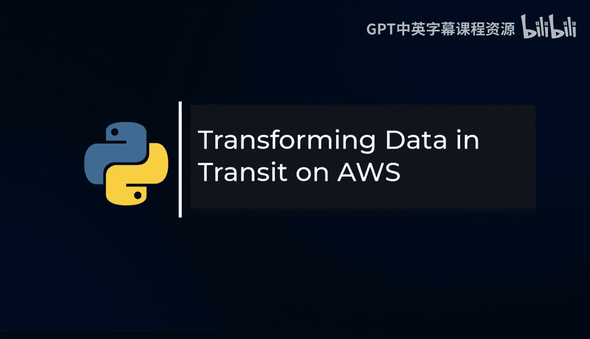
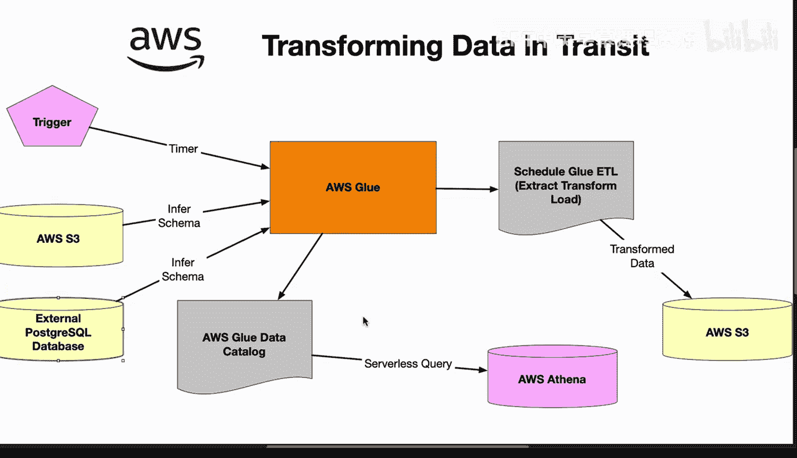

# 杜克大学｜机器学习运维｜DevOps⧸DataOps、Azure、MLFlow和抱脸｜MLOps ｜ Machine Learning Operations p33 40_03_06_AWS传输中数据转换.zh_en -BV1yE421c7uA_p33-

Transforming data and transit on the AWS platform。Has a great example in Abuis glue。

 Let's take a look at this diagram from the beginning to the end， first。You had trigger via timer。

 a glue operation。 glue is a serverless ETL system。

 What that means is that you can point it to multiple data sources。 So for example。

 if you had a big file in S3 that was maybe a CSV file that was millions of rows。

 Then you also had an external Postgres SQL database， you could tie those two together。

 create an ETL extract， transform load operation and then transform that data and put it into another bucket in S3 right So you've got this great reusable operation that is constantly making new versions of the data because this external database could be updated by some vendor that you're dealing with。

And what's great is that this trigger that runs periodically will transform it and put it into a new bucket。

Now what's also nice is that glue can catalog that bucket for you and create a metadata record What that means is that later your data scientist can actually use Athena to query that catalog without having to actually pull all the data out of S3 and they can run serverless queries and do data visualization and maybe manipulation based on using athena plus glue。

 So there is a lot of serverless goodness that comes from the glue inside of your ecosystem and this particular architecture is a very common pattern that is a appropriate pattern for many organizations and actually fairly straightforward to both understand and maintain。

