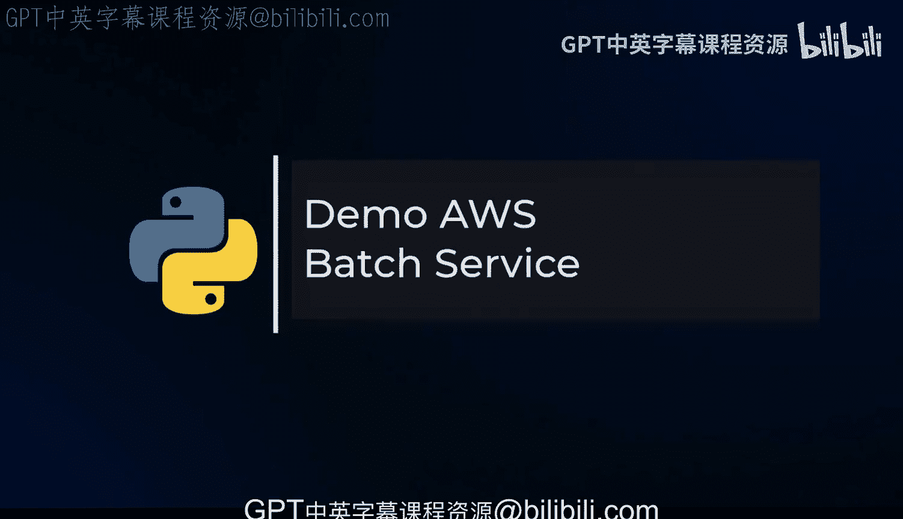
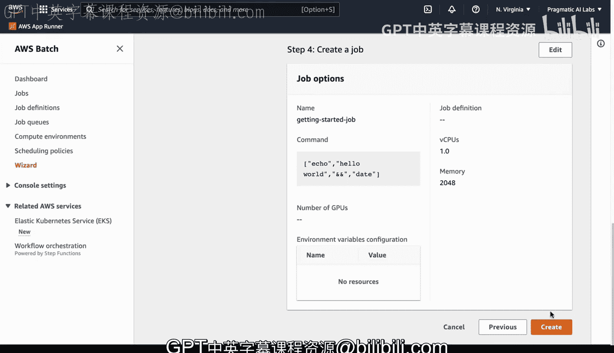

# 杜克大学｜机器学习运维｜DevOps⧸DataOps、Azure、MLFlow和抱脸｜MLOps ｜ Machine Learning Operations p34 41_03_07_AWS-Batch服务演示.zh_en -BV1yE421c7uA_p34-

Ew S batchch is a great technology for just solving。

Basic problems in terms of running something in the cloud。 And in this particular example。

 you here you see that there's an application image a config。 There's a job queue。

 There's a scheduler and then you run your job。 So it's a very straightforward and useful service and it's also easy to get started with。

 let's go ahead and run this first batch job here。 So if I say get started。

The first thing it does is opens up this wizard。 And you can see there's not many steps。

 You create a compute environment。 You then create a job queue that that will hold。

 you know more than one job if you needed to create a job definition。

 then create a job and then create。 So let's go ahead and run this first one。

 which is getting started Comp environments。The next thing you can do is figure out where you want this to run on do you want it to run on Fargate so you don't have to manage servers。

 I would really push towards this where you can actually run it inside of a container and it'll actually handle all the backend for you。

 there's also Fargate spot， which is also a very good idea because you get us up to a 70% discount So if you're running lots of these。

 this is a great idea。 and then there's the virtual machine route which would be on demand or spot。

In this particular scenario， you could also tune it to how many virtual CPUs you wanted to be able to use。

And this is the network that you're going to use as well， so the VPC would have run in。Next up。

 you have a job sw and in this particular scenario here。

 the idea is that this would hold all of the work that you're going to process。

And then finally you have a general configuration and this is where you put things like you know how long of a timeout do you want。

 for example， and maybe a different execution role。

 so this would be if you're needing to do other things like talk to other APIs or other parts of AWS。

 you could actually give it a different role。And then finally， in terms of the job configuration。

 this would be the image that you're going to use to start a container。

And if you want to play around with a different image or even build your own you could push this here。

 which is is often a good idea to build your own image that has everything you need inside of it maybe some huggingface libraries。

 for example， and then finally what's the command that you want to execute when it runs now you could swap this out by writing code that inserts a command。

 but for now let's just do a hello world。And let's also do a date here so we know what time it ran and then you can say what's the number of reserved virtual CPUs for this container and then you could also change the memory if you wanted to。

And you could put some of these other configurations on here as well which are pretty interesting like you could actually put volumes that are attached to it。

 you could do some logging， so there's some really advanced container things that you could do as well。

 and then finally it goes through it gives you all the information and then we can actually go through and run the job。

