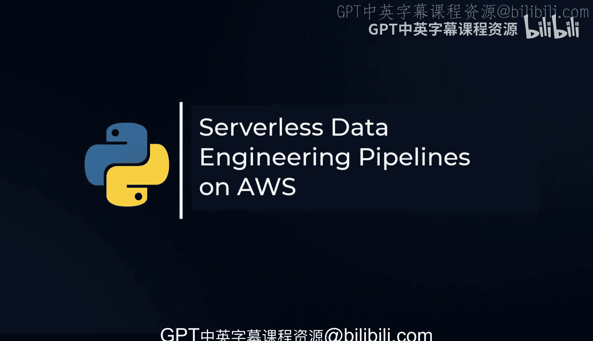
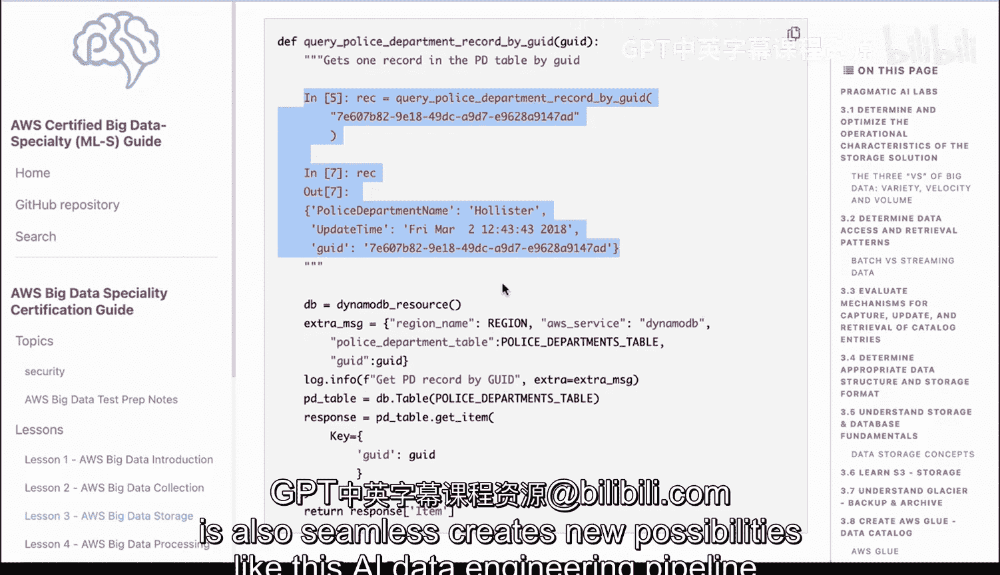

# 杜克大学｜机器学习运维｜DevOps⧸DataOps、Azure、MLFlow和抱脸｜MLOps ｜ Machine Learning Operations p35 42_03_08_AWS无服务器数据工程管道.zh_en -BV1yE421c7uA_p35-

One of the more powerful ways to develop applications quickly on the AWs platform is to use serverless technology。

 So， for example， in this scenario we have a serverless data engineering pipeline that does many different things really quickly。

 So let's start off with a cloud watch timer it goes through and it triggers a read from a dynamo DB table。

 This dynamo Db table is a key value store that has information about police officers police departments。

 different law enforcement metadata， it collects that puts it into an SQS system once it's in SQs。

 then it automatically triggers a Lada which then goes through and processes using the sentiment analysis API from AWS called AWs comprehend information that is coming from these reports that finally goes through and puts a report into S3 which can then later be visualized or put into a report for example。

A quarterly report on how the community is interacting with police departments across the United States。

Now if we take a look at this in detail here， here is an example of the code。

 so you would go through here and create a globally unique ID so get one record from the database and then once you go through here。

 you can actually assign additional metadata， for example。

 if you wanted to add attributes about a particular region or a particular department or type of interaction all those could be done on the fly because it's a schemaless database。

 so really the ability to quickly move using serverless technology there's also schemaless creates new possibilities like this AI data engineering pipeline。

