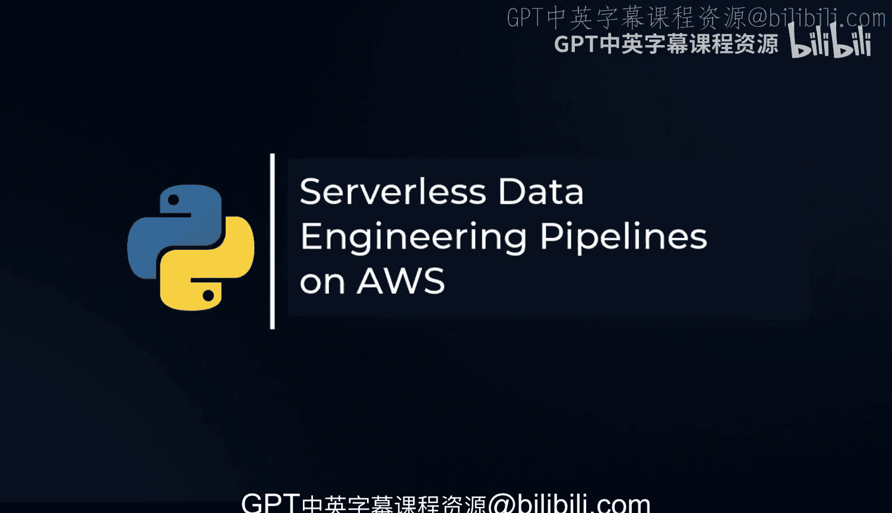
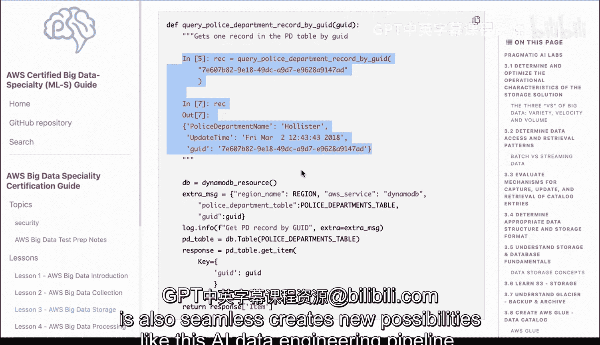

# 机器学习运维：第35讲：AWS无服务器数据工程管道 🚀



在本节课中，我们将学习如何在AWS平台上使用无服务器技术快速构建一个数据工程管道。我们将通过一个具体的例子，了解如何利用AWS的各项服务，从数据读取、处理到最终存储和可视化的完整流程。

---

在AWS平台上快速开发应用程序的一个强大方法是使用无服务器技术。

例如，在这个场景中，我们有一个无服务器数据工程管道，它能非常快速地完成多种不同的任务。

上一节我们介绍了无服务器技术的概念，本节中我们来看看这个管道的具体构成。

以下是该数据管道的核心流程：

1.  流程始于一个CloudWatch定时器。它触发从DynamoDB表中读取数据的操作。
2.  DynamoDB表是一个键值存储，其中包含关于警察、警察局以及不同执法相关的元数据信息。
3.  读取的数据随后被放入一个SQS（简单队列服务）系统中。
4.  一旦数据进入SQS，它会自动触发一个Lambda函数。
5.  该Lambda函数使用AWS的Comprehend服务（一项情感分析API）来处理来自这些报告的信息。
6.  处理后的数据最终被放入S3存储桶中，之后可以用于可视化或生成报告，例如一份关于美国各地社区与警察部门互动情况的季度报告。

---

现在，让我们详细查看一下其中的代码实现。

以下是Lambda函数处理数据的一个示例代码片段：

```python
import boto3
import uuid

# 创建DynamoDB资源客户端
dynamodb = boto3.resource('dynamodb')
table = dynamodb.Table('YourTableName')

def lambda_handler(event, context):
    # 生成全局唯一ID
    unique_id = str(uuid.uuid4())
    
    # 从数据库获取一条记录（示例）
    response = table.get_item(Key={'id': 'some_id'})
    item = response.get('Item')
    
    # 动态添加额外的元数据
    if item:
        item['region'] = 'Northeast'  # 添加区域属性
        item['interaction_type'] = 'Community Outreach'  # 添加互动类型
        # 可以根据需要添加更多属性，如部门、时间戳等
    
    # 后续可以将处理后的item发送到SQS或进行其他处理
    # ... (此处省略了发送到SQS或调用Comprehend的代码)
    
    return {
        'statusCode': 200,
        'body': 'Processing complete'
    }
```

在这段代码中，你会创建一个全局唯一ID，并从数据库中获取一条记录。然后，你可以动态地为其分配额外的元数据。

例如，如果你想添加关于特定区域、特定部门或互动类型的属性，所有这些都可以在运行时完成，因为它是一个无模式数据库。

因此，利用无服务器技术快速移动的能力，加上无模式数据库的特性，创造了像这个AI数据工程管道这样的新可能性。

---



本节课中我们一起学习了如何利用AWS的无服务器服务（如CloudWatch、DynamoDB、SQS、Lambda、Comprehend和S3）构建一个高效、可扩展的数据处理管道。这种架构避免了管理服务器的复杂性，允许开发者专注于业务逻辑，并能根据需求自动扩展，是实现快速数据工程和机器学习的强大模式。