# 杜克大学｜机器学习运维｜DevOps⧸DataOps、Azure、MLFlow和抱脸｜MLOps ｜ Machine Learning Operations p36 43_03_02_从零构建Python函数.zh_en -BV1yE421c7uA_p36-

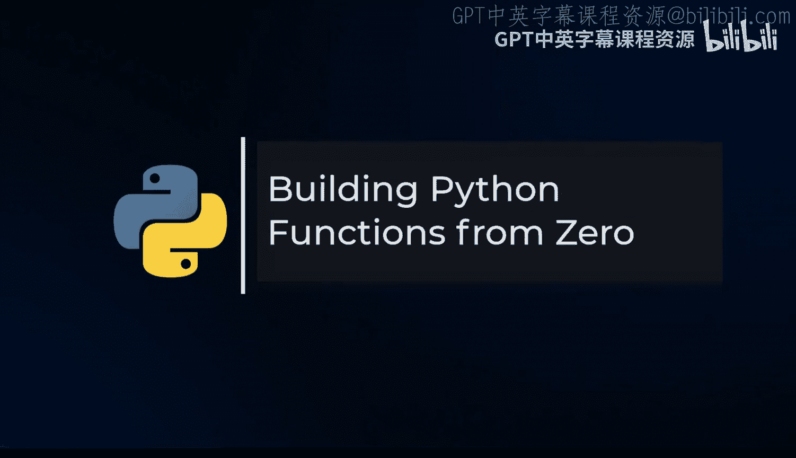

Hi， my name is Noah Giifft and today I'm going to walk you through how to start from absolutely zero a function and build it into a series of Klan tools using both Python click and Python Fire。

 building out library structure and then eventually containerizing it。

 pushing it into the cloud and then deploying continuous delivery of a containerized microservice Okay。

 let's go ahead and get started。

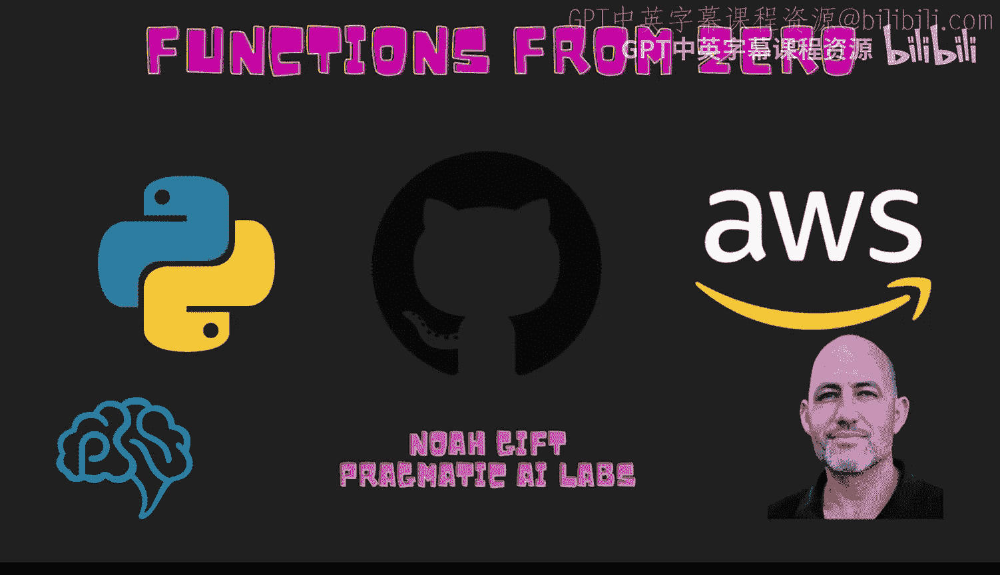

The first thing I'm going to do here。Is I'm going to go ahead and create a new repository so that you can see the artifacts that we create and you can as I have each checkpoint。

 you can get a copy of the checkpoint， so I'm going to go ahead and create a new repository right here。

And we'll call this。Call this functions。From 0。And we'll say live training like this。

 and one of the things I would recommend whenever you're creating a GitHub repository for Python is to do two things。

 essentially make a Readme file and add a GitINre file and in this case the Git ignore file gives us Python。

And then I can go ahead and create a repository。And there's really now that we've got this basic repository。

 there's a couple different flavors of writing code in a web browser to bring up。

 especially again for like this kind of style of coding。

 one is a Jupyter notebook or a coLab notebook and another one is some kind of a web-based development environments and a Riley actually has a lot of really great web- based development environmentments。

 that you can use with the Kota codeta system。In my case though I'm going to use two different systems。

 I'm going to use either GiHub codespaces or I'm going to use coab notebook som now that I've got this repository I'm going to toggle over to。

The GitHub code spaces here。And let's actually。Switch over to it。

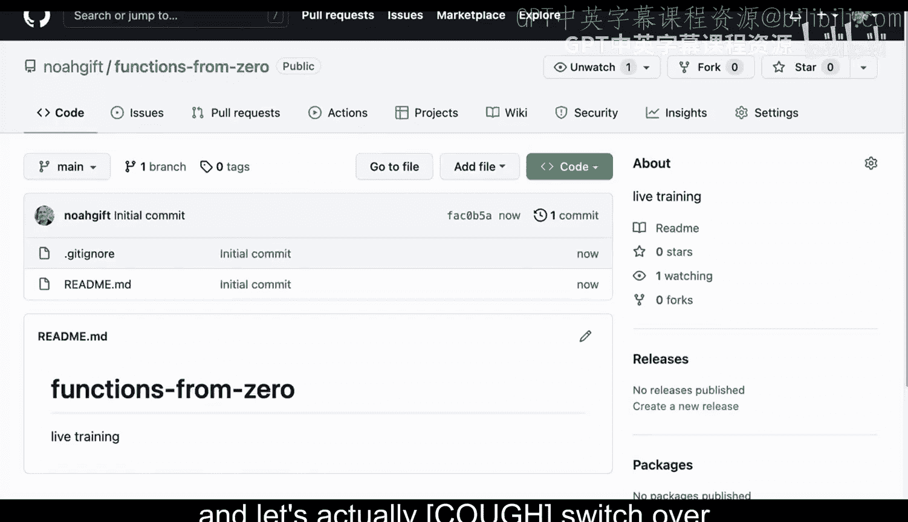

And I'm going to type in Collab。What's nice about coabab is that it's a great environment to kind of go through and build out a function and as I build out these functions and statements in Python。

 I can also checkpoint that into this repository that I created。

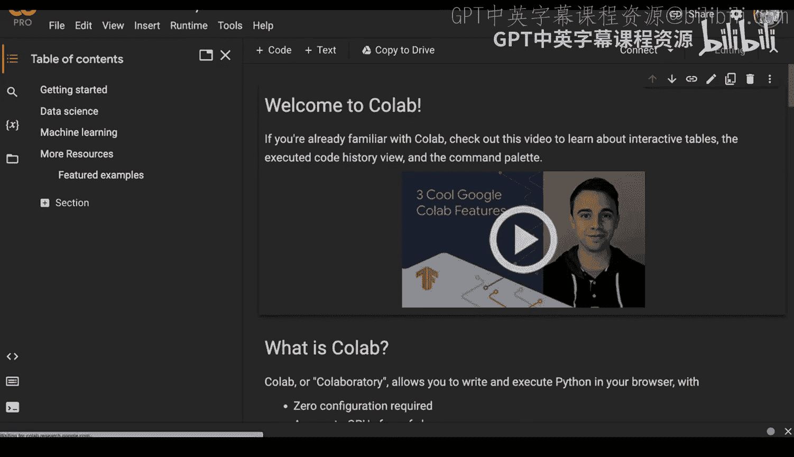

That's really what we're going to do we're going to go through here and use this system to do that。

 so I'm going to go ahead and。Swap this screen here so we have a beginning screen here and at the beginning of a notebook。

 this is where I would keep the notes and we'll just call this statements right here at the top and this would just be a file to keep track of。

And what's great about this collab notebook environment， we won't go into too much detail about it。

 but you can think of it as like essentially like a Microsoft Word document or a Google Doc。

 but for code， and so you can do a combination of keeping notes so as you're learning Python for example。

 you can keep notes here so I'm going to go ahead and click to connect to it。

And then what I'm going to do is I'm going to create a text cell and put this above here and we could just say you know our notes right。

 okay， I'm going to put two hashtags to create a structure here and say， you know。

 learning statements。There we go。And then once I've got this set up。

 I can just go through and step by step put whatever it is I want to want to do so the traditional way in Python to learn statements would be to start with the hellello world and let's go ahead and and stay with the tradition in Python it's very straightforward to print a hello world you just use a print statement and put inside of that bracket。

 a string in this case we say hellello world and so that's really the essence of a statement。

In Python is you have some。Either a variable or a function or some component of the programming language。

 and you execute it and you get your feedback now。You can also do this in a terminal as well if we went to a terminal you could see that very similar things happen My recommendation would be some kind of Jupiter programming environment like coabab which is a free service or Jupiter or some service where you have a notebook is I think one of the best ways to learn Python because of the interactive nature of it so that's the hellello world。

 but what if we want to build out more things other than just a hellello world what are some of the core things to remember for statements well I think the first thing would probably be variables and so we can do the same thing we can add a little note here。

Underneath and put this cell block here and we can say。You know， variables。I'm going to go ahead and。

Edit the cell。There we go， and we'll save。3，3 hashtags， so it's below here， variables。

 and what is a variable， Well we can just literally call it variable and put。

A value and assign to it， that's it， right？And as I mentioned earlier。

So that if you wanted to play around with this notebook as I finish each of them。

 I'll do a checkpoint and check it in for you， but to get started with just so you get a little bit of a snippet of code。

 I'm going to check this in so you can get a copy so we'll say file。

 save a copy in GiHub and I'm going to find that new repo。

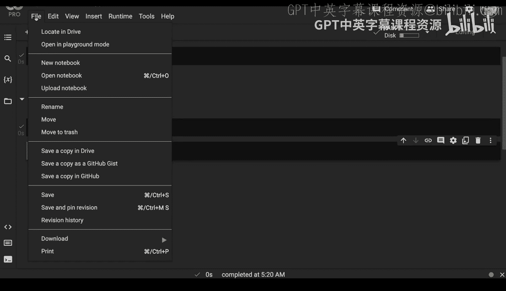

That I just created。And I'm going to check it into there， so we'll go ahead and say GiHub。Here we go。

And we say functions。Here I'm going to try to find the one that I just built functions from zero。

 So we need to find a repo here called functions from zero。That I just created。And I'll check it in。

And。

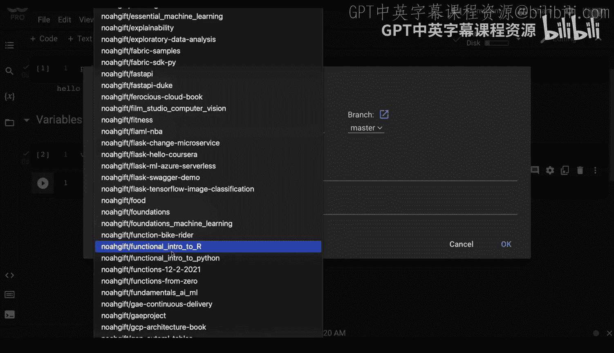

Functions from zero， there we go。And I might as well just show you this round trip because it is kind of a neat little round trip is that。

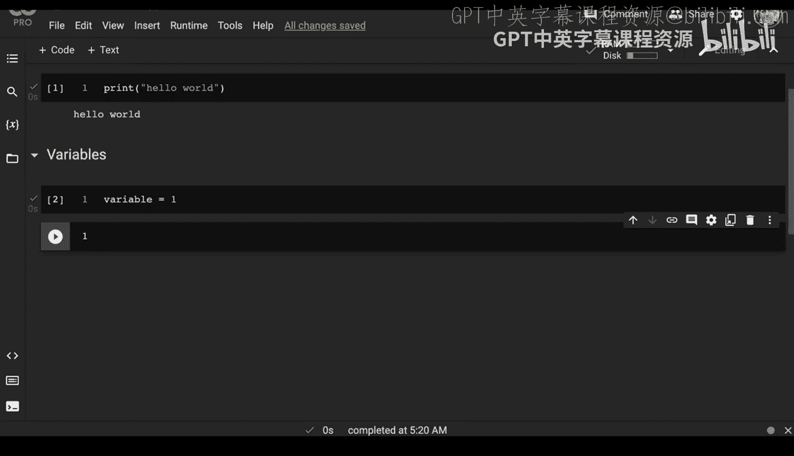

Oncece。Once you check that in， then you at home can actually go through and play around with us。

 so I'll go ahead and put this into a chat。So you can get access to it。Here we go。And。Perfect。

There we go so essentially what's really nice about this feedback loop at the very beginning here is that you can。

 first of all， visually look at what I wrote， but you also can just click this button and if you have access to the coabB environment boom we're back and so you can play around with your own version of this and keep notes so in my opinion again。

 one of the most valuable way to learn Python so we're back here， I'm going to connect back again。

 you saw the feedback loop。

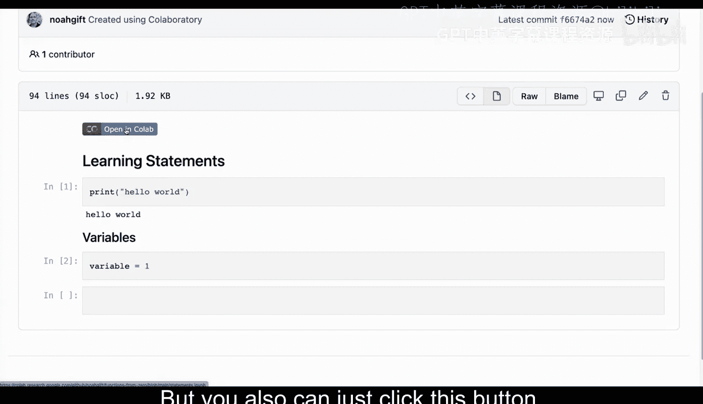

So what is the point of a variable here， why aret we doing this Well really the idea here is that you need to store things so that you can loop over them or you know keep status of some data you pull from a database or whatever it is you want to do something with you need to keep it somewhere。

 that's what a variable is used for a good example would be the classic kind of math problem right if I wanted to。

Go through here and do a x is equal to one。And then。诶。

Go ahead and put a statement below here and sayY is equal to two。Like this。

I could then use those two things together and do a math problem， right I could say x plus Y。

And we could see what happens3， right， one and 2 is equal to three。 So that's really it。 I mean。

 it's just a place to store things。 So what are what are the components of building building logic out in Python first got to be able to write a statement second。

 you got to be able to do some variables here。 Now what else what else can we do Well the next thing that I would do is we need to be able to store things other than just a variable。

 We need like a more sophisticated container。 And so you could think of maybe a variable in a way like you go to the grocery store and you don't use a cart or a basket you just walk in。

 grab some， you know I don't know some apples and then go go through。 you can only store so much。

 you need to have some kind of a container in order to to carry other things。

 So in this example what I'm gonna do is I'm gonna to build one more。

And we'll call this data structures， and these are the things that we need to use in Python。

So that we can actually store more than just one thing and so a list would be the first thing that I would start with and a list the way it works is。

 we could call this my list is it just holds a sequence of things so I could put in here one， two。

 three。And then once I've got this in the list， I can do things with this list like， for example。

 say zero。There we go， my list and I can say I want to grab the first thing in the list in Python。

 the lists are ordered from zero to each incremental number。

 and so if I wanted to grab the next thing in the list。

 I would go through here and I would say my list。And I would grab the next thing。

 and you can see that now that grabbed number two。And then if I go through and I say my list and I can actually tab complete that's one of the nice things about this coab environment。

 we can go through here and we can say， okay let's grab the last thing and the list right so it's nice because it allows me again just like a basket in a supermarket。

 I can put more stuff in there you know and kind of pull it out and you know change things around I think it's a very similar concept so let's even add a little note there。

Underneath here， and we can say。Ls。So that gives us something useful。

 one thing I'll point out to about this thing that I'm building for you is if we go to this tab in the left notice it builds a nice hierarchy so this is a great way for you to learn is again in my opinion you create a hierarchy inside of a notebook like this and then you keep your own personal study notes and so again I'll just be nice here。

 save a little checkpoint for you and so you can see a copy of it as I'm building it。

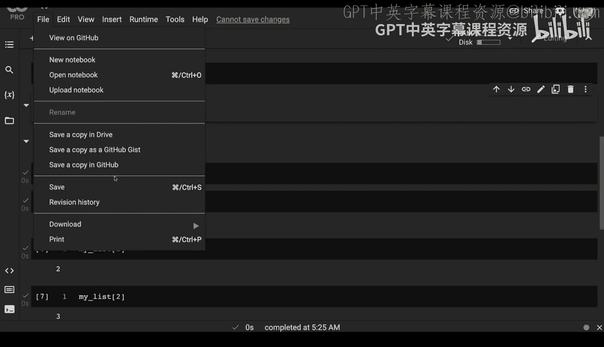

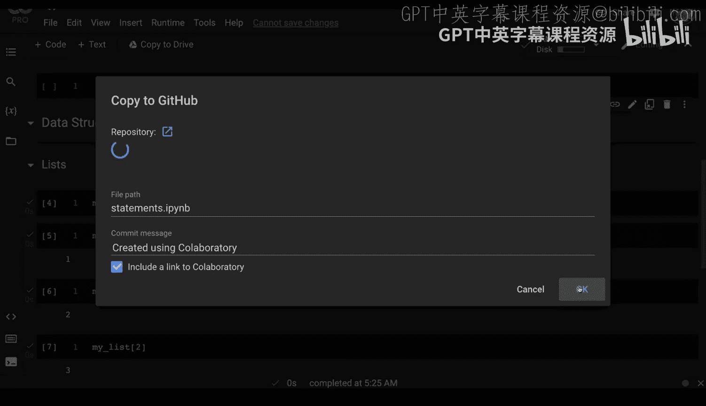

We'll wait for this thing， there we go functions from zero， I remembered it， that's nice。

It went through and made a copy so we got lists here， okay， well that's nice。

 but what else can we do Well we also have data structures called dictionaries in Python。

 let's go ahead and create that。So I'll go through here。

Create a dictionary and dictionaries are a little more sophisticated and I would say probably the most common form of a data structure in Python because they're so flexible。

A list you only put things into it and pull them out in a dictionary you can do key value exchanges so how would you create a dictionary so we'll go ahead and we'll say my diict right here and I'll go ahead and put this inside and we'll say one。

And we can do one， right， And then if I do。Two， we can do two just like this。

And then at this point I have a dictionary， how do I know it's a dictionary。

 one thing you can do in Python that's really helpful is you can use the word type in this case if I do type like this。

 I do my diict。Notice it tells me that it's a dictionary。

 so same thing if I go up here and I want to look at what the type is for a list。

 I would just go through here and say my my list just like that。There we go。 And we can see it。

 we can see at the list。 Now， what can you do with the dictionary。 Why is it so， so interesting。

 Well， the key components of a dictionary is you have a key and you have a value。 So in this case。

 we'll go through here and we'll say my di。Dot keys， just like this。

And now you can see I have a one and a two right inside of there， which are the two keys。

 and if I have values， if I say my diict dot values，Let we go through here。

 we can see there's a one and a two as a value so we've got a lot of ways to access the dictionary。

 the keys and values is one way another way that a commonly people will do is they'll also loop over a dictionary you also can loop over a list as well so let's go ahead and do that next let's start to pull stuff out programmatically and I'm going to build a loop so go through here。

And we'll say okay let's build some loops and really a loop is a control structure so once you start to get up and you go through you building out these data structures。

 the most common thing is okay well what do I do I need to start pullinging stuff out so you need some kind of control flow and this particular example here what we can do is we can just say for key value。

 that's like kind of a common way of of putting a loop variable or you could do key value like this doesn't matter how you do it and you say in。

My dicks。Dot items。You can then pull those out one by one。

 and so in this case we can go through here and we can say print。

This is my key Now I'm going to show you what I would consider the best way to do print statements when you have a value you want to put in and display and Python。

 they have something called F strings and all this means is that can if you put an F at the beginning。

You can actually put a variable inside and it'll just print it out and so it's a great way to print things out and Python this is my key。

And then I can put a statement below， and we can say。If。This is my value。Like that。え。

And we go through here and we say value perfect。And there we go。

 we can see that we're able to loop through， pull the first thing out。The first key。

 and I'll put the value of that key， the second key。

And then go through and and print that out now you can do the same thing as well with the list we had so if we go back up here we can also loop over list and remember we have the My list a very simple list but we can we can do that as well so we can say four values。

Or we could say four items make the loop variable different。In my list。We can just say print。

This is the value。In the list。And。We can go ahead and put this as a loop variable。

 items just like that。Really， so this is， I would say。I'm a fan of minimalism。

 so what's the smallest possible？Thing to know in order to be。You know。

 competent at something or at least get started with something。

 and I would say with Python this is this would be。

Pretty close I mean there may be a couple things missing， but if you know how to print things out。

 you know how to make a variable and you know how to create a list and a dictionary and loop。

 you can do a lot you can potentially start really learning Python very quickly and this is what I would recommend when you're getting started with Python is to master these things so。

Now that we've got these statements though， couldn' we do a little bit more with them。

 so I think the next thing that I'm going to do is'm going to shift here。

 I'm going to push this into our repo here， we'll say save a copy and GitHub so other people can get access to it。

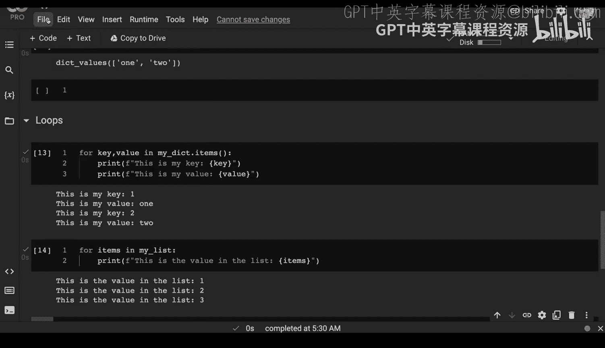

And then I'm going to toggle to writing statements in a more of a programmer type environment。

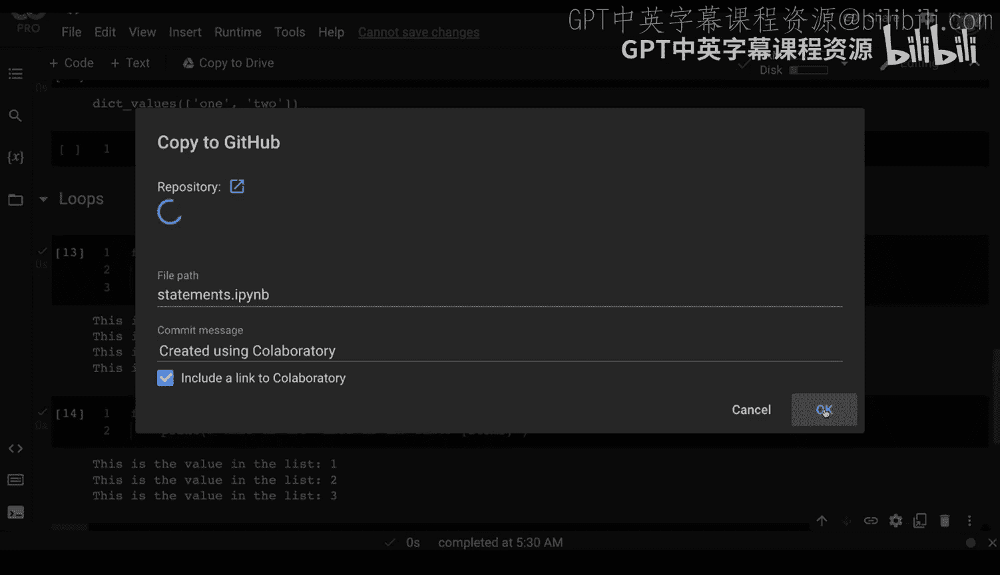

Kind of a good academic environment， and I use it all the time myself to build things。

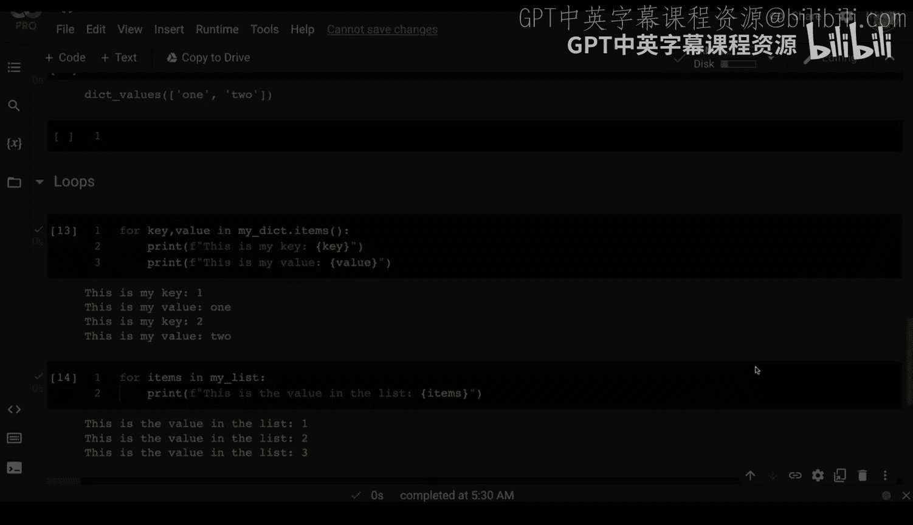

But a lot of times when you're building code out you want to actually write statements so you can write a script and so the next logical thing to do would be okay let let's actually learn a little bit about how to structure a software engineering project from zero。

 so the first thing that I would say would be we need to get some kind of development environment and so what you could do is if you have access to GiHub code spaces would be this is what I'm gonna to do I'm going go ahead and launch GithHub code spaces。

 you could also launch visual studio you could check this out into a cloud environment。

 There's tons of different ways to write code just for ease of use for me personally because I'm in a browserbased environment I'm going launch a Github code spaces。

It should work very similar though in any cloud based development environment or even your local desktop。

I'm going to go through here， I'm going to find my code spaces。

I use these so much that a lot of times will need to delete one of my old code spaces so I can launch a new one。

Okay， I'm going to go ahead here。Share this this environment for you， so give give me a second。Okay。

 here we go， so got we've got this Github repo back here， I'm going to click on this code button。

And I'm going to say new GiHub code spaces。 I don't know that。I'm going to go new GitHub code spaces。

 here we go。And let's let this thing build out。There we go。So when you first launch。Getub codespaces。

 you get this kind of environment and so in a way it's kind of equivalent to the coabab environment。

 but it's a little more software engineering focus and the reason I want to show you this is that it is nice for starting to think about things in a software development way I'm going to change the color theme here real quick to Vi Studio mode so we can get it darker and then I'm going to go over to this section here and say terminal and say new terminal。

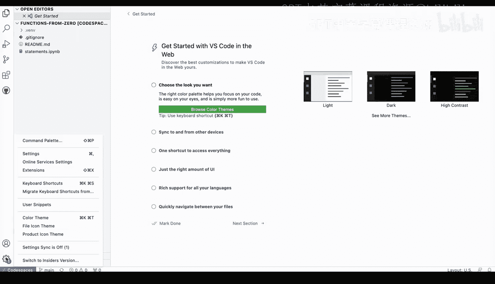

So the first thing to be aware of， and I'll make this a little bit bigger， there we go。Is that。

What I would recommend is that。We'll go ahead and close this。Delete this here。

 what I would recommend。Is when you first get started with a project is to create a scaffold so that you're able to have some structure for making sure your code works and this is I think sometimes easy to lose sight of when you're first learning to program。

But ultimately as you get more and more sophisticated as a programmer。

 it's important to be able to reproduce your code and share it with other people and then you yourself。

 if you come back to something you're able to actually test your code out and so what we're going to do here first is I'm just going to write aHo world inside of your let's just keep things really simple and so I can use the command touch which is this command touch。

 and I can type inHo。pyY。And that's a way of just making an empty file in Python。

 You could go through here and say file， new file， but I find it easier to just use the word touch。

 If I go to that file now， we can use some of those things that we just talked about。 In fact。

 we can just build a hollow world Python script。 Let's go ahead and do it。

 Let's just put in a print statement right here。And will'll just say， hello world。

There we go and so this would be the difference between the Jupiter s coab environment and this is that I'm doing statements again。

 but I'm running those statements as a script which is what programmers do so how would you execute this hello。

 Py just go through here just go ahead and say Python hello。Return， we see howo world。

It's actually very straightforward to build out a hello world script in Python。

 Now what if we wanted to implement all of the things that we we did earlier。

 well that's pretty easy as well let's go ahead and do that so I'm going to build one more script and we'll call this。

My statements， so we'll go ahead and say touch and we'll say。My statements。Here。That Py。

So we've got on my statements file and then let's go ahead and just make it a little more complicated。

 let's put a list in here so we'll say my list。And we'll just put'll put some different things in this list。

 let's not be boring， let's put fruit in their apple， cherry。And maybe like。A lemon， there we go。

 apple cherry lemon。And then I also could a dictionary， and we could say my dictionary。

And maybe we can put in something else like drinks， we can say coffee， I'm sorry， in my dictionary。

 we'll do an actual dictionary， we'll say。A drink。And we'll say coffee。And we'll say。呃。Milk。

And we can say。Whole milk。 there we go。 We have， we have a couple couple different things here。

 and then I could I could do what I did earlier， right I could。

 I could start to use these things and I could say。For item。In my list。Right here。My list。

And I I can loop through this， and I can say。Something like with an S string and I can go my favorite。

Thing to eat is， and then I can put in。An item inside of here so what I would recommend when you're starting to build out a program and you're putting them into scripts like this is to maybe first start with just a little bit before you get to advance with it and just test it out so we can do this we can test it out we can just type in Python my statements and say my favorite thing to eat is Apple right okay that's good enough I mean the grammar is a little rough but it looks pretty good pretty good。

And then， I could say。Something like， you know。For。The key value in my diict here。

You could do something like this， you could say。My。Favourite。Thing to drink。Is。

And then we don't necessarily have to use the key and the value。

 one of the things that you can do in Python is that you can actually throw away the part you don't need in the loop variable so I can just do this。

 I can put an underscore like that and what's nice about it as it says。

 look I don't need the key part of this I can just do the value only and I'll just go ahead and put this variable inside and we can go through here and say。

呃。Value right there。 Okay， and then we can run it again。 and let's go ahead and say Python。

 my statements。 Oh oh， we have。A problem because I didn't do dot items。 So that's again。

 what's nice about the the iterative style developing is you can see the problems as they develop here。

 which is kind of similar to the collab notebook， we can see items。Go through here， and。

There we go we have my favorite thing to eat is apple cherry lemon。

 my favorite thing to drink is coffee whole so so we got something that's working here so this would really be I would say the basics of building a script。

 but there's a few things to be aware of that。I've glossed over。

 and I think the first thing would be that we don't have a way of testing our code。

As a software engineer with test their code and so my recommendation would be we need to to build out a structure to catch bugs before they happen。

 So here's here's a really easy bug that happens a lot and that we can catch if we build out a project structure。

 So if I wanted to。Go through here and say， for example， my diict。Is equal to my diict。Like this。

What does that mean it doesn't it's actually I'm taking something I already did and I'm making making a copy of it and assigning it to a self not really useful right there's no there's no reason to do this。

But syntactically it would work。But it could potentially cause a problem in the future so this would be like a syntax bug I also could create a bug like this where I could go and I could say my list equals and I could just kind of or my list two or something like this and I could just forget to fill it out and now look what happens。

It just blows up， right， invalid syntax。 So in both of these scenarios。

These potentially could be issues， I'll comment them out。

That it would be great if we could check them automatically as you start to build more sophisticated systems。

 these things start to become an issue right and so what we can do in this particular scenario。

Is build out a structure that can catch these kinds of things so the first thing that I'll do is I'm going to check this code in so that you have access to it。

 we'll go here and say git so I'm going to go back into this terminal here and we'll say git add star now what's nice about the git ignore file when you're creating a project is that this ignores things that you don't want to push into a Python project。

And what's great about it is that I can now do Git add star and what this means is it'll just take everything in my project and add it。

 which is really convenient。And now if I type in Git status。It'll show me that， oh great。

 the two files that I wrote， they're going to be here for me。

 I can go ahead and push them in and so I can just do a commit message we'll go git commit。

 adding files to repo like this， I can then do git。Push， there we go。

And now that I've got that pushed I could go back to the repo and take a look at it and kind of toggle back and forth and fact let's do that I'm gonna to go here I'm going to say go to your repository let's take a look at it there we go you can see there's my hello I've got that statement I've got my statement here right and I still even have the Jupyter notebook file or the coLb notebook file that I created earlier so we're building all kinds of great stuff and if I want to open it back up again I can go here and I can toggle back to this。

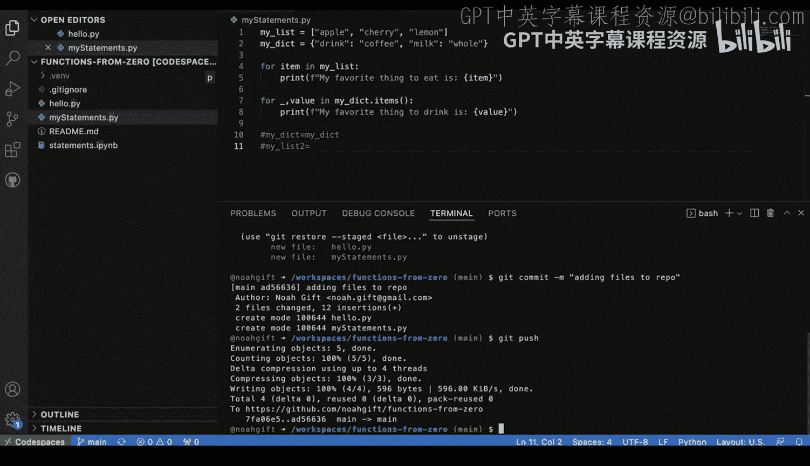

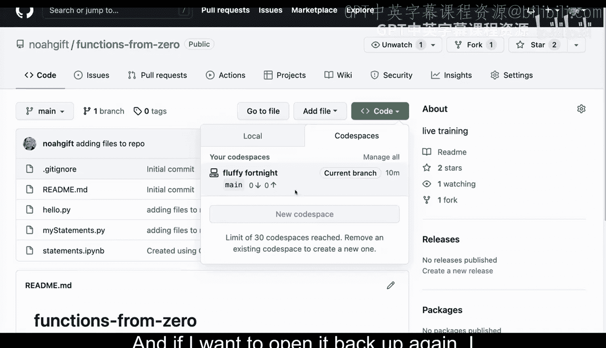

So we're making lots of great progress， but as I mentioned before one of the issues with building a project outside of just learning Python is that if you want it to be reproducible it's an important thing to create a structure that allows your code to be easily testable so that you can do things like essentially DevOs and what DevOs is is it's the process of continuously improving your code and continuously taking that code and pushing it into production。

 like if you're building a backend web service or a machine learning application so in order for us to do this we need to slowly build out a little bit of structure in a project。

 I call this the Python a scaffolding and really the three files that you need when you get started would be make fileile and a test file and a requirements file so I'm going to go ahead and build these out real quick so that we can。

We can have testing in our project， I'll create this make file so I'll say touch make fileile one thing to note is that make files only work on Linux or Mac systems。

 that's again why I would recommend people use like a web based development environment if possible because it does solve a lot of problems。

If I go through here， and I say。you know touch make file。

 we've got that this is this is where I would run commands that will be helpful later we as we build things out。

 the other thing that would build would be a requirements file so we can go through here。

And do requirements。txt。And then the other thing that I can build is some kind of a test file。

 So I'll go ahead and I'll say test and list you。Test hello that would be a good one to build out Okay great we've got those three files that's pretty much all I would need in order to build something out。

 The other thing that I typically will do is if I have some stuff from another project I'll typically use that as a way to get started and so I'm in another browser window。

I'm going to grab something that I have from another project and just paste it into this to just move move things along so this make file here。

Lially， I could cut and paste this for every project that I work on， but the idea here would be。

Any software I need to install like libraries like if I wanted to write a web service。

 which we'll do later today， or if I want to install the Linting software or testing software or a machine learning framework or whatever it is I need to do I would do this install。

 I just type in make install and if I want to test my code I would type in make test and it runs a command that's annoying to type out and if I want to format my code。

 I can use this formatting tool and if I want to Li my code， I can do a Li command right here。

So what's nice about this？Is that。All I need to do in fact， if we want to be really fancy here。

 we could say any Python file， let's go in and Li it and that's it， that's pretty good setup here。

 the other thing that I'm going to need to do is build out a requirements file。

And so I'm going to go ahead and grab a few files。Or import statements that I typically would use。

Would be or packages， pilott， P test and black， that's a formatting tool。Once I've got this set up。

 I can just type in make install。 And so we'll go through here， and we'll type in make install。

And this will。Give us an installation。Which will allow us to link our code and test our code。Okay。

 great。 We've got this。 We've got this working here。 So notice that。What I say here is I say Python。

Disable two warnings that are are these are recommended warnings and configuration warnings。

 I just want to look at errors and standard warnings with Pyland and that's what this command does。

What I'm going to do is just type in make Li and this will check all of our Python files right because we have two and says oh great。

 they're all perfect， which is which is great， but let's go ahead and。Let's uncom this， right。

 which I talked about earlier would be something that if you're a beginner to Python would be easy to make a mistake like this。

 well how does Pythint help us well， if I run Make Li again？Aha， look what it tells us it says。

Listen， you're not supposed to do this。 You're assigning the same variable to itself。

's that's something I would not recommend that you do。

 And so this is a great way to essentially become a better developer in the instant that you start developing code is just do Linting into your code and so now I can just fix it。

 Now also it can check as well， it can check actual bugs in your code So if we go through here and we type in make Li。

😊，Look， it also said look， you can't do that。 That's invalid syntax right So it really is helpful。

 I would say all professional software engineers that I know use some kind of Linting with with with their projects It's just going make you more productive。

 And so a lot of times when you're learning Python。

 it's easy to get overwhelmed because you feel like you're the only one that's struggling。

 but the problem often is you're just not using the right tools。

 The Linting just makes things a lot easier for you。

 So you don't have to constantly be doing extra work。

 And that's really one of the things I think that's。

An important thing to consider sometimes when you feel like you're struggling or you're barely above water。

 it's because you're not using the right tools that the experts are using in this case this would be one of those tools。

 The other thing we can do is we can also test logic in our code so let's go ahead and change this hollow world and make it a little bit more tricky。

 not too much， but let's just make let's make a function which we'll get into after we take a break but just for getting started here。

I'm going to build a function here and I'll explain it after we go on a break。

 but I'm going to add two numbers together。Right here。

 there we go and if I go through here and I print。X。I print add and we do two and two like this。

We can just run this， make sure it works。There we go this print for so how would I test the logic of this。

 all I would need to do is go to this test file here and say from my from hello。

Import add and this testing library allows us to actually programmatically execute the code。

 so we also can test that the logic works because the linting will only check the syntax this will check that the logic works on our code and so I would just go through here and would say death test。

Add。And we just say assert that2 is equal to， this is the a quality operator is equal to add one and one。

And does that work， how would we know well we can go to our make file and we can just say make test and it look it says right here。

 test hello。So let's go ahead and do this， we'll say make test。It says a O。

We have some kind of a problem here， so what？I don't know what that is。 that must be。

Some kind of testing module error。Maybe we don't care about pilotland then we can skip the pilotland for now I've never seen that error before there's some kind of installation error but the syntax that's important to know about is and I'll just comment it out we'll just do that we'll just say for now we won't run the pilot。

 but basically the idea here is that you also need to test the logic of your project once I've got all that together。

All I need to do to share this project with somebody else is I just had to type in make call just like this。

And we see make call。And it goes through， it pulls the packages down。

 We do the lint and we do the test， and then we're good to go。

 And so now I'm going to go ahead and say get status and say get add。Store。

And we'll go ahead and commit this code， adding code to repo。

And so it is nice right that you you can always come back like maybe a month later。

 you're working on a project and you want to make sure that it works。

 you just go through here and you just say make all right and it installs the libraries that L it that is very helpful it really is a time saver and as I'm teaching people to program that's one of the most common things I find is that people are working way too hard and they don't have some kind of a test system like like this and once you have this setup I would say you're gonna be 10 times more productive Now we're not fully utilizing all of the power though of testing and so what I'm gonna to do the last thing I'll do before I take a break is I'm going to show you how if we go back to Github we can。

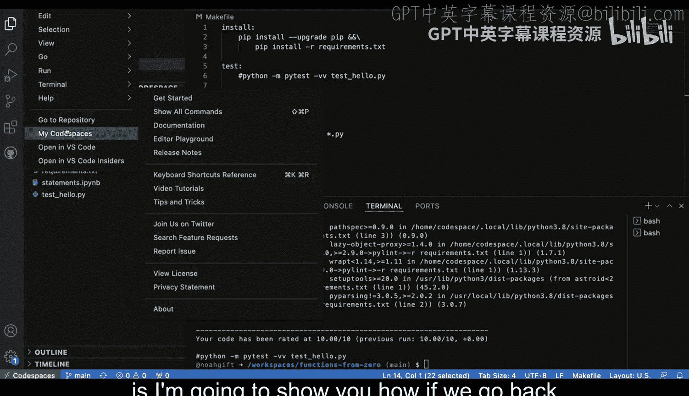

Get even more power for our project to help us by using a continuous integration server。

GitHub has one called actions I'm going to go ahead and click on actions and you can see here it's a very popular service。

 you can do all kinds of really sophisticated things with it like deploy applications and do security analysis and all kinds of really neat things we're not going to do anything complicated we're going to do something very simple which is we're going to just create a basic configuration file here that that does the same thing I was doing locally' that's all that we're going to do so。

I'm going to go back here。And I'm going to grab a previous one that I'd already set up just to go quickly and I'm going to put this into。

Our project， so let's go here and go ahead and do this and say start commit。And now what that does。

By initially kind of triggering this is that it will tell the GitHub's action system to go through and build out an initial build of our project and we can watch it run so it's going to do everything I did locally right it's going to say installation。

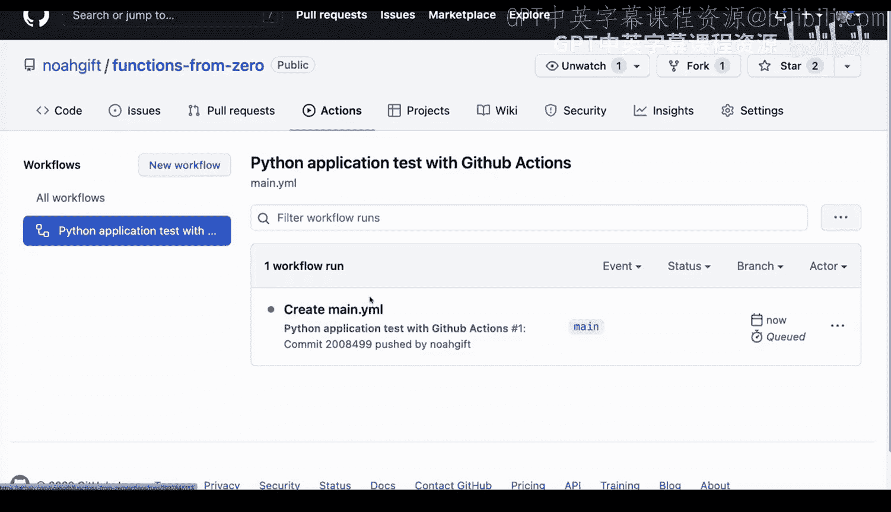

It's going to go lint。And there we go， we have a perfect build and I can click on this three。Icon。

 I think it's called a hamburger menu， click on this thing， say create status badge， copy it。

 and then I can put it into our project and then now。

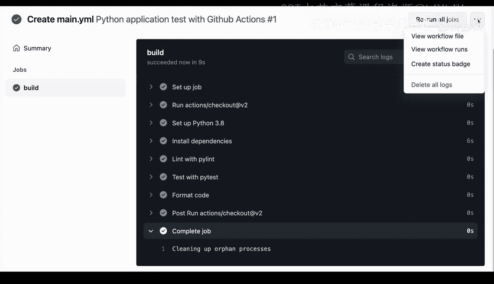

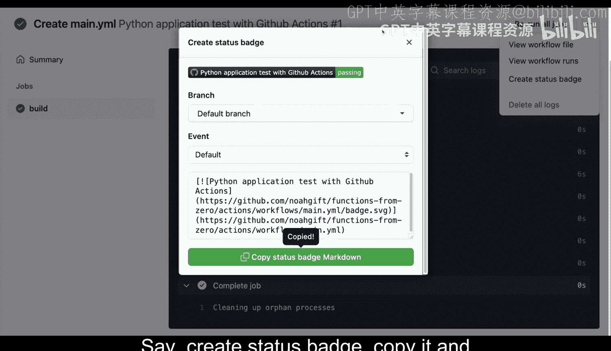

We have。The ability。2u。Know that our project works That's it So this is a great kind of checkpoint here for this because I can now share this with other people on my team or somebody at university that I'm studying with or whatever we know our project works you can clone it this concept the reason why it's so important is that every time I make changes now it'll programmatically run so let's just show this real quick。

 if I wanted to go through here and and let say I can even edit it from right here。

 let's say I break this let's say I go through here。And I don't know， I add like。

At the bottom Rar equals， like I just make some bad code。 let's see what's going to happen。

Is our system here， our little robot will run it again because we made a change and it will fail because the li won't work。

 The li won't work because。

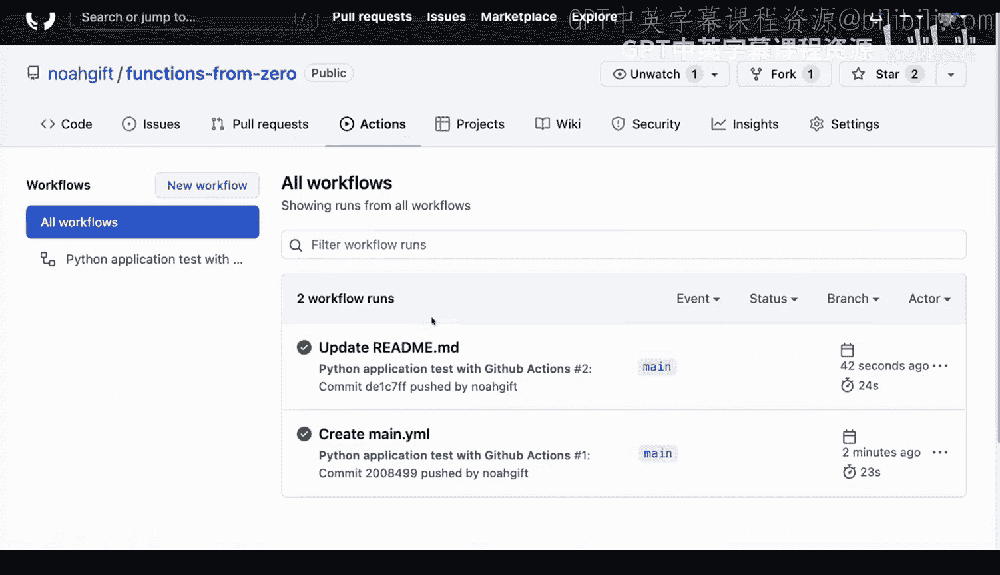

That is invalid code， so the syntax itself just will fail。AndHere we go。

 we installed the dependencies。Aha， there we go， Lintting does not work。Right here， module hello。

There we go cannot import hello right so this is the great part of setting up continuous integration。

 especially again if you're a beginner， it seems like you don't need this if you're starting to build code。

 but as an expert I would say you do need this because it'll make it so much easier for you going forward now to fix it pretty easy for us to fix we just go back to hello and and we fix this we just comment this out。

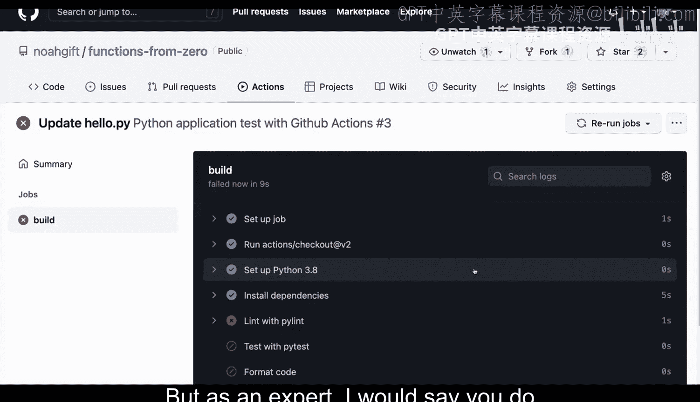

And let's go ahead in。And build this code and watch it run。

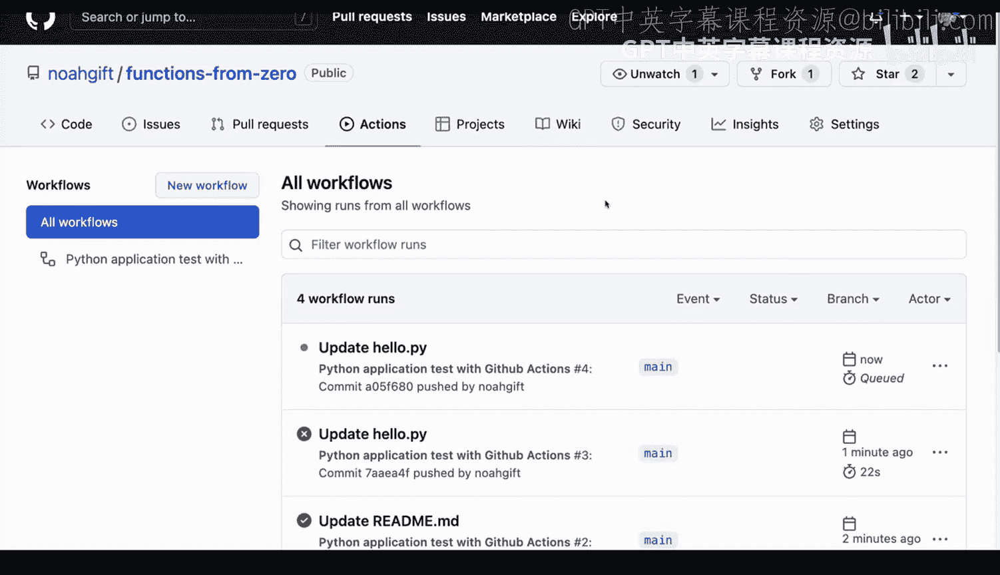

And we go here。And we see that now it should be able to pass。Install depend penencies， Lint it。Great。

 everything， everything works。So this is a great checkpoint， I think to you。

 if in a little bit under an hour， what I would recommend， someone learning Python knows。

 know a little bit about notebook， know a little bit about a project structure。

 build out some kind of a continuous integration environment。

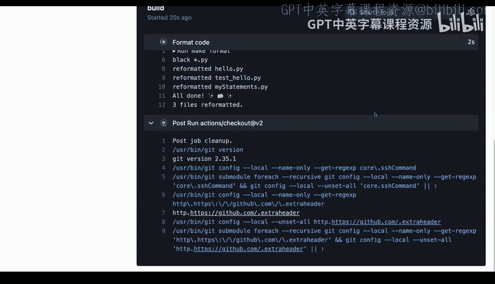

And again it seems like it's why did I have to set up the stuff。

 you know it's extra files and all this， but basically what we're doing is we're investing in the future。

 it's like a retirement account， we're putting money away now that will benefit us for the rest of our project and this is really the reason for setting this up so the idea with a function。

Is that it's a building block right and so you can think of this as really the center of a lot of things in Python and once you understand functions。

 really the sky's the limit， you can go through and you can do cloud computing is pretty easy。

 with a function， you can also do pandas， because pandas you can actually write a function to manipulate the whole data structure and pandas and every single row。

 you could do some kind of operation to it， you can also do command and tools which will get into in a little bit。

 you can also do web services。And you can also do GPU programming so really a function once you know a function。

You're effectively able to do pretty much anything you want and the other thing to be aware of with functions is that in many cases they're optimal versus object oriented programming。

 object oriented programming works great for GoUI， so when I'm doing Swt development for example。

 where objective C or something like that， I would like to use the object oriented capabilities to do a lot of code reuse。

 but if I'm going to build maybe webbased things， functional programming often。

Is really the best strategy， so that's something to consider。

When you're when you're when you're using functions is that it really is the building block for a lot of things。

 so lets let's dive into that and start to use some functions and then start to turn them into different things so I'm going to go back to this repo。

And launch our codespace again。Here and。Click on this。The reason I like Codespace。

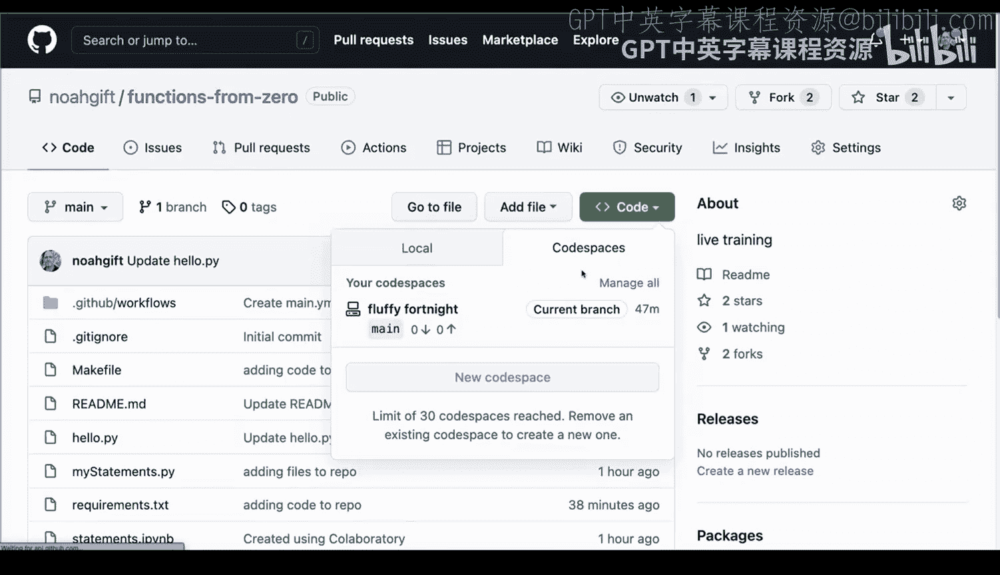

Is that it's very convenient if you work a lot with GitHub， but as we mentioned earlier。

 there's lots of these kind of cloud based development environments。

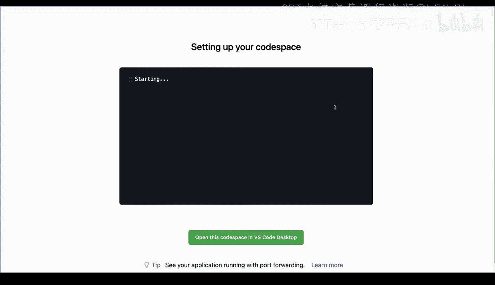

Okay， so。To start with here， I'm going to go through here and go back， have a terminal down here。Now。

 one thing that we haven't done yet。That often is a good idea， is that。

Is that I like to use a Python virtual environment。Because it does protect me from weird。

Arrors like that error that I had with Pyin or Py test。

 I'm pretty sure it's because I didn't have a virtual environment of Python。

 So I'm going to go ahead and set this up。 So the way you would do that。

As you could type in virtual E V or Python3 MV E V。

 they both you know depend on what platform will work and then I do this。

 I do dot V E and V I like to put it，In my home directory and the idea like why would I care about this is that I can actually have all my packages in a certain directory and I don't have to worry about what was globally installed on my system。

 it can cause very subtle weird errors so let's go through here。And do this。AndAnd I can say source。

t V E and V and activate just like that。And once I have this。

 notice that watch if I type in pylin or I type they may work。

 but it basically allows me to separately install just inside of this repository now what I typically do as well。

Is that I will， I say which Python， I like to check and double check that， oh okay， good。

 it's this python that's inside of the virtual environment。

 so it basically separates everything into this particular directory。

And then the other thing I do is I take this command and I put it inside of my。Bash our C file。

So I go through here and I go to。Bashhar sea。And I drop in inside。And we say createate。啊。

Virtual or source virtual environments。 and so now every time。

Source virtually in V every time I use this， I don't have to worry about it。

Any shell that I open in this environment will work， so let's go in and try that out。

 So if I open up a new shell here。Look， this is sourced and I don't have to worry about it。

 always kind of a good idea。To， in my opinion， to do that。 So I'm going to close that shell。

 Now I'm going to do make install again。And let's see if that fixes our pie test problem。

 I think it will， so it'll upgrade our。Python package installation tool。Install some libraries。

And let's see if does P test work， if I run it， it looks like it does。 Let's see if I unment this。

 if this works。Now if I type in make tests。There we go。

 So that was the problem right so if you don't use Pyin， you get these very weird。

Subtttle problems that that crop up。 and so I'm going to go ahead and add that change。Get status。

Get add。Make file。And we'll say adding testing。 Now we got testing and we're ready to build out functions。

 So to。I'll do a get pulled to get those upstream changes。Which I just anytime with gett。

 I just tell it'll tell me a message， I just， I just put what they tell me in， I pull this。

We can merge it。There we go， and now I can do a gi push。嗯。So let's go into a function here Now next。

 I think the best place to build a function out to start with here would be to kind of analyze this function here。

 Now， notice with a function that it has the syntax of de right here， and it has the the word。

 which is the name of the function and it has the parameters that go in in this case would be X and a Y and it has a return statement。

 So really there there is。The structure of a function is typically that style。You have the syntax。

 you have the name of the function， you have the inputs and you have a return statement now you don't have to do that though you can write functions that basically don't return things。

 you can write functions that don't accept things and there are different styles of that and so it's probably worth you know talking about that a little bit and showing you that and I guess what I could do is I could go back。

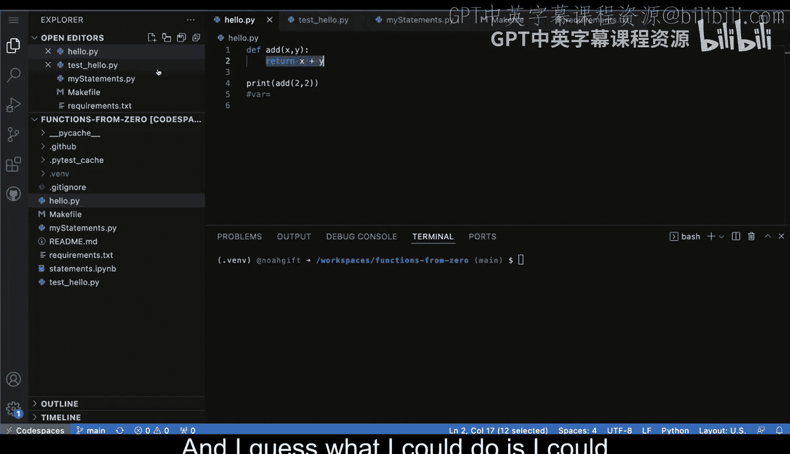

To collab real quick。And show you that in that same notebook。

Go ahead and just toggle out of here for a second， we'll come back to this and just go to the Coab notebook that I was working on。

Or actually， what we could do is just make a new one。 That's probably even better。

 Let's just make a new a new notebook and this one will call functions。

 So I'll go ahead and say file new。

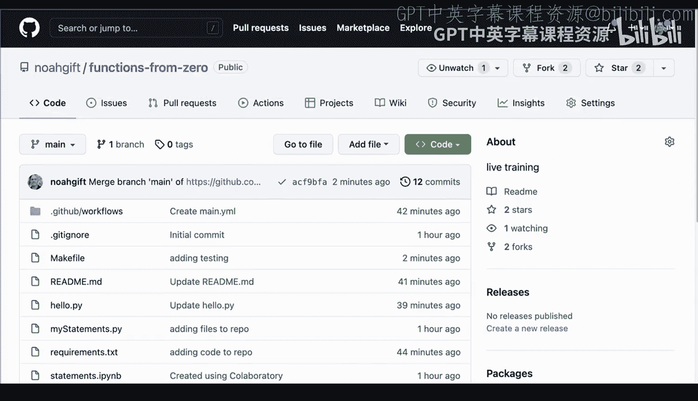

Notebook。And paste this in so you can see it。There we go。And we'll call this one functions。

And just a few key things here to be aware of， first I'll get it hooked into GitHub so we'll keep track of it。

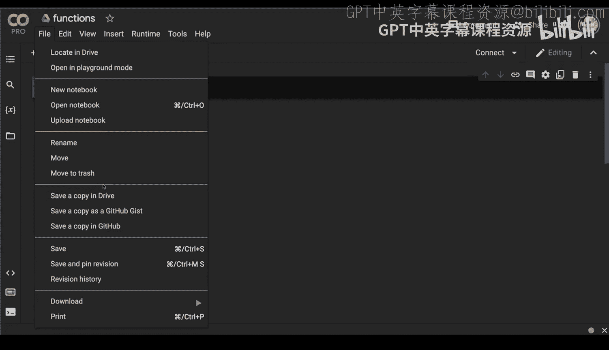

And this is repo as function from zero。Okay。Functions from 0。 There we go。

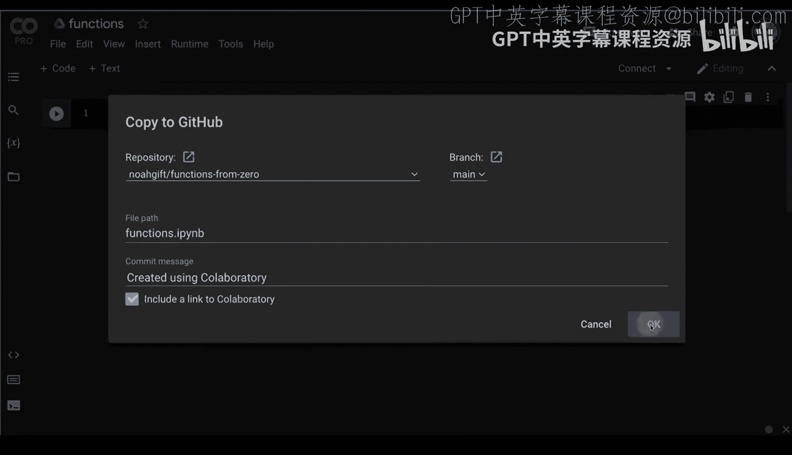

And。That's been checked in。And then I'm going to do the same thing。

 I'm going to just go through here and。Let's open this up， make sure I've got everything。Okay。

 raw set。 it's all'll tee that。 I'll go ahead and put a text block in and we'll just say the the。

Styles， styles of functions。So the styles here for functions would be you could just do the simplest function possible。

 which would be deaf， simple。And you do pass that's that's the most simple function possible turns out it does nothing right all this does is just it's it's an inline function here that does absolutely nothing to make it a little bit like slightly more complex we can do。

呃。We can do simple2。And we can make another function。This one will not accept anything。

And basically it will just do something， right， and we can just say like simple。

So you also can build a function like this and then to call it。We can actually just go here。

And say simple to and to call function， you just put the parentheses around it。

And and go ahead and run it。 There you go。 So so this is not。Really doing a ton of work。

 but sometimes you do want to write a function that just has a bunch of logic and the reason for this would be。

Maybe you want to just collect a bunch of work that does certain things。

 and so the idea here would be this just is some logic and just runs。

Now the most useful kind of functions， in my opinion。

 typically are the ones that will take some value， do something and then return it back out。

 and so this would be more of like we'll call this let me make a text block here。

We'll call this like。Most useful function。This would be the style that I would recommend as you say deaf and you have my worker。

 we I'll just call a worker。It takes some kind of a value， maybe it takes the name of a fruit。

And then we put in whatever work we want to do inside of here， and you could say like。嗯。

Maybe like a statement， we could say a statement。And that's what we're going to do。

 and I could say my favorite meal。Is chicken。Plus。Chicken and， and I put in like。A fruit， right？

And we do that statement and then I could I could just return it right so I could so that's the thing that's actually doing the work。

 And then I could return back that statement。 In fact。

 I could even put it into a data structure if we want to use a dictionary， we could say like my。My。

we'll call this meals， there we go， that's a good name for it and we can say dinner。

And then we could put that inside of a dictionary like that。

And then I just go through and I return the meals， right， so this is a really good style。

 which is I put something in。I can always change the thing that goes inside this function。

 I do some work in this case it's a statement I maybe put it into a data structure in this case it would be the dictionary and then I return it back out now why is this so important This pattern is identical to the pattern if you're gonna to build a commandlan tool you're going to build a web service you're going to do machine learning all these kind of patterns you'll see them everywhere and so this is why I would say this is the most useful style So how do we use this function pretty easy to use。

I can go through here and I can say。Meal。And I can call them my worker and just put in something we'll call this apple。

There we go。And then。Now it captured that value inside of the meal。

 so all I need to do first I can see what the type is。In this particular scenario， look。

 it's a dictionary， right， because I created the dictionary here。

And then I return back the dictionary。How do I get the value and do something with it。

 I just in Jupiter at least or coab notebook。I can just type it out there we go dinner。

 my favorite meal is chicken and apple right， and then I could do whatever I needed to do with it right I could say meal。

Dots， you know， keys。Right and I could see the keys or I could do the values or whatever a lot of times what you'll do with the result of a dictionary is you probably put into a function as you put into another function right and so I could have another function that maybe would you know do some other thing with it like in fact let's do that let's go and build another function that accepts that function and we'll can say like。

You know， human， right， and this one will take the it'll take food。And then inside of here。

 we can say。Basically， we can just remember what the payload is like， so it would be this。

 I would say。嗯。You know。We can go consume is equal to。foodood。Food， dinner。Like that。

And I could say return。Consume。And so now I could say here print。嗯。啊。i。😔，Wants my meal。And then。

It will be。And then I could just basically put this all into a statement so I could。

 I could basically do。I could do this， I could put human， we'll say like my meal。Like this。

And then I could go through here and I could say。嗯。Human。And we put meal inside of there。

 and then I can just put in。The results of that into here， so we'll say my meal。Right there。 So。

 so this would be kind of the style that again， you would do as you would， you would build。

I want my meal， it will be my favorite meal as chicken and apple kind of the grammar is not perfect。

 but the style is perfect， which is that you you have a worker。It does something。

 you return back the results， you don't necessarily only do something inside。

 you want to return it so that you can pass it down to some other thing。

 which then does some other processing and then you use the results of that。

 And so that that is really the classic style to kind of build things out quickly。

 So let's go ahead and commit this。

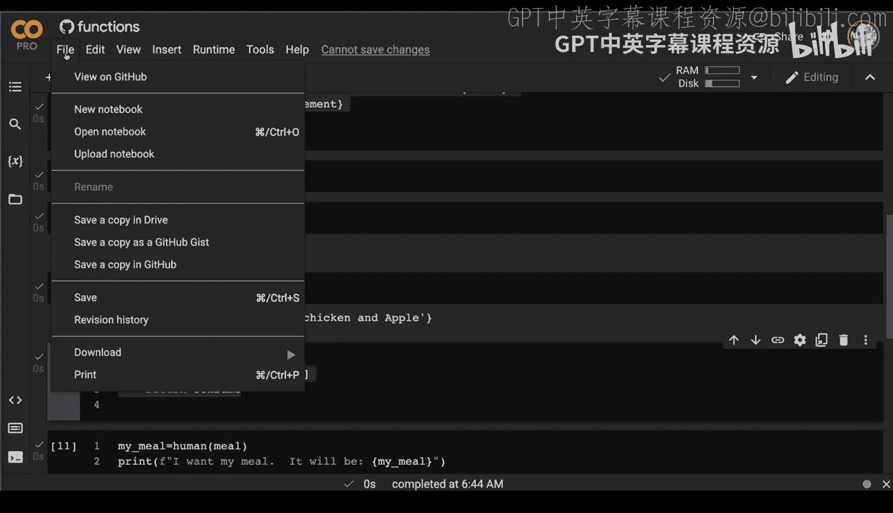

And we'll put this into GitHub。And that's really the majority of what I would recommend。

Is important to know about functions when you're first kind of learning Python and playing around it enables us。

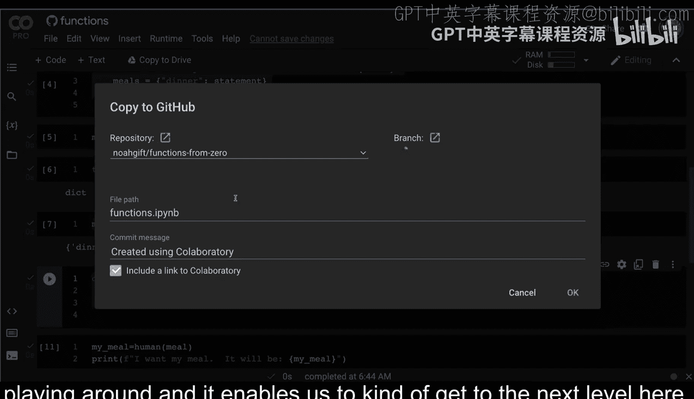

To kind of get to the next level here。Okay， we we've got this。

 I've checked it in and I can go back to。My GitHub code spaces environment here perfect。

 and I'm going to go and launch my GitHub code spaces again。

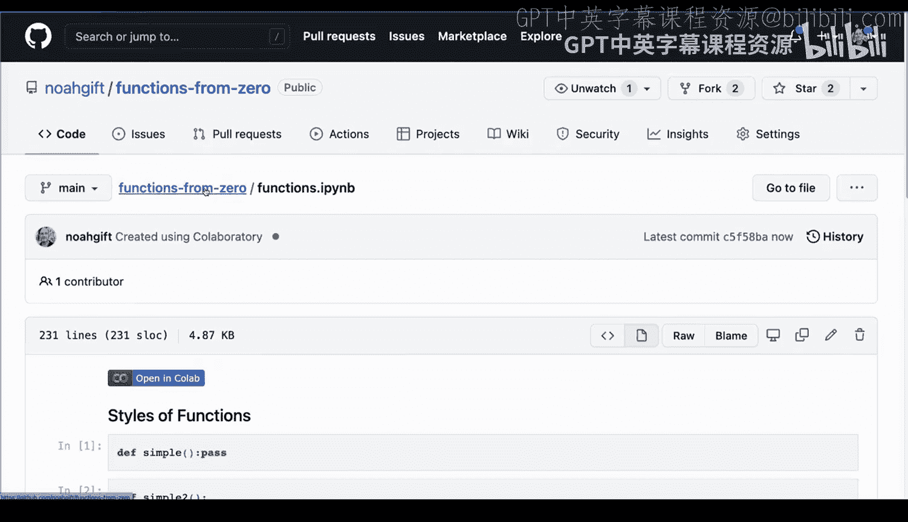

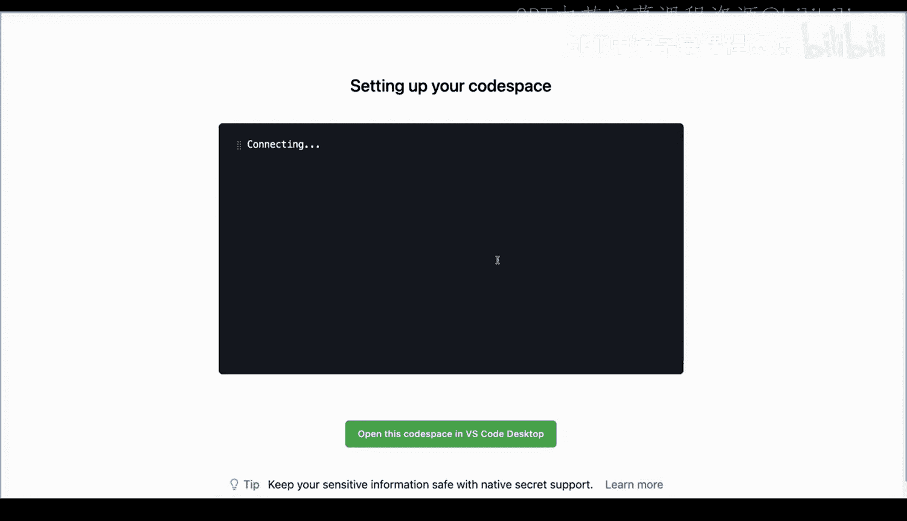

And I'm going to go through， open up a terminal， here we go。

So now that we know that we have got some logic and we can kind of do some fun things here what could we do to build out something that's a little bit more fun Well I think a good thing to build out that that would use that same style would be to process you know some text from somewhere maybe through an API and kind of combine things together。

 So what I'm going to do next here is I'm going to write a。We'll call this a。A wiki bot。Here。

And what this code is going to do is it's going to call out into Wikipedia。

 and it's going to grab a little bit of text from Wikipedia and then print it out。

 And so what would we do？ So the first thing if I was going to play around with something like this is I would first put。

It into my requirements file， the library I'm going to use， so in this case， we say Wikipedia。

Which I believe is the name of the library that I'm going to use。I can look it up though。

 make install， and this will install this Wikipedia library。Great， and now。

I go through here and I build out a wiki bot， so we'll go through here and we'll say。嗯。

ItBasically imports Wikipedia。Wikipedia。And if I remember correctly， I think it's like Wikipedia。

 actually this is a good point that I'll show you here is I like to think in a different way。

 which is the i Python Jupiter way， and so I'm going to add a library called I Python。Like this。

 And now if I do a make install。We can actually kind of think in an interactive way。

And so I'm going to play around with the code I'm going to write before I write it。

 and I do this all the time in order to interrogate an API or something like this。

 we'll go ahead and say import Wikipedia。There we go and then the next thing that I will do。

Is that I will say Wikipedia。And and I can just go， oh， look。

 I can see all the things that it can do and look it says summary。And if I do a question mark。

 I believe this will tell me what it accepts。 So it says， okay。

 you just put in the title and then how many sentences you want back。 Okay， that looks pretty good。

 So I think for。Let's grab。Somebody I've used before， I think it's Lebron James， I think is。Is no。

 let's do Google。 Let's try that。 That's an easy one。Let's do Google。Does that work？Okay。

 what about Google Lowcase， does that work？ well， let's look at。

Let's look at the Wikipedia Library real quick。If you don't know how something works， in my case。

 I don't know。I'm going to find it out， so we'll go to Wikipedia。

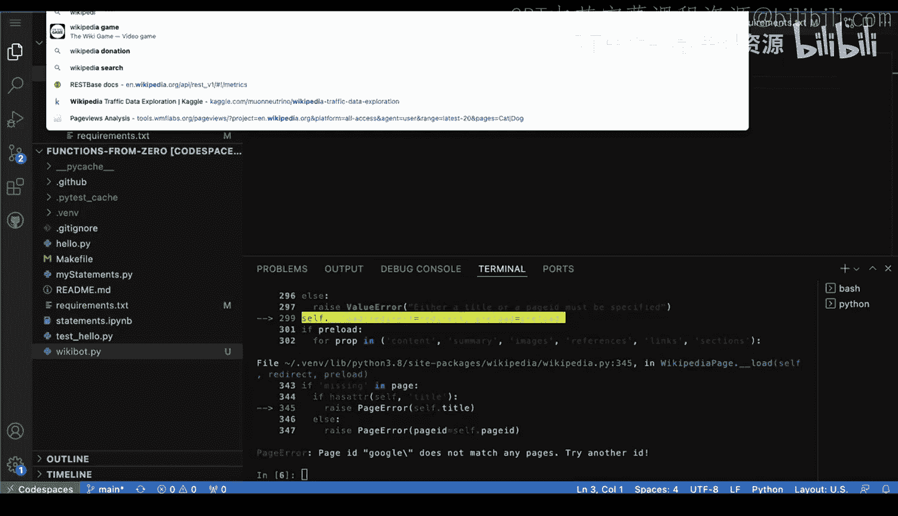

Python， I'm going to go look at the library here and see what I'm screw up。So yeah。

 I don't know why that some of the ones I was looking for didn't work out， let's do theirs let's do。

A summary of Wikipedia。That looks like a good one。嗯。Or list you。Let's do Facebook。 Let's do that one。

That looks like a good one， we'll go back here。

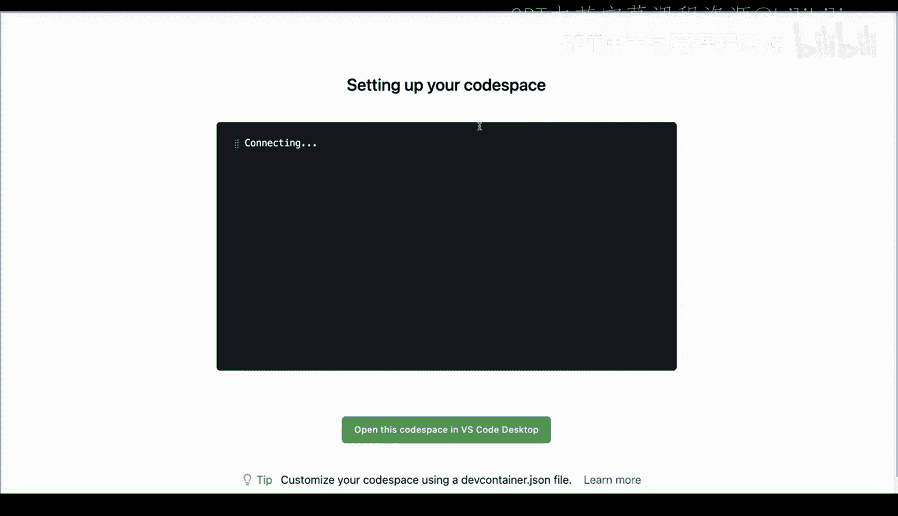

And。Let's go back to my terminal。And we'll open this thing up again。Tmin。

 I think I have one already running。 Yeah， so it's let's paste it Wikipedia summary。

 Facebook sentences one， okay， Facebook is a common web director found at some American universities okay。

 great well， I wouldn't necessarily call it that I would say it's a lot a lot different than a university page。

But let's go ahead and use it， we've got a Wikipedia summary here。

 I'm not sure why it wouldn't also use other websites。Like I guess we could say Wikipedia， Wikipedia。

Does that work？Okay， great， we have Wikipedia， Wikipedia， what about。Microsoft。Microsoft， okay。

 great， let's do Microsoft， I like Microsoft。And what we can do is just go through and just put it into into the section here and I can go back to my terminal。

 even leave that i Python window running and just test this out okay， here we go， Python Wikibot。

And now it's not going to do anything because we didn't assign the results somewhere。

 so we'll save results and then we'll save print results。Okay。

 so we're using the stuff we covered earlier。There we go and and we have a statement now this is okay。

 but it's hard coded right so it's not useful really other than a hard coded script。

 I mean if you want to write a hard coded script it's okay。

 but it's a lot more useful to write it into a function so I can do stuff with it so。

What I'm going to do is I'm going to build this into a function and we can just call this scrape。

Right here， and we can just say name， that would be our function。

 and then we just slightly restructure our code。To basically not use Microsoft anymore。

But we want to use the name。And then from here， I could， if I wanted to。

Even change this to say length。And in fact， in this particular scenario we could set a default value as well。

 that's one nice thing we could have two default values， we could actually have Microsoft。Here。

And then what's nice about this is I don't have to pass this in sentences。

 I would just type in length right here， right so we've got some good things work in here and I would just return back the result。

And now I just change this to scrape。And so what this should do is now we have a usable function here that we could build stuff off of。

 I'm going to go ahead and say Python Wikibot， oh， I need to call it that's the main thing right。

 so let's go ahead and call it。And now we've got a function that calls into Microsoft。

 So it's pretty useful now because。I don't have to always ask only for Microsoft's web page or Wikipedia results。

 I can ask for others， so if I want to go through here and I think the other one we are looking at was Facebook。

And we can go through here and we can type in。Facebook and we see that we've got Facebook in there as well。

 so it's kind of nice we have a useful。And we say Wikipedia here。

 we've got a useful function that we can build over and over again。

 There are some limitations though， to this in that。

You don't want to go into your code and just basically。

You know every time you want to make a change to it， you change your code long term。

 that's a bad strategy， but in the short term because we're going through this， it's okay。

I think the next step though is that we need to write a unit test for this to ensure that it works。

 so what I'm going to do is I'm going to go into this test hello file here。

And I'm also going to import my other code。Now， I mean。

 probably actually it's better to create a new test file， let's create a new test file。

 so we'll call this touch。Test。Wikibot。DotpyY。And then I would go through here and I would say。

From Wikibots。Import。Whatever the name is I had， which is scrape， import scrape。

And then I could go through and I could build a unit test out which could say test。

And do scrape here。And then I would say assert。Assert that the word。Microsoft。

Is in the result that I send right， because I think if when we did Microsoft。Let's take it， Yeah。

 there we go， Microsoft is in here， so I could just write a simple test that says assert Microsoft in。

And then。Scrape。And do this。Or no scrape and then do Microsoft make sure that the word Microsoft appears when I scrape the Microsoft's website Okay。

 that looks pretty good， So it's a pretty pretty logical and simple style。

 All this does is it says look for this word inside of the output。Of the scrape。

 and let's go ahead and say make test and let's see if this works。Well。

 we didn't test the other file， so that's the other thing to be aware of in our make file。

 we should do test hello now if we want to be lazy。We can do this。I believe this will work。Yes。

 it does work， so basically it grabs anything with that。With that regular expression。

And so in this case， we say， up look， it passed。 now if I change this test and I say。

Look for Facebook in。The Microsoft search。We can look through here and it will fail。No。

 that's not right that that didn't appear in the output。

 So this is a pretty nice little test here that we have and I'll just undo it and check it in。

 so so we've we've made a lot of progress and that now we're able to use a function。

 kind of make logical code。Build build stuff into it， but we have some， as I mentioned before。

 some limitations to our code in that we need to parameterize it。

 And so this is where I would then go to the next step and I would start to build out a command line tool So I'm going to go through here and I'm going to say I'm going to check this in。

And shake it add requirements。Comumit this。Adding function， let's go through here and。Push this。

 do a get pull real quick。Merge our code。And then do a get push。

And if we want to go back to our repository， we can watch the test in action。

 you can see that's that's what this。

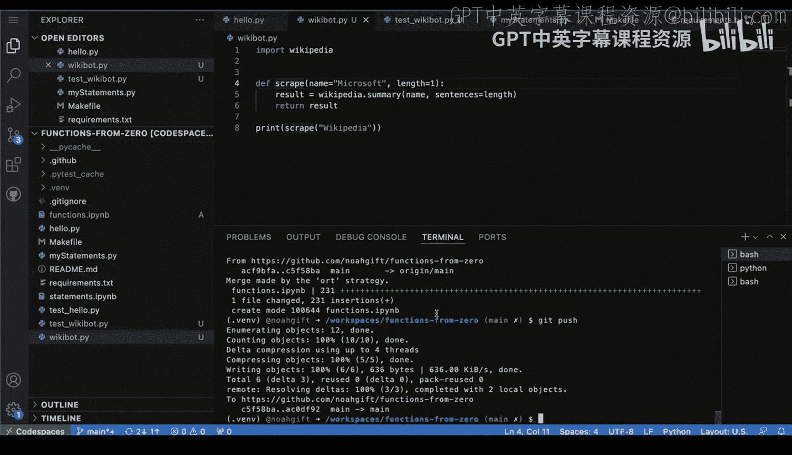

That's what this little icon was so we can watch it。

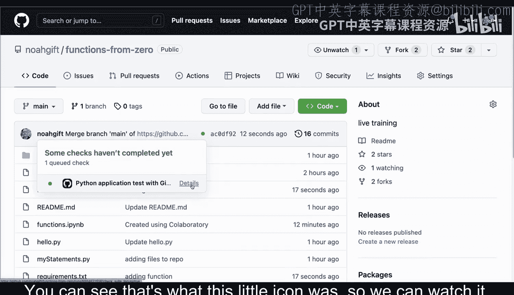

And so it's going to install dependencies， it's going to Li our code。

Now it's going to do the tests because we enabled that functionality， which is pretty exciting。

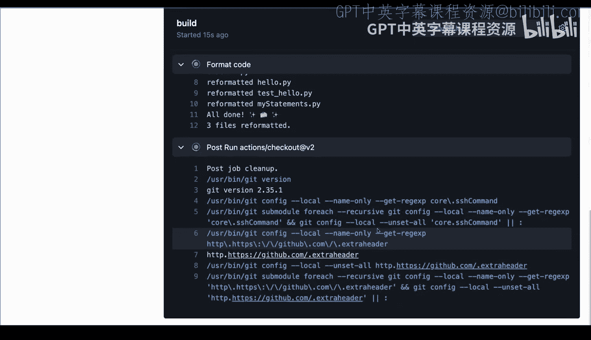

And then we're to go through and we see everything works right so we're on our way here。

 the next thing that we need to do to make this a kind of a realistic project and make the function more useful is to then use a Kamelan tool and what we're going to use。

Is a library called click。So I'll again， go back to our code space here and launch it。

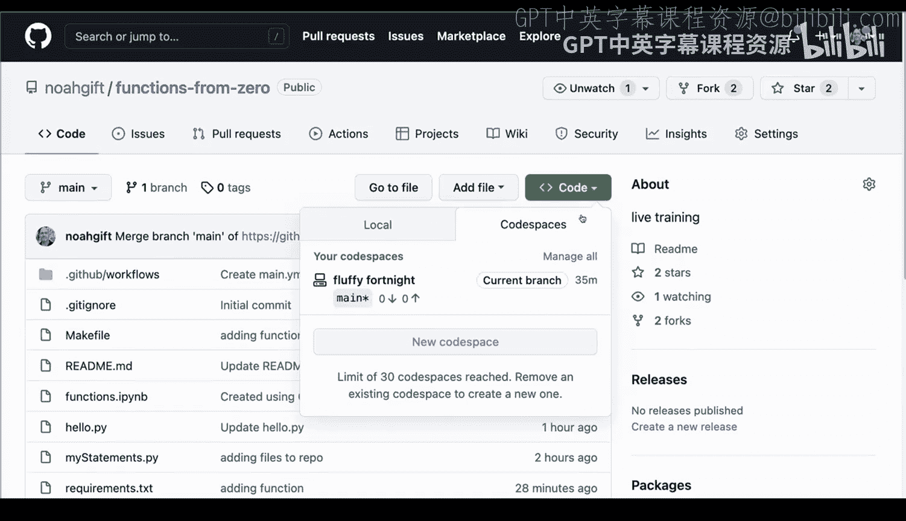

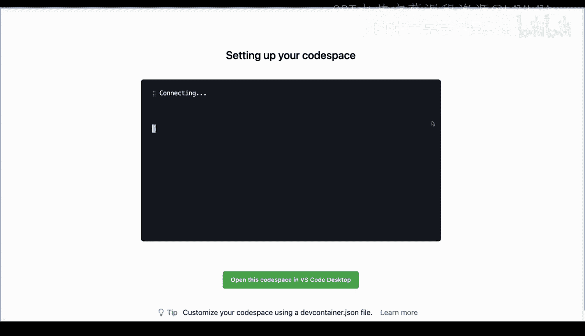

And then I'm going to use the click library。So I'll again， open up a terminal。

And so in order to make click work， I'm just going to look at the documentation for click real quick or just kind of grab one of their little examples here。

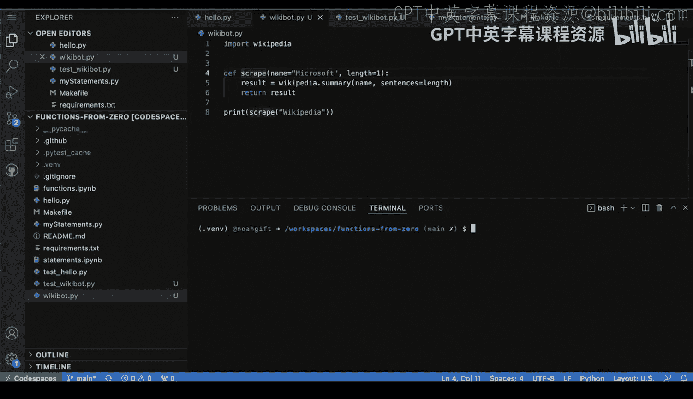

And， and。

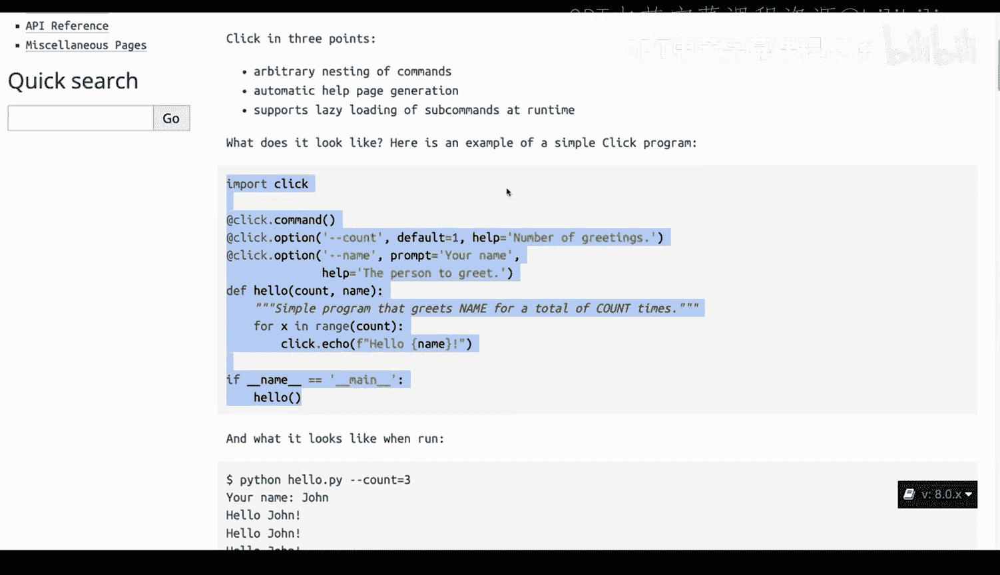

Pick that as an example， so I'll just throw this。Keep working。 I'll just throw this into。

Maybe another file that would be like。Or even the read me。

 I guess I could put it into here just temporarily just so I can take a look at the code。Right。

 so this would be。Essentially the essence of what we would want to do is build something like this out。

 so I could probably just copy this actually into our file and just manipulate it。

I'll go here and just paste this in。 So what do we want to do。

 we want to bring this import statement here like that。And then， we also。

You also can go through here and swap this out， so let's pull this function into our click code。

 which is right here。And。And then if we want to go through here。And。Put in。This into a command tool。

 all we need to do。Is just called this scrape。Right here。

So this is that if under undername thing right where it will only run this if it's run as a script。

And then I would change this to be name。So change changes to be name。

And this would be web page we want to scrape。Web page。We。Want to scrape。Like that。

And we could prompt your。Like Wikipedia page。Wikpedia。Page to scrape。Here we go。And that looks。

 I think this will work。So let's go ahead and try this out。And you can see here。

 the reason I like it is that you can just add this on top of it。And in my opinion， less code。

 that's why I like the click library。 And so if I go through here and I type in Python。Wikibot。

 it should also give me a help menu if I wanted to run help， so let's just show you that。

There you go right so pretty neat actually it shows us a help menu。

 it's like a real Uni utility and then from here I can type in dashje name directly and just type in you know Microsoft for example。

And in this case， though， we don't want to return the results。

We would want to actually print the result， so we would change things up a little bit here。In that。

we would want to actually。Manipulate this a little bit and get rid of the return statement。

And in fact， we can look at the click documentation。

 they have some fancy things here where they have this click echo， and so click Echo。

 which I'm going to bring in in a second。

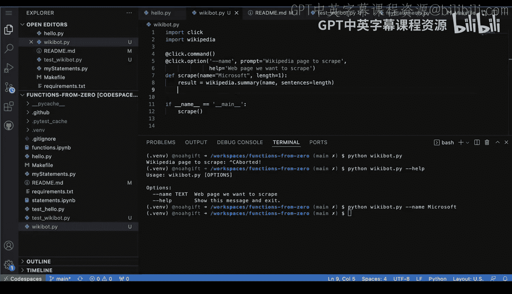

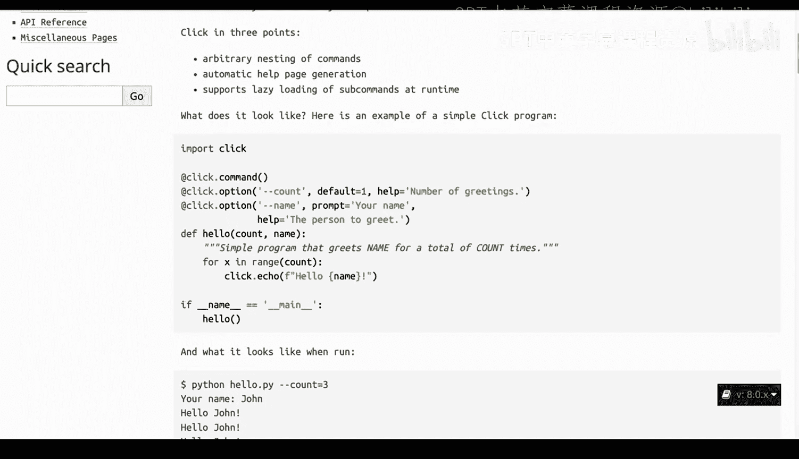

Can do a a formatting where it does like a color syntax and in fact， I have an example I'll grab。

And another screen， and I'll pull over here， so we'll go click。And we can go here。

And I will grab this thing。Here we go。 Click E。 So click has a neat little。Thing like this。

 you say click echo， click style， and basically I can just say， you know， the result right here。

Whichch we put inside of here， which will save result。So what's cool about this is look。

 it says foreground mode red， so I can make the text that I pull from the Wikipedia bot here and we can make it red。

 so let's go ahead and do that。Pretty cool， right or blue or white or whatever。

 maybe white would be a good one actually。ALittle， little easier to read。Let's go in and try that。

There you go， there's white text or we can make a blue text， we can make it whatever color we want。

I think you can also make it have like a highlight as well。Blue is a little hard to read for me。

 I would say。Probably。Well， I guess we could make it fancier。

 so what I could do is I could look at click their documentation， which I'll pull up here。

And I'll just temporarily。

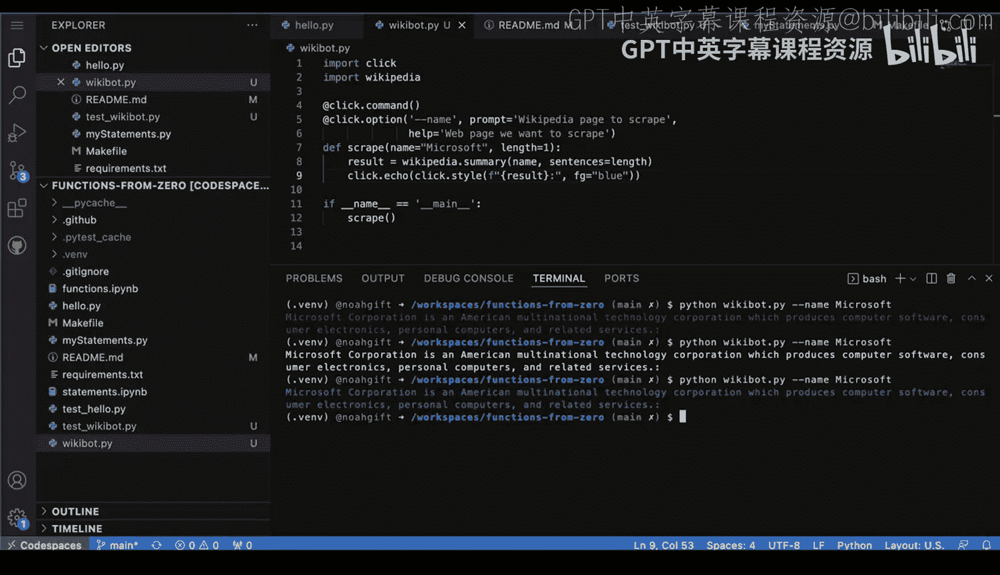

。Do this。I'm going to pull up their documentation。And we'll find it。

Let's go ahead and look at the documentation and we can look for colors。

And maybe make something that looks pretty cool， maybe a little bit of。Becauseuse I think it has a。

Background。Yeah， background。 so we can do a。Maybe like a background of。White on blue。

 maybe let's try that to a background of blue， so I'll go back。

 let's just grab a little bit of this text。

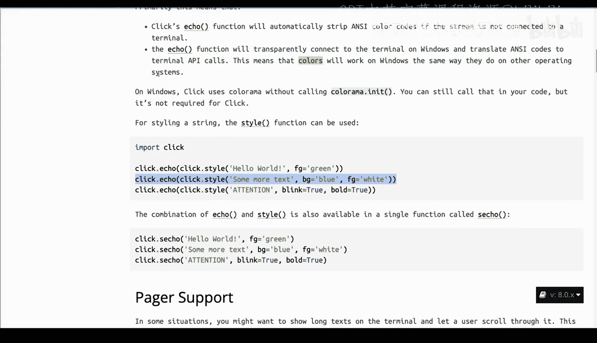

And then， all。I'll put this into our code so i need to put this in a buffer somewhere。😔，There we go。

And then I can grab this thing back。😔。

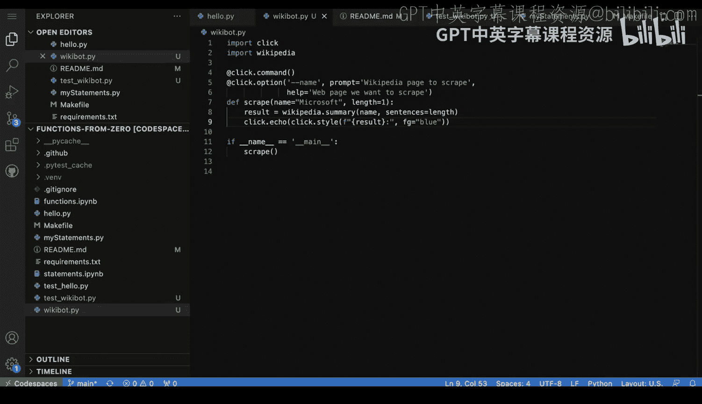

Put this back into our。

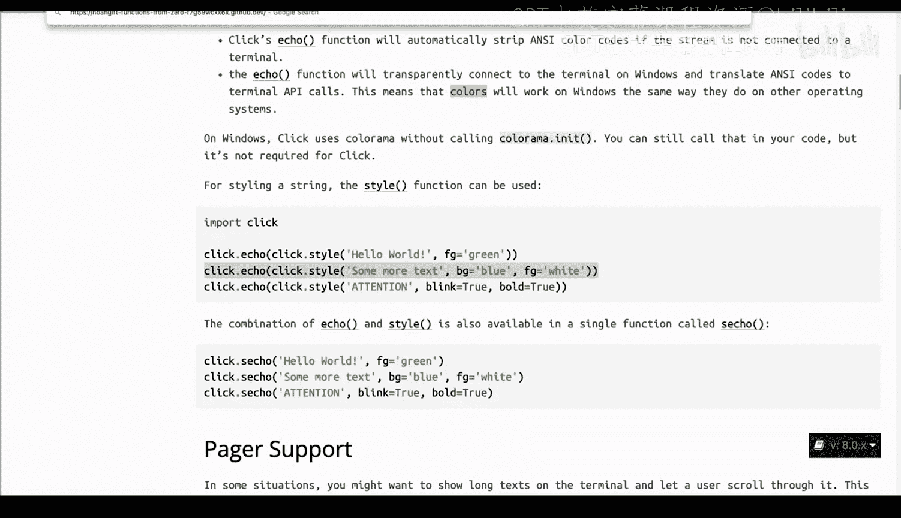

Screen here。嗯。So I'm going to paste in something like this， it'll， it'll look， I'll put a。

 I guess I could put a comment。Or something like that in our code。

Like that and it's going to look something like this。

So I'm going to change it to be foreground will be blue， but let's do the background。White。

 maybe that'll make it easier to read foreground is equal to。Wait。Like that。

And then if I back open this terminal。We can we can try it out。To Python。Wikibot， dash dash。Name。

 Microsoft。So we missed。😔，Something， what am I missing here。😔，Foreground。Orground blue。

I don't don't know why that is。Maybe I have some kind of syntax bug。

That's the least of my worries is making it fancy。 So I'll just we'll just we'll leave it here。

 we'll leave it blue for now。 but but the general idea here is that。

Is that now I've got this building block piece of code that I can pull things out and essentially build off of now。

There is one thing that is a little bit bad about what I built is that I hard coded that function and incorporated it into this wikibot。

 and so it makes it less useful。If I wanted to build a library。

 so I think the next thing that we should do is build out a library instead of just hard coding all this logic and of there so how would we do this well we can go through here and just start to build out this structure in Python so that we can also build web services and not just Kmelan tools so I'm going to go ahead and make a directory。

Called my Lib。And I'm going to create a file inside。Called under under a knit。

Under under dotpyY and all this does is just tells Python you can look inside of the under under a knit under under dot PY file。

And and that will be something that you can you can import into。

 And so what I will do is I'm going to take out。Essentially this piece of code。

And I'm going to put it into into like a。Something called bot。 so I'll go ahead and create that。

 so I'll say my lib。Bott at PY。In。From here。We can just put this inside and we can go back to our statement that said return。

In fact， I can change my test to reflect this。And so what we can do。

Is even add a test inside of here that instead of Wikipott will say my lib。From my lib。 bot。

Import scrape， let's just double check。 Does that look good。 And now let's go ahead and run our test。

 So this is when you start restructuring your code。Oh we say Wikipedia is not defined。

 we can kind of test out what's going to break so in this case we say import Wikipedia， there we go。

And if I run it again。Aha， we've got it working so we were fairly successful in pulling this into its own little project file right here。

And then。I can now make this a little bit easier and it's more portable。

 so what I can do is I can call this。Potentially scrape。Scrape scraper or something like that。

That might be too confusing， we'll just call this。Maybe CLI， there we go， we'll call the CLI。

And then I'll go down here and I'll type in。CLI like that。

And now I can just say instead of importing Wikipedia， I can just say。From my lib。Dots。

My Lib do bot import scrape。RightAnd now this just makes it a little bit cleaner。

Because I can actually keep that code isolated here， and so this would just be scrape。

And this would be a little bit simpler like that。And then everything would it would look similar。

 and so I believe that should work and we say make。Test， does that work？😔，And then， in terms of。

Click， it also has its own testing library and so what I can do。

I I'm going to make a test just for a command tool so we can test that as well。If you go。

Back to the make file here。This is going to test all those files so we we could。

Actually use a click based test here as well and so I can grab that real quick， I've got an example。

 I'm going to go and build this out。Let's see。

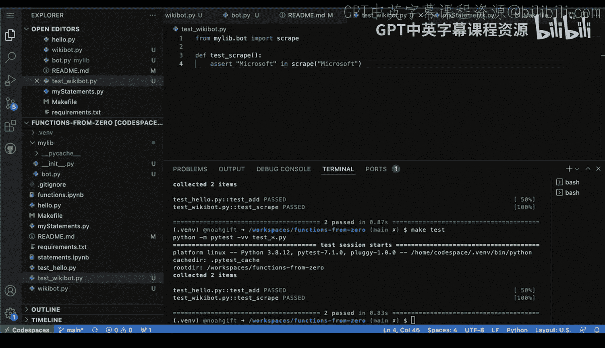

Click。Test， let me just grab it real quick。Testing click applications。Yeah。

 so the testing looks a little bit like this so we can。

Potentially。Put a test down here so we can say from click testing， import this test runner。

And there we go， and then we just say test and we say the name of our file， which would be。

 in this case， Wikibot。So wki Bot。😔，Keep bo and we say， okay， let's go ahead and invoke it。

How would we invoke it， we would invoke it with scrape， we saw that earlier。And we would pass in。

I believe。We would pass in。Dash dash name。And let me see actually。Click。

I have another example here of a click test that I'll pull up real quick。In this user。Cookbook。

 let's find our test recipe here。Click。Tests， C lie。Option。

I need to find one where they have an option where they test。Okay， yeah， so its it's basically this。

You just put in a quote like that。And then we would say Microsoft。Just like that perfect。

 we say name Microsoft， we should say， okay， it should be able to successfully test。

And then also we could go through here。And we could just assert that Microsoft is in the output。

If this is successful。We will be， we will be in business。 We not only have a test for our library。

 but we also have a test for our command line tool。 So let's go ahead and do this。

 So let's go ahead and say make test。And oh， we have， we did something wrong， which is。

What did I do here？Given the command。Cleed out name。 function has no attribute name。Did we not。

 let's go look at our Wikibot real quick here？And oh， it's because we call it CI。 So it's correct。

 Our test is a failed test。 So let's go through here and let's call this CI。 So so we need to say。嗯。

From Wikibot。Import CI right so this would import the piece of code that is going to run our command line tool and let's go ahead and run it。

And we're better， so scrape got an unexpected keyword argument， sentences。嗯。Which。We。Oh， I see。

 so we need to change that code。Because we've changed the way the structure of it works。

And so I can just slightly tweak this。If I go back to Wikibot。

And and notice that it has sentences here。 we don't need to put in the sentences。

 although let's make our command tool a little bit more useful。 and let's just add that right。

 let's just add。At click dot option。And then， let's say。Length。

And then we can do the we can actually take this prompt out because I don't want it in the prompt in here。

 I want it to be more concise and then we can add a。

Help option here for somebody to be helpful to them。We can say this。We can say， help。And say。The。

 the length。Of the output。From Wikipedia。Like that。And then we would take this out。

And we would also take this out。Because we don't need to pass it in like that。And we could。

Just pass that in perfect name， name， sentences link。 And so now if I do a。A test。

 I believe will need to pass in。Inside of this test also。Another parameter， which would be。Here。

 dashes sentences。And then， put in。Wen。Hopefully this will work。First try。

Did you mean to pass in length， We did。Thank you。I did mean to pass that in。

Did I not pass that in command？😔，Invoke。Tbu sink。No， I don't。

I don't know why that one is particularly causing a problem I' just so I don't get too caught up into into boiling the ocean here。

 I'm just going to put in one here。And just take this out and then we won't pass that in。

So I can get this working there we go， and let's just make sure it worked by just running it。

 that's always a good idea。And so， it expects。呃。To anex。Scred。List double will check your scrape。Oh。

 because that's， a that's the problem， that's why I had a problem before。

Is it it wants to pass in length， so let's see if I can fix this。Lith， length。Lith。

And we can say length equals length。Now I see what the issue is。Length equals length。There we go。

 and let's go ahead and run this。And we can say。Okay， we need to pass in name is equal to Microsoft。

In dashache length。Is one。No， no option to find。😔，The length is killing me。

 so I'm going to not use it。And let's just get this working。And go back to bot double check。

That looks good， we pass that in sentences link。And we don't need that， there we go。

 let's try it one more time。对。😔，See if this guy will work。😔，There we go， we got working again。

 so that's a good sign if I do make tests。The test， we need to fix the。

This thing because we don't want to pass in the length anymore。And we got our code working。

 so this hopefully shows。Howo。😔，We， let's see here， Microsoft。Oh。

 we want to say not that the output is Microsoft， we just want to assert that。The output。

 we want to assert that Microsoft is inside of the output。

 so we just need to change it a little bit like our other test in。And let's go ahead and do that。Yay。

 we got everything passed， right？In my opinion， the testing really saved us here。

 even though I had a little bit of an issue with it。

 is that it allows me to kind of debug something that could be potentially a little bit complex。

 so I'm going to go ahead and check this in。Get add。Star and go ahead and commit this adding。um。

Tests for CLI。And go ahead and push this so what's great again is that our build system will go through and test this out for us now I did mention that I wanted to trout the fire tool as well which I've played around with before and it is kind of an interesting concept this fire so let's go ahead and pull it up and say Python Fire library。

And I'll go ahead and show you in the docs why I think it's kind of a cool。

Function cool tool here is that。

You can see the way this works。Is that。Python Fire is a library for automatically generating a chaallean tool。

It's probably the simplest possible way to build something and so for what we're building。

This could be you know amazing， right and so look at how it works， you just put。

 you build a function。And then you just import fire。

 and then you say if name under under whatever you say fire， fire。

And if the fire will actually load this up。Let's try it out。

 let' see can actually let's see if we can actually build this thing。

 so I'm going to copy that example and go back to our code space here。

And。What we can do is make a。Terminal here and make a different thing。 we'll call this。

Let's say like fire CI。Let's try that fire CLI， how about that， that looks pretty good for a name。

And if I understand correctly the way it works， I've only used it a couple times。

 but you basically say import fire， and then I believe we can say。From。My lib。Dot bot import scrape。

 and we know that scrape， if I remember correctly。Takes。Name and length。And so I think。

We can just say。This， we can just do this， we can say fire scrape， that's it。Bt。

 talk about a small amount of code。If this actually works。

 it's going to be amazing so we can go through here and we can say Python， Fire， CI， dash help。

No module and fire。 Okay， well we didn't load it so I need to install it， go to requirements。

Go to fire。 All right， let's do a make install。🤧嗯。Okay， that looks like it works。

 let's go back to our fire CLI。And let's run it。W， so it looks like it works。

 It found the name and it found the length right so pretty magical command line tool here。

 So let's do it。 Lets let's do fire CI and we'll do name。Microsoft。And then we'll do the。The length。

 right， I think it was length。Wen。Wow， that was pretty easy。

 so the world's easiest command tool in Python is probably the fire library because and this also shows why the structure of creating a library with a function inside of it allowed us to easily test two ideas out very simply and so I'm going to go ahead and I'm going to say get status。

And I'll go ahead get add。This， commit this。Adding。Fire example。

And we'll go ahead and push this into production。And then again。

 go back to our repository and just make sure everything is loading。

Here and we can see here that it looks like it's pushed。And we can go to actions。And CO。

 there is some kind of a problem。 Let's， let's。

So we should fix our problem here。If there's still a failed test that oh， Lintting is bad， oh。

 bad indentation， all kinds of problems。 Well， that's great， right， because and it also shows。

That there's a warning which can happen sometimes。嗯。when you're building things with Pint。

 and so this is now stuff that I can fix。So because I know that this is something that。

I don't know if I need to fix this because this is I think something that happens with it's a click library issue with Pyint。

 but I'm going to copy this particular message first and then we'll go back so let's go back to our code space。

And let's fix these issues。

Okay， let's go back into this。 Now I should have actually run this。

But I should have done make Li and I would have seen this already right there you go So this is where the formatting tool really becomes amazing。

 So if you remember I created that I haven't run it yet， but this formatting tool。

 let's do this let's do make format。And I believe it just will magically fix all that。

 So now if I type in make Li。There's going to be only one problem。 There we go。

 So the formatting tool is a nice secret weapon to have just kind of waiting around in your project。

 and then the next thing that we can do。Is that I can go to。The actual make file here， which I'm in。

 and I can also say you know what， I know that that particular warning I don't care about because it happens with click。

And I'm going to say disable it。There we go。And I've tuned it。 now I've tuned my Li。 there we go。

 we got everything working， and I can say make all。Test the installation， test the Linting。

 also test the unit test。Perfect， right， we've got everything cooking here。

 so we really have a fairly sophisticated project that we're being able to build really quickly。

 at least the start of one。Adding working code。And we can say Git add， right。

 because I changed all those I reformatted them with the Python black tool。

 the Git status will be different。And it should say that all of them are changed。 yep。

 And then we go and say get commit。It's fixing。Foratting issues。There we go。get push， perfect。

And then now that it's been pushed， we can go into。The repository one more time。

Check Gitthub actions， make sure that we fixed our issues。

And we should be in great shape。

Maybe the first thing to start off with here would be to。

K of decide what kind of web framework do we want to use， In my case， I'm going to use the fast API。

Which I have done some stuff with it recently， so。I'll pull， pull it up。There we go。 Let's。

 let's go ahead and。I was doing some machine learning code with fast API recently。

 so I'll grab an example。呃。Projects and just kind of tweak it a little bit。

And show you how we can make our code work with it， so I'll call this one。Main wI。

 we'll go ahead and call this main。And then instead of here。

 I'm going to paste a bunch of code and we'll just reduce the stuff we don't want out of here。

 so the the first thing is。Just to show you an example of the kind of stuff you could build。

 this was a project that I'll give you a copy of it。

 maybe I'll do a live training on it in the future。This is a。Using Databricks。

 I built something for ML flow。Around this， so this is like a complete machine learning microservice framework。

And I pull a model in from machine learning system and then build a microservice。

 we're not going to do that。 We're going to keep it really simple。

 but basically the stuff that I care about is is I probably care about。The UV corn。

 which is the web server， and then I care about the fast API stuff。

And so I'll go ahead and put this in here， so we'll kind of do this。

 and I'll check this in in a second so you get access to it as well。And then with。呃。

If I want to accept a J payload， which I think we do want to accept a J payload。

Then I would need to build out some kind of a model for it and so let me just kind of clean this up a little bit so we'll need to do fast API instance here and so what this does is is it makes my fast API object so I can build out some kind of an endpoint for it and so we can。

We can basically test this out pretty easily first。By。You know。

 by basically testing one of these other routes and so I probably。Can just get rid of。

Everything in here。😔，And the payload would just be。TheWhatever I would actually send into it。

 and so this particular class here。Would be what， what is the thing I want to send in。

 And so instead of story， I'm going to call this。Wiki， there we go。And so the text here。

Instead of text， we would call this name so basically this would be like what web page I want to send as a payload。

And so I will just change this to。To wki。Right， like this。And then I would say wki uppercase。

And so this just uses this to later build out API documentation。

And then all I need to do now is import。Things from my library。So I can say from。My lid。Right。

 is that what I called it my。My lib。From my lid。Dot。嗯。And let's look inside of here my lib dot bots。

Import scrape。And so we can reuse all of our code this should be pretty handy to reuse。

And in particular。We would just need to swap out the way that we we called that， right。

 And so we know that。All we need to do is pass in the name and let's just double check real quick。

 let's look at the code Yeah， I just need to pass in the name here。And I can go back to。My。

My main file here， let's close a lot of these because it's confusing， too many things open。Okay。

 here we go， we got main right here。And I'm going to just。Pass in。The results。Would be。Scrape。

And then the。The basically the the the。The instance of the wiki right here， if I。

 if I remember correctly， let me just double check here。Text。😔，Yeah。

 so basically it would actually be。Let me just look here。It would be wiki dot name。

 right because this is a class and so that attribute。

 I would need to pass that in right here so we could even be more precise。And we could just say name。

Is equal to wiki name right and what's nice about this is that we then have the text result here。

 and then I can actually create a payload。Which would be our dictionary and then encode it and then send it back out again so we could say this。

 we could say you know， payload is equal to。And we could say。Potentially the name or yeah。

 the name that that works。Or wiki name， that would be a good way， wiki name。Or wiki。

How about Wiki page， wki page that's better Wiki page。

 and then I would just put in that result right which would be the scraped result back and then we can just send that payload back out to people。

These other ones， this would just be like hello， hello functions like that。 And then I like to build。

Also like a really simple route when I'm prototyping something so I can test that anything works right。

 just so I can test the swagger documentation。Which we I'll show you a second。

 So that looks pretty good， I think we've got。We've got our code written here。

So what I can do is I can type in make install because I'm going to need to install。

All of the flask stuff， so let me grab that real quick。And put it inside of here or I mean。

 fast API fast API stuff， so we'll go ahead and we'll say fast API， I think we need pedantic as well。

And then I think we need UVv corn as well。UV corn， there you go and paste these in here。Whis。

 paste these in。Okay， we got UV corn， pedantic， fast API， all the stuff is good。

 let's go ahead and do a make install， get this cooking。And this will stall all the。Fasty APII code。

Great， and if I go through here and I say Python。Ming。Oh it says base model is not defined。

 so I also need to import the base model that didn't install that。And let's go ahead and do that。

 so that would be from Pedantic import based model， so we'll go ahead and do that。There we go。

Python main。Okay， so this thing's running。 now， this is one of the really awesome things about these kind of cloud based development environmentments is that they do let you test it out in a web browser。

😊。

And so if I go through and I open it。Now you can't see it。

 so I'm going to change it temporarily so that you can see it， I can change the screen share。

And I'm going to show you this share。Which would be。Right here， and you can see。Potentially， yeah。

 here we go， you should be able to see this function。And what's nice about this？Is that。

You can can then go through and run the docs here right and so in particular what I can do is I can just say。

Docs。And then we have fast API opens up now the endpoint should it be called predict。

So let me change that， we'll call this， I'm going to change it on the fly and say wiki。

And we'll call this scrape story， I'm just going to change this behind the scenes here for you and I can。

Stop it and start it again。And I believe it should。

Be smart enough。Do just week back up again。Hopefully。

Go ahead and hopefully this will just reload if it doesn't。

Then I'm going to start it back up one more time。And maybe open up a different。

I'm going to close this and reopen it。

For you。Okay， here we go， we got it working。Chrome tabab， here we go。Hello， functions。

It should be working perfect and then I can go through here and I can say docs。Perfect。

 and now here we go the documentation， I can click on Wiiki scrappe story。 Look， there we go。

 name string， I can try it out。And what's nice is I can just。Put the payload I want inside。

 so I can say。Microsoft。And does it work？Execs。And it will give me the curl。Which is right here。

And the result there you go。 So we have a full functioning microservice with swagger documentation。

 which is awesome right so this thing accepts now Jason payloads So if I wanted to for example。

 you know basically put some docs in would I would copy this which is not a bad idea to show people how to copy to talk to this so I'm going to。

Basically switch switch back to my other。

Other repo here， so let'。I'm going to copy this and put it somewhere so I can use it。

It'll be right back， let me just use it just here， okay， that's good。

So I can。I can just swap the terminals so I don't have to resshare again。

So I can go here。This should work。

Yeah， so we'll just go back to code spaces so so great we got we got we got something working here。

 which is amazing。And。And we were able to test it out now the next step here would be that you know。

Can we actually get this？rununning into a production based environment and how would we do this。

 well I would say we can and the best way to do it potentially would be to build a container first so that we can test that a container works and then we also could put some documentation。

That I was going to put that says how to call it， right。In this case， if we do a gi pull。

Let's pull all the changes that looks good we could say like。You know。To call。Microservice。

could use something like this。よし。Something like this。Something like this， there we go。

 so we got that documentation。But we also could containerize this and the way to containerize it。

Is fortunately not too bad。We can actually take a Docker file。And and create it right here。

 so I'm going to go ahead。And I'm going to。Touch a Docker file。So do this Docker file。

And then if I past this inside。I'll show you a few things that I'll build here。

 I'm going to take out a couple things I don't need， I don't need model。But basically。

 I'm going to use a Lambda。Container base image because I'm going to deploy this to AWS in their cloud based environment。

 I'm going to make an application， I'm going to copy the file into a application directory。

 I'm then going to copy the requirements and then I'm going to install those requirements and I'm going to launch this thing so it's pretty straightforward actually to get the container working locally here。

AllAll I need to do。Is actually go ahead and say。Dor Bill dot like that。

And this will build the container。Okay。It's downloading it locally here。

And I could even put some documentation。About how I did this as well into our read me file。

So we'll do this。 we'll say containerize it。Build container。And I think it was just Docker。Build dot。

And then。To know what the image was， you can say Docker。Image LS。There we go。

 you can see that that's the image right here。To build container。And we'll put a documentation here。

Right there and then to actually verify it。And run it。

All we would need to do is just put in a command here。That I can just get real quick。Which would be。

This。Docker Run。And put the image ID inside this。There we go。And in this case。

 the address is already in use because I had， I believe， something running。

Already in foreground mode。And now， if I run it again。We might have to just kill a process。

 let's do that。P S S E F Gr Python。Sometimes you have to do this。 You have to kill a process。

 So this process is like。Running somewhere， I don't know where it is， but I can just kill it。

 I can just say kill9。And kill this process。Now there's no Python running now if I run Docker。

There we go。In this case， it says no module name my Lib。

 so this is great because this shows one of the things that happens when you build containers is that。

You potentially need to copy more things into the container。 So in my case。

 I can fix this because I can just copy。That inside of this location。

And I'm going to just add a little copy statement here。I'm going to say copy my lib。My lib。

And it's going to go into。My lib like this。 There we go。 I think that that should work。

And then I'll go ahead and rebuild。Docker build。Perfect。

 now if I go through here again and I run this thing， well that's the old one。

 so I need to find the new image ID。which should be the latest one， so just go grab this ID。And。

Go here。There we go。We。Have it working， which is a good news。

 and I can test it out more easily by just curling it first。

That way I don't have to go back and forth with web browser so it looks like it's working。

 I would say that's pretty good。 Now what we could do if we want to get。

A little sophisticated here and not have to go back and forth between the browsers if remember。

I had a read me file here， I had the post command， so we can basically just put this into a file。

And make like a。あ。It'sBasically a touch chi in that says invoke dot S。

And then I'll just piece this inside。And I just have to tweak it a little bit， right。

 because if you remember。嗯。That it takes this J payload and so all I need to do is pull this out。

And I can。Put this in， like that。We should just be able to do invoke it。

And then I don't have to open up the web browser for now。 I can actually just test this out。

 And so let's go ahead and do that。 Let's type in bash andvoke。There you go。

 pretty cool so I could and I could test out different things as well， I could test out。Wikipedia。

 right， which is another thing that we could test and perfect。

 were able to test our working web service I would go back to Docker。There we go。

 We're making API calls， are things are going great。

 So what I'm going to do then is I'm going to stop this。And I'm going to check all this code。

So go ahead and do that and in fact， I should probably put this in the documentation， you know。

 build container Docker image and then。We'll see it run container。One container like this。

And we can type in history so I get the command。Here we go， something like this。

I'll just type in something like this。Right， because the ID would be different。And then we can say。

 invoke。Evoke。Ren。And we say， invoke。DH， invoke your post request。Like that。

So this would allow us to test the post request so great。

 we got all kinds of great stuff cooking here。And I can do again， get status， get add。

And push this into our repo adding microservice。 So we've made we've added containerized microservice。

 containerized microservice。So we've done a lot of stuff with operationalizing these functions and putting them into a product now the next thing we can do that's really。

 really slick is we could now shift to the cloud。In order to do that。

 I'm going to just in this window right here， just type in。

 I'm going to use the EWBst cloud and we'll go to a console and I'm going to use a product called Cloud9。

And cloud9 is kind of nice。Because it allows me to very easily work and talk to AWS。

So notice here I have a project calledBuilding Cons alreadyready， it's a powerful machine。

 I'm just going to use that because it's close to me and I've got it available。

And in particular。We'll go into。Fctions。

From 0 right here。Perfect。And I'm going to just check this project out。Right here。

 I'm going to check out onto this cloud based development environment。

 so it's kind of similar right to the other environment。

And so I will need to check out the code I've already set up my SSH keys so I can I can just kind of move quickly here and just check this out now let's take a look at this repo though。

How would I run this locally， well we should。Potentially deactivate the virtual environment that I'm currently in。

 and make I'm actually going to delete this one。That。Because。I want to create a new one。

And I'm going to just say Python3。Dash M， V， E and V。And make， make a new one。And then from here。

I will。I will go through and。And source my Bsh RRC， which I have。

 I think the virtual environment set up in there to look for it。

 so I have a new one now and I'm going to say make install。

But I need to first change into my directory， which is functions from zero。

Or I'm going to do make all so basically。Check out the the code。 installs it， Lint it， test it。

 make sure everything is good。That that's really the first step in a brand new environment。Great。

 we're in great shape， looking good so far。Awesome， boy， it always feels good。

 all of our code passes。Okay， the next thing we can do。Is。

Is actually now wire this into EWS's code repository and so in order to do that。

 we're going to have to toggle back and forth a little bit。And so what I'm going to do is。

Is actually。Go to。Go to this environment that I've got set up here。

 which I can show to you and so again I checked it out into this environment。

And you can see that I've got it running， I didn't make all， everything's great。Now。

 the next thing that I'll need to do though is I'll need to take the containerized application and push this containerized application。

Into the environment that I want to want to work with and so in order to do that， I would need to。

Talk to something called EWS。E R。And I'm going to pull that up in another window and then I'll just paste it into this one。

 so we'll go ahead and say AWS console。And here it is。Lo back in。ECR。Elastic container service。

I'm sorry， El。Container registry is what we want， ECR， ECR。A container retry， perfect。Okay。

 and I'm going to just paste it into this window and then we'll come back to this environment。Here。

 so。I need to keep this browser window。Kept around。Yep， this will work。Okay， let's grab this one。

Okay， so。We've got these private repositories set up here。

 I'm going to go ahead and I'm going to create one。And I'm going to say in this particular example。

 let's create a。呃。Microservice we'll call it a wiki。 Well call it a Wiki repo。And here we go。

 we've this， we've created this wiki repo now if I scroll down here。

It's going to give us these build commands or these push commands here。And so look。

 it's got all these really cool push commands。Now。What's nice about this is that I can just literally step by step run these commands inside of here。

The best way for me to do this is I'm going to just copy all this。And put this into a file somewhere。

That。That allows， That allows us to。Use it later， and so I can now go back to my other environments。

Here。And we can interact with this particular repo， so perfect we got this going。

And so the first thing I'm going to do is I'm going to authenticate to this remote environment。

Here we go。And this basically just says， hey， I want to talk to the container registry。

Then the next thing that I'm going to do is I need to build a container locally。 If you remember。

 we only built it inside of AWS。 I'm going start into Google。Yeah I'm sorry into GitHub codespaces。

 want to build GiHub GitHub code spaces， if I go through here and I paste this， there we go。

 Docker build， we can see that it will run here。This is why having a powerful machine is nice if you are using a cloud based environment。

 a more powerful machine would be great， so it gives you more capabilities。Perfect。

 and then once this works， assuming that it works。The next thing that we would do would be we would tag it as the latest image。

Or the latest build image， and then we would go through and we would push this out。Here we go， Dr。 P。

And。Instead of this， we could say Docker push。Push this code into the repo now the reason why we want to push this into the container registry。

Is that it allows us to easily then。Go and work with other microservice technologies on AWS to host our application and so that's great right we have this thing pushed into a container。

Registry， we're able to do it from a cloud based environment inside of AWS it was really fast to communicate and so now all we need to do is move over to the AWS service that I want to use to deploy this called apprunner。

So I'm going to go ahead and pull it up real quick。And just paste it in this window。To apprunner。

All right， let's go ahead and paste it in here。And so this gives us this apprunner window。

And I can say create new service like that and here we go here's why the container registry is so important and this is why it's kind of amazing。

 we just started with a function， we built up a Cammele tool， we built up a microservice。

 we containerized it， we pushed the containerized microservice into Docker container registry and now we can link to it using this app in our service。

And from here， we just need to tell it what is the container image UI。

 so enter a URI to an image you access or browse， we'll select this， we'll go through here， Wiki。

 there we go。And we can continue this and then now we can do automatic container deployment right here。

We can also go through the access role。 and then from here， we can actually。Build in。

The the name of the service， we'll call this functions。

We can actually call this function as a service， right？Which is what we're building fast。

And then I just scroll down here and I just say next。Perfect。And we can do create and deploy。

 there we go， function as a service now what's amazing。About function as a service is that。

It allows us to very quickly take this and containerize it。And put this into production。You know。

 there's a little bit of a gray area about what does really it mean to be function as a service。

In some cases， it would be just the AWS Lambda function。

But you could also make the argument that something like this that uses a container that has a function wrapped in it could also be called function as a service。

What's happening now is it's essentially ingesting that container file that we built and tested before in GitHub code spaces and then it's creating a microservice wrapper for it so that we have the HCDPS location here and in particular we can also see the。

The linkage right where this links into the container registry that we talked to before。

 and in fact I think if I just click on this， yeah it would show me that page and then as the service is being spun up。

This will actually go through here and show us all the different things。

 including the service creation。The metrics， you know， like when it's running in production。

 the actual configuration， so where does the container live？Also custom domains。

 if I wanted to set up some kind of a a custom domain here， so in this particular scenario here。

 we can see that。We're able to successfully create a pipeline for automatic deployments。

So it looks like we're pretty close， so let's go ahead and let this thing flush out here。

And what's really， really cool about all this。Is that。All we'll need to do is click on this URL。

When this is finally operational。And what that will do is it'll let us play around with the microservice while it's actually。

Hostted in a AWS cloud。Let's give this thing just a little bit more time。

 it usually takes just a few minutes or so。For for for the microservice to to run。Okay。

Let's let this thing。Get flushed out here。Almost complete。Okay。Looking good。 Look， it says now that。

It's performing a health check， so that's the final spot， but we can see the operational。Sequence。

 we go through here and we say operation and progress， it creates an auto deployment pipeline。

 so it means that every time a new container is pushed into there itll redeploy。

 which is pretty amazing， it pulls the image from the elastic container registry。

 it provisioned the instances and deploys them and then it performs a health check as soon as that health check is passed on port 8080 then we should be able to run so。

It's close， health check is successful， now it's going to route traffic to this service through this encrypted domain here。

 which is really amazing。Let's go through here， and let's。Let this thing flush out。Almost done。

There we go， it's set to running， that's a good sign。Here we go。So it should be active so if I just。

Copy this link。In theory。Let me just test that out on another window real quick。Yeah。

 I think we can do this let's go ahead and test it out。 you can see it's green now。And there we go。

 we're in here。And， in fact。I can do docs like that。There we go。

 we're back into our web scrapper microservice。We go to post it， we try it out， and we say this。

We say Wikipedia。And let's go ahead and do and execute。

There we go。It's all working perfectly。In my opinion。

 what's awesome about this kind of a workflow is how kind of the breadcrumbs can be set。

Where you're building a real world microservice， really starting with just a statement and trying some ideas out。

 experimenting， building a project structure。 And then later going through， building into a function。

 building to command and tool to interact with that， then building it into a local microservice。

 then containerizing it， then using a service like this that does full continuous delivery。

 So you could potentially hand this off to a client and say， okay， we're good。

 Here's your here's your microservice that I've deployed。😊。

