# 杜克大学｜机器学习运维｜DevOps⧸DataOps、Azure、MLFlow和抱脸｜MLOps ｜ Machine Learning Operations p37 44_03_03_使用Python-Fire构建NLP项目.zh_en -BV1yE421c7uA_p37-

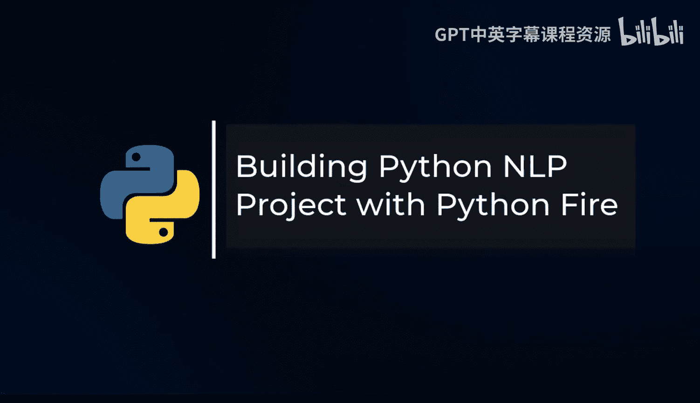

So the idea here with， with building things with functions is that we， we need to put the logic。

Inside building。With functions。So。😔，If we take a piece of code here and we put some kind of logic inside。

We can map it to a lot of different things， in fact。

The one of the ones that I thought would be good to cover would be to do some NLP。

And so the logic in this case willll just do this would be。NLP。And then once we've got that logic。

 we can map it to a command line tool。 That's probably one of the easiest ways to do it。

 We can also map it to i Python。And then， and then we can also map it to。A web framework。

And then if we want to， we can also。Map that logic to cloud functions in， in either AWS。Or to GCP。😔。

Whatever， whatever is necessary for the problem in hand。 So that's kind of the。

 the the scaffolding here of what， what we can cover。So， so next。

 what I'm going to do is I'm going to。Go back to Github codespaces here。And。

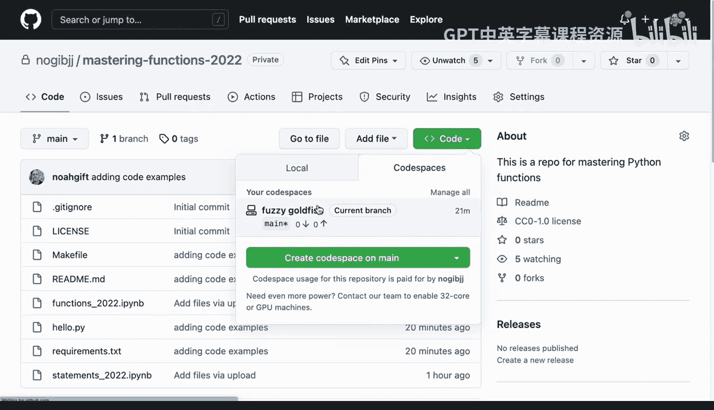

Start to build out a structure。For a project。

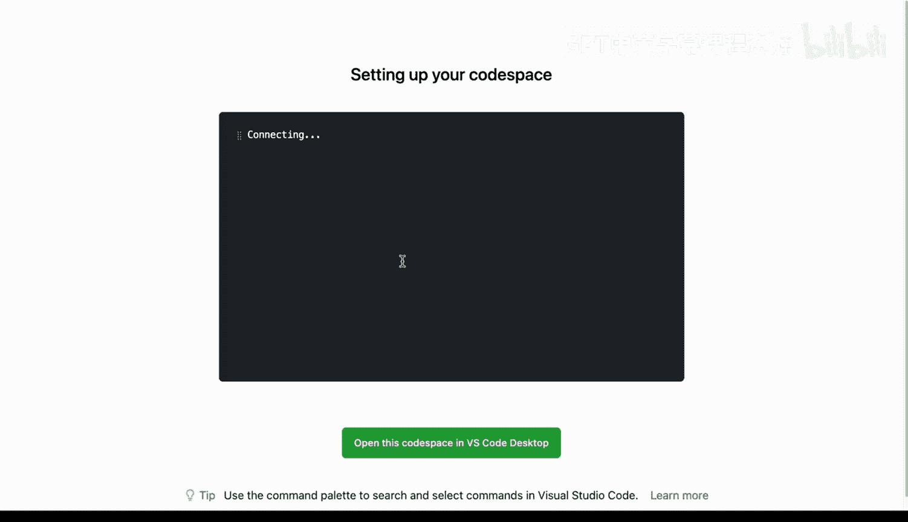

And， in particular。That the next thing that I want to do is， is import another library called。

Text blob。 And I'm going to find that T blob。

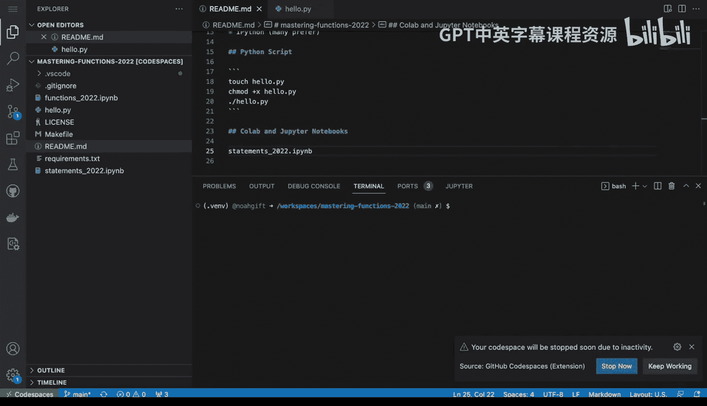

Here we go。 Simplified text processing。 So this is kind of a neat little library that you can build demos with。

 And it's a simplified text processing library。 Here's a good example of what you can do with it。

 So let's actually import this library。 So I'm going to go over to my requirements。

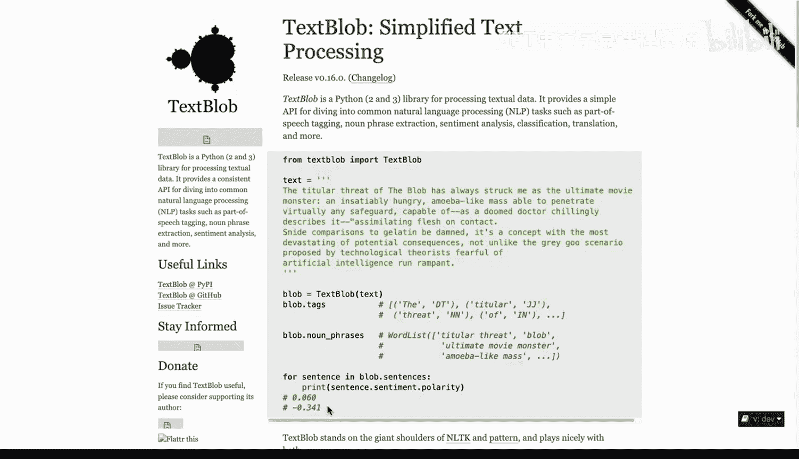

And I'm going to put in text blob。Because I've got the structure set up with the make file and all this。

 it's really easy to install。 I would just go through and say make install。Okay。

 now that I've got make install。The， the problem of testing it out is pretty easy because I also have i Python。

 So if I want to try out an idea， I can just refer to the docs again。

 just kind of go back and forth and say， okay， how do I use it， So I do this， Okay。

 from text blob andm poor text blob， great。

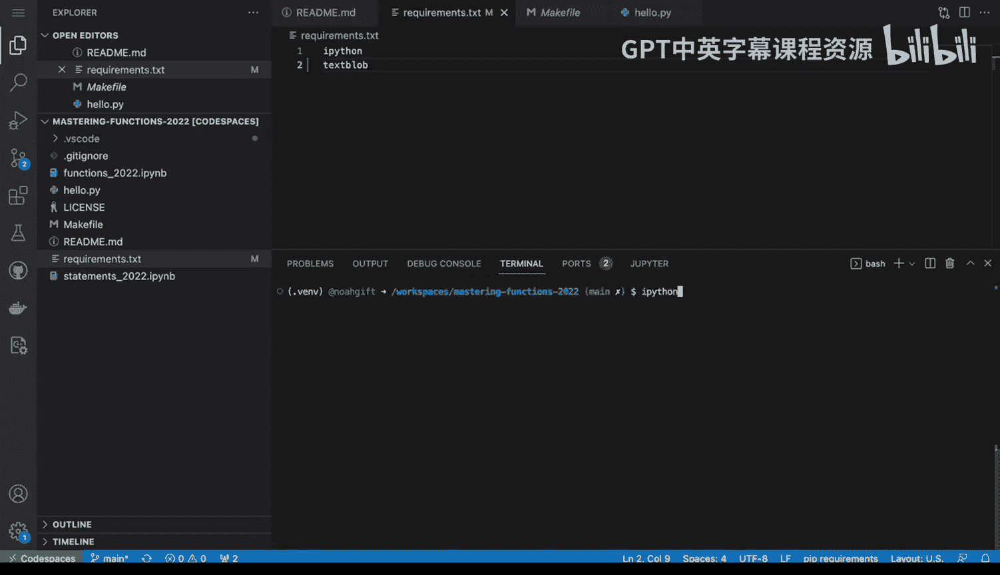

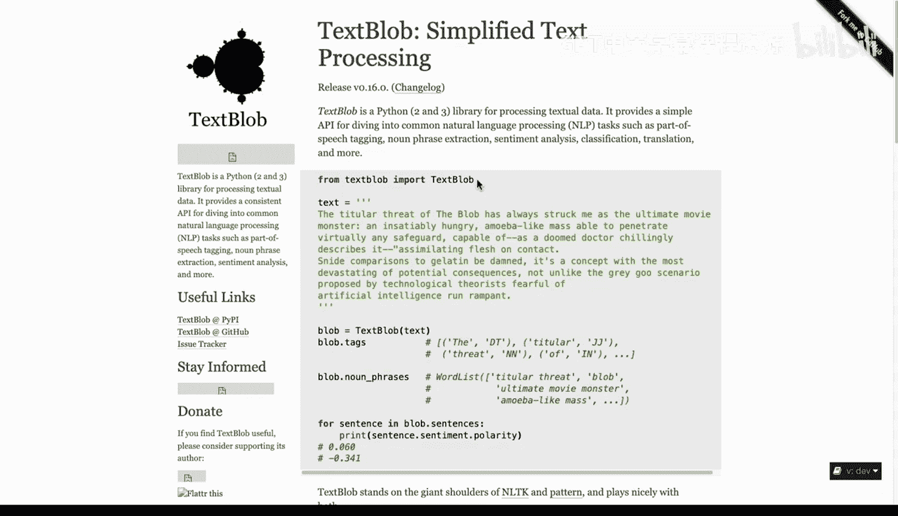

Okay， now I need to make some text。And。For that。Let's， let me think about it a creative way。To。

 to solve this， actually， let's， let's be very， very efficient。

 And let's use a library called Wikipedia。That will grab text automatically for us。

 Then we don't even need to build anything in all scenarios。 and so。

I'm going to do another make install。And let's first get some text and understand how to build some text。

 So we'll say I Python。And we'll say import Wikipedia。Great， and now if we say。Results we can。

 or actually， we can even first do Wikipedia。Dot summary。😔，And we can say。um。L A。Let's do a search。

 I think I I think it has a search。 Yes， let's， let's search for。Loss。OrG State Warris。

 That's a good one。 Golden state。Warriors， what comes up？Or years。Where here， there we go。

So we have Golden State Warriors。 So if I do that， Golden State Warriors。We can do some text。

 Wikipedia。Notice how it has this nice little autocomp as well。 So it's really like an IdeE。

There we go。 What do we get？Awesome， so we have some nice text to play around with for free。

 right by using Wikipedia do summary。 So now， if I just assign this to text or let's even make it nice golden。

😊，State。Warriors。Text。Like that。We can actually。Tut out our text blob， and we'll say。Again。

 go back to the documentation。 we want to say from text blob and port text blob。 So we'll do this。

 And then what's the next thing they want us to do， Make text。 We've got that。 I see。

 So we just say blob。

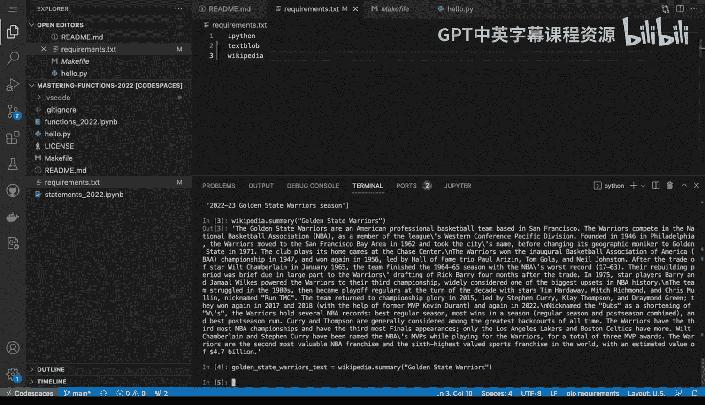

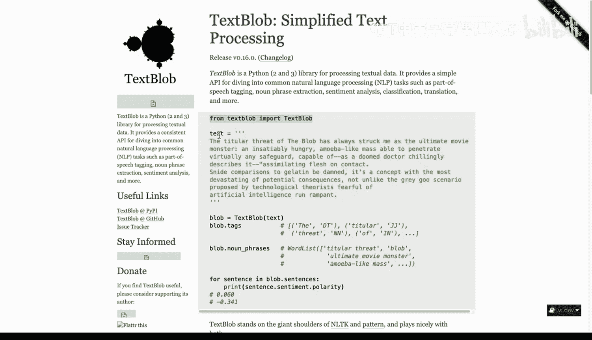

Well， that's pretty easy。 So we say blah equals， in this case， we'll just swap this。

Golden State Warriors text。And now， if we do blob。Dat。

There's a bunch of different methods available here， including。Things like。Sentiment。

 let's look at sentiment。So， we can see that。Plarity， subjectivity。

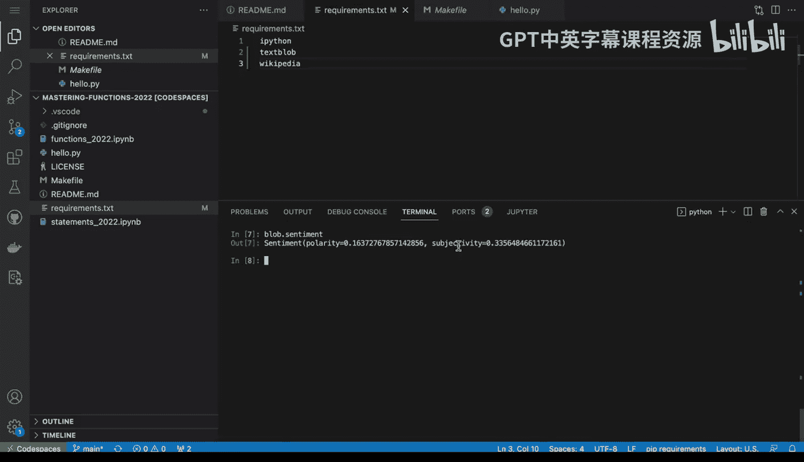

So we got a sentiment analysis， what else were they showing here， tags？

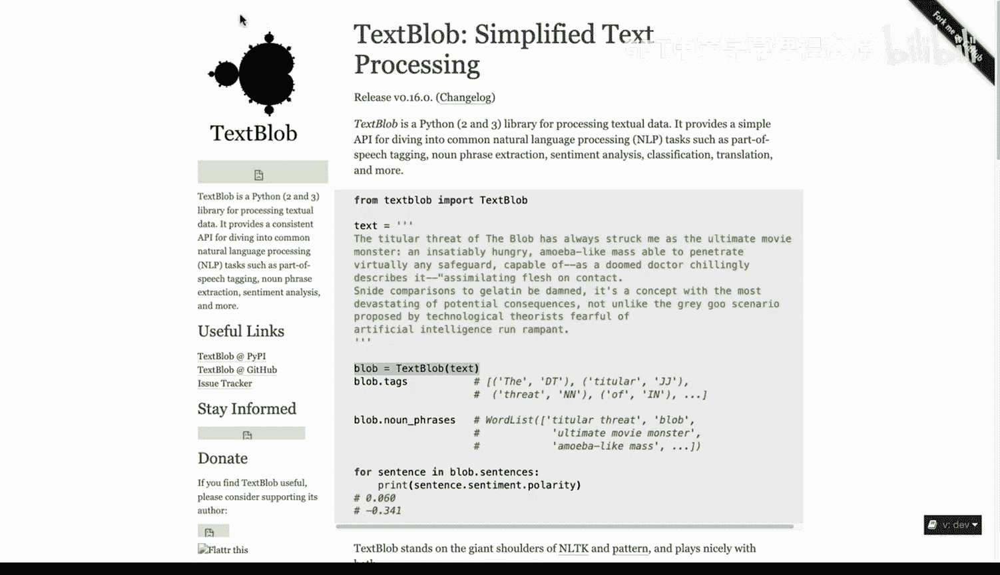

Okay， let's do tags， blob。Thet tags。Oh， so it wants us to download the corpus。 not， not not too bad。

 Let's go ahead and do that。In fact， let's be nice。 and let's put this into our make file。

To make it easy。Right， so let's do this。Python。Download the corpus。And so I could just do this。

 make install。So that's one neat thing about i Python is you can do the exclamation point。

And it will， it will run any kind of a shell command。 And so now， if I run that again， tags。

Look at that。 Pretty cool。 So it's able to actually grab a bunch of tags out of here for us automatically。

Which is really neat。And what else can I do， It can do noun phrases， okay。

So let's do Lob noun phrases。There you go。And it's able to grab a bunch of different phrases out of there。

 So kind of a cool little library that And if I wanted to just， I don't know。Like， make that into。

I'm assuming if I just said zero。Oh， I see。 and then I can slice things out。A bit at a time。 Okay。

 neat so。I've got， I've got something to work with here that I think will be pretty cool。

 So let's build out like。😊，Let's build out something that processes。All that into logic。

 And so in order to do that， I'm going to make a library first。

 And I think this is always a good idea。 If you're starting to build something that's。That's fairly。

Reusable， it's good to build a library。 So we'll create a directory first called N L P。Logic。

And then we'll just create a empty file。Inside of there。That。

Is going to tell Python that it's a library， right。

 which is an under under a knit under under dot Py。And now we can start building out inside of here。

Our， our code。 So we'll call this core。N LP dot P Y or something like。 So we'll say touch N LP logic。

Core N LP。There we go。And I can just start building stuff out。 So we， we can even。

Go back to i Python。And this is what's cool about it。 And just steal some of the ideas like， okay。

 what's some of the stuff we did。 Okay， we did。 So we， we， we said from text bb on poor text bb。

 okay， we need that。What else did we import。We had this。That lookss kind of neat。

 Let's pull some of that。 Whoops， let's pull some of that。 What else do we have。Import Wikipedia。

 grab that right so you you can reuse some of your ideas。And then I don't know what。

 what was the noun phrases， maybe。It was kind of cool。So we had summary。Wikipedia summary。

 that's a good one and we got we already got that one。And。Blob。Noun phrases， okay， blob noun phrases。

Okay， so， so we can build out probably a couple functions。 So first step。

 let's gra make a function to， to。Pull a summary text。So we can say， well， actually。

 we can build three functions here。 I would say first， we would call search Wikipedia。Right。

 and this would be name。And all this is going to do is， is going to return。A。A wkipedia。Dot search。😔。

Of the name， right， So not nothing too tricky。But we could add a little bit of logic in here as well。

 like， you know。Searching for name。Like this， just to give us some debugging。

RightSo we know that when we call this function， it'll search Wikipedia。

 And now we can build another function that summarizes Wikipedia。 So let's say summarize Wikipedia。

And will say name。And this， and we put documentation as well so we can go here， search Wikipedia。

Alrrright and then build another one here that says。Summarize Wikipedia。Okay。😔，And then。We can build。

Another one。 or now we put the logic。 So the logic would be。Like this， would be。Pris。嗯。You know。

 finding summary for name， Wikipedia summary。😔，PDA summary for name。😔。

Add some documentation for this。And then， we would return。Wikipedia dot summary。Of the name。And then。

We could。Build another function that gets a text blob。嗯。Object， so we can say deaf text。

Get text blob。Like that。 And so this one。Will take texts， but it'll return back just the blob。

 which we can do many things with。 So we'll say here like。Getting。Text bb。In this case。

 I don't think I want to print out the text because it can be too big。So what I'll do is just do。

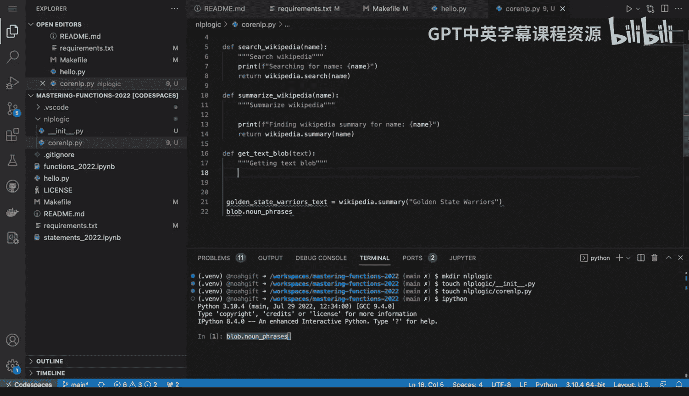

From。We'll just say， what was the syntax It was。

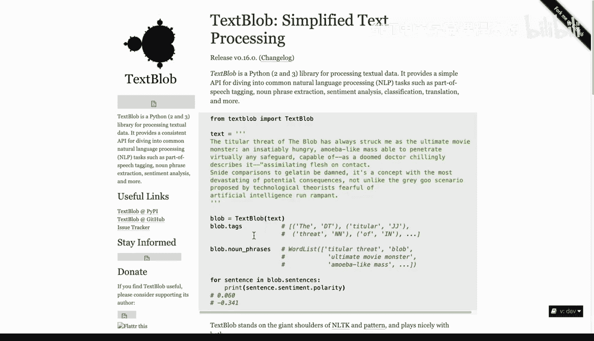

It would be like this。Okay， so we'll say。Blob。Is equal go to text blob。And we just return back blob。

Right， so again。Getits。😔，We'll say gets text blob object。And returns。

Right so that means we can do lots of things with it。 And then finally。

 we'll build one more that says get。Get now， get freezes。Right， so this， this is going to take。嗯。

In fact， we could piece everything together。And we could just say name。Right， so get phrases。

So this will say， like find Wikipedia。Name and return back。Phrases。

So this kind of encapsulates a lot of things all at once。

 And this is really kind of like a main function。 And so we would say first。Get the summary。

 so we would say text。As equal to summarize Wikipedia and we pass the name。And then。

We would say phrases， or would say blob is equal to， and we'll say gi。Text blob， and we'll pass in。

The text。 and then the final step would be the phrases。And we would just say。Is equal to blob。😔，Dot。

Noun。Phrases。And we can just say return phrases。Like that。 There we go。

 So we got find Wikipedia name return turn back phrases。 perfectf。 So。

 so we got some nice little logic here that will allow us to do all kinds of fun things。 Now， the。

 the cool thing。😊，About I Python， is it also lets us just play around with all this code before we even get。

Too far down into building real things with it。So this is， again， the power of function。

 So what I'm going to do。Is I'm going， I'm going to say from NLP。Let's make it a little bigger。

 So from NLP， logic imports。Core N LP。There we go， so we got our library。And now， in theory。

All I would need to do is is type in the Golden State Warriors。InTo the get phrases。

 So it would just wrap everything up at once so we can say。The， the name is equal to。Gordon State。

Warriors。Or years like that。And we say phrases。Physical 2， gi。Phrases。Name。😔。

Git phrases is not defined。😔，Oh， because I need to say。Co core NL P dot get phrases。

So I have a misspelling， which is。Expected noun。P， H。😔，So all I got to do is save that。

Exit out so that it it'll reload。 And I just go through the whole scenario again。 So I just go。

Up arrow， up arrow， imported。Then do the up arrow again， put the name。 So this is really nice about。

About using the i Python。Oh， I still misspelld it。So let let's let's misphes wait， actually。

 let's just find out。What let's just do this。 Let's， let's find out what the heck's going on， so。um。

u。Let's just go one by one。To debug this。Okay， so text that works。Bloob， let's go to the next one。

That's the 1 I care about。PHr。😔，Blob equals。😔，嗯。Core and L P。😔，Dot。Get。😔，Text blob。

And we need to put in。The text。Right so I'm just reproducing what's inside of there。

 And now I just need to say a blob dot。Noun。Underterco。Phrases。So that should work。

 let's just throw that in there。Throw that in there。So was that different， Yeah， that looks。

That looks correct。And so now。If I run the next step and I say phrases is equal to。Corn L P whips。

Core。😔，LlP。😔，Do。um。Get phrases。Text what happens， there you go。呃。Search request is longer。😔，Then。

 the maximum length。Hm。So。Summarize。Get phrases。Search requests。

That's a very strange error I'm getting。Page title， let's see what happened here， so。Get phrases。

 If I go here， we have summarized Wikipedia。Let's double check I'm doing the right thing。

That looks correct。Summarize Wikipedia。😔，Summarize Wikipedia。😔。

So this one is blowing up for some reason。And its s， in an unknown error occurred。

 search requests longer。Please report it on Github。 Yeah， not sure。 Im I'm not sure what's。

 what's going on here， but。嗯。Doesn't necessarily make sense to me。Because。😔。

In this particular scenario， summarize Wikipedia。Is only doing a Wikipedia summary。

And so it doesn't necessarily make sense。 Well， let's try it again to debug it。 I can do this。

 I can see I Python。And I can say from NLP。Logic。Dot core， Nl P。Imports， summarize。Wikipedia。

Like that。 And now， if I just type in text is equal to summarize。Wikipedia。And we put in golden。Stay。

Warriors。Let's see what happens。So I didn't get that。 So， so that is， that is interesting because。

Let's just double check here。😔，Yeah， that looks like that's what's happening。

It's possible I'm introducing some kind of a bug in the code。If， if I look at text。Right。

 that's the text。And。If I say get phrases。 So now let's run get phrases。 So if I， if I say。Oh。

 I know what the problem is。 I'm passing in the text。 I am passing the wrong thing。

 I need to only pass in the name。 So I just need to say like， like phrases like this。

I see what's happening。I'm Mount smarting myself is that I just say get phrases。

And we just put in here， Golden State Warriors。Right soca it does everything。

 Golden State warriorors。The Wikipedia was telling us the right thing。And。😔，We just need to say。

Import that。 So say， from。Nl P。嗯。NLP logic。tcor， NLP。Amport， get phrases。A bur。There we go。

 And there we have phrases。So not bad。In my opinion， this style of。Using a Python first。

To completely build out the logic in functions is a pretty powerful way to code， because。

Some of the tricky things and bugs and all the stuff are already figured out。

 And I I know my way around the code I wrote now pretty well， just by playing around with I Python。

 So now I can build out a tool。Right so I would say the first thing that I would build out here would be a command line tool。

 So again， I'm going to need to。I'm going need to use。A library。 And， in fact。

I would say the easiest possible way。To build a chamelean tool is probably。To use Python Fire。And so。

Let's go here and import fire， and I'll show you what I mean。

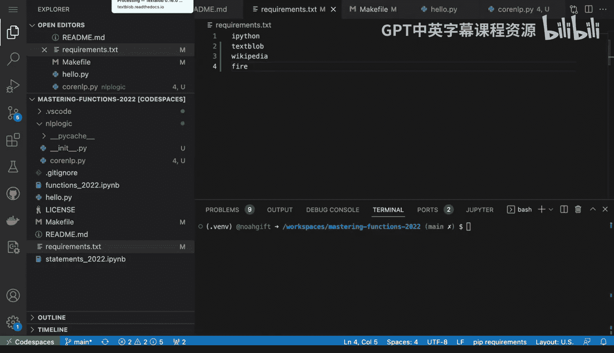

So if we go through here and we say Python fire。Just grab this and we can see it from Google。

 it's a simple way to create a chameleon tool。And it's shocking， actually。

How simple this tool really is。 And so。What you do is you say import fire。

 and then you just builds a cha tool。I believe。That's。We can just copy。This。

And will call this next tool。

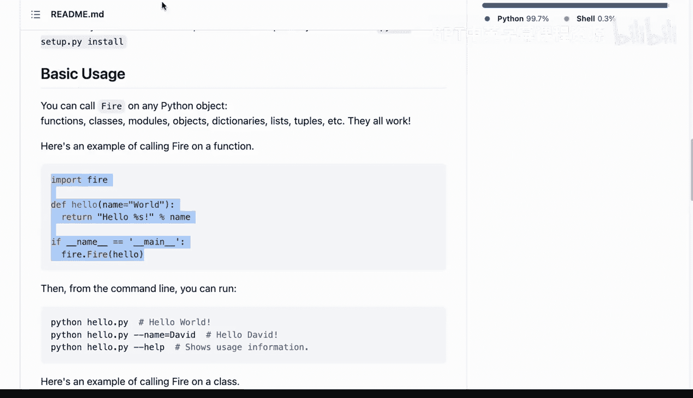

Let's make a new。Function， and we'll call this。Wiki。Wiki phrases， W P Y。And so。From here， I just say。

Pce the sand。So I just kind of copy that stuff。And。😔。

What I want to do is import the logic that I built earlier。 So I want to go to this core LP library。

 So I want to import this thing right here。This does all the work。For us。And so， I'll say。From。Coor。

😔，From NLP logic。Dot。Core in a P。😔，Import giphrases， right？And now。This is what's。

Kind of amazing about it。Is that。I don't even have to。Put code inside of here。

 if I remember correctly。I can just do this。Right， so talk about the world's simplest chie tool。

It's pretty amazing。So。😔，If I remember correctly， and then I also want to do the chabbang line。

And make it a Python tool。 So I'll grab this。And we'll put this inside of here。😔，That looks good。

 I'll need to chaode it。There we go。 And now， if I run it， if I do dash help， does it give me help。

 Oh， I need to install fire。 so I need to。Even though I put it here， I didn't do make install。

 so let's do that， make install。Allright。Help， does it work？Whoops， rung wrongg file。There we go。

 Pretty cool If we go through here。 Look， it gives me all this stuff。 I didn't even do anything。

 right， because it grabs it from the dock strings and I actually have like in seven lines of code。

 I didn't even have to the only lines I had to add was this。

 So kind of an amazing commanding tool library， to be honest。😊，And， and so。In this case。

 we would just do name。And we would say， golden。Stay。Warriors。There we go。

And it's going to go to Wikipedia， grab the summary， then we're going to find the phrases outside。

Kind of shockingly powerful what you can build if you first build the logic in a function。

And then take that function and and put it into a tool like Python Fire。 Now。

 to make this somewhat professional， what we should do， though。

 is we should take this code and we should。Build like a Devop structure so that we have somelinntting。

 some testing， things like that。 So to start with what I'll do is I'll build a test。File。

 so we'll go here and we'll say test。Wiki phrasees。I don't know， test。Core NLP， core NLP。W PY。

 so in order to test now， I'm going to want to add some other libraries。 so I pi test。

And we'll add Py test cove right So this allows us to do test coverage and also add Pylint right So these are all and I'll also add Python black。

 so these are all libraries I like to use。 So I like to you know run test with Py test。

 I like to check for syntax with Pylint。 And then I like to format my code with Python black。

 And so what we can do is make sure that our make file has all the stuff inside of there。

 And so let's add a step called format。Formats。

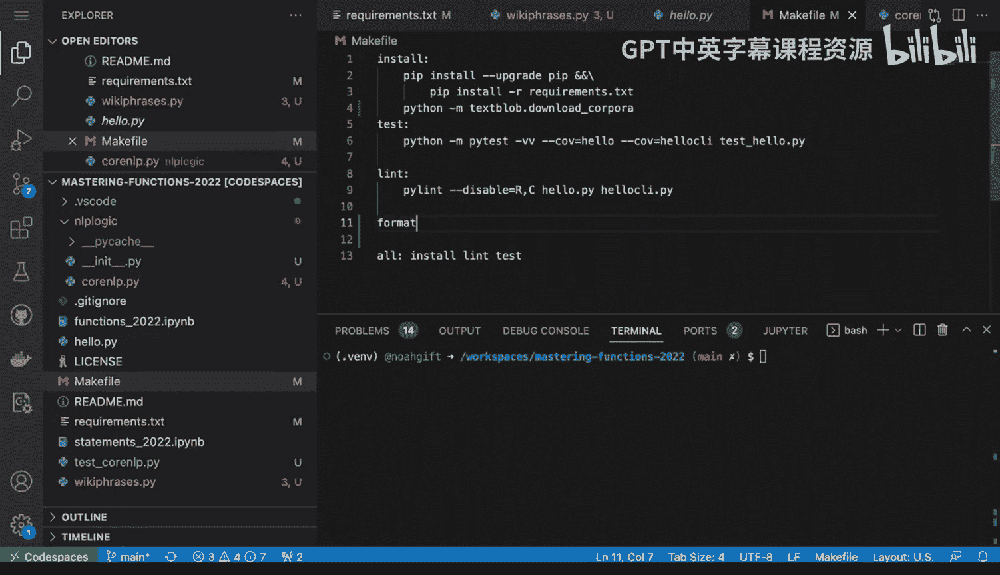

And again， I'm going to use。Stack overflow。Python， black， all Python files。Let's see。

 What does it give me。嗯。Ran。😔，Python black on all Python files。Let's read the documentation。Black。

I think I can just do oh a direct so it works with a directory。Okay， so let's do that。

 Let we'll do the directory approach。

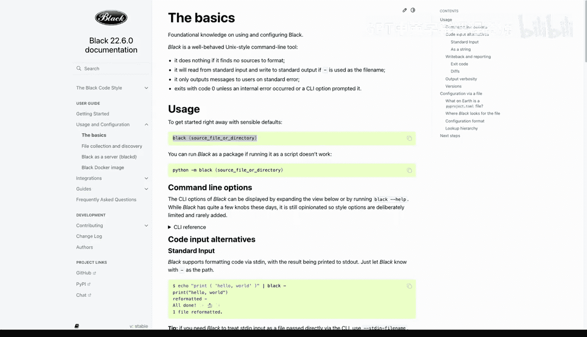

And we'll say black。A W PY and。In NLP logic。 So let's see what happens。Make format。 or actually。

 first， let's make install to get all the libraries。Okay。And then let's do main format。Nice。

 so it cleans up our code。And it did catch all the files， which is great。

 So it makes things a little cleaner。 like if we go to this library， like， look it cleaned it up。

 made it look you know， more presentable。 So I think this is a great idea to add this。

 And then similarly， you know， let's do Pin。😊，In this case， what we'll do is we'll say。Astrik W Y。

As well as。NLP logic。As W Py， let's just get everything。And let's just say make li。

Do we have any bugs？Ooh， nice， 10 out of  ten0， which is always nice to hear。

And then the only other thing we need to do is build a little bit of a test structure。 So for this。

 we don't care about the Hello file。 What we want to test out is the wki phrases。

And we also want to test out the library， which is NLP logic。You know， P。Logic。

And then we want to tell it to look at the test file， which is test core N L P。 Now， if we run this。

I think it'll just say no tests。Yeah， I'll just say no test， right， So0% test coverage。

 So there's nothing。And and now I just need to add some tests， so let's go ahead and open this up。

The test file here。And so。I would do similar to Bill library。 there's some similarity here。

 So I would just say， you know， from。NLP logic。😔，U。Imports。

 and we can just import all the things that are in here， like。You know。We， we could do。This。This。

Can do this。Next one。Good text blob。We don't necessarily have to get complete test coverage， but。

Get close。There we go。And then let's just make one test to start with。

 I can also do make format to make sure I formatted that right。Oh， can I parse this， Yeah。

 I always screw up。The multi import。Thing with Python。Let's， let's do this。 I screwed that up。

 Let's put them all on the same line， and let's let Python black。Slve it for us。

So we'll see if the power of Python black， okay。このアよ。Okay， that's how it wants it， all right。

Python black is the guru。 So we'll listen to it。 So we'll say death。Tests。嗯。

We'll just say not D get phrase， don' we want get phrase。Good phrase。Deaf test， get phrase。

 That's kind of the， the core one that we care about。And we just。

 I guess what we were what we could do。As we could。

 we could just do a functional test keep things simple， and we could just say a search。That's。

If we look at the last thing we ran here。When we did we did the commandme tool。

 what was in the outputs？It was。Well， we can just run it。 We can just say up arrow， find。 Here we go。

 What， what shows up in the output here。So。Golden state， okay。

So let's just say assert that is inside of。Get phrases。Gol and state， right， that's an okay。

It's an okay functional test。Alright。So now we have at least the tests。And so what we can do。

Is we can look at our make file here and we just， we're going to run this make test。

 So if we say make test。We have a bug。And it says it couldn't import search Wikipedia。

Because I probably did the import wrong。睡出。😔，Well， how about this？

I say with the promos dot Corin Al P。 There we go。 That's what the issue is。

It's going to run our functional test。There we go。 We have just from that one functional test。

 88% test coverage now。I am curious。Wiki phrases。H yeah。I guess wki phrases was nothing in it， so。

Now。Let's check all this in。So let's do get add star。Commit this。Adding an NLP KimA tool。

And let's go ahead and push this。And now what we can do is go back to the repository。

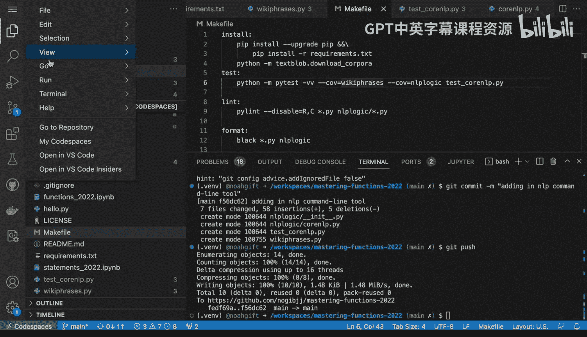

And let's use Github actions to do continuous integration， right， which is， I think。

 so easy to do that。You should do it。And if we go through here。

 we can just set up a workflow ourselves。And not too tricky to build things out here。

 I always just have some other GithHub actions that I built previously。

And so if I look at function bike rider here， I probably have one I can use。Sure， this looks good。

 let's just take this as a template。And I just go back to here and paste it in it。

 And I can tweak it。 So the idea here is that this Yaml file will。

 will test our project automatically for us。 And so this is on Python 3，8。I believe。

We probably let's open up a new terminal。And let's open up。What's the the last reo， here we go。 Let。

 let's open up gettthub code spaces again and just see what version of Python we're using because。

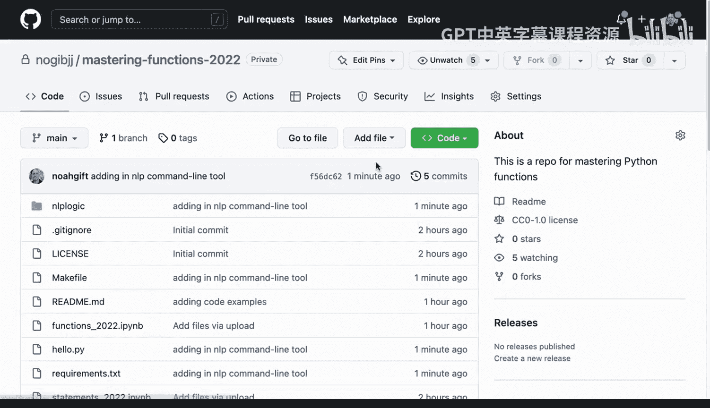

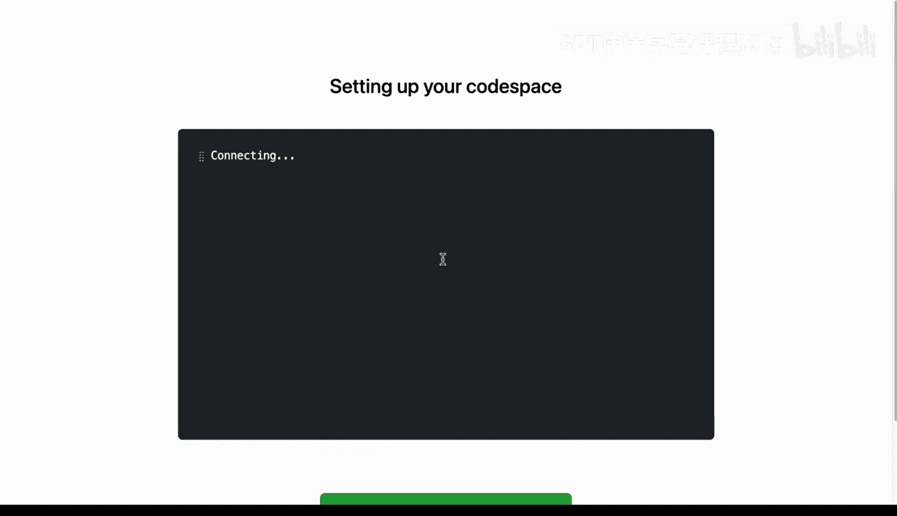

We want our build system to test the same version we're using inside of our project。 So we'll。

 we'll just type in Python。

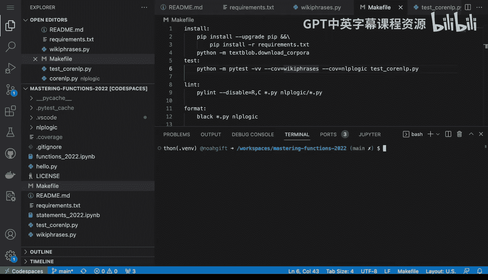

Here。😔，Okay，3，10。 So let's test 3，10。 So we'll change this to 3，10。And then we'll go through here。

 I will say 3，10。And we have make install， make Lint。I would say at the very end。

 we should do a format， even though the formatting won't keep。It'll at least tell us。

That the code would need to be formatted， which is something to just be aware of， Like。

 if I was looking at the build process， it could help me debug something in the future， right。

 I could go， oh， wait， I didn't。 I didn't run wait make format。 So we'll say make format。And then。

 here， we'll do。Format。With。Python black。There you go， make format。Start the command。Perfect， now。

 if I go to actions， we can see this in action。

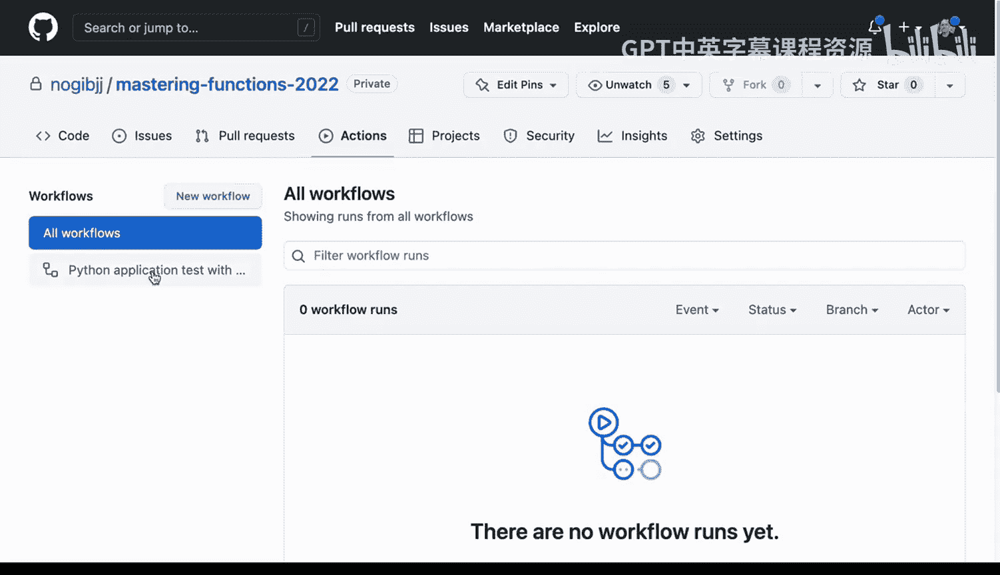

Its building。And this will。Hopefully， work on the first try。And this will test our project。

 link our project， format our project。Well， we have one problem。It says。Available versions。3，10，5。

 Okay， so I think it's telling me。

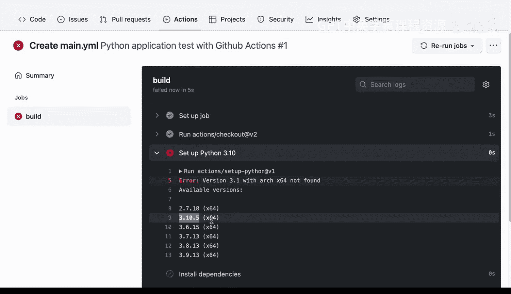

That。That's， that's not good enough。That I need to put 3，1，5。Which is fine， let's do that。Which is。

 which is all helpful， Like bugs are actually。Are helpful information because it lets us be very specific。

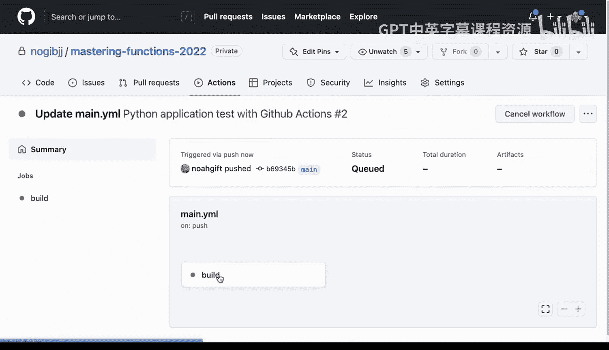

About seeing what version of Python this is tested with。Okay， there we go， set it up。

 install in dependencies。 remember it's also going to do the corpus download。

 which is actually also a nice functional test。And。There we go。Now it's going to go through。

Linter code。😔，Ourlinntine is successful。 Oh， it was not successful because it did correctly identify。

 We did some naughty things， which I didn't use these imports。

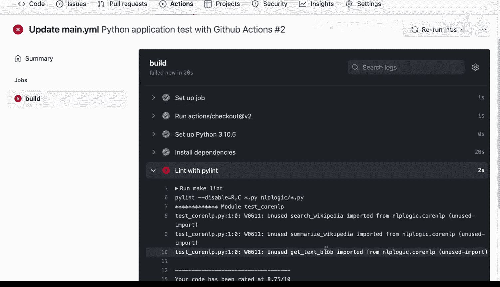

Not a problem， we can fix that。We can go over here， so we don't want to import things we don't use。

So。Let's fix that。It actually makes the code easier to look at easier on the eyes。There we go。

 And it's， I guess， make。Lynz。😔，It'll be larger。There we go， so get status。Get add test。😔，Get commit。

Adding import fix。Push this change。 and now。Oh we need to do a gi pull first because we added Gi of actions。

So it's always fun to play a git。And then we close it。It'll merge。Whoops， merge message。Get push。

There we go。

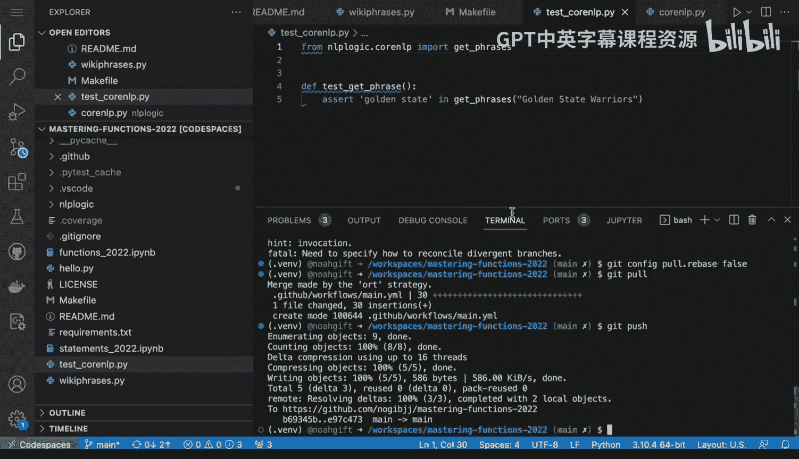

So， now。Wei。😔，Go back to actions。Merge the branch。Look at the build。And we should have this。Cooking。

 so。Seending up Python 310 and slowing dependencies。Lining the code。Testing the code。Or first。

 we have to deal lens。Running the test。Foratting， perfect。We've got it。Awesome。

 we can create a status badge Now。 Just copy this。

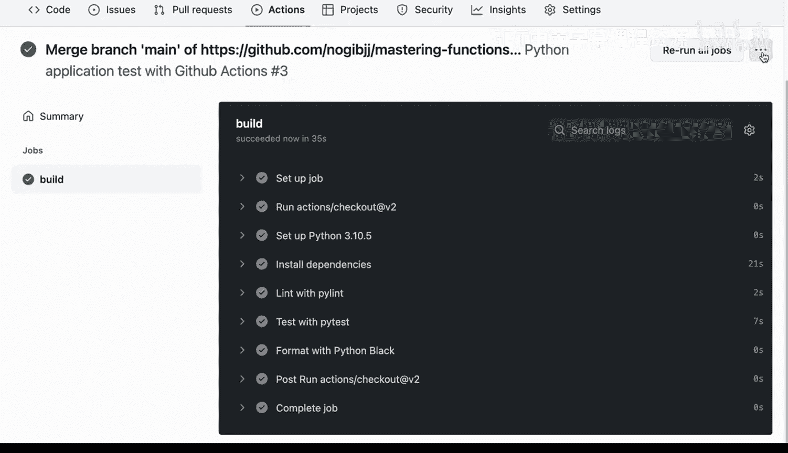

Go back to。

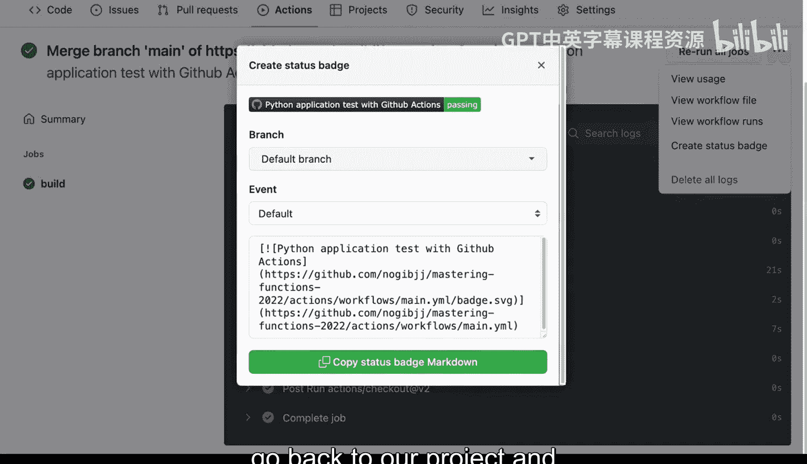

Our project and just make it really cool by adding a working status page。

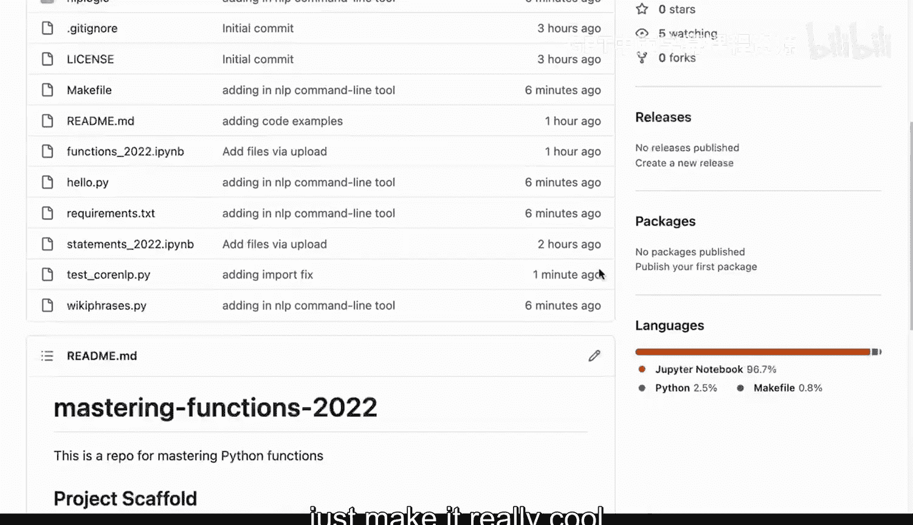

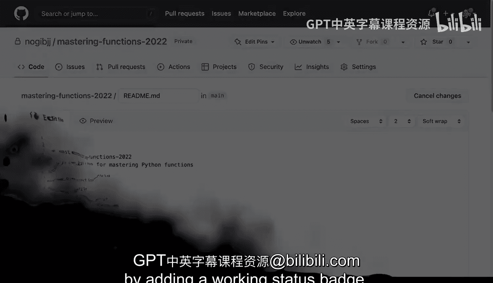