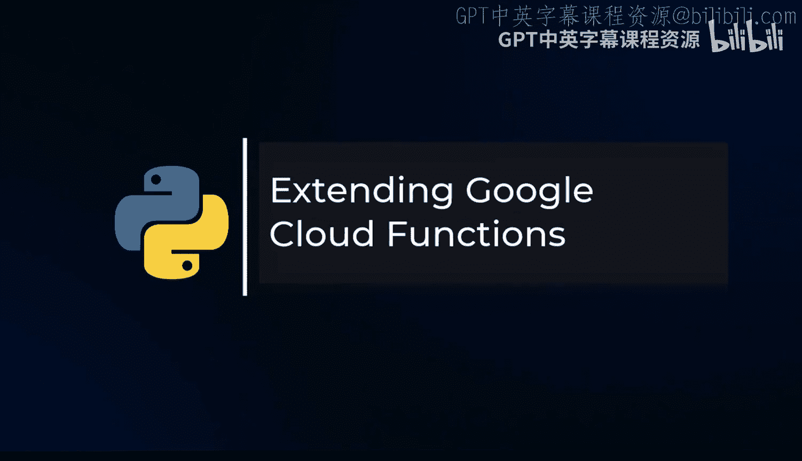
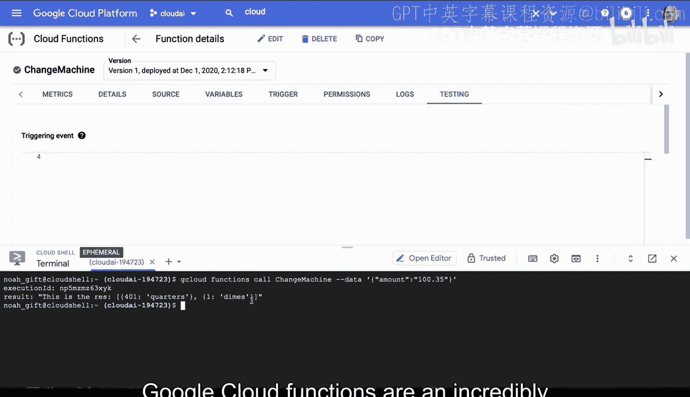

# 杜克大学｜机器学习运维｜DevOps⧸DataOps、Azure、MLFlow和抱脸｜MLOps ｜ Machine Learning Operations p38 45_03_04_扩展Google-Cloud-Functions.zh_en -BV1yE421c7uA_p38-

Okay， so let's take a look at this Google Cloud platform here and see how we can use it to build things quickly。

 I'm going to go and search for cloud functions here and let's go ahead and pull that up。

 There we go， Cloud functions and notice that I have a couple functions here。

 a change machine and also something that uses other things。

 but I'm going start with creating my own and we'll come back to those。 So first。

 let's go ahead and create a function here。And once I do this。

 it'll give me a dialog box that says you know function name， the region， the trigger。

 we'll go ahead and say hello here and notice these trigger types right there's the regular web service which I can invoke from a curl command or a postman or something like that I can also do pubss or this is a great tool for a data engineer being able to respond to largescale jobs or dataPro or Spark or something like this。

 you can also trigger things like cloud storage Firestore。

 there's all these like platform as a service databases and things like that that you can trigger so really it's a building block。

 a core building block for things in the Google Cloud platform。Okay so once I've done this。

 I'm going change this to allow unauthenticated invocations so I can quickly prototype things when you're playing around。

 I think that's a great way to use this service and then the next thing I'll do is go through and change my runtime you can see here that you can usenet go Java all these different runtimes I'm gonna pick Python 39 and notice that there's this inline editor。

 which is the default most of the time when you start that's where you want to really stay although you can upload zip packages。

 you can upload things to cloud storage or you can even hook into Google Clouds proprietary get source code management system again inline editor is the way to go Now notice the requirements Txt here allows you to install thirdparty libraries but let's go through here and just look at this hello world here and see that it accepts messages inside of a。

HereAnd you could actually parse adjacent payload if you wanted to or if there's some kind of a problem。

 it'll default to hellello world let's deploy it and then we can play around with it。

 So notice here that once we start deploying it it takes a few let's say like a minute or two to load and fully operationalized things you you can also。

Go into this actions section here and do more things like you could for example make multiple copies of it or look at the logs。

 but in general what you want to play around with is the testing functionality which is there's a trigger which would allow you to remotely trigger it or testing which allows you to test it in the console and in this particular example you could just put some kind of payload and whether it's successful or not the Hello world will just kind of pass things through and respond back to whatever you've passed in。

In this case， we could say messages， hellello world。

Okay so you know once this thing is done again it'll take maybe you know 10。

20 seconds here to finish， then it'll be able to take that trigger that shows up from the console and and actually pass that into the request object。

 the Google Cloud function will engulf it parse whatever it needs to parse out and then return back result So we're ready to go let's go ahead and test this function there we go and we should see the results of our invocation there we go。

 hellello world right so again that's that's kind of a trivial example。

 but let's make something a little bit more complex and what we can do is build something from scratch and so let's go ahead and take a look at how that would work so。

What I'm going to do is I'm going to look at this more complex function here which is translate Wikipedia and if you notice here that it's importing to thirdparty libraries。

 it's importing the Wikipedia library which allows us to parse web pagess and you can see that I had to put those into the requirements TxT file in both scenarios and then also Google Cloud Translate which allows me to use the Google natural language processing API so these are definitely some hard requirements for me to use this now then I just took some sample code directly from the Google documentation here。

 I mean this is essentially the just some function I copied and then I went through and I made my own handler here called Translate test so you can change the name of the Google Cloud function handlers and then I just parse basically entities language and sentences so what's the Wikipedia page how many sentences do I want to grab like。

2040 you know100 sentences and then what's the language I would like to translate that to so there we go that's the whole function in a nutshell。

To invoke it， all I need to do is go to testing and once I go to testing。

 I can paste in adjacent payload here that will get passed into this cloud function and notice here that its entity equals Facebook that would be the Wikipedia page sentences would be 20 and then the language would be Spanish and so if I go through and I test this out。

This will invoke this cloud function。And it'll do a lot of work for me behind the scenes。

 including grabbing a web page and then again using NLP there we go So pretty useful service here and you can see how you could really add a lot of value to an organization very very quickly by using this kind of technique and now you could also trigger this via the curl command or postman if you pass an adjacent payload so this is ready to go it's already a production service which again shows how powerful it is Now another kind of cool way to invoke this。

 especially if you're building things a lot from the command line is to use this G cloudud functions call and notice what it does here is it allows us to invoke any Google Cloud function by name and then also we can do data and it'll pass a payload to that Google Cloud function so really in a nutshell super super useful way to invoke。

Things for you know data engineers there we go， we got this thing passed in it's been translated to Spanish so there's a lot to like about rapidly building solutions with Google Cloud functions and you know really maybe the next thing we can do。

Is try out you know a different one more example to really kind of hit things home here so let's go back again to cloud functions and let's build another one and in this case we'll build one from scratch that's a little bit more complex so let's go ahead and create a function and we'll go ahead and make something that returns back change so I'm going change the function name here there we go create change and then again we'll leave everything as HttP trigger allow onauthated invocations。

That looks good we'll go ahead and say save next and again change the runtime to Python 39 perfect Now in this case we can just cut I can just cut and paste some code because I'm not going to use a third party library pretty straightforward and I'll walk through this code。

Here we go， here's a function that uses Jason it goes through and requests a payload that has the word amount in it and amount will be the change that I'm going to give and so then I use a greedy algorithm that finds the largest coins first uses those and consumes them until it can get down to an even remainder so I'm using the Python library really standard library to do all this work so it's pretty straightforward and then I go ahead and I deploy that now because it'll take a minute or two and we're in a hurry I can just go to an existing cloud function that I've already created and we could just test that out because it's the exact same code so。

If we go to this existing example here， change machine。

 I can also go to testing and I could just put in a trigger in this case we'll say a amount。

There we go and then I'll say $1 and 34 cents or $1 and $34 here and then test it out and it will allow me to really easily get a payload result so pretty easy to build solutions very。

 very quickly with these cloud functions and finally we can actually do the same thing we did before。

 which is we can actually invoke the function that that we're calling from the console into the terminal here by using the Google cloud functions in vocation from the command line here we go。

 we change it to change machine。I go through here and I just clean up the data a little bit it's just going to be a different J payload。

 we'll say a amount and I'll put in some amount here。

 and maybe make things a little bit interesting and say $100 and you $35 what would be the correct amount of change for that and just coins。

So if we go through here and we run this， we see that the calculation would be it would be 401 quarters and then one dime so really in a nutshell。

 Google Cloud functions are an incredibly easy way to do data engineering and if you're impatient it's a great tool to use。

