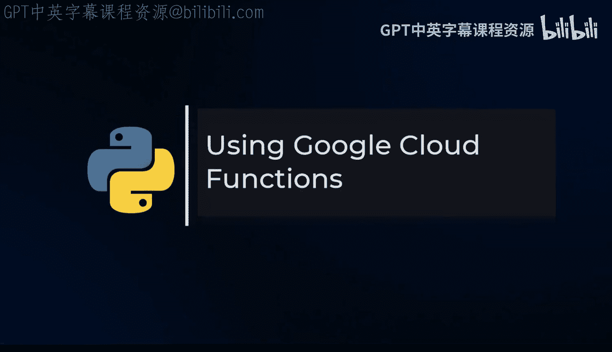
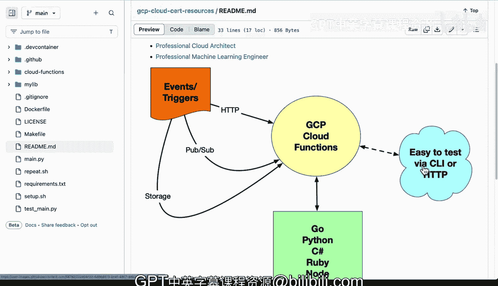

# 杜克大学｜机器学习运维｜MLOps：39：使用 Google Cloud Functions



## 概述
在本节课中，我们将学习 Google Cloud Functions 的架构、创建流程以及如何测试函数。我们将通过一个简单的“Marco Polo”示例，演示如何用 Python 和 Go 语言编写并部署云函数。

## Google Cloud Functions 架构简介
首先，我们来看看 Google Cloud Functions 的架构。这是理解 Google Cloud 平台计算工作原理的最佳方式之一。

第一步是事件触发器。这意味着在触发器系统内部，你可以监听诸如存储事件（例如将图像或文本文件放入存储桶）、发布/订阅消息流，或者简单的 HTTP 调用。这些事件都可以触发云函数的执行。

Google Cloud Functions 的优势在于它支持多种现代编程语言，如 Go、Python、C#、Ruby、Node.js 等，并且易于通过命令行或 HTTP 进行测试。

## 创建云函数
上一节我们介绍了架构，本节中我们来看看如何在 Google Cloud 控制台创建一个云函数。

首先，进入 Google Cloud Functions 界面，选择“创建云函数”。你会看到有第一代和第二代两种版本。第二代提供了更多触发器和功能，但目前仍处于初步阶段。本教程将使用第一代。

以下是创建函数的主要步骤：

1.  **为函数命名**：例如，可以命名为 `hello-world`。
2.  **选择触发器类型**：对于初学者，从 HTTP 触发器开始是个好选择。你也可以配置其他触发器，如 Pub/Sub、Cloud Storage 或 Firestore。
3.  **设置身份验证**：一个良好的默认设置是要求对调用进行身份验证，除非你明确要创建一个公开的 API。
4.  **选择运行时环境**：接下来，选择你希望使用的编程语言。平台提供了丰富的选项，包括 .NET、Go、Java、PHP、Python、Ruby 等。我们选择 Python 3.11。
5.  **管理依赖和代码**：所有语言的云函数都提供了依赖包管理功能。你只需在此处列出依赖项，平台会自动安装。代码入口点处的函数名（例如 `hello_world`）需要与你在第一步中指定的函数名匹配。

## 编写函数代码
现在，让我们编写一个比简单“Hello World”更高级一点的函数。我们将创建一个函数，它接收一个包含 `name` 字段的 JSON 请求体。如果 `name` 是“Marco”（不区分大小写），则返回“Polo”；否则返回“I don‘t know you”。

以下是 Python 版本的示例代码：
```python
def hello_world(request):
    request_json = request.get_json()
    if request_json and 'name' in request_json:
        name = request_json['name']
        if name.lower() == 'marco':
            return 'Polo'
        else:
            return "I don't know you"
    else:
        return 'Please provide a name in the JSON payload.'
```
编写完代码后，点击“部署”按钮即可发布函数。

## 测试云函数
部署完成后，我们可以测试函数。进入函数详情页，选择“测试”标签页。

平台提供了两种测试方式：
1.  **在界面内直接测试**：你可以在提供的文本框中输入 JSON 负载进行测试。例如，输入 `{"name": "Marco"}`，点击“测试函数”，应返回“Polo”。输入 `{"name": "Bob"}`，则应返回“I don‘t know you”。
2.  **在 Cloud Shell 中测试**：你也可以选择在 Cloud Shell 中使用 `curl` 命令进行测试，平台会生成相应的命令供你使用。

## 使用 Go 语言示例
为了展示多语言支持，我们再看一个 Go 语言的相同功能实现。

以下是 Go 版本的示例代码：
```go
package p

import (
    "encoding/json"
    "fmt"
    "net/http"
)

// NameStruct 定义了期望的JSON结构
type NameStruct struct {
    Name string `json:"name"`
}

// HelloWorld 是云函数的入口点
func HelloWorld(w http.ResponseWriter, r *http.Request) {
    var d NameStruct

    if err := json.NewDecoder(r.Body).Decode(&d); err != nil {
        fmt.Fprint(w, "Error decoding JSON")
        return
    }

    if d.Name == "Marco" {
        fmt.Fprint(w, "Polo")
    } else {
        fmt.Fprint(w, "I need another name")
    }
}
```
测试过程与 Python 版本类似。在测试界面输入 `{"name": "Marco"}`，函数将返回“Polo”。

## 其他功能与管理
除了编写和测试，Google Cloud Functions 控制台还提供了其他实用功能：
*   **监控指标**：你可以查看每秒调用次数等指标。
*   **编辑与重新部署**：如需修改代码，可以点击“编辑”，调整后重新部署即可。
*   **查看日志**：日志页面对于调试和查看函数调用历史非常有帮助。

这构成了一个完整的、基于事件的轻量级计算环境。



## 总结
本节课中，我们一起学习了 Google Cloud Functions 的核心概念。我们了解了其基于事件触发的架构，逐步完成了创建、编写（使用 Python 和 Go）、部署和测试一个云函数的全过程。我们还看到了平台提供的监控、日志和编辑等管理功能。Google Cloud Functions 提供了一个支持多语言、易于测试的完整无服务器计算环境。