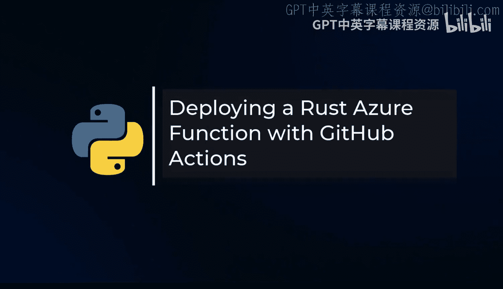
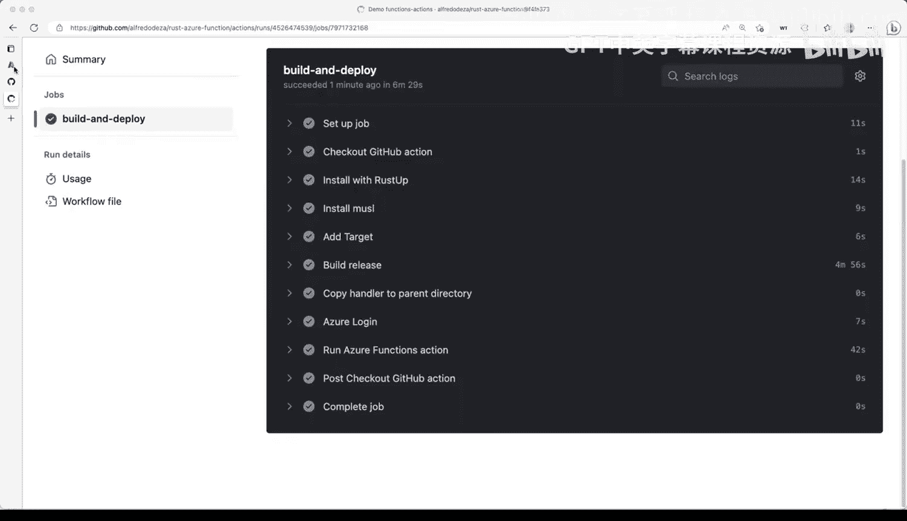
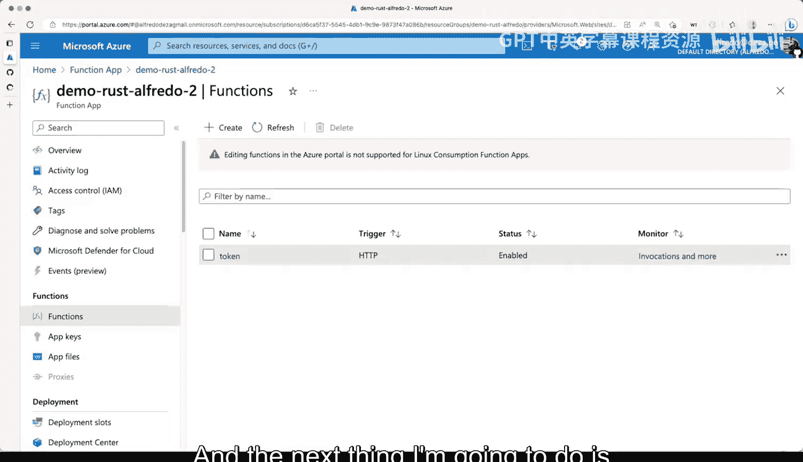
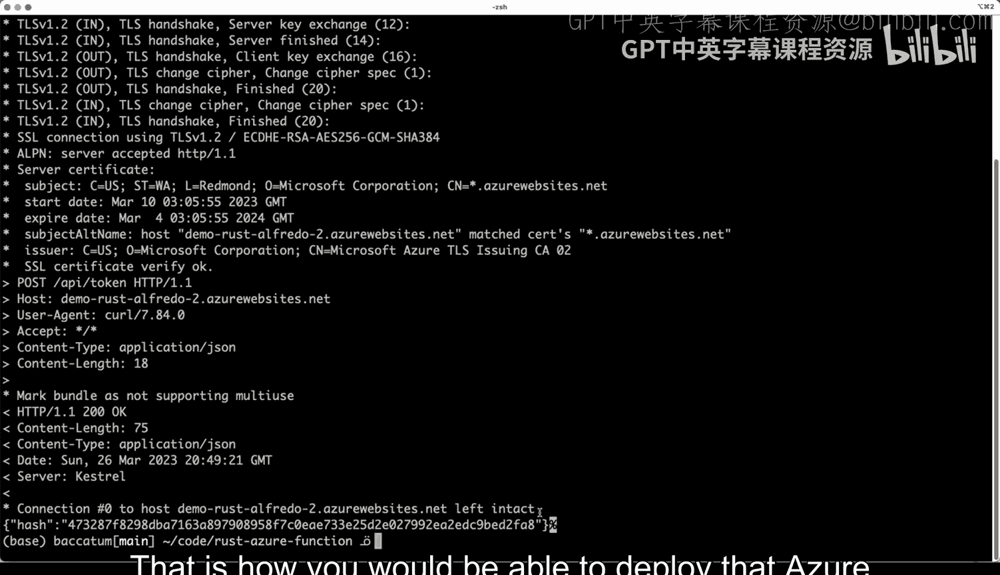
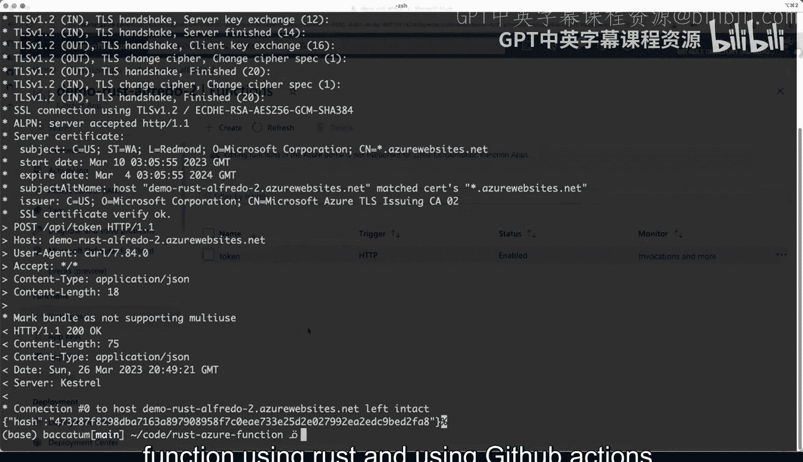
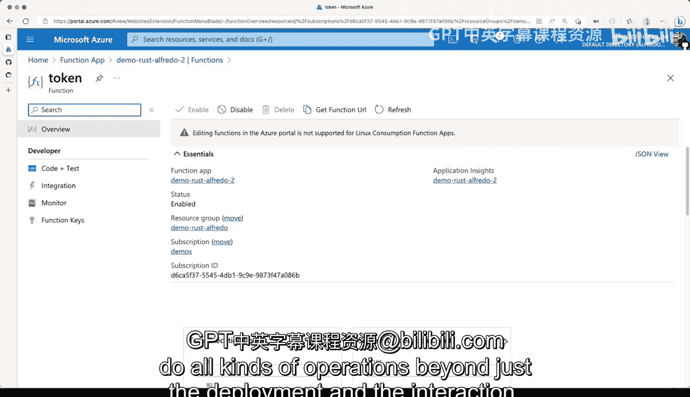

# 杜克大学｜机器学习运维｜DevOps⧸DataOps、Azure、MLFlow和抱脸｜MLOps ｜ Machine Learning Operations p40 47_03_06_使用GitHub-Actions部署Rust-Azure函数.zh_en -BV1yE421c7uA_p40-

Now let's see how we can do Azure Azure functions。 Let's use rust a little bit of rust with Azure functions。

 So the first thing you need to do is， of course， come to the Azure portal。

 This is my account and I am going to create a new function application so you can either select it here or search for the resource right there so I have it here when I make use of that function app so wow there seems to be a couple of already a few ones that I'm using I'm using for those a different subscription I'm going to create a new one and walk you through what that will look like so that subscription looks fine is one that I have for demos for my resource group the name of the research group I really usually like to create a new one that is that will be name something that is meaningful for me so I'm going to use something like I'm going click that one I'm going to say demo rust freto that looks okay。

And usually for a function out name， I'll use something the same。

 it seems like this one's taken taken already。 So let's try to this is something that might happen。

 And you do you notice this it's azure websitenet it means that it needs to it needs to be unique So let's try to make a unique and when I say number two。

 How about that， then we get a green check。 we are good to go So this is code So what are some of the things that are gonna happen here when we're using rust。

 well， we need a runtime stack。 So is this thatnet， no Js。 Well， rust is not here。

 What we need to have is say custom handler。 The reason is that rust doesn't have a specific support as an azure function So we need to have a custom handler All so that looks correct There's no version because it's old custom is us seems correct to me and what gonnana have is we to do the Linux。

Operating system for rust。 and that looks correct consumption serverless。

 That's the default will give me the ability to save when I'm running that。

 you have a functions premium， a different app service plan。

 consumption serverless is definitely fine。 So this looks good。

 demo rustalredo to and the demo rustellfredo is a resource group。

 So I'm gonna to say review and create。 and then once that's there， I'm going click create。

 and this is going to take a second， you're gonna see initializing the deployment。

 So deployment is in progress。 And while that's going I'm going to switch over to different tap where I have the actual code。

 So this is the code that I have it is rust Azure function。 it has several different files。

 You can generate these files if you are using visualseer code you can actually say hey。

 I want to have a new Azure function and you will have to install the actual。

The actual extension for Vi Studio code to generate some of these files and thats certainly is something that is possible and you can do that yourself but here I already have them generated so I'm switching over to Vi Studio code so that you can see what I'm talking about I'm going open aette and I'm going to say Azure functions and I'm going click create new project so you can see select the folder I will contain your function project so this looks like the one that I want and then I'll say which one I want well want a custom handler and then this will walk you through some of the things that you want to have so you can have like an HttP trigger that looks like the right one I'm going to be using an E so I would select this one and then I would name name exactly that rust Azure function however I want in this case it says HtP trigger number one Now once you complete all of this process you will get some files added here you。

let's talk let's take a quick look so you'll see hosts adjacent， you'll see some of these things。

 the full executable path that is the resulting that is the resulting binary that you will have after you build rust that you will be using for your serverless your Azure function。

 which is a serverless application youll have that this is how you will be using so then we'll have some local settings which are not interesting really and and then that's it so you will have definitely the configuration now one particular thing that is very important that we do is having this configuration added to cargo。

 we're gonna to say target and we have to add these because otherwise it won't work for the environment Azure function So this is something key that you must have present in your configuration otherwise it won't work now let's go back to the portal and we'll see the deployment is complete we're gonna go to the resource we've created our function app now。

We've created the function app， but this is kind of like the container。

 but it's not an actual Docker container， but it's kind of like the name where all of the functions that are going be created are going to appear we haven't created an actual function just yet so because actually if you go here you will see that there's there's nothing going on right And if I click functions you'll see that there are no results。

 So this is kind of kind of weird right we're trying to we in we just created the function app。

 but like there's no functions。 So what's the deal。 Well， these groups them together。

 I can have 20 different functions here for the same demo rust Alfredo to which we have here So that's pretty good and from here we will need to have the name of the function which is in this case is demo rust Alfredo2 and we need to have that because what we're gonna to do next is。

You could definitely deploy these from Vius Studioudio code I'm going to show you some very cool automation that you can do so going back to the repository this is Azure function and I'm going to show you how to actually deploy it and the one thing that we need is the Azure function app name so in this case is's not demo Raal Fre so let's quickly go and edit that it's going to be dash2 over here。

And let's quickly go through the things that we need to know。 It looks like that's fine。

 Azure function name will be used there。 I'm going gonna to commit the changes and now I'm going to walk you through everything that these Yal file for Github actions is going to be doing so actually I need to do one more edit which is this non workinging functions actions this is actually working and demo function actions look like a good name this is going to be displayed on on the UI so we have name demo function actions workflow dispatch will allow us to click a button and be able to execute these as you saw the Azure function name is what we just created this default is fine the Azure function package path that's the root of the project。

And then we will go and start building these on the GiHub action runner itself so let let's go through each of the steps that we have here so we're going to install rust stop we're going to make sure that we're installing muscle tools as well because we will need these to compile our binary so that it works on Azure functions we need to make sure that we are adding the target so that has to happen this x8664 unknown Linux muscle needs to be there and when we're building which is the next step we need to build using unknown Linux muscle again that is required so that we can run properly in the environment of the Azure function Finally we're going to go and copy the handler that executable and resulting binary to the parent directory remember that configuration that set handler's that's these resulting name right here and that's going。

To go to the root of that directory and then we're going to log in onto Azure and we're going to use the Azure credentials where are these Azure credentials coming from。

 These are a service principle， which I show you in a second how that works and then we're going use the Azure functions action so that we can actually deploy so let's take a look very quickly at what Azure functions are are actually what the Azure credentials are So the Azure credentials will come from this command。

 it is an Azure Ci， make sure that you're authenticated。

 you can use it from the Azure cloud shell the Azure cloud shell。

 if I'll show you in a second is you can access it by clicking that button right there it will populate a shell over here you will be already authenticated and you can run this whole command。

 let's quickly walk through the command and what it does Azure Azure active directory service principle create for our back we're gonna name gonna have a name make sure that this name is unique across。

y subscriptions and perhaps even can across your tenant we're going to have to use this flag that you might get that it is a flag that is going to be deprecated but it's fine。

 you'll have to keep going and accept that because it's what it needed for the Azure function the role of contributor and we're gonna to set some scopes and you can you can restrict what this service principle will do for the resource group and finally youll get as a result a big JSON blob and that JSON blob is going to go onto your secrets for the repository I'm going to scroll super fast all the way to the top and then I'm going to go to settings and then I'm going to scroll here on the left and go to let me see securities and'm going to say secrets and variables I'm going to select one for actions because we're running actions and then you can see here they already have it so if you don't have it you will create a new repository secret you name it Azure underscore credentials and you paste the output of that JSON with all that you will be able to。

Run all of these and deploy your application。 so in this case we have a very。

 very simple application， let's quickly see the source soon as see source and main R and it is something that will take a string as input and willll create a digest and will return it back you can see here that a hash is what we're going to return back and then our one thing that Azure functions require is to have your your code。

 your pieces of API under slash API so in this case I'm saying this is token and this is tokenize and thats that's what we're going to be exposing and this is the main here you have another one that is pretty important for Azure functions you're going to have to have a specific you're gonna have to map your function to interact on a specific port and that is coming from this environment variable functions underscore custom handle。

Under port that is injected run time so when we're starting up Act web in this case。

 it will use that and it will put it right here when we're binding to any host and we're running。

Alright， so now what we're gonna do is we're gonna go to actions and we're going to find we're gonna to find our demo functions actions。

 which is this one and then when I run that workflow and then we are going to click this This is what workflow dispatch allows us to do remember we had that in the YamO file and it will take a second and we'll show up here very good。

 and now it's build employee is showing up Now this will take a second let's wait until this complete and then come back to verify everything worked okay so our Github action or GiHub workflow finished you can see here it took about five minutes to complete it was correct correctly deploy everything again the steps install rust up muscle added the target。

 build a release which gets us to create the binary copy the handler to the parent directory the resulting binary then we authenticate against Azure that works correct。

And then it runs theure functions to deploy。 So nothing else you see here。 I mean。

 only if there were errors you would be wondering like trying to investigate what's going on there。

 let's head back to demo rustal Fredo2 which is our function app once you' are here you'll head over to functions and click that and you'll see now that this one appears。

 So token is the one that appears then you'll see that there's execution costs。

 I mean theres there's nothing there， you can inject function keys that there's all kinds of things that you can you can try here。

 I'm gonna close these and the next thing I'm going do so I'm going try it out on the terminal All right so I'm here in the terminal and I'm going walk you through the actual command。

 So first we start with curl I'm gonna send up an Htp request that's what I'm going to use vervos to get all kinds of details the header is going to indicate that this is a J post it's going to be a J request and dash。

Po is going to send a post request。 The data is going to be this Jason body that starts here text with a key end string as a text。

 and then finally the URL is going to be this one starting with demo rust Alredo2 remember that's why it needs to be unique and the actual URL I'm going to use the endpoint is slash API token So if I run these I'll take a second and you can see that at the very end。

 we get that hash compute。 So there you go that is how you would get you would be able to deploy that Azure function using rust and using Gi Github actions。

 So if you go back to the portal you will be able to try to get other settings you can check service plan even if you click here you can again interact with that get the function URL and do all kinds of operations beyond just the deployment and the interaction。

