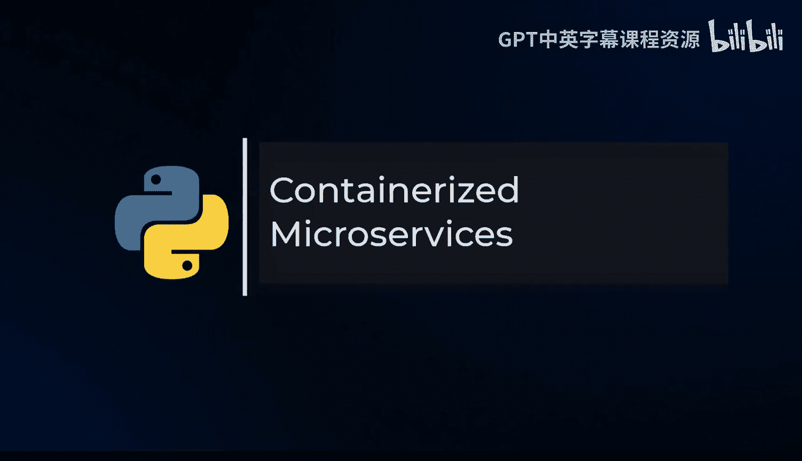
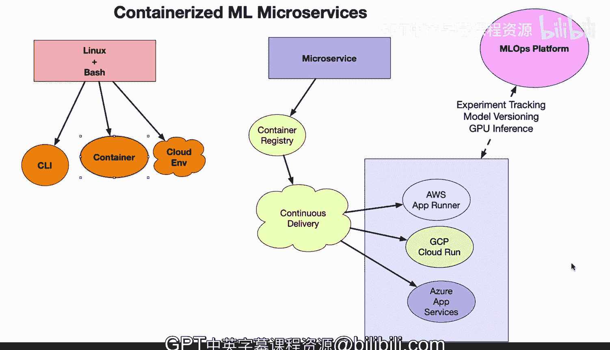

# 杜克大学｜机器学习运维｜DevOps⧸DataOps、Azure、MLFlow和抱脸｜MLOps ｜ Machine Learning Operations p41 48_04_02_容器化微服务.zh_en -BV1yE421c7uA_p41-

Here is a containerized machine learning microservices idea。 And first， we have Linux and bash。

In this particular example， we could be interacting with Linux in Bsh with a command line tool。

 We could be using containers with Linux in Bsh。 We also could be using a cloudbased environment。

 These could include AWS cloud 9 or for example， Github codespaces and this is where I would build out my container。

 Now when I was ready to deploy I could hook up into the microservice framework for the cloud provider。

 These are provided via container registries where I would register my container。

 and then I would do a continuous delivery process that would deploy to one of the cloud platforms continuous delivery platform as a service offerings。

 And here's a good example AWs apprunner is a microservice friendly framework that allows you to take a container and push it out automatically either through a build system like AWS code build or through your own build system like Gitthub actions。

The Google Cloud has a similar container based deployment called GCP Cloud Run。

And Azure app services also has a similar service that allows you to do containerized workflows。

 There's also another step that you could add and that's by integrating with an MLOs platform。

 So what this means is that potentially you could deploy some models by interacting with an API call and then calling an inference inpoint that's sitting out somewhere and this deployment target is then using that MLOps platform to make your API calls。

 Another thing you could do is your microservice may need to interact with the experiment tracking service potentially you could have an internal tool that's working with experiment tracking and potentially looking at the latest version。

Of a model that has the best metrics and automatically picking that model for the interaction with the platform as a service offering。

No， the big thing to take away with this kind of a workflow is that the container makes things possible。

 The container by packaging the runtime as long side the code allows you to do these really efficient microservice based continuous delivery。

 So if you are going to build microservices， I think these three platforms， EWS apprunner。

 GCP Cloud Run and Azure app services are a great place to start。

