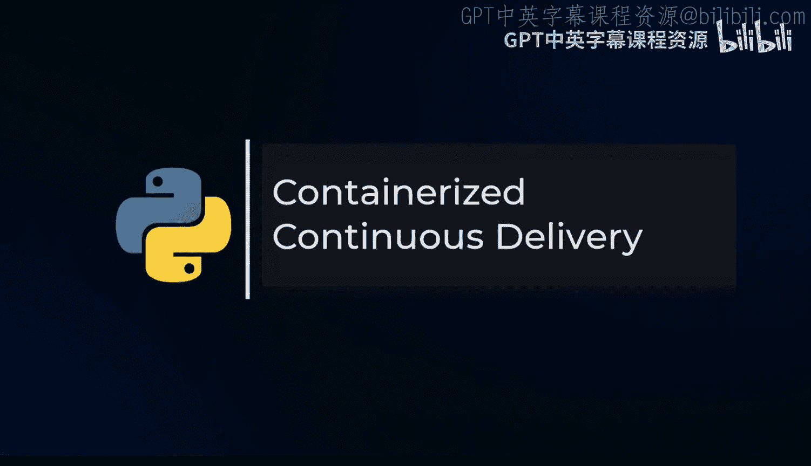
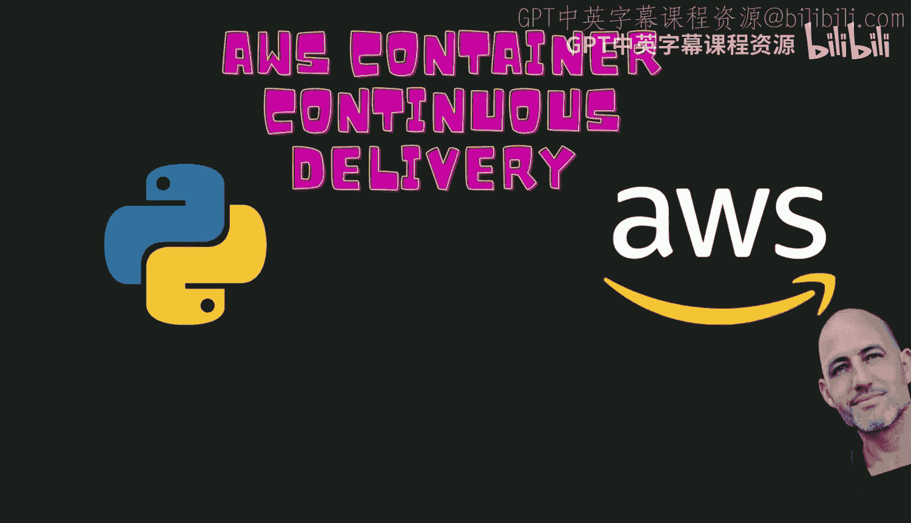
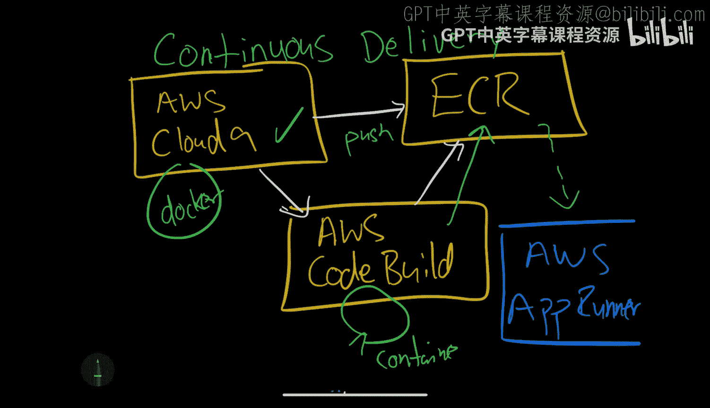
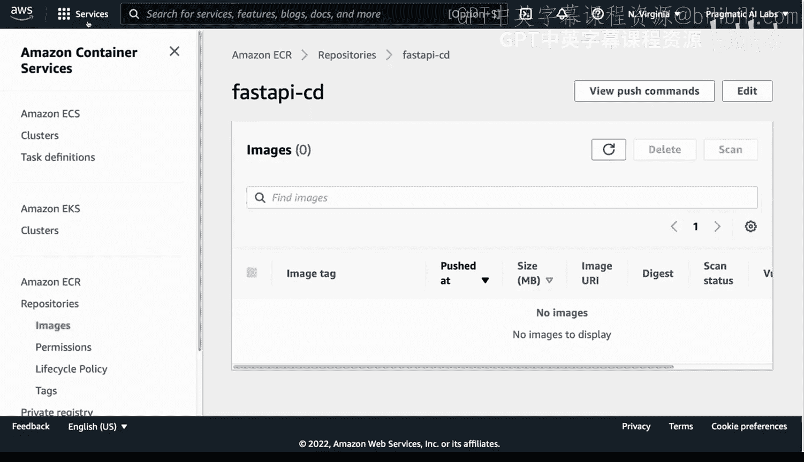
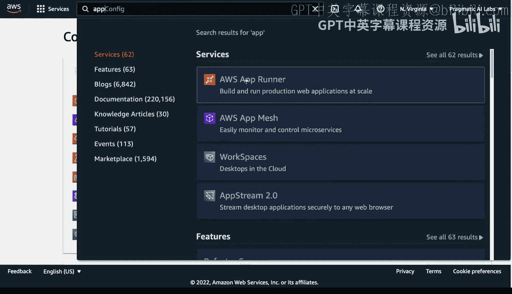
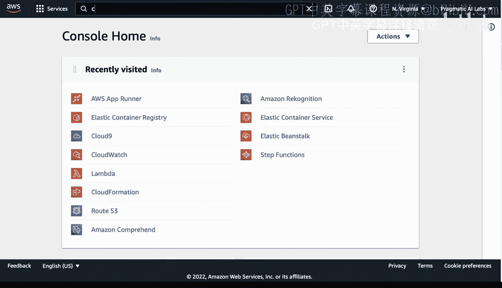
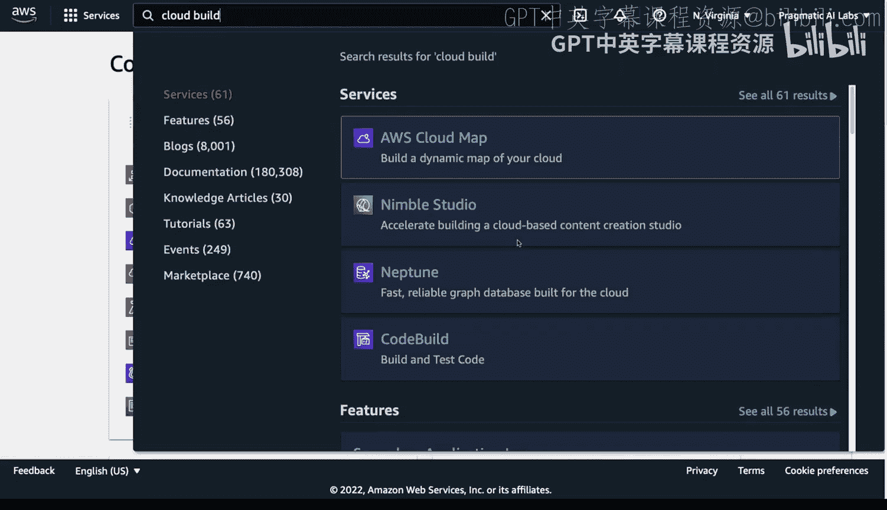
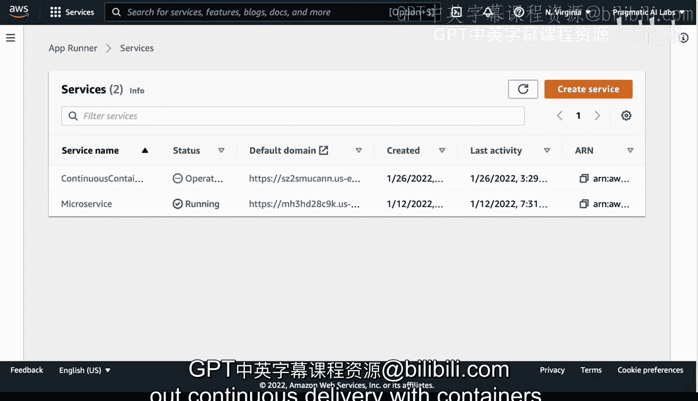

# 杜克大学｜机器学习运维｜DevOps⧸DataOps、Azure、MLFlow和抱脸｜MLOps ｜ Machine Learning Operations p42 49_04_03_容器化持续交付.zh_en -BV1yE421c7uA_p42-

Hi， my name is Noah Gift and today I'm going to talk to you about how to use containers along with AWS Cloud9。

 ECR and apprunner and CodeBuild to build this ecosystem of continuous delivery versus the container based story that stands alone。

 let's go ahead and get started。

Let's dive into continuous delivery with containers on the AWS platform。

 The story would start with AWS Cloud 9 here and you could develop your project and then actually build this locally so you would have a feedback loop right here where you would build out using for example Docker build command once you've got that build you would go through and push this to the ER registry once you're there you could in fact just deploy to AWS apprunner a second approach which would be more of a continuous build process would be to first test this out。

 then get code build to always update the container by rebuilding the container and pushing that new container change to ECR So there are a couple different ways to do this but in the real world the build system would most likely be the thing that is testing and building your project and then pushing it to ECR which would in turn。

Trigger apprunner。Allright， let's go ahead and build out this project here。

 you can see it's a very simple microservice that just adds two numbers together， nothing fancy。

 but I do have a Docker file inside and that's going give me the power to use some of these highlevel services on AWS so first up I'm going to go to fast API here and I'm going to go to code I'm going clone this locally I've already created SSH keys so it makes things a little bit quicker but we'll type in gett clone。

And from here we'll type in yes， perfect now I'll seed into this repo and the next thing I always do is create a Python virtual environment。

 so we'll go through here and say V E and V and then I'll put this inside of my home directory to hide it and then I will source this thing。

And in fact， just to be lazy because I hate having to source my virtual environment a lot。

 I'm going to just put this into my Bsh R C file here and go through here and say V E and V and then source Tilda dash VE and V。

Been activate now it'll load every time。 and if I go and open up a new terminal here， for example。

 there we go， you can see that it load loads so that'll save me a little bit of time and this will install the packages。

Perfect things are good to go and then I can run my application that's always a good idea to just get things running let's go ahead and try that out。

So here we go， I'll just type in Python main dotpyy， there we go， we've got this service running。

 I open up a new terminal， I can just curl whatever is the output in this case is going to be this HTtP address there we go and I can test out adding we can say add to or let's just say with three and three。

Perfect， we got six。 so we got this thing running locally That's good to know about now how do I push this thing to ECR Well。

 fortunately it's pretty straightforward if you go to ECR here。

 we can go through and we can create a new repo and let's go ahead and do that and we'll call this you know fast API。

啊。And we'll do a continuous delivery， so we know that it's for continuous delivery。

 and then you could go through and scan things as well。

 which is pretty neat because it'll check for security bugs。

And we'll go ahead and create this repo now that I've got this thing hooked up here， fast API CD。

 If I click on this repo and I look at the push commands。

 it gives me everything I need to authenticate from the cloud9 environment I'm gonna copy this I'm going go over here and I'm going just put that command in There we go。

 now I'm off inside next step I do the next command， which is to build this thing locally。

 And this is the trick with building things is you have to first get this image built so that we can push it to ECR。

 I picked a very fast machine， that's why it's running so quickly here it's a 16 core machine with I think maybe 64 gigs of Ram so really。

 really beefy machine is a good idea if you're dealing with containers and then next step here。

All I need to do is do the final two commands here， tag and push， let's go ahead and tag it。

Go through。And then let's go ahead and push it， which would be the last command here。

 And so the beautiful thing about this is that again。

 I love working with very fast machines because it allows me to quickly get things done but now that I've got it into ECR all I need to do to run this with AWs apprunner is to tell it to listen to this container that I just pushed to ER and this is really an ideal way to deploy to the environment for apprunner because apprunner can't support containers。

 so let's go ahead and go to AWs apprunner and if we go into this repo。

 I'm gonna create a new service and then look all I need to do is say container registry。

 we want to do the private registry if I browse here we should be able to see this fast API continuous delivery perfect and look what we can do is we can say every time I push a container from potentially AWs code build go through here and pick it up and deploy it now。

can say automatic and so this one would monitor the registry and deploys a new version every time I do an image push so this is really a dream scenario because you get the best of both worlds。

 you get continuous delivery plus you're able to use containers we're going to go ahead and select that and then we will create a new service role。

Go through here and do next and we'll say， you know， continuous。A container。Fast API just like that。

 and then I could just leave everything default here。

And then go to next and notice I didn't even have to put in commands in because the container is smart enough to know how to do things and I just do create and deploy now one of the things that is giving me a bug here is that it says oh。

 that role already exists well it's pretty easy to fix， we just go back here。

And we can call this role CD and just rename that thing and go back here and say next and do the deploy。

There we go， create and deploy。And as I mentioned here。

 this will take a little bit of time to deploy to AB apprunner and so what we could do while this thing is getting set up is is watch it but we also could go to the AW code build service and take a look at how we could kind of move it to the next level So let's suppose now once we get this thing running what we would want to do。

 well I think really the next step in a real worldl production environment would be to go to cloud build and what's nice about or sorry code build is that code build can actually automatically build a project for us and push that container。

 So if we went through here we said create build project and we say push app runner for example and we say this project will push new containers we could go through here and we could set up all this stuff go through to。

The GitHub set it up into the repository in my GitHub account， which you can authenticate to。

 and then you can go through the steps of a build process， which would be pretty straightforward。

And that all I would do is I would go down to insert build commands here and it could be as straightforward as those same build commands that we did when we pushed it to ECR and then every time I make a change to the GitHub repository we have continuous delivery so in a nutshell you can see that this is an amazing way to deploy code because you're using containers as the mechanism to deploy the software and if we go back here and you want to see this is the exact same project。

 what it looks like when it's running we can go through here and you can see that in fact I've got this thing cooking here and I could add numbers together and and get this thing working so really in a nutshell。

 the 80bu apprunner plus ECR is a dream scenario for building out continuous delivery with containers。

