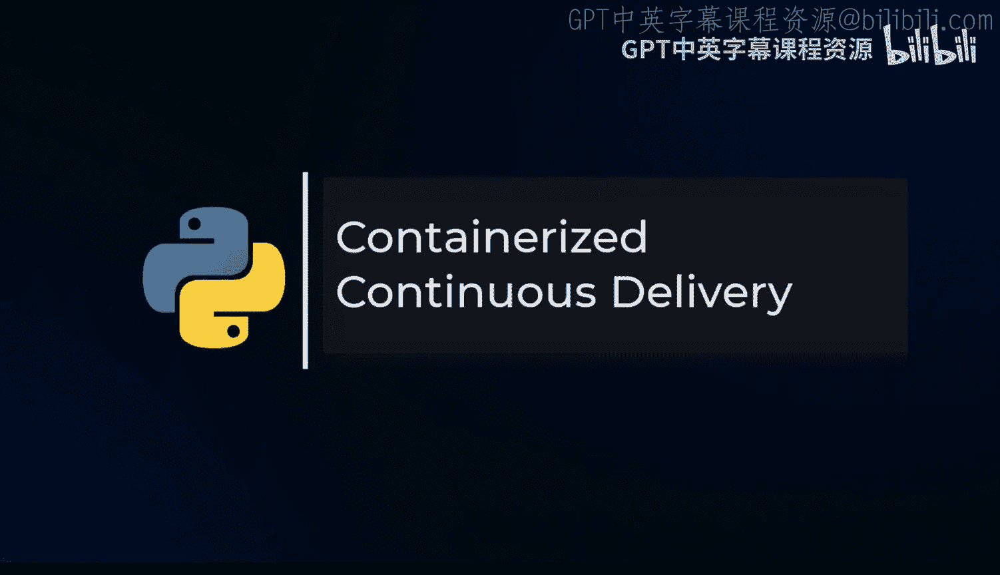
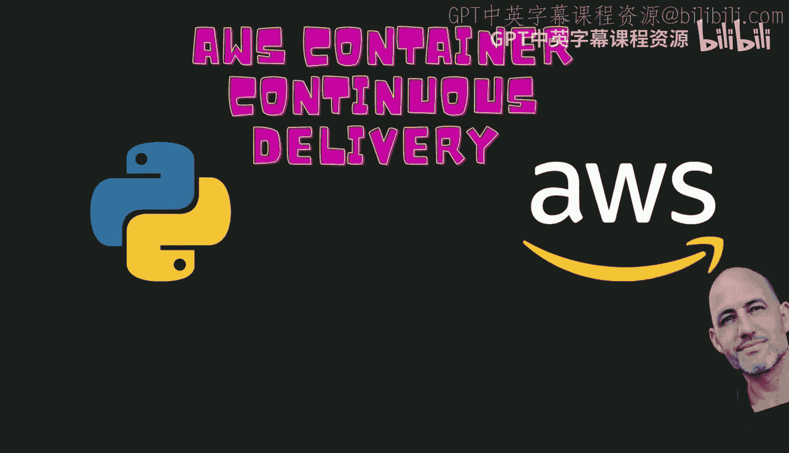
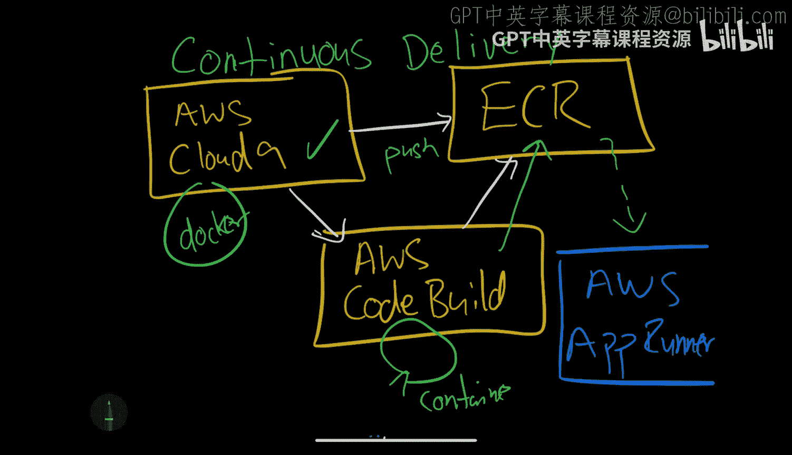
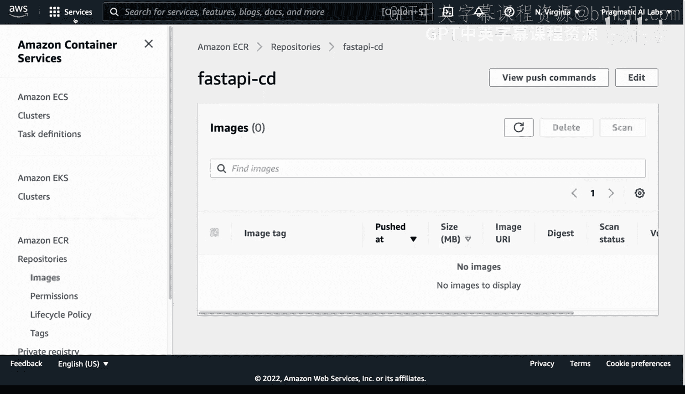
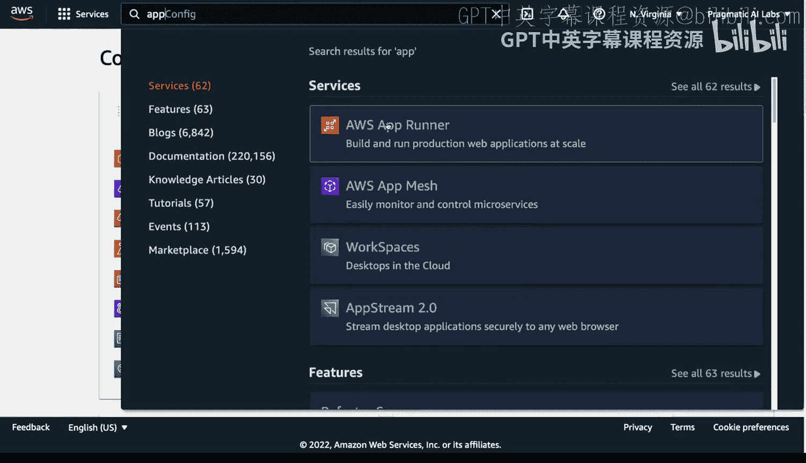
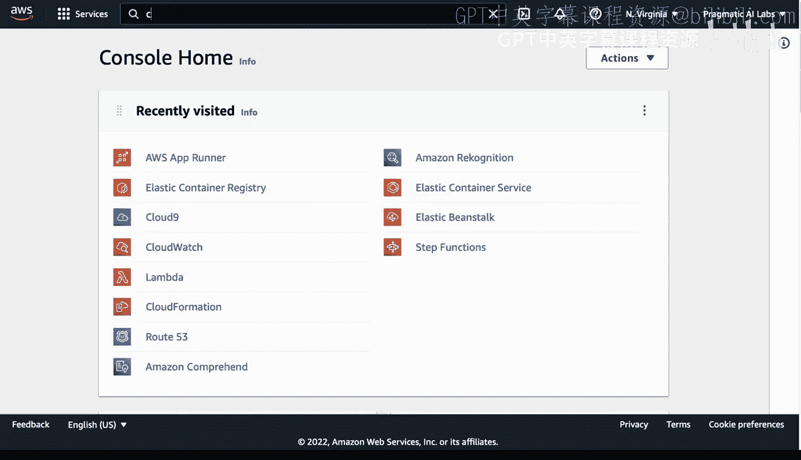
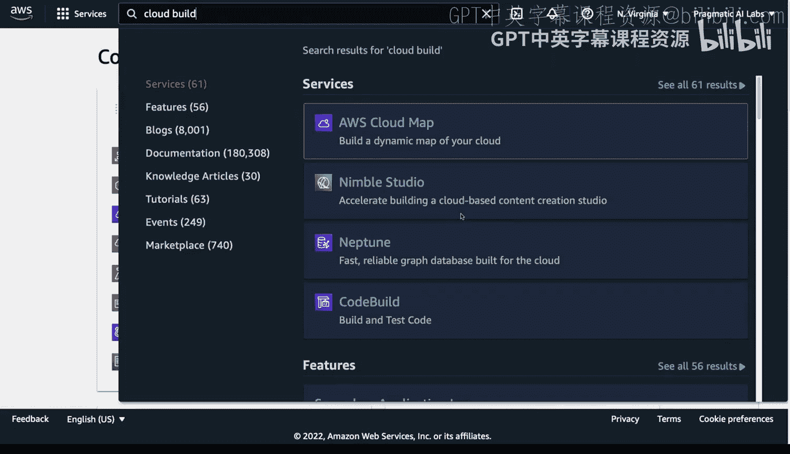
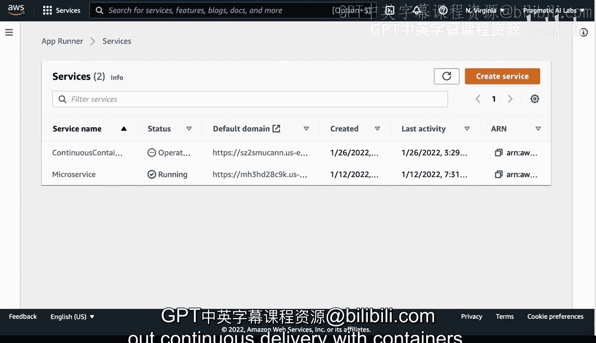

# 机器学习运维：P42：容器化持续交付 🚀



在本节课中，我们将学习如何利用容器技术，结合AWS Cloud9、ECR、App Runner和CodeBuild等服务，构建一个完整的容器化持续交付生态系统。



---


## 概述

上一节我们介绍了机器学习运维的基本概念。本节中，我们来看看如何将容器化与AWS平台上的服务结合，实现从代码开发到自动部署的持续交付流程。我们将通过一个简单的FastAPI微服务项目来演示整个过程。

---

## 容器化持续交付架构

让我们深入了解在AWS平台上使用容器进行持续交付的架构。

整个流程可以从AWS Cloud9开始。你可以在Cloud9中开发项目，并在本地构建容器镜像，从而建立一个快速的反馈循环。例如，你可以使用 `docker build` 命令进行构建。



一旦构建完成，你可以将镜像推送到Amazon ECR（弹性容器注册表）中。

镜像推送到ECR后，你可以直接将其部署到AWS App Runner服务上。

另一种更符合持续构建流程的方法是：首先对代码进行测试，然后配置AWS CodeBuild服务。CodeBuild会自动重新构建容器镜像，并将新的镜像变更推送到ECR。

在现实世界的生产环境中，构建系统（如CodeBuild）很可能是负责测试、构建项目并推送镜像到ECR的核心组件。随后，ECR中的镜像更新会自动触发App Runner进行部署。

---

## 项目实践：构建与部署

接下来，让我们动手构建并部署这个项目。

这是一个非常简单的微服务，功能是将两个数字相加。项目内部包含一个Dockerfile，这将使我们能够利用AWS上的高级服务。

首先，我们需要将代码克隆到本地。我已经配置好了SSH密钥，所以克隆过程会更快一些。

```bash
git clone <repository-url>
```

克隆完成后，进入项目目录。接下来，我通常会创建一个Python虚拟环境。

```bash
python -m venv ~/.venv
source ~/.venv/bin/activate
```

为了方便，我将激活命令添加到了我的 `.bashrc` 文件中，这样每次打开新终端时都会自动激活虚拟环境。

```bash
echo "source ~/.venv/bin/activate" >> ~/.bashrc
```

然后，安装项目所需的依赖包。

```bash
pip install -r requirements.txt
```

安装完成后，最好先在本地运行应用程序以确保一切正常。

```bash
python main.py
```

服务启动后，可以在另一个终端中使用 `curl` 命令进行测试。

```bash
curl "http://localhost:8000/add?x=3&y=3"
```

如果返回结果 `6`，说明本地服务运行成功。

---

## 推送镜像到Amazon ECR

现在，我们来看看如何将本地构建的容器镜像推送到Amazon ECR。

这个过程相当直接。首先，你需要在ECR控制台创建一个新的存储库。

以下是创建存储库的步骤：
1.  进入ECR控制台。
2.  点击“创建存储库”。
3.  为存储库命名，例如 `fastapi-cd`。
4.  可以启用镜像扫描功能以检查安全漏洞。
5.  点击“创建”。





存储库创建完成后，点击进入该仓库，查看“推送命令”。这些命令提供了从Cloud9环境进行身份验证和推送所需的所有步骤。

你需要依次执行以下命令：
1.  使用AWS CLI进行身份验证。
2.  在本地构建Docker镜像。
3.  为镜像打上符合ECR仓库地址的标签。
4.  将镜像推送到ECR。

我使用了一台配置很高的机器（16核CPU，64GB内存），这能显著加快容器构建和推送的速度。

---

## 使用AWS App Runner进行部署

将镜像成功推送到ECR后，下一步就是使用AWS App Runner来部署这个容器。

App Runner的优势在于它能直接监听ECR仓库中的特定容器镜像，并在镜像更新时自动部署新版本。

以下是部署步骤：
1.  进入AWS App Runner控制台。
2.  点击“创建服务”。
3.  选择“容器注册表”作为源，并选择“私有注册表”。
4.  浏览并选择我们刚刚创建的ECR仓库（例如 `fastapi-cd`）。
5.  在部署设置中，选择“自动部署”。这样，每次向该ECR仓库推送新的镜像时，App Runner都会自动拉取并部署新版本。
6.  为服务创建一个新的IAM角色，或使用现有角色。
7.  配置服务名称（例如 `fastapi-container`）和其他设置，大部分可以保持默认。
8.  点击“创建并部署”。

服务创建后，需要一些时间来初始化。在等待期间，我们可以探讨如何利用AWS CodeBuild将流程自动化到更高水平。

---

## 使用AWS CodeBuild实现自动化

在真实的生产环境中，下一步通常是集成AWS CodeBuild来实现完全自动化的构建和推送。





CodeBuild可以监控你的源代码仓库（如GitHub），每当代码发生变更时，自动执行预设的构建流程，并将新构建的容器镜像推送到ECR。

以下是配置CodeBuild的大致思路：
1.  在CodeBuild控制台创建新的构建项目。
2.  将源代码源设置为你的GitHub仓库，并进行授权。
3.  在构建规范中，插入构建命令。这些命令与我们之前手动执行的命令类似，包括：
    *   安装依赖
    *   运行测试
    *   构建Docker镜像
    *   将镜像推送到ECR
4.  配置构建触发器，例如在每次向主分支推送代码时自动运行。

通过这样的设置，你就建立了一个完整的持续交付流水线：代码变更 -> 自动构建与测试 -> 自动推送镜像到ECR -> 自动触发App Runner部署。

---

## 总结

本节课中，我们一起学习了如何构建一个基于容器的持续交付生态系统。

我们利用AWS Cloud9进行开发，使用Docker进行容器化，通过Amazon ECR管理容器镜像，并借助AWS App Runner实现无缝的容器部署。此外，我们还探讨了如何使用AWS CodeBuild将整个构建和推送过程自动化。



总而言之，**AWS ECR + App Runner + CodeBuild** 的组合为构建容器化应用的持续交付流程提供了一个强大且高效的解决方案。它结合了容器化的灵活性与云服务的自动化能力，是现代化软件部署的理想场景。