# 杜克大学｜机器学习运维｜DevOps⧸DataOps、Azure、MLFlow和抱脸｜MLOps ｜ Machine Learning Operations p43 50_04_04_容器化机器学习.zh_en -BV1yE421c7uA_p43-

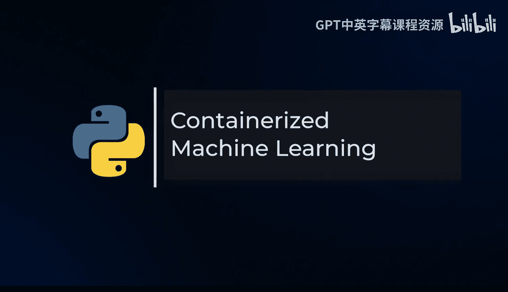

How do we actually do this， How do we actually containerize this？

Well， the first thing to be aware of is that we would need to toggle back and forth。

Between the container registry and so in order to do that。

 what I'm going to do is I'm going to throw this into our tab here。

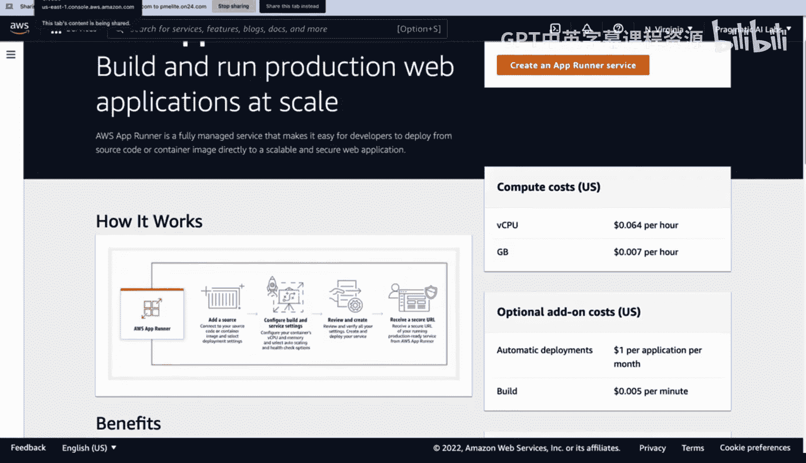

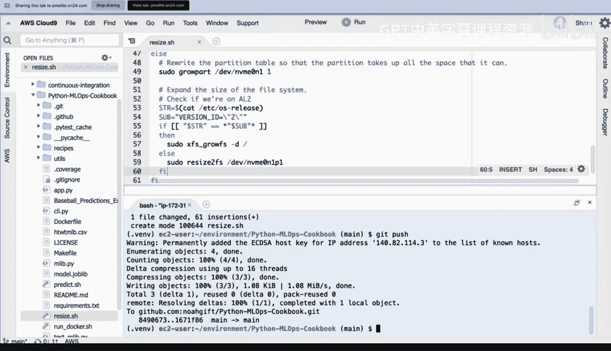

And I'm going to go to ECR。

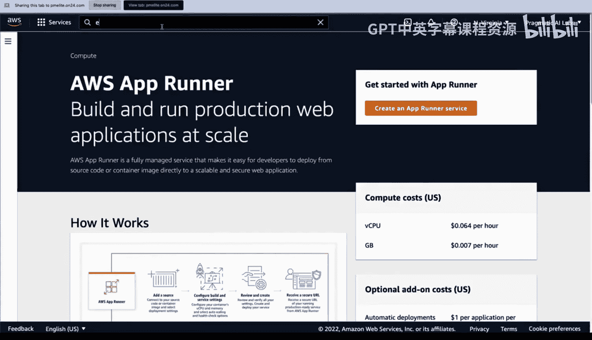

Wwhich is elastic container registry and we're going to create a new container registry location where we store our microservice as well as our model。

 so the first one that we'll do is we'll create one called Emma Los cookbook。

So that would be the one that had the height weight model into it。

 and I'll just go ahead and say create repository。Once I've done this， we're in great shape because。

All I need to do is go to this Emma Lops cookbook example here and look at the push commands right here。

And these push commands here are pretty straightforward， and I couldn't even just copy them all。

And maybe keep them around。For for when I actually work on them。 So I'll just put those into like a。

A browser here so that I can use or a text pan on the side here。

So what I'm going to do is now that I've got this thing set up。

 we look at the images that I or the commands that would need to push it。

 I'm going to go back to cloud 9， and then I'm going to push things into this repo because the AWS apprunner environment。

 if I go here。

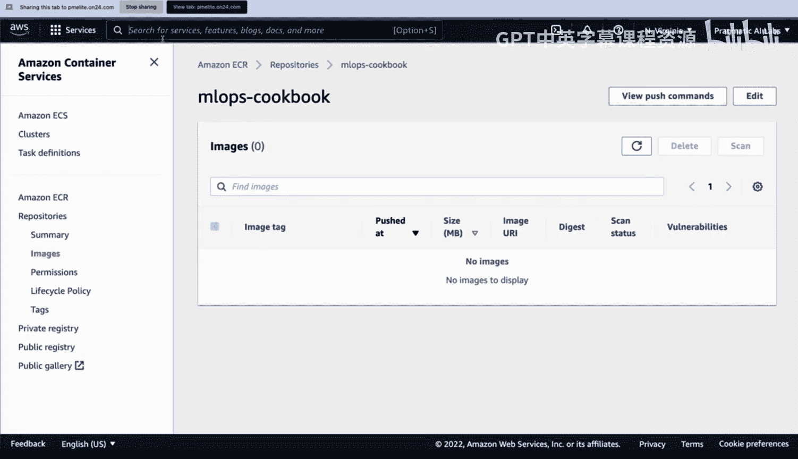

It it can actually take a container， so let's go ahead and go to Cloud9。

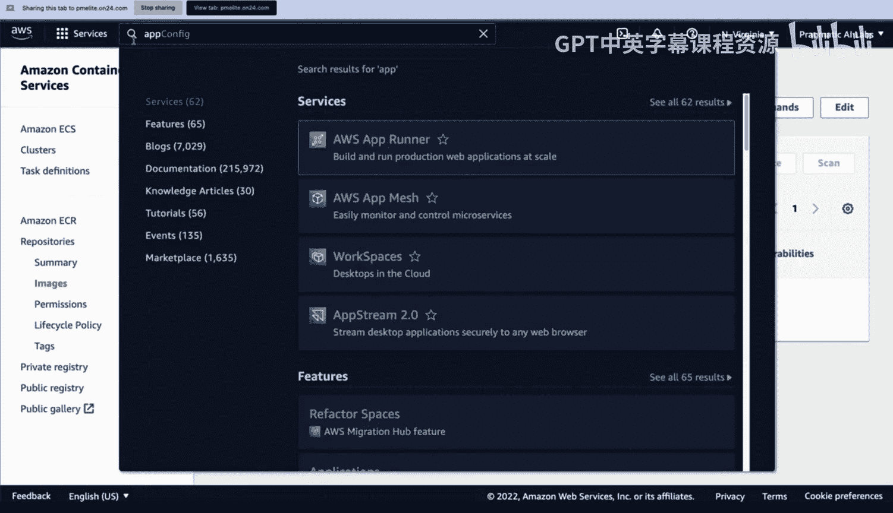

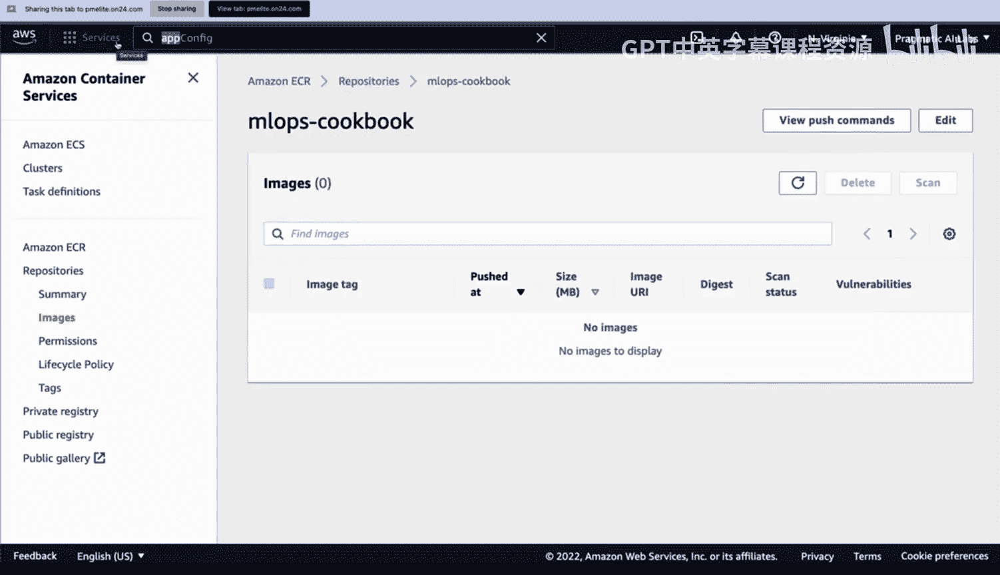

Go back to that environment。

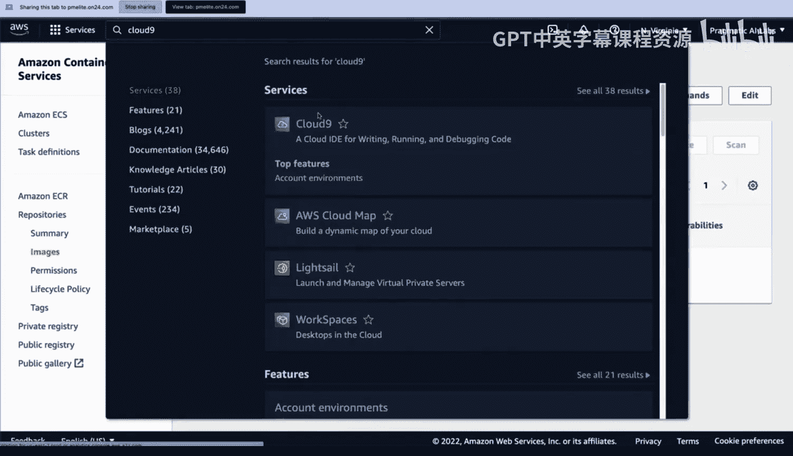

Open I。And will。We'll go here， okay， great。So we're back in our cloud9 environment and all I need to do is do those commands to get this thing running。

 So the first thing that I'm going to do is I'm going to log in。I'm going to log into。The the。

The ECR， here we go， AWS ECR log n great， we got we got it working the next thing that I'm going to do is notice that because I have this Docker file here。

We're in great shape actually。Use this to build out the model so I would inherit first from Python 388 and then I would。

Work in this directory and then build out these packages right here and then put those into an endpoint that runs a microservice I can even run the microservice first here I can just say Python app Py and in this case。

I don't know why。😔，We're getting that issue。 I could Google that real quick。

I think it's some silly issue。That I've seen before。Oh， you cannot import， you need to update flask。

To two version two， okay， well let's update Flasklin， Okay， so I'm going to go to requirements。

And I'm going to update flask。Well， what I'll do is I'll just do this。

 I'll take out the flask version， and I'll do make install to find the latest version。

This is one way if you have package conflicts and then if I run it， let's see if it works No。

 but doesn't that doesn't seem to work。U。It says。That's actually a very strange message that I'm that I'm getting here。

 that I've that I've never seen before。嗯。Let's try one more time here。To see。

Really quick if I can fix it within a second。And。It seems to be related to latest version。

 in my case， oh， I I see you can， you can do。Let me see if I can make one more change here。

Let's see if I can fix this。Make install。😔，え。Okay， that fixed it so it just needed a particular version and if I could I could even fix the flask version too because I could type in Pip freeze。

And then Gr。Fask。There we go， so we use this version of flask， we'll just put this one in。That1，1，2。

 there we go。Got it all working， we know that the microservice works。

 so let's go ahead and build the container。I'm glad I tested that first。

And we can go through here and we can say Docker build MLOs cookbook， there we go。

 we got this thing running and again， because I have a fast environment here。

We were able to push things pretty quick。Okay， this is looking good。The next thing that I will do。😔。

Is I will。I will actually tag this image。Once this thing' is done。That looks good。

And then I'll tag it and then I'll push it。And once I push this。

 we have a lot of new opportunities available to us。

And the reason is that I can now use many different parts of AWS to serve this thing out and make it a continuous delivery process。

 in fact， without needing to do anything else that's the nice thing about containers is as long as you push the new container to the container registry then that's all you need to do so if we go to the AWS console。

 I'm going go ahead and。

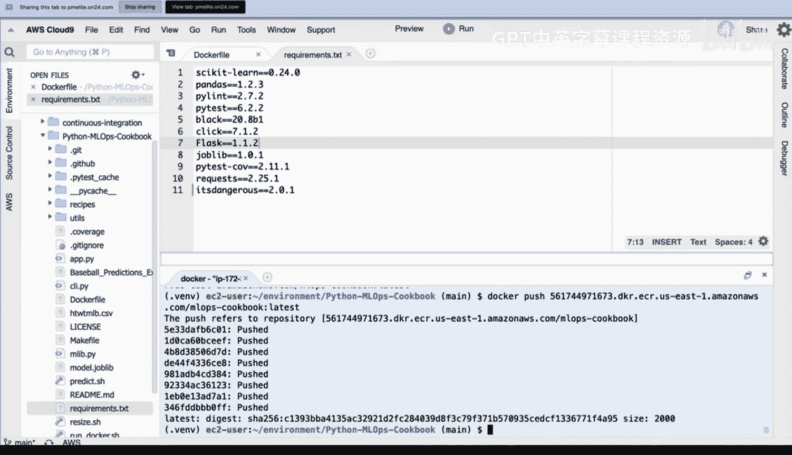

Just to paste this into this window so we can keep the same screen So inside of apprunner all I need to do is say create an apprunner service and I just point it to that container registry。

 the one we just created。

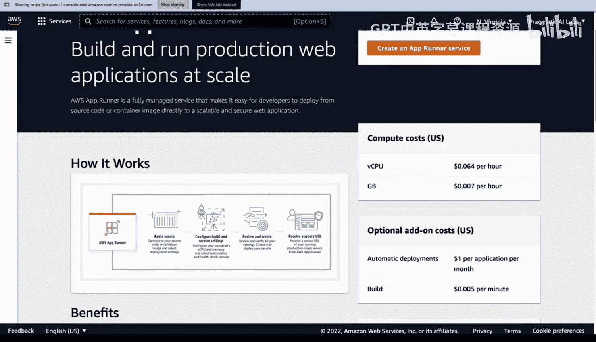

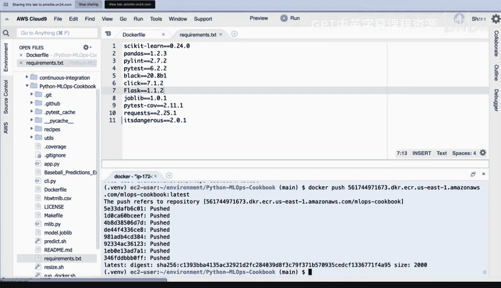

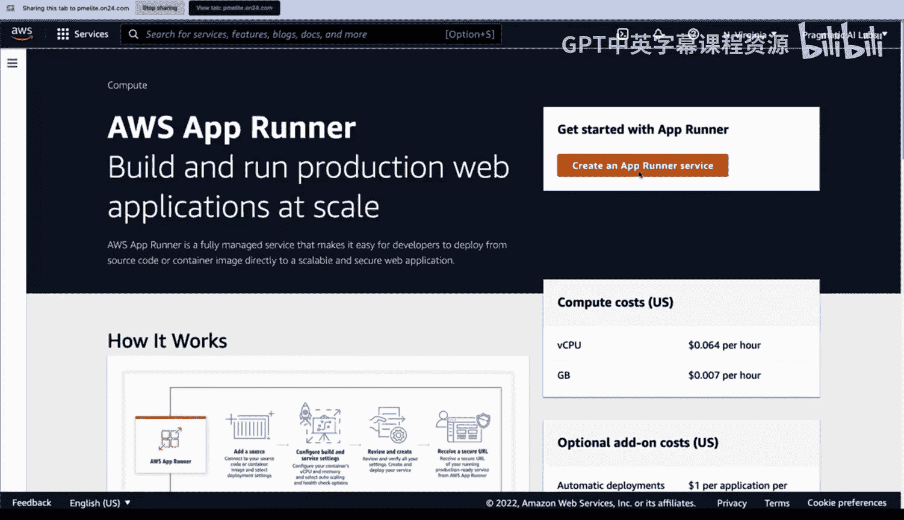

In this case， the provider would be Amazon ER。I would click on。The image repository， and look。

 there we go， Emma Los cookbook。And let's go ahead and run this and now this is what's pretty pretty cool about this is I can again set up continuous delivery and this is apprunner will monitor your registry and deploy a new version every time you push a new image of it so you could have the build system like for example。

 GiHub actions can do this it could be pushing new versions like you could query the model registry for example。

 ask if there's a new version， we just saw how to do that， you could download a model。Take it。

 containerize it once you push the container， the deployment already works and so now we would say what kind of access role。

 let's go ahead and pick this one， let's pick this access roll and we could say。

 you know continuous delivery，Of MLops。Cookbook。And I don't really need to do anything else。

 Everything else is good default。And we can go through here and we can say push。

And this will take just a few minutes。And it will deploy this microservice and what's awesome about this as well is that look what it it gives us an encrypted endpoint。

 which works pretty well， it also gives us a link to the repository and let's actually open that up。

And just so you can see it while this thing's running， I'll go ahead and show the repository， look。

 this is the image I just pushed， you can see the size。

 actually pretty small size because I use the slim package。

And it shows me everything I need to know about that particular image。

 so pretty nice process once you've got this set up is that it will go to。This。Inpoint here。

 and you can see that in fact， I can watch everything happen in real time。And even if I needed to。

 I could build out a custom domain for this like my company or API。mycompany。

com or whatever I need to build， but this is a basically production quality。

Service that would be serving out this ML endpoint。Well， what we could do。

Because it will take a few minutes to create is we could also go to our other projects and let's try to deploy a second let's try to deploy a second machine learning service that way we can deploy two right because this is the one earlier that's pretty simple。

 let's see if we can deploy a slightly more complex。Version， so， let me find。That environment。

 here we go。And。I'm going to paste this into our window。And what we need to do。

Is we would essentially need to。Just slightly tweak things a little bit here and that I'm going to。

Maybe open up a new window， a new terminal here。I'm going to deactivate this virtual environment。

Because I want to use a slightly different one for a different project。

And I'll create a new virtual environment and we'll do this， we'll say Python3 virtual environment。

 and we'll call this one。Maybe databricks。There we go。And then I could source it。And then。

I could actually。Check out that other repo， so let me grab that another window。And we'll go for。

ML flow project best practices。嗯。And we'll get clone this thing。There we go， we got it。

And I can see the into there。And we could do a make call。And if you remember。

 this is the one that had the model， we just updated it to a slightly simpler text based model。

That did fake news detection。Give this just a second。Pilot home。Perfect， great。

 we got it all working， things are running in a great great way here。And then notice as well。

 we have a Docker file。 So this one's going to be a little bit different。 I mean。

 it doesn't have to be exactly different， but just to give you some comparison here。

What I'm doing in this particular Docker file is I'm using the Lambda base image。

 which which is kind of an interesting base image here in that。

It potentially could be used to be pushed to AWS Lada if I needed to。

 but what I do here is I make a directory called app。

 I copy this fast API microservice to app directory。I copy the model inside。

 I copy the requirements and then I do an installation and then I will serve out this particular project。

 so in order to do this one we're also going to need to create another tagged image and build in all that other stuff so what I'll need to do is go to ECR again。

And behind the scenes， I'm going to create another repo。And this one I'll call。

 I'm going to create it in FastS API， I'll just do this in another window so I don't。

I don't have to go back and forth here。And I'm going to create this and then I'll essentially fast API。

Email ops。Do this， yeah， fast CPI in my labs， I've got this thing。

And then I'm going to copy the push commands and I'll bring them back to here in a second。

 here we go。Okay， so in our window here。All you need to do is build we've already authenticated。

 and I'm in the repo that has the container， so I just run in Docker build。TheThe name of the image。

 So let's go ahead and do that。 This one will be a little bit bigger because I'm using Amazons。

Lamb Lambda repo， which will take a little bit of time。

Because it's going to get there's more stuff inside of it。And let's let all this stuff go through。

And one thing I will point out， though， is that before you even push it to the container registry。

 we could actually test the Docker container local to just make sure everything works。

 it's possible it won't work。This is kind of a new workflow I just created today。

I always assume the first time I do something， there would be problems with it。呃。But。But。

 let's go ahead and see what happens。Okay。So if I type in the Docker。Image Ls。

This shows me all of the containers that are on my system and look， this is the one I just built。

So in theory。This image ID。I could run it。And I think I might have some instructions in the Read me file about。

How to run it and in fact。I don't。Well， it's fairly straightforward I can basically just do。

Do the Docker command here， let me just get it real quick。And。Lask。Fask， flask， microservice。Yeah。

Docker command here。 Let me just grab this thing。Fask。No I want fast API， sorry， fast API， fast API。

 I have a Docker command for it。And here we go， got it right here in front of me。Okay。

 so we're going to run now。This， this command。Which is Docker run。

And then I just need to put in the idea of that I found up here。

 which would be this image ID right here。There we go， so I'm going to paste it in here and in theory。

It should work unless we have problems， so far it's working。

And then I could basically make a prediction against this endpoint。

 so even before I push it to the app runner service， I could also just test this out。

Let me open up a new terminal。And I'm going to seed into this environment here。

And I could just curl this endpoint。Which that。Will probably not be what I wants。

Because it's running a local host。Let's double check my command here。依是1，27。😔，80，80。Hん。I think。😔。

We could try local hosts to see if that works， not not。

But what we could do actually is this instead of running document command like that。

 I could just say。Run it on 00，0，00，0， let's try that。Does that work？I think it does。

And now if I curl this， this might work。Yeah， for some reason。

 I'm having some kind of a curl issue with this thing。But。

Let's just assume it's going to work let's without me digging into why my my Docker command doesn't work so how would I push this thing well I'm going to do the same thing I'm going to tag it。

And push this into here。And then I'll do a Docker push command right here。There we go。

 so we're now pushing this into。The same container registertry。

 So we have two different kinds of machine learning models。 One was the one we created in our。

Cloud based spark system， The other one is the one already had。

 and we can see they should behave very， very similar。In terms of how they operate。

 except for one is a very different。Kind of service because we trained this model from an external big data system。

And notice this is a big， big model too。 Now the model， I'm sorry， docker container。

 now it's not because of a model， a model is tiny。 It's just that this particular base image was from。

Adie was lambmbda， they for some reason made it really， really big。

So it's just something to be aware of。And once this gets to 1。2， we should be good to go。

And there we go。 So So now I'm going to go back to our。嗯。

I'm going to go back to our cloud 9 ecosystem， so I'm going to pull this up in another window and then show you so we've got。

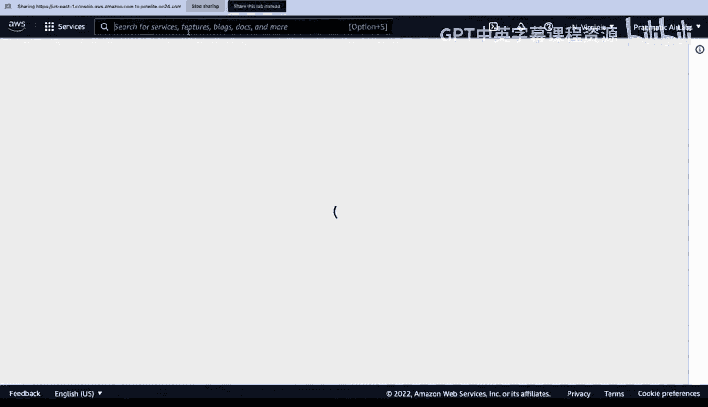

Cloud。9ine。I'm sorry。Appprorunner。It's good apprunner。

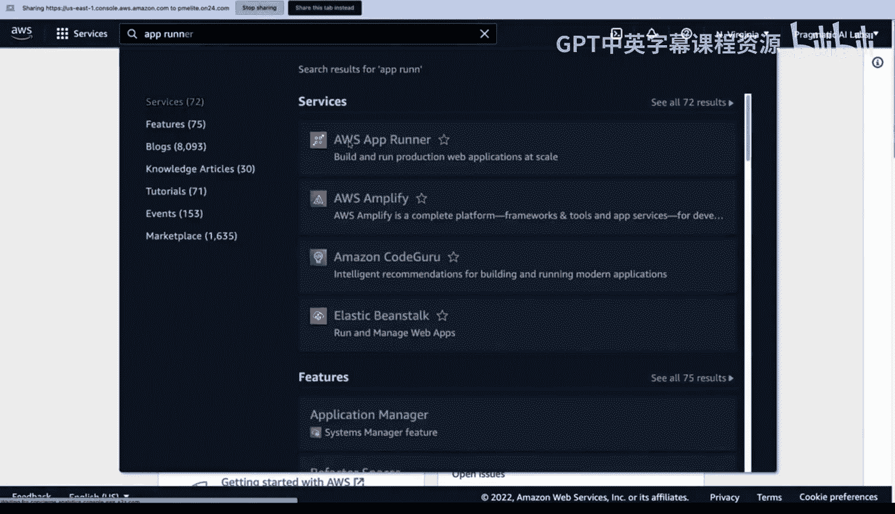

And this is looking maybe good。So we have this one， which is the one I just created。

 let's go ahead and。There we go， predict weight from Major League B players， this is the URL。

 I'm going to go ahead and type it in here。Here we go， and then if I want to put the endpoint here。

Which is predicts。You could see that I could go through here and invoke this。Now。

 I have a chiulle tool。That I that I wrote that'll help us actually call this endpoint so that I don't have to do anything fancy。

 So， so what I can do is I can go back to。My。I can go back to my other environment and invoke this service so right because we know it's working。

 but if I want to do a post command and all that stuff。

 I can't do it from the browser I need to do it from some other location so what we can do is to run this particular command is I can just go back。

I can basically go back to my cloud9 environment and just invoke it real quick so let's swap Windows here。

 go back to cloud9 and we'll go back to our other terminal right which is right here。

 the MLLs cookbook， and remember I had this utility which was UT's CLI so here's where it comes in handy if I do do the help。

One of the things that we can do is it says predict sends a prediction to the endpoint。

 so let's see what that does。We can do this prediction， whos prediction。U。Help。

No such command what is， oh predict， yeah， predict， that's right， predict help。Okay。

 let's run this thing， aha， it says host。And so I even could look at the code real quick to just double check。

What the。What what the Emlos cookbook U command tells me to do。

 I could have made that a little bit more。DoSelf documented。 but I think the URL。Just needs to be。Oh。

 I see the full URL with with the predict endpoint as well， so I'll do predicts。Dash host。

And then I'll put in that URL for apprunner。And then I'll do predicts。

And then it'll it should do a prediction there we go。

 So now this is querying that endpoint that we that we pushed via。AWS apprunner。

 and then if I wanted to put in more weight or change the value。

 I would just go through here and just say。You know， 155， for example。

And then it goes through and it shows us a different value。

 so pretty neat here that we were able to get that thing working in fact。

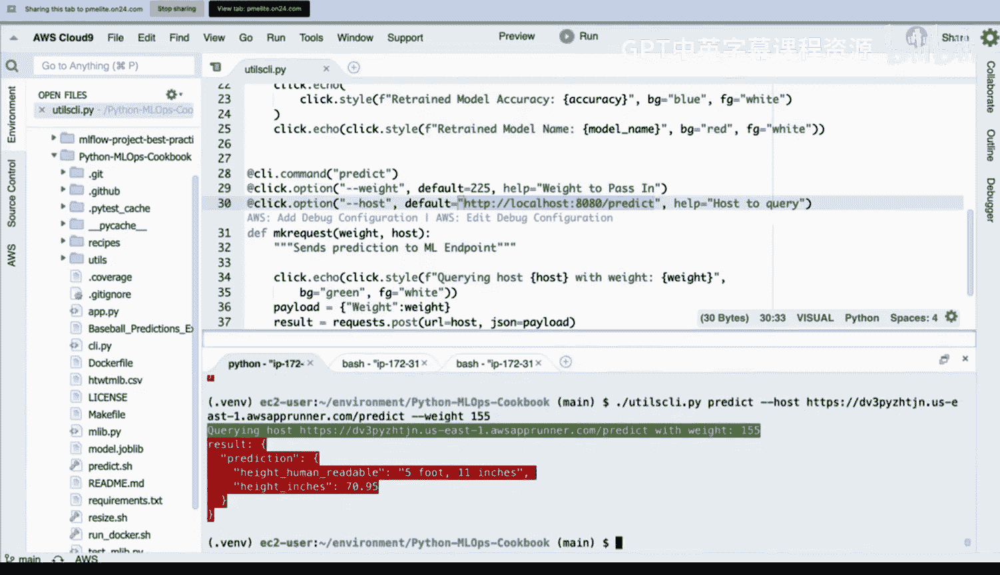

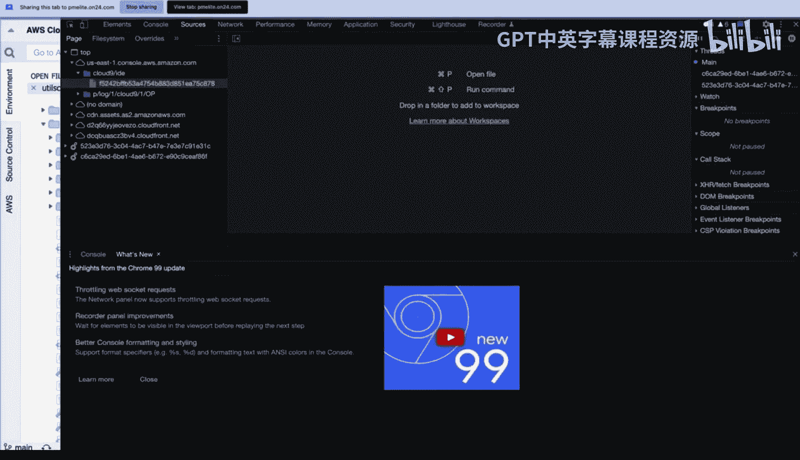

If I go back there now。To the apprunner service， which I can just pull up real quick。

And throw this into our window。We should see those invocations now， so if we go through here。

We see the services running。We have the activity， the metrics， and under the metrics we should see。

 look there we go， we've been invoking it right， I just invoked it four times and in fact I and I can see that these are all successful in vocations。

And latency， active instances， all that stuff is pretty neat。If I want to go to logs。

 I also could say view and Cloudwach and also get all the logging input as well。

 So whatever I decided to put inside of there。Would show up inside of this ecosystem as well。

 you can see that this thing's running。I'm sorry in this log events here。

And also if I wanted to click on application logs， if I clicked on View and CloudWatch。

 I'll have to throw that to you real quick。Into another window。We'll do this。

 we can see the application logs。And whatever our service is doing in terms of application。

 will pop up here as well。 And we can see all the different things that we're doing。

 Here's the basically the the。The post request right here。There we go。

We can see the prediction right here。All the stuff that verifies that I just called that service so very。

 very nice and again， all I need to do is programmatically push the new version of the container in order to get this thing running into production。

We've verified that this thing works now let's go to the other AWS app runner service and I'm going to open that up and build out a new one。

 so let's go ahead and do that。Let's go to。A。Change our window here。

To go to AWbu apprunner and let's create a second service and this will be the Databricks model that we created earlier。

And I'm going to use ECR right here， so we'll go browse。

And I remember the name of that was called Fast API MLOs， let's go and see if we can find it。

There we go， fast API MLOs， we'll go ahead and say continue。And then we'll do the same thing。

 We'll do continuous delivery， right， because we want to keep pushing new versions of this container。

We use an existing service。And we'll see。Push。Container。Production。Or no。

 we'll just call this fast API。ELOs， there we go That looks good and this will take just a second to deploy as well。

And and then and then we can test it out。 So maybe this is a good spot to while this is for the next five minutes deploying。

We can talk a little bit about。The architecture that that we actually that we actually built。

 and I can sketch this out。 That would probably be a good thing to do。 So I'm going to。

Pull up Siz padd here。Let's do that， let's go to sketch。And let's try this out。😔。

Then let's build this。So。Let me just skip this。Going。And I'm to make this a flat screen here。

So in a nutshell， let's also get a little bit thicker of a pin， maybe like that that looks good。

You you have， you have a couple different flavors here that we're able to show the first one。

Was we had the Databricks system。Which would be the platform now it could be any platform doesn't have to be databricks。

But and we could even put platform here。And so the platform does a lot of nice things for us in that it has this feedback loop of。

 you know， it has the model。It has the data。It has the。有。😔，You know， notebooks。

 all that kind of really cool stuff inside of here available for us。And then as a result of that。

 we downloaded that model。And then。We package it up and push that into ECR。Which is the Amazon。

Container registry。 once it's in the container registry。

 then we build out a microservice via the apprunner。 It could go to， I mean。

 it doesn't have to go to apprunner， could go to。Lots of different services on AWS。

 This one in particular happens to push this out to to apprunner， right。

 like it's it's a base it's basically a。A。A great ecosystem to push out a endpoint。

 And then if we want to curl it， we just curl this endpoint and we say you know HtDP。

Bh right and this goes through and lets us have the end result。The second way， this would be。

 you know， method one， the second way is you could just。

Get a model somewhere could you could even download the model from somewhere and then do the same thing right you could just download the model。

 push it into a container registry and then do a deployment。And it is a fairly legitimate。

Point to be able to just download a model， in fact， let me show you what I mean by that。

Is that if we go to something called TF hub， this would be a great example， this TensorFlow hub。

 you can just download a model right here and it's got all kinds of things like text problems。

 image problems， video problems， audio problems， let's just take one of these things like image classification。

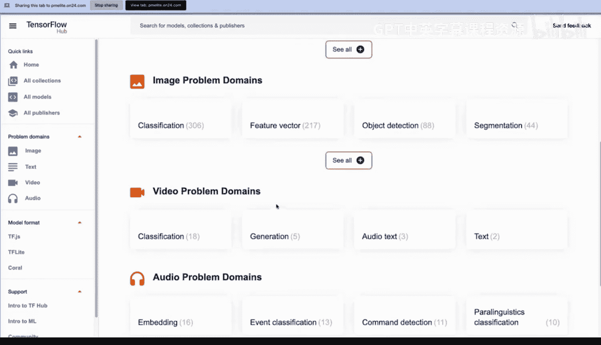

I could just take one of these and look right here， just it tells you right here。

You just go through here。TF version one， you literally download this。

Package it up and it serve it as some kind of a model here。

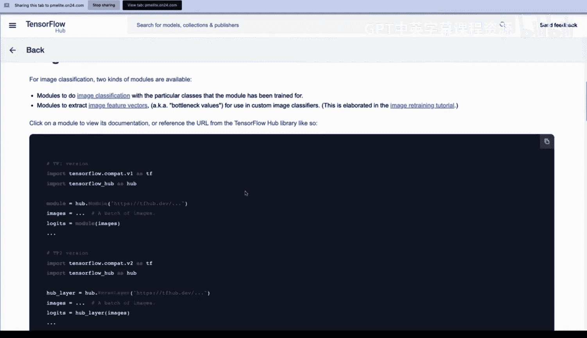

And this is a great technique， I think。In order to take other people's work and use it。

You also can pick the different formats as well like TF light so you could take a very small model like this and you can actually go through download it。

 it gives you the the whole version of how to actually input things into it and then serve that out via containerization so you don't always have to。

To produce the model yourself in our case on one， I did train it locally and on second one。

 I trained it with AutoM， but you also could just download it from some other location。

 I think we're seeing more and more of these kind of hub based solutions becoming available as well。

But that's basically you know all we did， so now that we've kind of gone through the theory there。

 let's go back to the apprunner service。And let's take a look at the final phases here。

 hopefully this thing is pretty easy to get running， we can see it's performing in a health check。

There we go， it looks pretty good。And once this health check is over。

It should be routing traffic to the endpoint。And if everything goes as planned fingers crossed。

 we can use the swagger API dock to。To make calls to this fake news ML service and actually use it as a prototype。

嗯。Okay， let's go ahead and flush this thing out here， perfect。Services set to running grades。

Looking good。It looks like it's probably running。 I could copy this。 There we go。

 So it's all running。 So I can just copy this， and I'll just paste this into our。

Into our screen here。

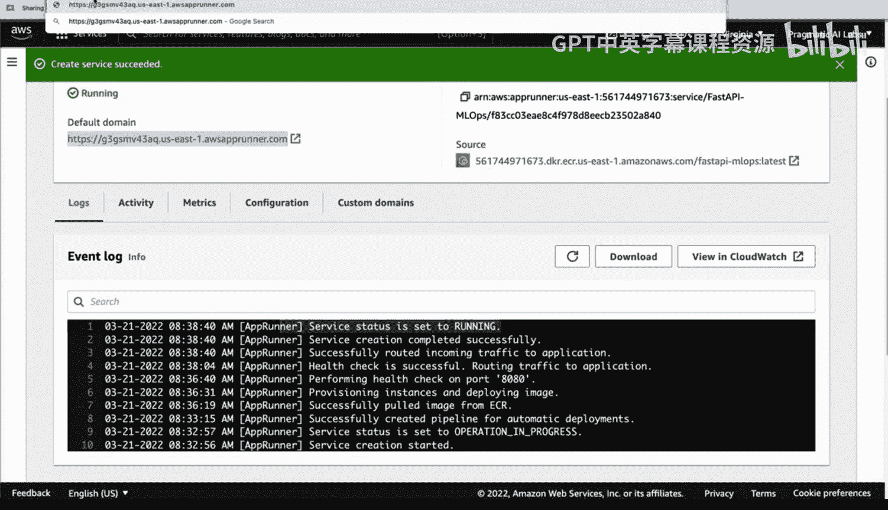

And check this out。 Okay， so at least at least something's running， right， which is good。 Now。

 what if I go through here and I say。Docks like this。Aha。

 we we have this thing working potentially we do a post， try it out。

 and we can do the same thing we did before， which is。Aens are coming。Let's just make it even。

Quicker alienns are coming and then go ahead and execute this and we can see yep fake news。

 there we go。

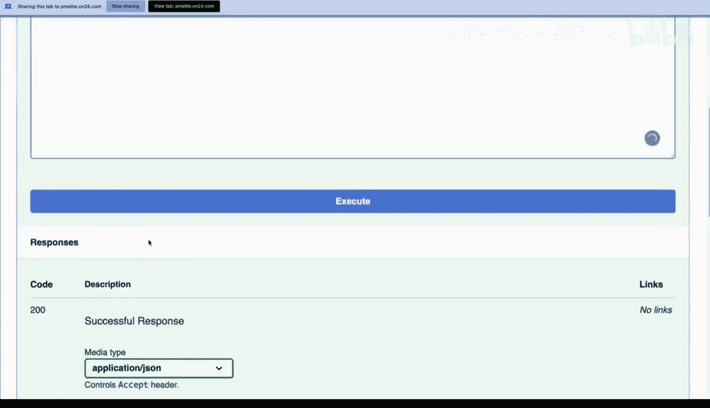

I think this is a reasonably compelling workflow that would work with many different kinds of models you can see here。

 this thing is actually working and in fact if you want to try it out yourself。

 you're welcome to while this thing's running， no promises I'll leave this running for too long。

 but you can try it out yourself and make your own fake news predictions。

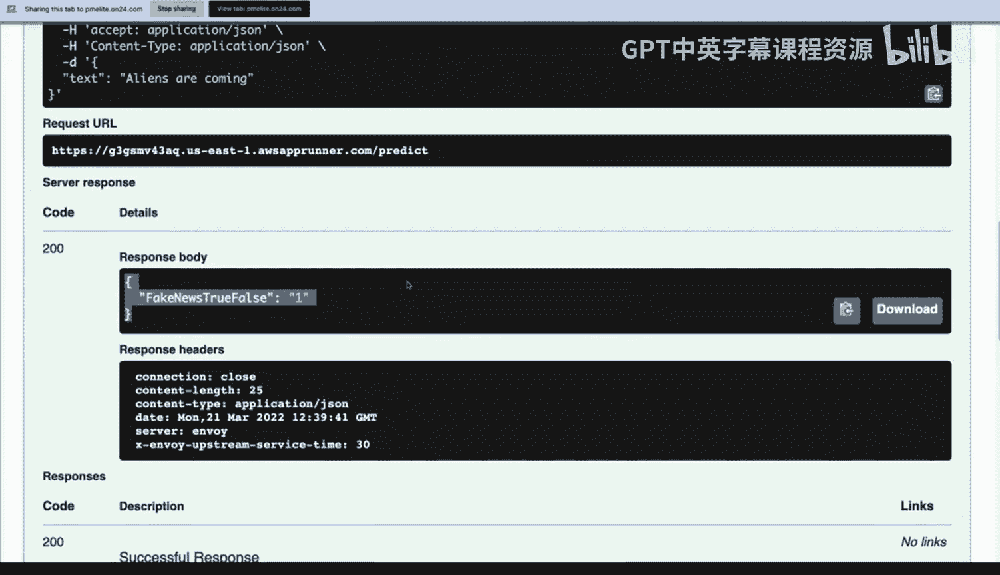

But this this， I think， is a fairly compelling workflow here because of the fact that it doesn't matter where we got。

TheThe endpoint， so that's probably worth。Talking about a little bit more as well is just to sketch out that。

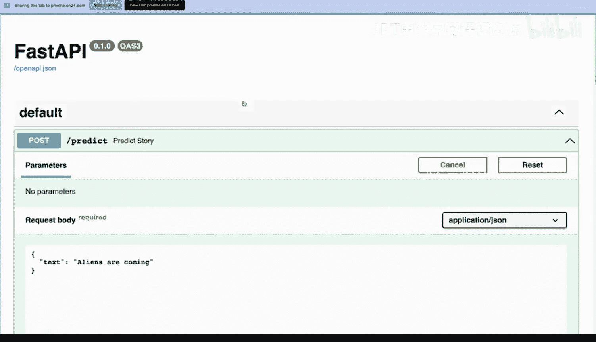

That idea a little bit more。If we just make this a little simpler as well， if I go back here。

 let's go this。

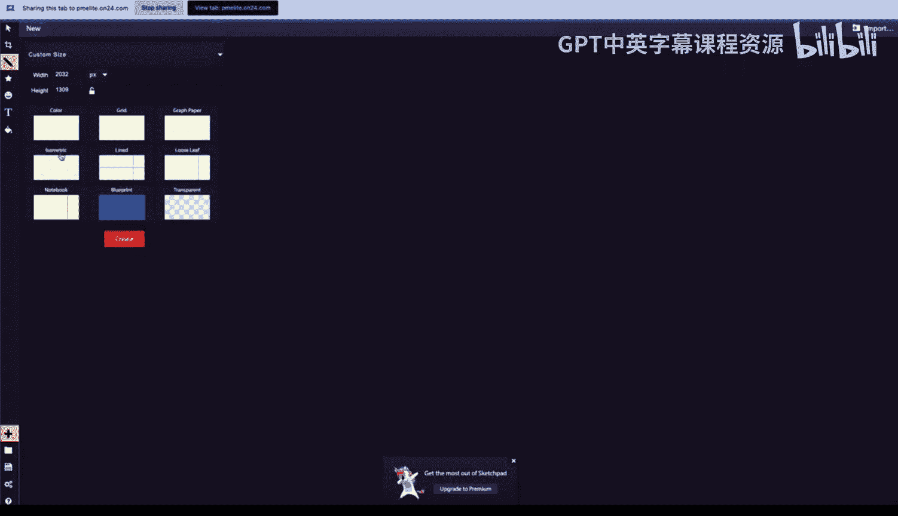

That。IfIf we look at a model。There's， in a sense， almost like four ways。

To to four or five different ways to， to serve out a model， let's assume that you're using。

Some kind of microservice framework。And what we'll just call this the microservice。Microserv。

Right and and where where did this actually come from or Well it came from a container registry and we could actually just。

Maybe call that out and we'll just say。This is a container registry。Like that。Microserv， so。

 so really it's not too bad， right？ We have a microservice and container registry。

 And then here's the part that is kind of open is that you could have。A version where。

You download it， right so that's option one。Is you just download。And we'll call this models。

So it's almost like who cares where you got it， download it。You put it into。

And we can basically do this。 We can make it like a。AMo and put like a。It can go here， right。

 the models can go， that's option 1，2 is AutoM。And Otto Ome is pretty compelling。

Especially if you can just package that thing up and push it into a containerized microservice。

 the third option is you do it the traditional way， what is you build it yourself。

 you build from scratch， that's a third way。I guess a fourth way that you could also。You know。

 do it yourself potentially is you could also call an endpoint。

RightSo maybe the model lives in a third party ecosystem。 So those are four ways。

That I think are interesting to consider， you， either download the model from some other location。

 maybe even tweak a little bit by using transfer learning。

2 use Autom via some system like Databricks， SageMaker， Azurel Studio， you know， whatever。

 whatever system you want。 And then third， you could just build it yourself from scratch。

 I think many people have。Obviously been doing this one， right。

 this is the one that people have been doing for a long time。

I would just argue for an MLOs kind of workflow。You may not always want to do that because。

In some situations， you don't need to right it's a little bit like。

 do you always need to build you know， a meal from scratch depending on what you have on your schedule。

 it may take a little bit of time to do that。 So you do want to be a little bit careful。

When you're actually tee that up。And then finally， for an endpoint。

You also don't necessarily need to even do any of these。

 you could just call an endpoint like what we covered in the case of the Databricks endpoint and the part that comes into the operational component is when you get into things like container registry microservice。

 you see it's trivial every time I make a change to my project or change to the model。

 I just trigger a new build， it pushes that new container into the container registry。

 which then deploys the microservice so。

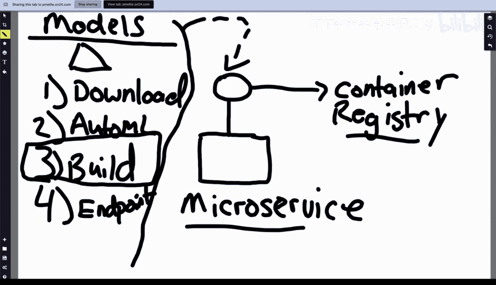

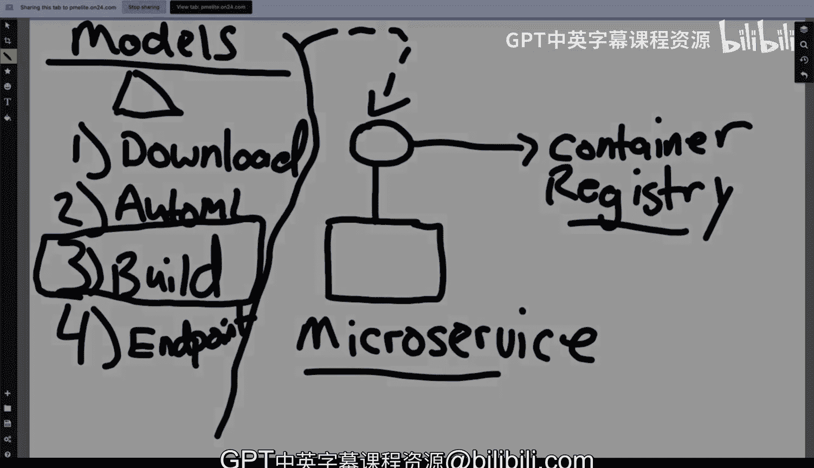