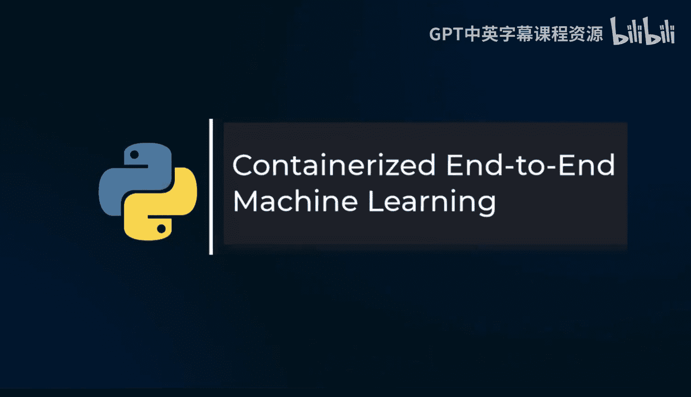
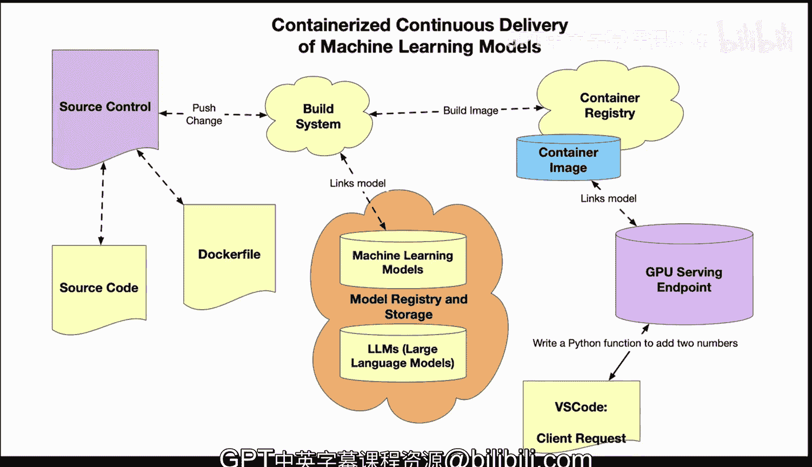

# 杜克大学｜机器学习运维｜DevOps⧸DataOps、Azure、MLFlow和抱脸｜MLOps ｜ Machine Learning Operations p44 51_04_05_容器化端到端机器学习.zh_en -BV1yE421c7uA_p44-

。Here we have a containerized continuous delivery of machine learning models。

 Let's walk through the key items inside this particular workflow and show why containers are a great fit for both traditional machine learning and also large language models。

 First up here， we have a source control system， this could be something like Github and inside your source control system。

 you have the code that does what you need to do。 So it could be。

 let's say a microservice that is going to use， let's say a large language model that would be something that would be very similar to a modern workflow around large language models and you would have a Docker file that would define every single aspect of the runtime as well as the microservice that you're building。

 once you've got that configured you'd push it into source control。

 Now what happens is when that change is going into the source control system。

 the build system would automatically build out the rest of the story here so。First。

 we would link the model so this could be something that's a small model that lives in a。

 let's say a model registry or some kind of fancy model serving system。

 or it could be in storage right it could be a large language model that you've put into let's say object storage and you're keeping it there and then inside of the build system。

 you would build out the container that would have the exact runtime you needed in order to invoke that model once it's inside of the container registry on。

 let's say， a cloud platform。That linking would then be able to occur with the GPU serving endpoint。

 So what's nice about this is that each of these pieces is separate yet when they're built。

 it's able to be linked together。 So the trigger of the source control is able to build the new container image once that container image is pushed into the container registry。

 the entire runtime is ready to go。 So you don't have to worry about there being some kind of fragile dependency here。

 because the runtime is linked inside of this container image， and also the machine learning model。

 it could be referred to in the storage system， for example， it's a large language model。

 it could just be a reference to where that model lives on disk。

 It could be high performance disserver or it could be object storage， etc ce。

 And then when the GPU serving an endpoint， accesses that container image， it's ready to go。 Now。

 how would you really invoke this from the client。 So let's say。

Uing let's say an open source tool like star coder from Huging F。

 your Viual Studio code interface would then make a request to that GPU serving endpoint。

 which again has the exact runtime built into the container image。

 it also has a reference to where the large language model lives。

And it's able to serve out your request and the request could be something like let's write a Python function that adds two numbers。

 it then invokes that GP endpoint， gives you back that request and that goes inside of your code editor。

 So really what a containerized continuous delivery system does is it actually reduces the idea of friction in terms of building something because of the fact that you're building automatically every time you push a change and then you know that when you want to deploy the GPU serving endpoint。

 it'll be trivial because the GPU serving endpoint。

 all it has to do is reference that container image。

 Ser it out and then it's ready to go in terms of testing。

 So containerized continuous delivery is a great way to do machine learning models and it works with both traditional machine learning models as well as large language models。

