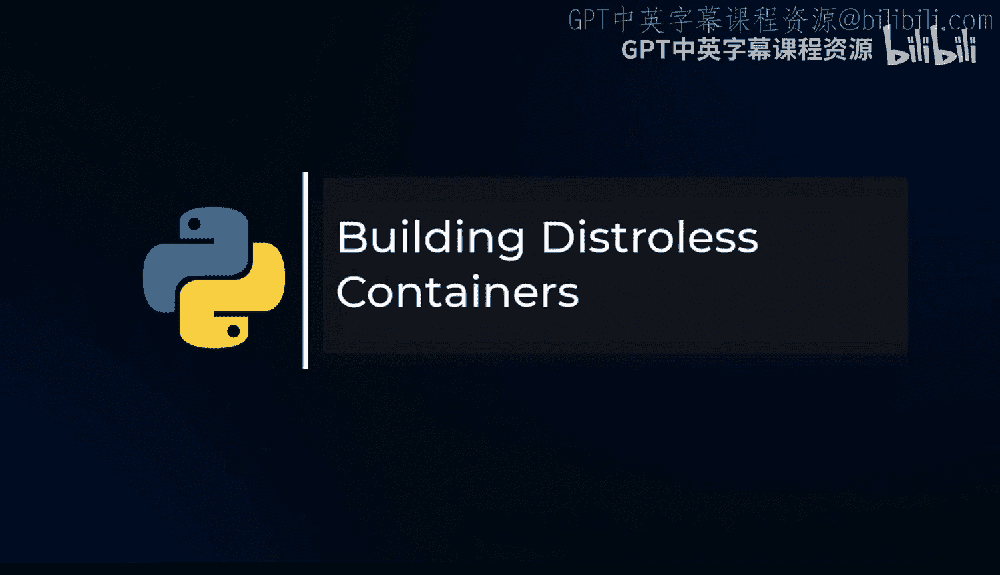
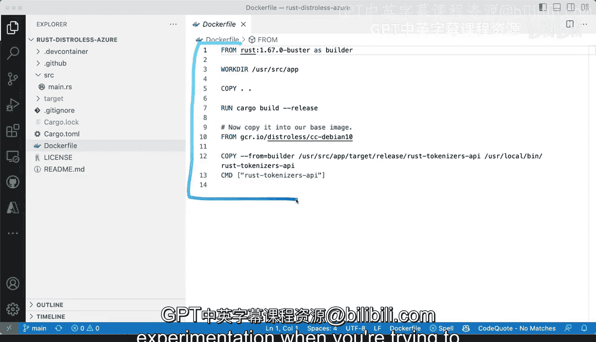

# 杜克大学｜机器学习运维｜MLOps：45：构建Distroless容器 🐳



在本节课中，我们将学习如何为一个真实的Rust项目构建一个极简的Docker容器。我们将使用“Distroless”镜像技术，它能显著减小容器体积，从而加快部署速度、简化回滚流程并提升实验效率。

## 概述

我们将为一个Rust编写的API服务构建容器。该服务接受文本输入，并使用来自Hugging Face的预训练分词器（Tokenizer）进行处理。核心目标不是深入理解应用代码，而是掌握如何使用Distroless镜像来创建一个体积极小、仅包含运行所需必要组件的安全容器。

## 项目代码解析

首先，让我们浏览一下项目代码，理解其基本结构。

我们有一个通用的API函数，它接收两个字符串参数：预训练分词器的名称和需要分词的文本。函数定义如下：

```rust
fn tokenize(pretrained_model: String, text: String) -> Vec<String> {
    // ... 分词逻辑
}
```

在Web服务器部分，我们使用Actix-web框架。应用会绑定到所有网络接口的8000端口，并提供一个`/tokens/{pretrained_model}`端点来接收POST请求。请求体是一个包含`text`字段的JSON对象。

这些实现细节并非本节重点。我们的核心是探索如何利用Distroless来容器化这个应用。

## 构建Distroless容器镜像

上一节我们介绍了项目背景，本节中我们来看看构建容器的核心——Dockerfile。通过一些调整，你可以将这里的技术应用到自己的项目中。

以下是完整的Dockerfile内容及分步解析：

```dockerfile
# 第一阶段：构建（Builder）
FROM rust:1.67-buster AS builder
WORKDIR /usr/src/app
COPY . .
RUN cargo build --release

# 第二阶段：运行（Distroless）
FROM gcr.io/distroless/cc-debian11
COPY --from=builder /usr/src/app/target/release/rust-tokens-api /usr/local/bin/rust-tokenizer-api
CMD ["/usr/local/bin/rust-tokenizer-api"]
```

### 第一阶段：构建阶段

1.  **设置构建环境**：我们使用`rust:1.67-buster`作为基础镜像，并将其命名为`builder`阶段。`buster`是Debian的版本代号。
2.  **设置工作目录与复制代码**：将工作目录切换到`/usr/src/app`，并将项目所有文件复制进去。
3.  **编译项目**：执行`cargo build --release`命令来生成优化的可执行文件。

到目前为止，这些步骤与常规的Docker镜像构建流程一致。

### 第二阶段：运行阶段（Distroless魔法）

这里是实现容器精简的关键，仅用三行代码完成。

1.  **使用Distroless基础镜像**：我们使用`gcr.io/distroless/cc-debian11`作为运行环境。这个镜像来自Google容器仓库，它只包含运行C/C++/Rust等编译型语言程序所必需的最少库文件，没有shell、包管理器等任何多余工具。
2.  **复制可执行文件**：从之前的`builder`阶段中，将编译好的二进制文件`rust-tokens-api`复制到Distroless镜像的`/usr/local/bin/`路径下，并重命名为`rust-tokenizer-api`。
3.  **设置启动命令**：指定容器启动时运行的命令就是刚才复制的二进制文件。

Rust的优势在此凸显：它能编译成独立的静态二进制文件，不依赖复杂的系统环境，因此可以轻松放入极简的Distroless镜像中运行。

## 构建与运行容器

现在，让我们在终端中实际构建并运行这个容器。

首先，执行构建命令。这可能需要几分钟时间，具体取决于你的网络速度。

```bash
docker build -t rust-local-distroless .
```

构建完成后，查看生成的镜像列表：

```bash
docker images | grep rust-local-distroless
```

你会看到一个惊人的结果：镜像体积大约只有**36MB**。这与动辄数百MB甚至上GB的包含完整操作系统的传统镜像形成了鲜明对比。

接下来，运行这个容器，并将容器的8000端口映射到本机的8000端口：

```bash
docker run -p 8000:8000 rust-local-distroless
```

容器启动后，我们可以测试API。打开另一个终端，发送一个POST请求。例如，我们使用`bert-base-uncased`这个分词器来处理文本“Hello, world!”。

```bash
curl -X POST http://localhost:8000/tokens/bert-base-uncased \
  -H "Content-Type: application/json" \
  -d '{"text": "Hello, world!"}'
```

服务器将返回分词后的结果，例如 `["hello", ",", "world", "!"]`。你可以尝试更换请求路径中的分词器名称（如`bert-base-cased`）来处理不同的模型。

## 总结

本节课中我们一起学习了Distroless容器构建技术。我们通过一个两阶段构建的Dockerfile，首先在完整的Rust环境中编译应用，然后将得到的独立二进制文件复制到极度精简的Distroless镜像中。

这种方法的核心优势在于：
*   **极小的镜像体积**（本例中仅36MB），节省存储和网络传输开销。
*   **更高的安全性**：由于镜像中不包含Shell等多余工具，攻击面大大减小。
*   **更快的部署与启动**：小体积镜像拉取和启动速度更快。



只需对Dockerfile进行一些简单的修改，你就可以为自己的Rust应用（或其他编译型语言应用）构建出轻量、安全且高效的容器镜像，从而获得更快的部署速度、更轻松的滚动更新以及更高效的应用实验能力。