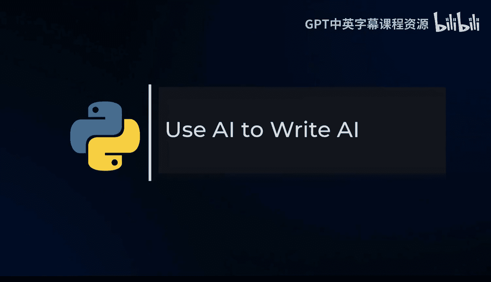
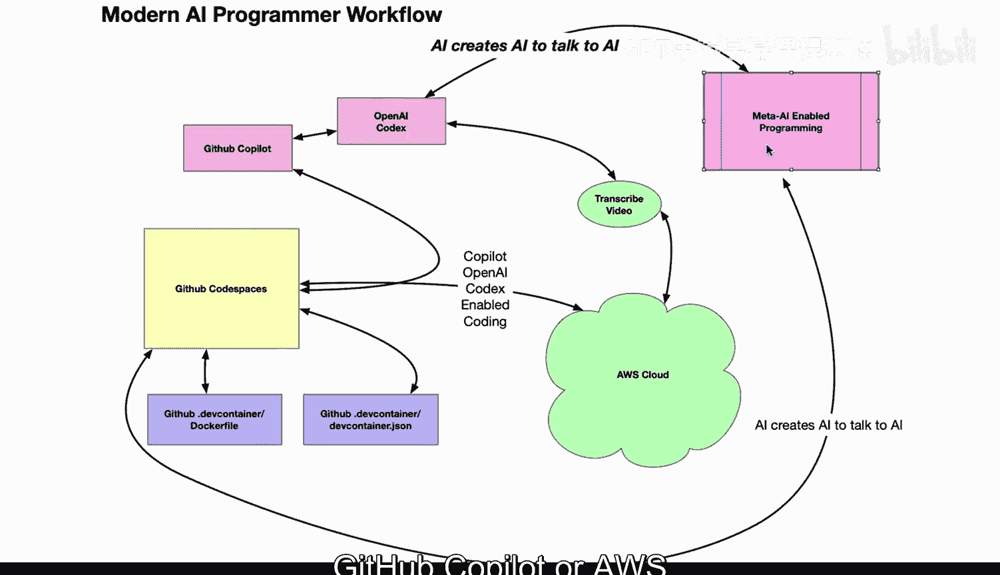

# 杜克大学｜机器学习运维｜DevOps⧸DataOps、Azure、MLFlow和抱脸｜MLOps ｜ Machine Learning Operations p46 53_04_02_使用AI编写AI代码.zh_en -BV1yE421c7uA_p46-

Let's take a look at this modern AI programme or workflow。In this particular workflow。

 AI creates AI to talk to AI and how do we do this， Well。

 to start out with if you look at Github codespaces， a cloudbased development environment。

 you can go in and configure it with customized Docker file。

 customized dev container files so it's really optimized for doing AI programming and machine learning programming so that you can use GPUus。

 one of the things that you can do when you're building this is actually talk to Github Copit Now what is it。

 Well， it's an AI peer programming utility that communicates with open AI codex and this is a pretrained model that is designed to help you autocomplete your code and it's intelligent enough to give you code suggestions Now what's happening when you're using this is that you could also communicate with cloud SDks。

 for example， you could build out a new system that transcribes code or that builds out things that。

To let's say the S3 ecosystem in AWS and what this means is that you are meta programming using AI in fact。

 you're using AI that was pretrained to help create AI solutions and this is really the modern AI program or workflow is that AI is in fact in enabler that enables you to build code faster。

 use higherleve workflows and also move at a faster pace while you're building out things in the machine learning space so it's important to consider how you can use AI tools like Github Copilot or AWS code W when you're building out solutions。

