# 杜克大学｜机器学习运维｜DevOps⧸DataOps、Azure、MLFlow和抱脸｜MLOps ｜ Machine Learning Operations p47 54_04_03_通过Copilot学习Python-DevOps关键技能.zh_en -BV1yE421c7uA_p47-

So really in a nutshell， the concept of a Python function and one way to think about it。

Is that it is a hub just like a bike， you you have these spokes that come off on a bike that allow it to turn the Python function and we'll just call this one f here is really at the middle of a lot of different things that you can do in terms of logic so you can go through here and you can build a library。

 that's one application of Python functions and we'll go into that in just a little bit another thing you can do with a Python function is that you can map it to a GPU so a lot of GPU programming is just mapping a function to a GPU you can also do data science and data engineering with pandas so that's another huge component of Python functions。

And then also microservices， so web services like for example， FastST API or Flask。

 those kinds of web services or AWS Lambda also you can build out the CLI which we'll get into it today as well and you could also say it can map to events and so with AWS programming in particular。

 you can notice how Lambda function in Python can respond to maybe like a file that's put into S3 and then you call that function and do something with it。

 so really in my opinion it's the center of really a lot of the most interesting things you want to do in Python and so that's what we're going to cover today is how to build out all these different things and start from zero。

And what we'll start with first is I'm going to create a repo and I'm going to share it。

And this repo will be something that we can step by step build together。

 and once we build this together， I think it'll be a good journey to get to that hub and spoke model。

 so we'll call this functions。From zero。And I'll put a description here that says a repo。To learn。

Functions。And it'll make it public so people can get access to it。

 always a good idea to add a readme file when you're building a new repo and it'll also include a getignR file。

And a license file， and that's really the basic scaffold。And then once I create this。

 I'll just throw this。Into。location where people can get access to it。And here we go。

Now other people can get access to this。And then what I'm going to do here is now build out step by step all the things that are important。

 and I'm also going to cover some of the emerging tools and technologies that really help someone go very quickly to becoming an expert in writing Python function so one of the ones that I'm going to show you that I think is really worth putting on your radar is this concept of using GitHub codespaces and the reason why codespaces is so critical is that it can enable copilot which is a software tool that will be a pair programr essentially and help you build out solutions very very quickly。

 in fact we're going to use it this entire session we're going to use codespaces with Copilot to help us build very sophisticated tools。

Now， the first thing I'm going to do here is I'm going to create a code space。

 but notice what I do is I actually customize it。And when I customize it， I'll have the ability to。

Create。Different types of options so this again is a critical piece of functionality for developer because you can pick really large machines。

 like in this case， the 16 core machine with 32 gigs of Ram and 128 gigs of storage in some cases that might be more powerful than a lot of laptops or workstations or it can be really difficult as well to get access to NviIDIdia GPUs for programming。

 especially if you want to dispose of them and create new environments and so this is also giving us the ability to use an NviDdia GPU and you can see here that this particular instance is high RA so it has 112 gigabytes of RA and 128 gigabytes of storage。

What we're going to do today is we'll start off with this one。

 we'll start off with a 16 core machine。And we'll go from there。

So it takes a second to provision in environment。And there also are actually some techniques that you can do to make the provisioning in the future go a lot faster and one of the things you can do is this concept of prebuilt code spaces。

which I'll get into a little bit， but the first thing I would recommend is when you create a new workspace with GitHub codespaces here is to just tweak it a little bit。

 make sure the theme is maybe the theme you want， I like this theme。

 it seems to be a really good one for contrast。

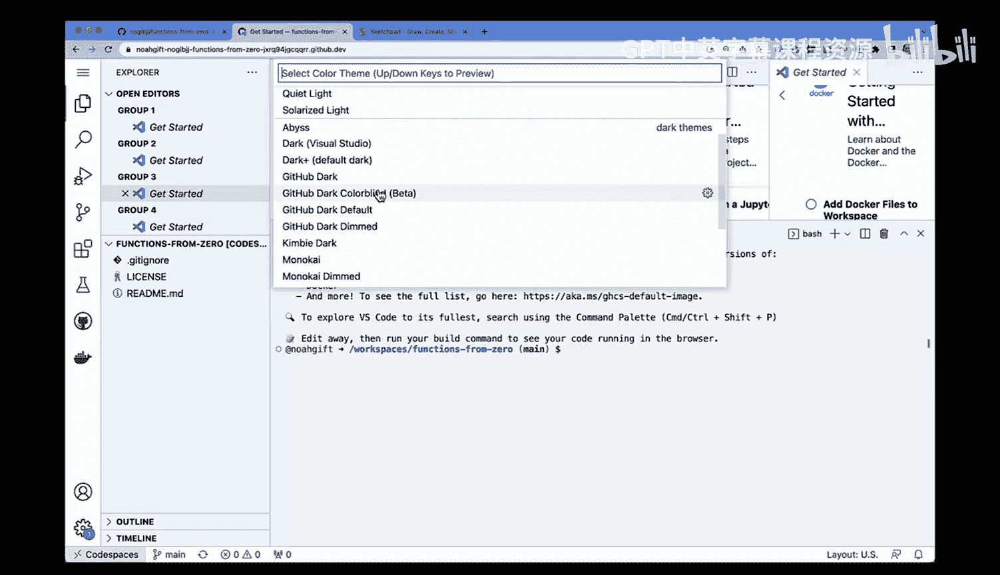

And really the first thing that I would do is is actually。

Persist some settings in my environment and so what I will do is I'll do shift command P and that brings up this command prompt and I'm going to say I want to actually configure my environment a little bit and so this is I think a critical component when you're first when you're first building out your environment is to you know get things set up so that you're going to be able to code very very quickly and so in this case I think if we just go to abuuntu or GiHub Gitthub codespaces we can just leave everything。

As the default and it'll show you what they've already preconfigured for you in this case you can see that all of these tools that are available for us are all going to be there and make my experience developing much much' easier the other thing that is important though is if I go down to extensions this is where the secret the secret weapon comes into play and this is where you can use this coppit tool and so I'm going to type in coppit。

Here。And there we go， we see Copit and you can either use Copilot nightly or coppiot just depends on which one。

Which one you care about， if you want to be on the bleeding edge or not。

 we probably don't care about being on the bleeding edge， so I'm going to just use regular copilot。

And also there's a neat little tool as well like if you're coming from another language like Java or C sharpharp or something。

 this is a neat little tool in that you can actually prototype the code and actually swap it from one language to another and it's actually a pretty awesome capability so now that I've got that enabled。

 notice that this will show up if I needed it to inside of these extensions that I've got loaded and the way I would do that is I would just right click on it and say add to dev container。

And then go to the other one and say right click on it and add to to dev containers that's pretty much the gist of all you'd need to do you don't have to do too many fancy things inside of here and then if I ever needed to rebuild this environment I would this stuff would be persistent so so what I'm going to do next is I'm going just check in all that code so we'll just say get status。

And we'll say get add do dev container。And just check this into my repo， say adding config。

 So now we've got our environment config。 So so what would be the next thing to do would be to。

Go back to this repo here and just toggle a couple of key settings here that will help us build statements and functions So one of them is if I go to the settings here and I scroll down。

 we can actually go to codespaces， which is the environment we're working in。

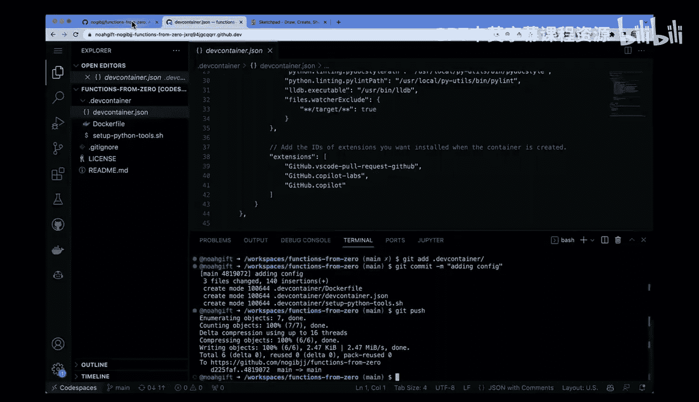

And I can do this option called prebuild and what's neat about this is it means that those customizations I set up they'll always be built automatically and so my development environment is always going to be ready for me and customize so I can tweak it and add packages and all kinds of other things。

 but I'm just going to click on setup prebu here tell it to。Work with the main branch。

We'll say on every push here， and then we'll go ahead and say great。Okay。

 so now that thing is actually going to be constantly building in the background。

And if I remember correctly as well。If we look at view runs here。

 there is a badge that you can select， which is kind of neat。

 and so you can also share with people that are going to copy your project。

 maybe other people in your team， other students， whoever you can let them know， hey。

 my environment with these config files， it works。And in fact， if you make a copy of it。

 you'll probably have a good experience with it because this is the dev container configuration right。

 so this is kind of a new thing that's emerging that I think we're going to see in a lot of cloud-based development environments。

 but for the kind of work that we're doing in particular I think it's critical to have some understanding of how these tools work。

So now that I've got that setup up， the next thing would be to do a couple other little tweaks here to configure things。

 to configure our environment and not much more， but a little bit more to configure our environment。

 and I call this the scaffolding for the project。

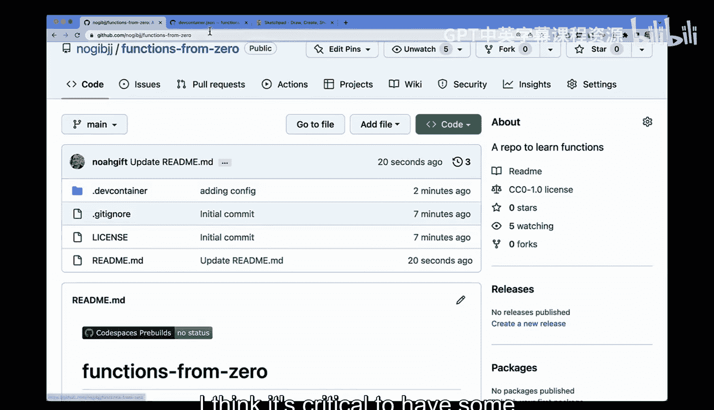

The first thing I would do is just create a bank file。And also create a requirements file。

And once I've created those files， I can actually just paste some code in there and also create a virtual environment。

 so I like creating a virtual environment。Just because sometimes it can eliminate issues。

 even though this is a containerized environment， it can be nice to put things in a virtual environment just so that weird installation issues have less probability of crop cropping up。

 so I just export。Virtual environment。Here， and I just say source。V and v。Then activate。

 And this just puts this inside of。My BacheRC file， and so every time I edit my BacheRC。

I open up a new shell， I have access to this virtual environment and I have access to Python right so it's the third we go。

 we've got our Python environment。And。Now what I can do as well is I can actually just copy code from maybe another project。

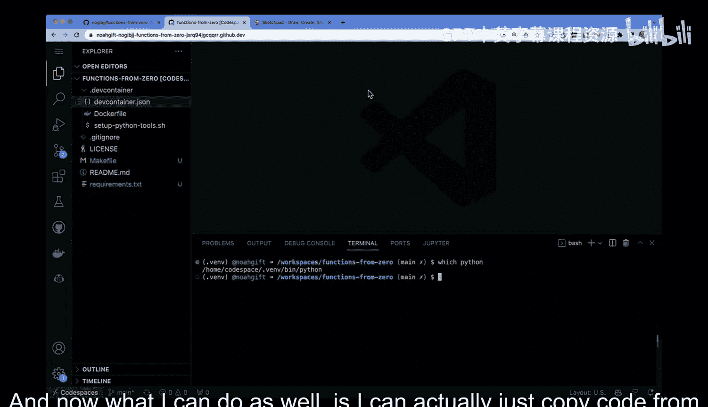

And just play around with it a little bit。 and so if I go back to my own organization here and I look at maybe a repo I working on yesterday like。

I think I was working on some Devop stuff。And I can just copy some things from that repo。

 and let's just go to the make file that I built yesterday and I'll just copy it。

That's what I typically do is just find some。

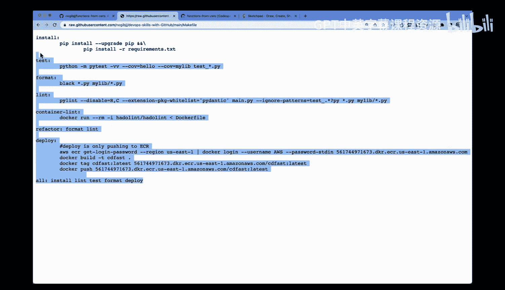

Make file that's close to what I want and then just tweak it a little bit。

And it even asked me do you want install an extension for make fileile。

 sure we'll install that extension and then I can just take out things I don't need for now like deploy。

 I can just say， you know， like echo。呃呃。Deploy。No op or something。No upper。Not operating。

Not implemented， three good， not implemented。And then the rest of the stuff。

 like if I wanted to li my my container， if I wanted to。To some other things in here。

 I think this looks pretty good this is and so the key highlights are I install packages by just technical me install。

 I test things by typing P test and I format my code by doing make format。And we'll start off with。

With actually。

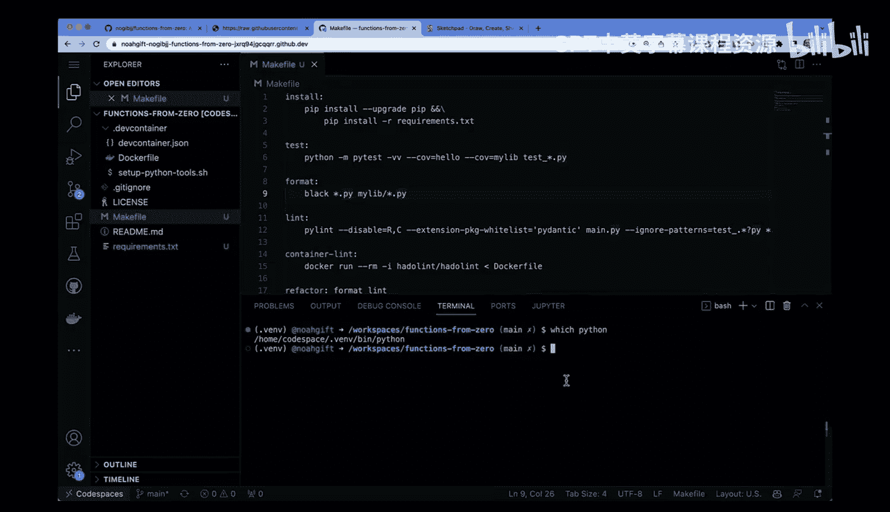

Also putting our requirements in and I'll also go to that same repo and just copy some requirements a lot of times。

That I have the same。Types of requirements in different projects， in fact。

 since I just built this yesterday， probably a lot of the same libraries。

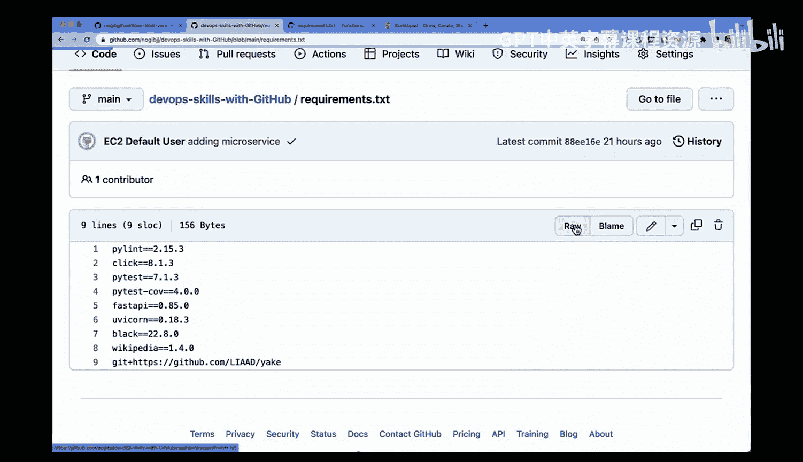

Or I mean， these version numbers have， it's very unlikely they've changed in one day。

 so I can probably leave those version numbers。And probably。Even。

Use leave those libraries because I'll probably use some of the same libraries。

 So it looks like a pretty good start for my project。

 and now all I need to do is type in make install。And this will install the packages that I care about。

Now， one thing that might be a good idea as well when you're setting up a new environments。

And get things cooking。Is that。It might be a good idea to also install a Python， but only install it。

Outside of requirements and so if I just say Pip install i Python。

 then I don't have to package it together with any kind of software deployment I do into the future and so in this case here we go I've got i Python installed。

And now that's really the core of the project。 So we can， we can start putting this step by step。

 all the different things that we're going to do。 So we'll say， you know， really。

 what are the things you need to do to。Master Python functions will step one。would be to。

Configure your environment。Rightice up， configure。development environment。

And what are those steps really would be configure GitHub？Coode spaces。Or the equivalent， right。

 it could be AWS Cloud9 is actually a pretty good environment and they actually are building similar tools。

 but again， we could just say equivalent cloud9。You know， Azure。

 Cloud shellll development environment， there's lots of these kind of cloud based development environments and then do Cate scaffold。

 so we say C scaffold。Here for the structure。Of the project。So this means like the make file。

The requirements file。对。These are all set up。And then really we're good to go and then maybe optionally。

 we can say like optionally。Optional。Set up virtual environment。And then。

Also optional install pipelineyth。Outside of requirements。

 so these these are just some things I typically do to get started。When I'm working on a project。

And once I've got this set up， then I'm ready to just start playing around and so what are the first things that are good to know about with statements at Python and so I think one of the best ways to play around with statements is just to use i Python。

Itself and so this is really the advantage of the i Python terminal is that it gives you an interactive workspace to play around with with code and what I find it to be a great way to try an idea so let's say I wanted to add together a couple numbers。

 how would I do this I' would just say you know two or two plus two。

And we can see I can just use it as a calculator right so I can play around with that idea。

 but if I want to assign a variable， this is a very common thing to do with statements。

 I can just say， oh oh， there's no X here so what do I need or there's no Y sign so。

I need to actually create it first and we'll say y is 2， and then we say x is equal to y。

And then we say X。Is going to be two right so so I can play around with different concepts that are maybe confusing to me and get clarity about what's happening I can also look at types This is another great thing to play around with when you're when you're dealing with i Python is like oh well what is actually happening underneath the hood So if I create a float for example。

 if I say you know number is equal to。1。0。What happens， right， we'll try it out in i Python。

 we can just say type and we can just say number。And there we go。

 we see that it's actually af floatat， so we see that Python has the ability to infer the correct type and put it inside and we can figure that out by using I Python。

 we can also build functions。In Python N Python as well。

 and this is a great way to kind of play around things too so if I just say you know de add and I say X and Y。

Here。I could even make it if I wanted to a one liner， which is kind of funny。

 I could just say return。How about int X？Plus。Ins。Why so we can even make a one liner function if we want to。

 and now we can just add things together by putting them into this。

So a neat little tool to experiment with statements and if you type in who。Like this。

 this who command， it actually shows you everything that's loaded into memory。

 which is a great way to try out different ideas and explore what's happening in your project or if you're importing different things so I think if you want to master statements i Python or the equivalent like coabab or Jupiter can be really handy the irritating thing about coab or Jupiter environments is that is that you're storing the file a lot of times and so you may not want to store like a debugging workflow right like you may want to just try something out real quick and so that's why iPython has a lot of advantages over other tools。

 In fact， one of the things you can do that I think is worth getting into is let's go ahead and build a hello file here。

And if I just touch a Ho file。And I actually go back to requirements。

One of the things that we can install is IPDB。Whi is a debugger that's actually iPython debugger and if I say make install。

 I'll show you why it's kind of cool to know about iPython is if we make a very small break one here。

 we could say x is equal to one y is equal to2， and then we could say。

 something like that and then we could say import PDB or IPDB。IPDB。

 sittrace and what this is will do is it will actually drop us。

Directly into a breakpoint and actually let us play around with this code right here inside of the script so if I go ahead and I run this I say Python hello。

Notice how it just drops us right into the line three。

 which is right after the x is equal to 1 y is equal to 2 and and I can just play around with the code so I can say kind of similar things I can say you know X。

 what is it， oh， it's1， Y， what is it oh it's two， and then if I say next。

It'll actually go through and it'll actually run that next line of code right and so I can even start playing around with z is equal to you know four and we you know and you can basically plan around with all of the things。

That are are available to you by by using this IPDB style。

 So so this is a good skill to have is to be able to。

Use both i Python and IPDB and and I'll put a little note to that like we can even。

Put this in our comments so that there'll be some documentation and we can say like step two。

Would be to get interactive。Debugging， working。Right， and I'll put an example。Like， you know。

 use i Python。And IBDb。Actually， it would be IPDB。IP。And we can put like a comment。

Herear a code comment or a code a block。And just throw that in there。Like that。

 and we can just say Python。So pretty good skills to have to start prototyping out things inside a python。

And then once I've got this hello or something like this this working， then。

We really have enough to actually build potentially the beginnings of。

The continuous integration system and so I'm going to briefly talk about that。

 so if I go to here and I set up a new diagram here and and I put in here we have Github here。

 we'll just call this。

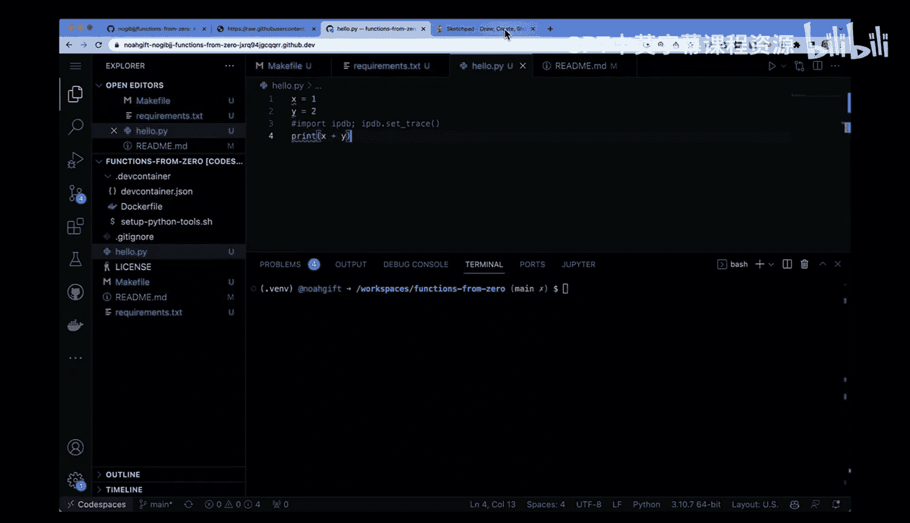

Okay。Because it could be any gett repo and then we've got our dev environment here。

 the key thing that we want to have from the very beginning as a developer。

Is we want a feedback loop。Between these two environments so that you can constantly be testing your code right so you're you're constantly you know moving through and testing your code and making sure that。

That this code itself will。We'll be working and so this is essentially a feedback loop。

 and this is something that from the very beginning is important to set up as this feedback loop。

And we're going to do that right now by using something called GitHub actions and just constantly as I'm developing。

 I'm getting a feedback loop now the feedback loop could be coppit。

is something that can help me write code， that's one of the tools that can feed into this。嗯。

Another tool that can help us feed into this would be the build system that could be another tool and each of these plays a role each of these play a role in building good code another one that could feed into there is the linting which we'll get into in a second so all of these things are a really nice tools to get us to constantly improve our code and that's the concept of continuous integration is to make your code just constantly better by improving it so if I go back here would we how would we actually do this if I go to my make file notice that I have this kind of a long statement here but basically what it does is it says that。

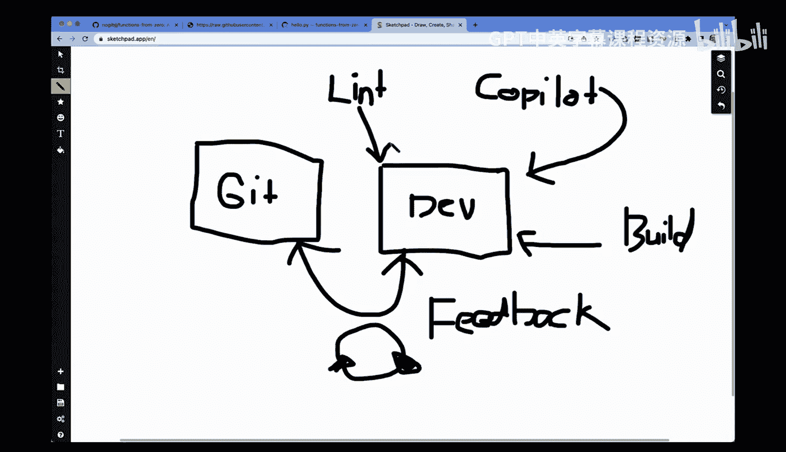

And I can take out maybe a very fancy thing， keep it a little simple or it says。

 if I see any test files， don't link those。AndBut if I see a Python file just will leave this for now。

 a Python file， then go ahead and and format or sorry Li of Python file and then this other line will format our code if I type in。

Make。Refactorctor it actually calls both at the same time。

 so I think this a pretty good pattern is to format your code constantly and lynchcher code constantly while you're developing and also get suggestions from like a tool like Copiot so if we go here and we say make refactor we can see that it actually went through and kind of cleaned it up a little bit and now how would we test out。

What a LintIn tool can do， but one of the things we could do is is if we， if we did this。

 if we said y is equal to y which。Won't break our code like because watch the code will' still run if I do that。

 but it's actually a kind of a time bomb that we put into our code and eventually it could cause a problem in the future it's just it doesn't make sense it's anil logical statement if we do make L。

 it'll actually fail the L so it says。Assigning the same variable to itself。And so it says。

 you don't want to do that， you want to actually fix that and that's what the Lintting does is it's constantly giving you suggestions about preventing bugs。

In the future。Once we have this feedback loop set up。

 we're ready now to implement continuous integration。

 so I'm going to leave that bug in there so we can use it。And I'm going to say get status。

And I'm going to say get add。Beat me。And then I'm going to add the rest of these files here and we can say。

Adding feedback loops。Feedback loop， start。There we go。And。

The only other thing I would need to do is do a gi pull。Because I think I added the badge。

I always just follow the instructions of what Gi tells me。

And just do the minimum possible to get it to work。Hey， there you go， this looks like it worked。

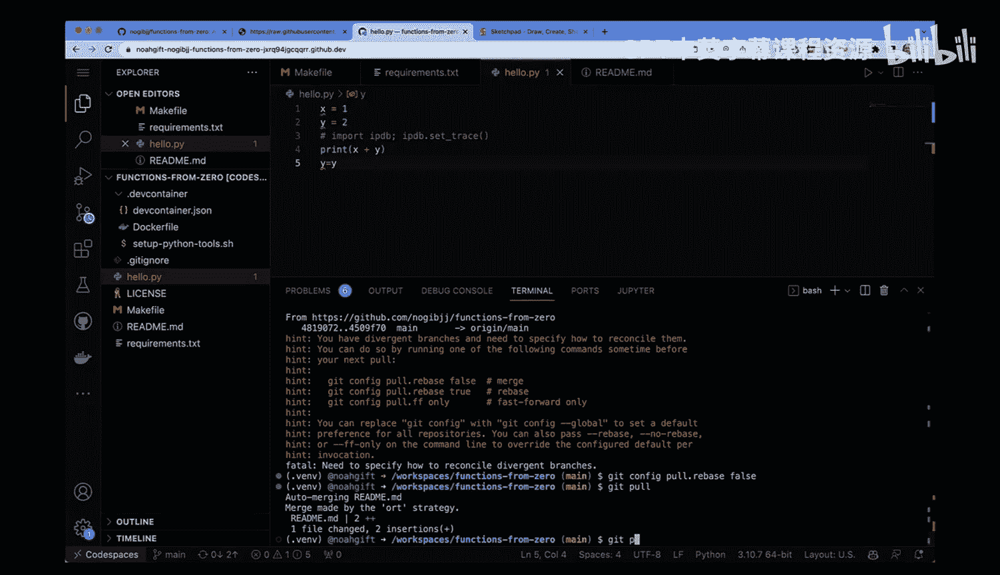

And we can we can push it so if I go back to this repo here， we should refresh it。

And there should be。Well， we saw that that codespace pre build was failing。

 which who knows why that was failing， but we also see that。

We have the skeleton right so we have a little bit of code here。

 we have a make file like we have some stuff here so we're ready to use GitHub actions which is a build system now you could do testing with cloudbasedase build system you could use thirdparty build system This one is the one that just happens to be here so we can use this you could use Jenkins that could be another build system we're gonna pick on actions here and I'm just going say new workflow。

And when you go to choosing a new workflow， one of the really cool things about Gitthub actions is it'll give you a bunch of instructions or suggestions they'll say。

 look， do you want to do Docker images， do you want to do you know some kind of security workflow。

 do you want to deploy packages， do you want to you know。Deploy web applications。

 what is it that you actually care about？And。It'll give you essentially like a guide for doing things。

 right， which is pretty pretty cool actually， I guesss worth diving into this and playing around with it。

 but we're just going to set up a really basic one。Here。

And what we will do is I can just use this as a template and just tweak it a little bit and so this template I think a good thing to do initially is to remove the comments because they're helpful but they also take up a lot of space and so we can just get rid of all the comments here。

And。In fact， you know what I'm going to do is I'm just I'm going to commit this。

I know it'll fail anyway， I'm going to commit it and then I'm going to go back to this environment and I'm going to edit it from my Giub code space。

 so let's go ahead and say get pull。

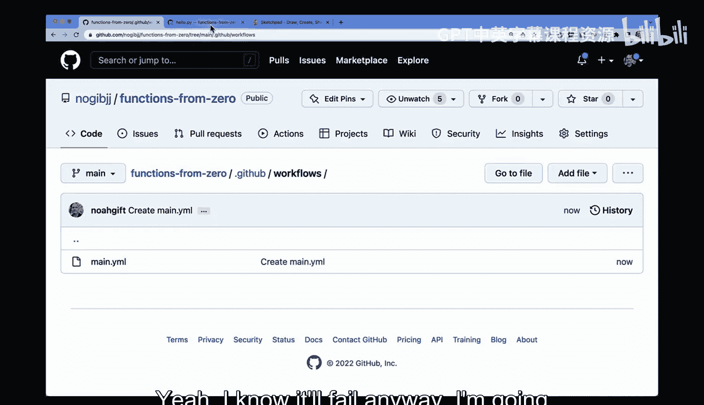

There we go。And now if we notice here。That there should be a dot Github file here with a Yaml file。

 So now we have a little bit of a cleaner environment to edit that。

 And so I think that's a great way to work is to use these clean environments here that are easier to develop with so we'll just take out some of the code comments。

Here， and so the this step here is telling us that it's going to run on the Abutu latest container。

Image。And。This will be the actions that we use that or the version of it and then this is really the start of it is we would just tell our build system what it is we want to do and it should be pretty straightforward actually what what I would want to do is is I just need to name it something so in this case we'll call install。

 we'll just say install packages。And then because I have this nice make file here。

 I can just say make install just like that， so I'll just go here and。And type in， make install。

Like this。And then the next thing I can do would be Li in my code。

 so L and I just do the same thing I just say make L and I just whatever steps I want to do so if I wanted to test my code I would do testing for now。

 we can just leave it with installing our software Liing our software and maybe even formatting our software as well so we can say name format and then do run。

Here we can say。Make format。And this is pretty good because。

It should highlight the fact that there's a little bug inside of a code that we need to fix。

 so let's go ahead and do that so let's take it。Status here。

 and we'll see that this file has changed， so we'll add it。And then we can go through here and。

Add new bin file。Okay。Great。Now that this is running。

 if we go back to this location and we click on the actions button here。

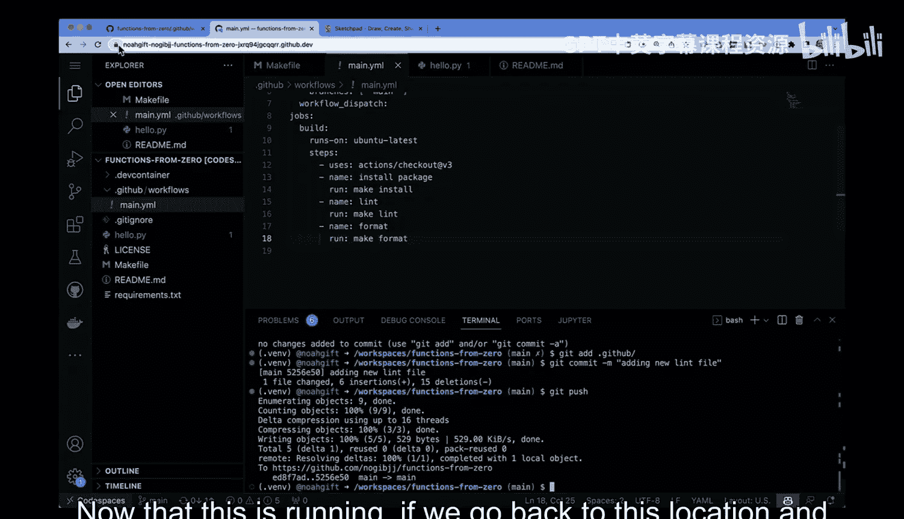

We'll be able to see that。That it actually triggered a new build。

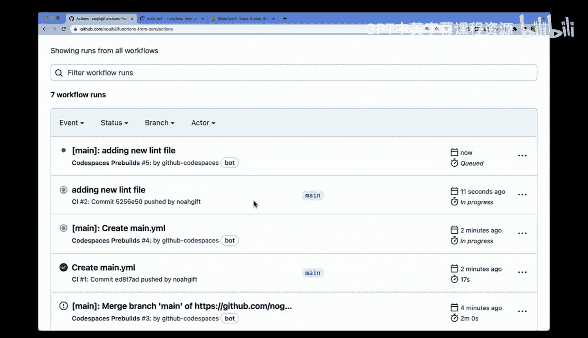

And this new build， we can actually watch it。WellWell it's getting set up。

Sos what's kind of nice about the build system as well is that I'm continuously。

Vifying and improving my system every time I make a change to it because it's running all of these tools and in theory is improving the entire architecture of my system and here we go this is what I was expecting was it failed before it got to the format step and it says look you know you can't do that that's not not a good idea our build has failed fortunately very easy to fix right we just go back。

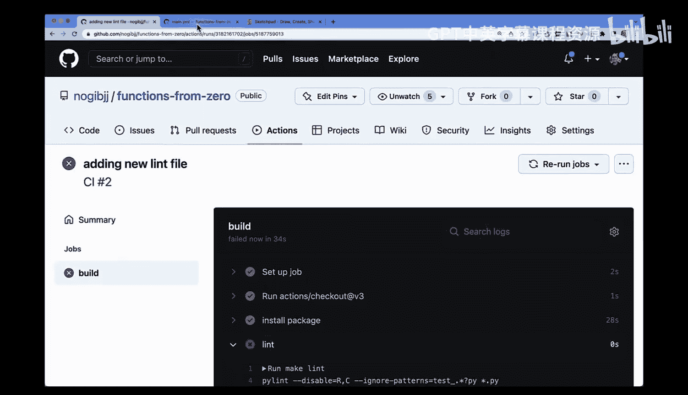

To here and we get rid of it， we get rid of that bad code。And。I can do make links locally。

Here or if I wanted to say make form， make refactor， right which is。Clean up the code。

 formatting and doodle into at the same time， enough I get status。We added it in here。Adding fix。

So now that we've got this， we have the ability to。

move a little more quickly right so we can build our code a little bit quicker because we have a safety mechanism that can watch all of our statements。

 another thing that might be a good idea as well is which I think is not bad is create a status badge for this。

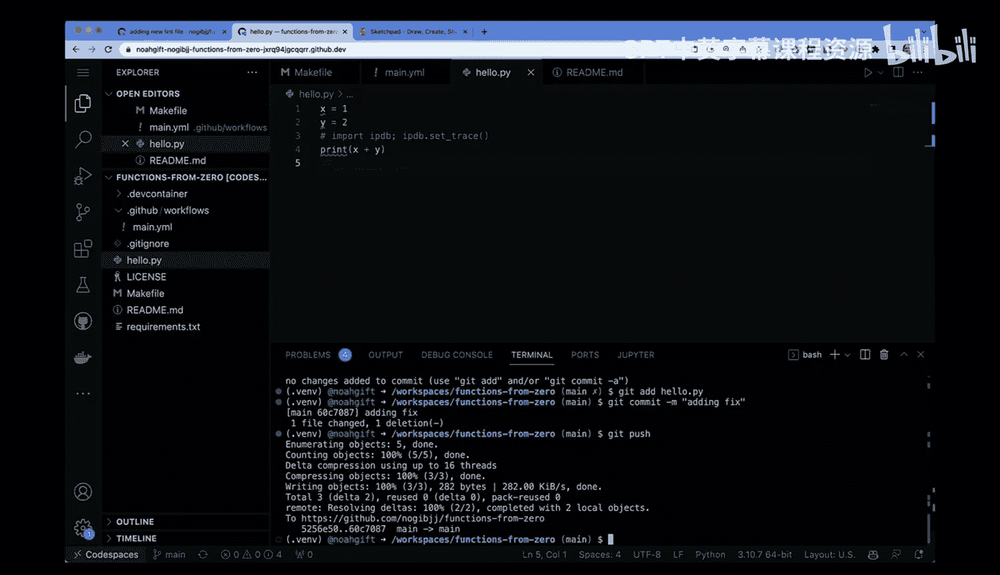

And so if I go here and I copy it， we can also go to。

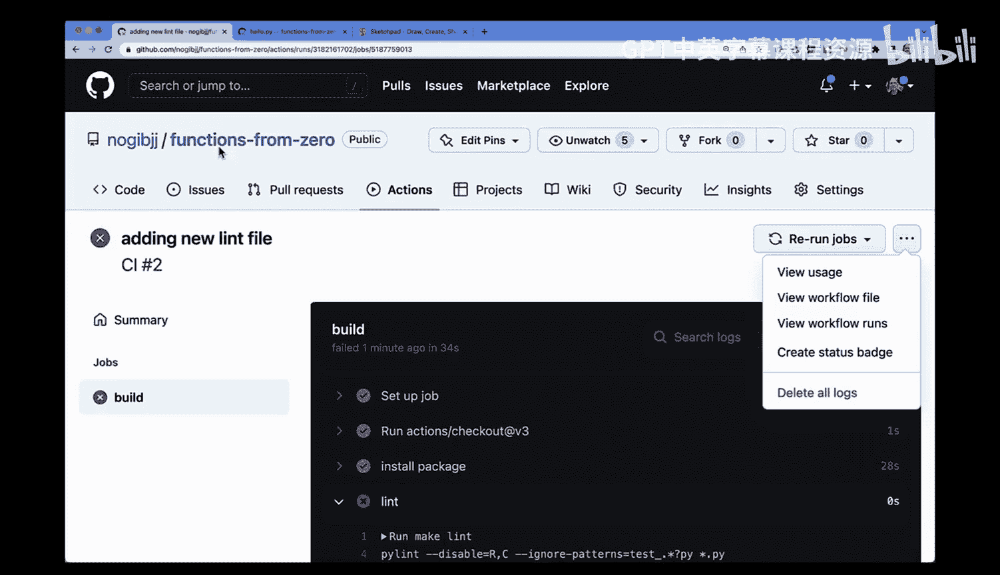

嗯。To this， well， we can do it from either location。 Actually， I can put the status bad here。

 Actually， I can just put it right here。

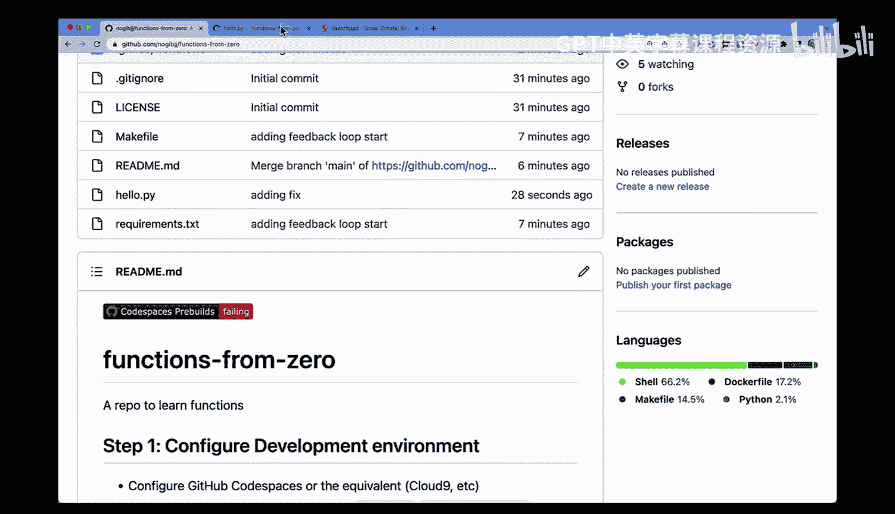

I can put the status batch， there we go。And。What I will do is I'll just also take it status。Get a。

Read me。And we'll say adding status bad。Which is is pretty cool。

And we'll push it andll that'll actually trigger a second build， so every time I make a change。

 it's going to run。

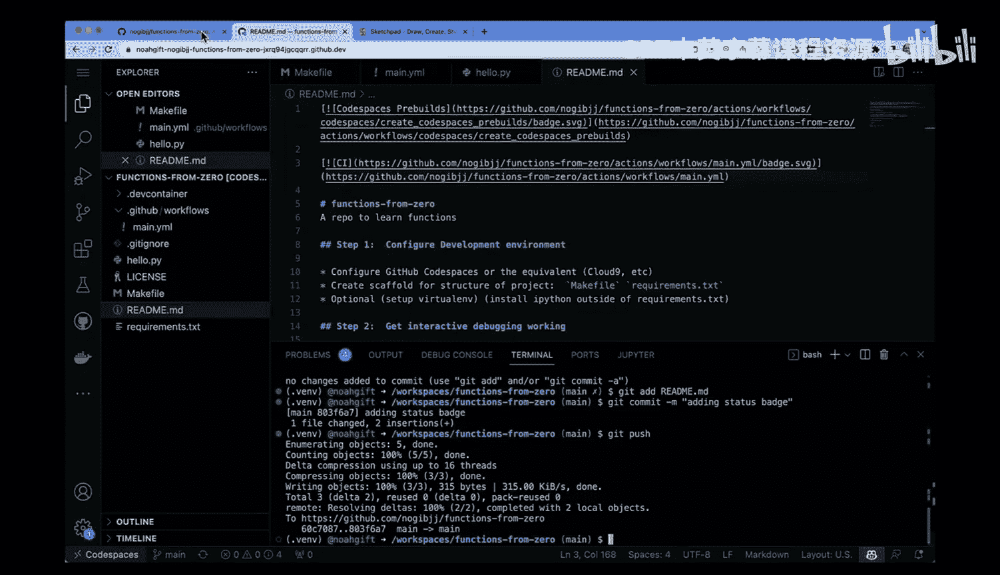

And now we saw that that fix did fix the li， but we can see it's going to run it again and then this one。

We'll basically。All it's going to do is just add a status badge。

 so it's showing that the previous build failed， but in a second it'll wake up and we'll see that this badges should turn green now I don't know why this one is failing。

It's not really that important because it's just the pre build of the project but。In the future。

 that could be something that I could fix as well， maybe the only other。

Kind of build system thing to think about would be that there is also something called matrix testing that could be interesting for what it is you're building and if we go to actions and we look at the documentation。

Here， if we say new workflow。嗯。And we go to matrixtri。There might be， or we say Python。

There should be a。An example here in the documentation of how to actually test。

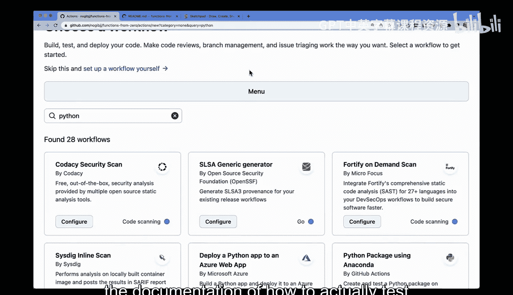

呃。Under continuous integration。

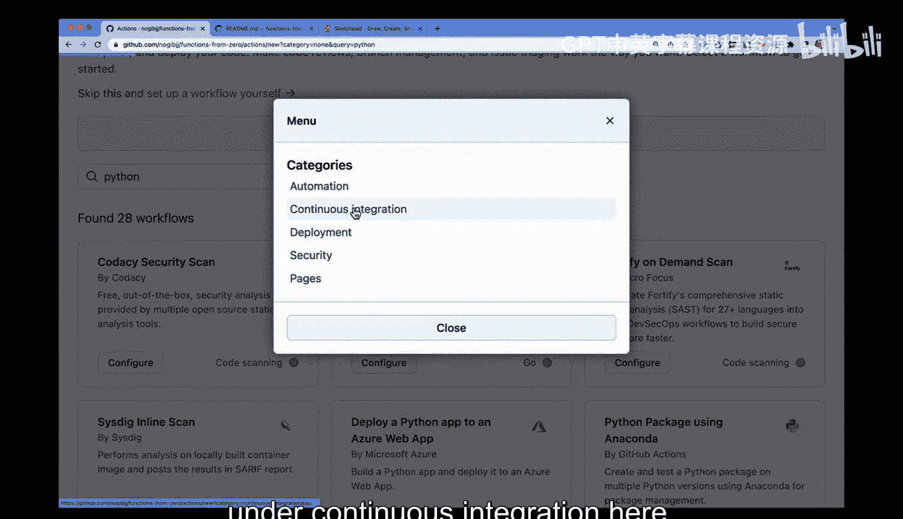

Here。There is actually like a matrix workflow。And let's just say， Python。And I think it's under。Here。

 let's see here。 Go correct test。And it might be under。This。

Let's see you can have actions documentation。Action documentation。We'll click on it。

 and if we go to the。The guide for Python。So if we go to examples。😔，嗯。Let's search for matrixtri。

There you go using the matrix。 that's what I was looking for。

 So one of the things you can do as well as you can actually。Test multiple operating systems as well。

 which could be really handy for especially if you're building things like functions that。

Maybe you need to use a certain operating system because they're going to be deployed in the cloud。

 this could be a really good strategy， or you also could test different versions of the language as well。

In particular。I believe there was one for Python。Right， let's see。 Python matrix。

I thought there was one that there was an example， but in general。

 that's just more of a FY is that you can test multiple operating systems and you can also test multiple versions of Python。

 but this is good enough we have things started and so what else could we do here to kind of kick off or finish up the statement section。

 the thing I would say is that now we can potentially start to learn a little bit about how coppit works and so one thing to remember about Copit is that the prompts are really critical。

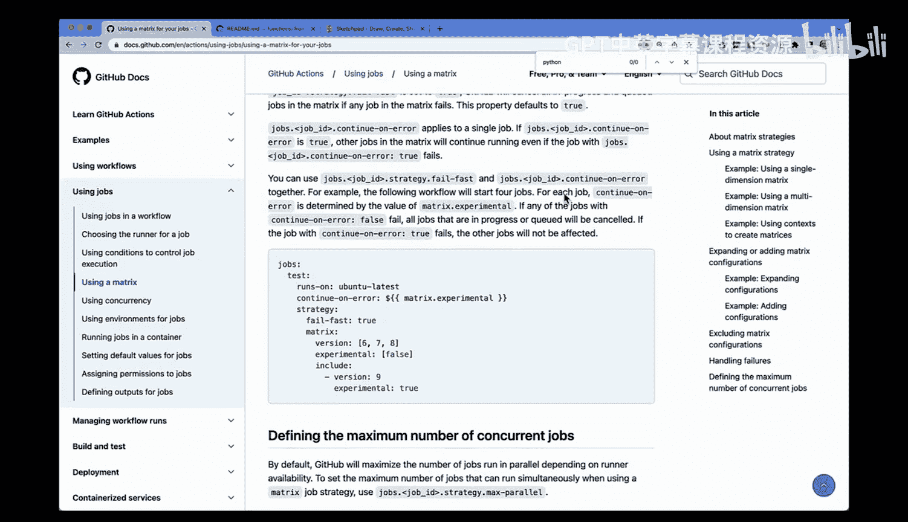

And so if I put a comment here， I can say， you know， create a Ho world function。

That uses F strings so the prompt is what's is very critical to actually getting it to write the right statement and so。

In this case， it says a function， right， and we say print hello name。

And then I can then decide how we want to call this and we can say something like call the function。

呃。Using。If under name。And so there we go。Hello， hello world， right， and so so basically the prompt。

It essentially takes the skill as the developer。you actually harness your skill as a developer into understanding how to prompt the coppilot AI to actually write the right code for you so there's a little bit of a skill here and I've learned as I start to get better at this is the prompt I may change it and kind of go back and forth but this is a great way to practice statements and Python and we can just try it real quick where if I just say Python hell we see it that it works and I can just use it as a scratch padd I can test down anything I want I could say like you know。

Create a list。With。You know，110 random。Fruits。Right， and so。With 10。Different types of fruit， right。

 So the prompt， again， is it's good to have a feedback where you go back and forth， back and forth。

 we can say different types of fruit。And we go here， look。Apples， pears， oranges。

 and then we can just decide what it is we want to do with them and we could say like you know。

 loop through the fruits。And count。The total， you know， so we could say， you know， loop through。

The fruits。And count the total。Fruits。In the list。And so we say it for iron fruit。Print eye。

 print Ly fruits， right， so which which is pretty neat here is it's actually shown you kind of an elegant。

An elegant solution in some sense， right， because it you don't need a counter to know how many fruits there are is actually。

It's actually。Only needs the length of the list to actually generate the fruit。

 And so it kind of gives you some ideas of what you want to do。 And then I even can do this。

 I can just say like， you know。Use an F string so I can even prompt it。

Right and it can give you new ideas like， okay， the fruit is this fruit number。And。

And then I could I could also build a prompt here that says like。You know， the total。

Number of fruits in the lists， right？And so I can actually ask it for basically a nice print statement that loops through this list。

 and then I also can ask it for a basically a summary of what it is that it's building so so really with statement is actually and coppi it and this kind of a mechanism it really is in my opinion the future of how code is going to get written and let's just run it real quick。

 let's just say this right there we go pretty neat and I can then now go to my make file and I can say refactor right so I can say here make refactor the codepit is extremely good。

And actually giving you suggestions for boilerplate code And I think that's really where it shines。

 And so as a developer you can you can use this tool to get rid of code that's just there's no there's not a lot of skill in knowing how to write a for loop or writing an F string and you just have that offload it now to this tool now as well I can just type in make you know make Li it works right。

 I can say get status。Get add and we could check this in and now we have。Basically， a completion。

 you know， finalizing。Statements using Copiot。So this is a kind of fun a fun journey because now that we've got statements。

Out of our way。we can now go into the next step is Python function。

 so let let's take a 15 minute break and when we get back if there's any questions I see there's at least a couple I'm going to answer your questions and then we'll move to phase two and phase two is now building functions and I'm going to heavily use Copit as well to build the functions for us so。

I would say one of the best ways to build logic would be to put it into a library first。

 and the reason for this， and let's just sketch this out real quick that the reason why the library。

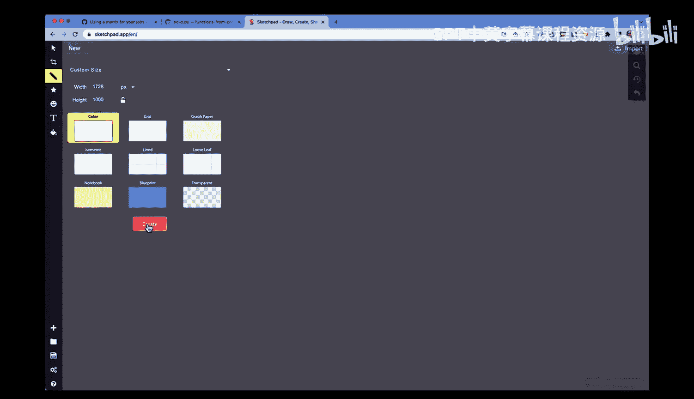

Is so critical in Python。Is that by building a library structure out。

 and we'll just call this the lid。Is that it allows us to move very quickly at building other tools。

So if you're going to build a very complex system， one of the best places to start is to put pieces of a logic into a library。

 And then once the library has been built， you can wrap and import。

A maybe a component of it into a command and tool。And test it out。

 get it working and then if that command tool is exactly what you want。

 then you can take the same literally the same piece of logic。

 and then also turn it into a web app as well， and this is something I recommend to students that I teach when they're building data engineering tools。

 machine learning engineering tools is to keep this library concept in mind。

 put the logic in a library。Make a command tool first， make sure it works and then。

If the logic stays in the library， the testing is also pretty easy because you can just test the library and the Cam tools logic and the web logic。

 the majority of it is actually all handled in one spot。

 So this is a pretty cool technique to actually build things very。

 very quickly in Python by using functions and this of course would be the Python function right in the middle here。

 so that's what we're going to do we're going to go through here and create a librarys structure first so I'll put this into the documentation So you know step1 configure environment step2 get interactive debugging work。

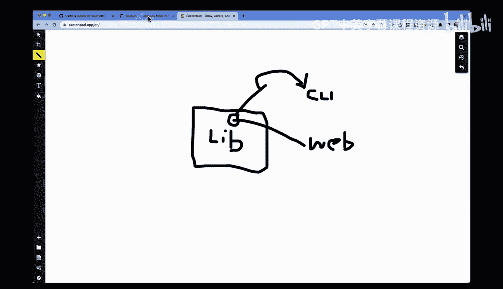

And then the step three here would be build a library， build a library。And use it。

So how would we do this？I would create a directory first， so we'll call this my lid。Here。

 and then inside of。My lid， I would put in an under under a knit。

Py file and this under under and knit do py files what's great about it is that it allows us to then then put new files inside of here that we can use for logic and so one of the easier ones to maybe start playing around with would be a calculator so let's go in and do that let's just say touch my lib Calc。

And we'll just we'll shorten it。 And then I can look inside of this。This library， right here。

And here's where。Actually， something like Copilot also is is pretty amazing because I'm going to build essentially boilerplate code and and I don't necessarily need to write it when the boiler code platelate code could be written by Copilot。

 So I'm going to say here。呃。A calculator library。And by seeding or module。

 So by seeding this with this information， it's actually going to get smarter at giving me suggestions。

 And that that's actually part of the technique here and。

I also need to tweak my make file because now that I'm going to add a library。

 I need to tell the formatting tool to format the code in the library。So we'll call this mylib。嗯。

As PY。 And we also need the Linting tool to look inside of the library。 And so we'll say my lib。

 there we go。 So， so now if I say make refactor。It will also be able to li。And to。

Reform out the code that's in the library and now that I've got this teed up here。

 let's just make this over here。Cl this。Now that I've got this teed up。

 I can start to to actually build stuff out and look， it's so smart。

 it already knows what it is I want to build and so it's going to say build an ad function。

 add two numbers。 Yeah， that's exactly what I wanted。And then we could say a subtraction， sure。

 let's build a subtraction function， what else let's build a multiplication， multiply two numbers。

 all right， how about what division sure， let's see that。And maybe we can also build。

Another function， which is exponent， so we can say。嗯。Build a function。To calculate。The， the power。

Of a number。With x as the base and y is the exponent。Okay， so we do power。Power of a number right。

 and so this is will give us the ability to handle exponents。And， and then。嗯。Sure。

 let's spell a square root as well square root。Return， right。And。

We could also build square root functions， I mean， maybe that's too much actually to build but the general idea is have we have some calculator functions here and then how would you actually start playing around with this I think one of the best ways to play around with it is to go back into i Python and to start playing with the module that we've written so I want to type an i Python。

And I'm going to say from my lid。Dot cc。Import， and then whatever it is I want to。

 I want to actually import。 We could say star。Because I'm just playing around with it。

And now if I type in who？The who will actually tell me each of the functions that was imported。

 So this is a neat little trick to play around with code with a Python from a library you wrote yourself。

Now， what I can do is I can just say add。Right in two and two or multiply， you know。

 we'll say multiply two and2 or two and  three， let's make it a little different。

if I want to do power。Right， I can say two to the third power。Here，8， right， So've， I've got some。

 some neat little little code here working。 And so how would I then。

Kind of take this to the next step， I think the next step when you start to build a library is。

 I would say the first thing you would do after that Python。Would be to build a chamean tool。

 And so what we can do is actually build a series of Camilan tools that invoke each of the library calls that we make。

 And so I would put this here。 I'll just say touch。And we can call this。Calc。CLI。Or we can say。

Calcii。How about that。Calelsci alive。And so this is going to be a command line tool here。

 and it's going to be pretty easy to build this command tool because of Copilot。

 which can do boiler light code for us。And also if we use high level libraries。

 and so the first thing I would do is I would say you know from my Lib to CalC import。

All these functions。And I also can import power here。And as I'm refactoring my code as well。

 one of the things。One of or as I'm using codepilot。

 I can constantly be running refactor which will make our code look cleaner right so it's like， okay。

 look you unus import， unus the import， that's true。

 we haven't done anything yet and then I'm going to say import click which is a commonly tool library。

That maps functions to logic， and then I'm going to create a group and click。

 which is a great way to put subcommans into a function。 so we'll go ahead and do this。

And we'll put some documentation like， you know this。A calculator program， there you go， perfect。And。

 now。I would put in here the name of each command so we can just say this， we can say add。

That would be one。嗯。And this would add two numbers together。

Now what I could also do though is start to guide it right so you can think of coppit when you use it in this manner。

 it's a little bit like like an animal or like a pet or maybe like a small child and that you have to gently guide it and so this is okay but we need to make it do a little bit better and so what I typically will do is I'll go here and I'll say look。

Add to numbers。 That's okay。 But I would like you to， to build out an example for me as well。

 So what if we， we say this。And then it'll it'll actually itll it'll give me a little bit more logic。

 And likewise， I don't want the the regular echo here。

 What I want what I want to do is I wanted to to use colored output。 So I'm going to say use colored。

Colored。呃。Output。To print the results。And then look， it will actually give me a better。

 a better suggestion as well。 So so there there is really a skill involved。In。

And actually using coppi it here so so we've changed this right like Copiot gave us this this it build all this。

 but each one I've slightly tweaked it back and forth so then the next thing I'm going to do。

Is I need to build one for the subtraction function， the multiplication function。

 the division function and the power function。 So let's go ahead and do that next。

 So this at this point the click with the copilot should be very smart because it now knows enough context。

 And so I'm going to go through here。 I'm going to say， okay， great。 let's go ahead and build this。

 Let's build this。And then it should even look it even knows that I want an example and look it even knows that I want colored output right。

 so now it's its it's kind of doing what I told it like I've trained it well。

 And so now we're going to do multiplication， same thing。

And we're going to do a multiplication command， there we go， multiply two numbers。

And then we're going to do a division command。Same thing。And we're going to divide two numbers。

And then we're to due power command。And then。we're going to do the power of this。

 and then it's even smart enough to know， oh， look， you want to invoke this。 great， here we go。

 Let's invoke this cha tool and。That's it。 I mean， really the code has essentially been written for me。

 and this is exactly what I want。 So in my opinion， this is a pretty powerful tool。

 Once you start building the logic together and what I can do now is I can say this， I can say。😊，呃。

Exlamation。What am I doing here？User。Why am I， Why I screw up at Shiang line。I can't even ask it。

 build a shipping。Shibing line。To run the script。 there you go。 So I was， I'm getting so lazy。

 I even have to have it build simple things like this。 that's what I want to though。

And then I can do this， I can say。Make it executable so I can do this。And now that I've got this。

 I can test it out and I can just add help and look pretty pretty comprehensive calculator a calculator program and it shows me all the commands it says it can add。

 it can divide， it can multiply， it can power and let's try it out so let's go through here and let's go through and we'll run the power so we'll say two to the  tenth0th power。

There we go two to the 10th power is 1024 right so we actually have a neat little tool here with colored output as well so。

The next step once you have a working tool would be to make refactor to make sure that the code gets cleaned up and it'll clean it up right so now our other tools work with making the AI output cleaner looks pretty good。

And now the only other thing I'd need to do is is start to build some testing for this。

 And there's two kinds of tests that you can do that are important。 One would be testing the。

The logic and the other one would be testing。Dian。sBasically the invocation of the command tool we can do both so。

If we go back to our make file here。Can I look at。The test structure notice that we can cover a certain library。

 like in this case。We don't really need to cover the Hello file because it's basically just a test file or like a prototype。

We do want to cover this， and we also want to cover the CI。 so we want to see Cal。CLI。

So we want to cover both of those and then， and then we want to run a。

 we want to basically build out a test。 Let's go ahead and say like。We'll call this test。Projects。

Right， so we can。We can。If we wanted to。Or we'll call this test。

Yeah let's just call it test project test project， so this will test our entire project here。

 I mean there's lots of ways you can paint subdirecties but let's just keep it simple。

And we'll say from mylib docalc。And we can say imports。And we want to actually import。Everything。

 right， so we can， we can do everything here。 And then here， here is where actually。

TheAlso the copit can be a huge win， as we can say。Look， it's smart enough to know。

That I want to write test。 And now I can just basically say write， write a test for。

 for every single function， right， So write a test。F。For each。Function in Calc。 There you go。

There we go。And。There we go。Again， the prompts are key here。Because now， I believe。呃。

I think this is it。 I don't think there's any more because I think it's just one， two， three， four。

 Yeah， I think this is it。And from here。If I type in， make test。

We have 100% test coverage and look how how simple that was and it's boiler plant code， really。

 there's not a lot of。Reason for me to write this code when the AI tool can write it for me and it did a very good job so then the other thing that we can do is we also can use click tools to invoke this Kamean tool and so now I'm going to say known I can also say。

That's。This particular tool。Cci was never imported。Because I didn't import it。

 so I needed to say from Cal CI， import CLI。So， so now we can actually test it。 And if I do。

Make tests， it should show that look。There is a little bit missing because we're not invoking the Kamean tool itself。

And so now what I could do is I could say use。呃。Write it。 write a test for for。For each command in。

Calci I。There we go。And so now。I need to actually import the click runner so let's say。Import。

The runner from click testing。There we go， and it even tells me。Exactly how to do it。

 So we say from click。Testing import。The runner。Which will invoke our tool。And then then we just say。

Invoke。The runner。And we can say runner。Is is this。Now， I don't know if that's exactly what I。

 what I want to build or not。 So let's look at the click documentation。 So let's say click。

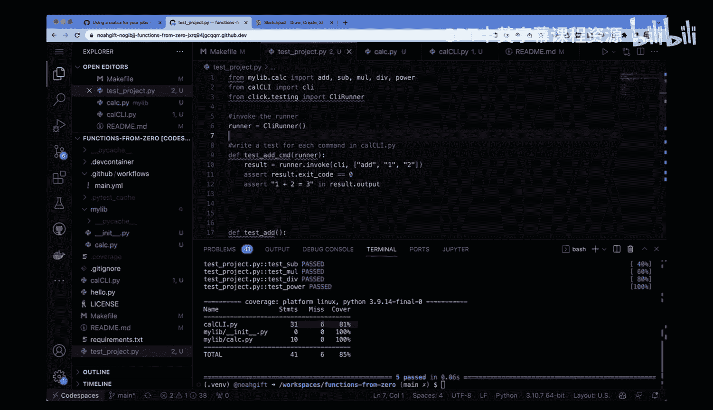

Test documentation， so it's not a panacea。The the copilt， you still need to。

 to know how it works and so， okay， we just， we want to put it inside of there。 Okay。

 so that's that's how we we invoke it。 So I'm gonna， I'm going to put this。

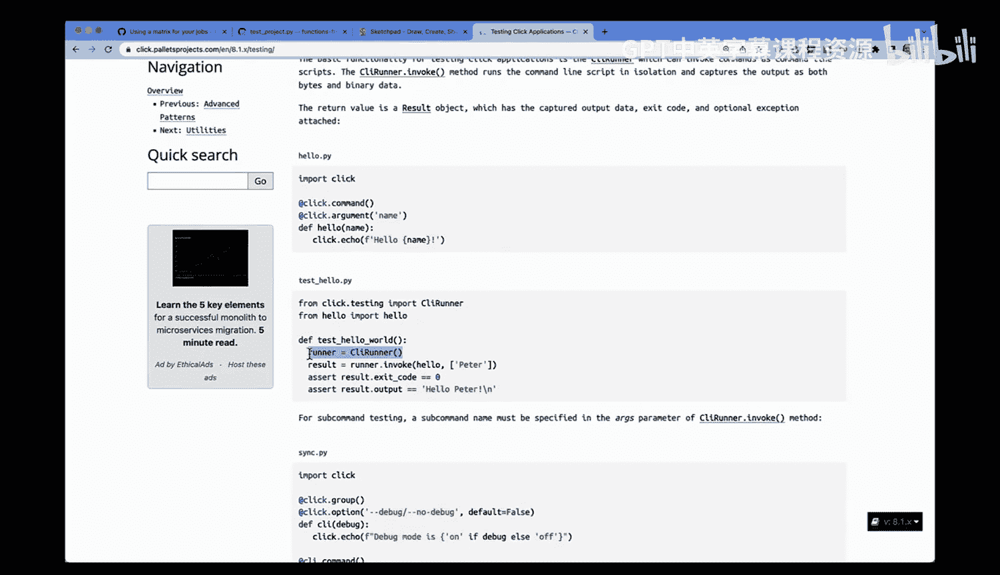

Instead of here。I mean， I guess you could make it into a fixture， I guess， which we could do。

 we could say from。Or import import by test。And we could say P test do fixture。

And then the fixture would be the runner。 and not that would work actually。

 And so basically what a fixture does is it sets up and tears down this runner for each test so。

In this particular example， it's going to pass in add one and 2 and it's going to assert that this is in the output。

 So let's try it out。 does this actually work， Now it's probably going to need to be changed a little bit because we don't we actually care about this。

We care about assert。That three is in the output。There we go。

 that's what we care about is is we know that if you add one and two。

 three should be in in the output and now we can write a test for。

The subtraction and do something similar， right， So if we say subtract one and 2。

 minus-1 should be in the output。Yeah。And then we could just we could build out。The same thing。

 the one for the multiplication。And we can build up one further division。

So really a great way to build out。Test for our code。 And this， I think that's it。I get。 wow。

 I guess you can do it。 a test for the help command。Which I didn't even think about。

 which our tool is telling us。And if I look at it， let's double check that that's in in there a calculator program。

 Oh， okay， so I guess it is。 So now if I do make tests。We have 97% test coverage。

 right so we we have the Copi that has really been friendly with us in helping us build a nice little tool here。

So again， I would just type in refactor。To just clean things up a little bit。

 Our code looks pretty good。 Let's go ahead and say get status。

 Let's add all of this code into our build system。 so let's say gi add。And check this in。

 say adding project files。There we go。And we're going to go ahead and push that in。

And now that we've pushed those。Those files inside， the next step is to go back。

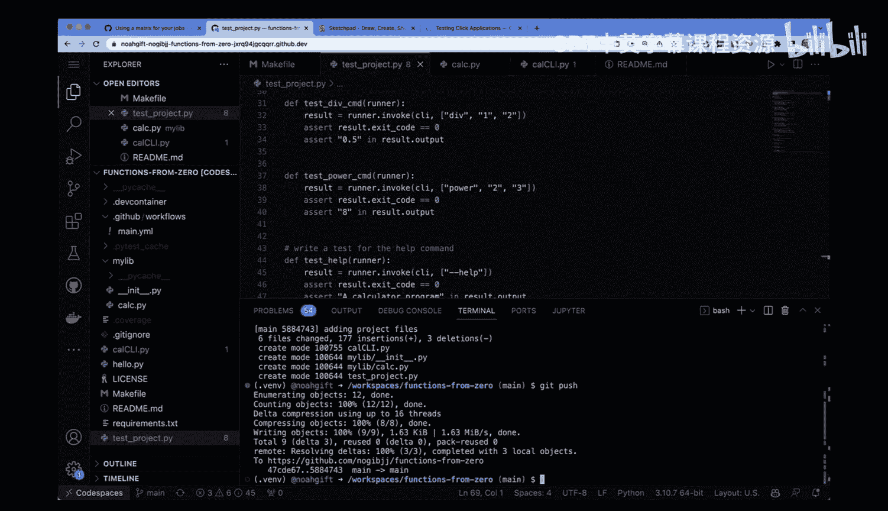

To our our repo here。And let's just double check the build process， so I'm going to go here。

And I'm going to。Look at functions from zero and we can look at we added these project files right here's my lid。

 and if I look at the build itself。

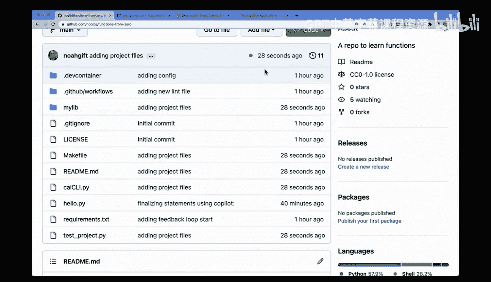

Here we can see that， in fact， we should verify that our build process is actually working correctly。

 So I think this formula is really a powerful formula to to build。To build tools very。

 very quickly and it's pretty amazing actually， what you can build and how amazing actually the system is。

 now， one thing that we need to change is we don't have any testing yet in this。

 So I'm going to go ahead and change this。 so I'm going to go to Github the file here for the build system and see here we only have a make Li and a make format。

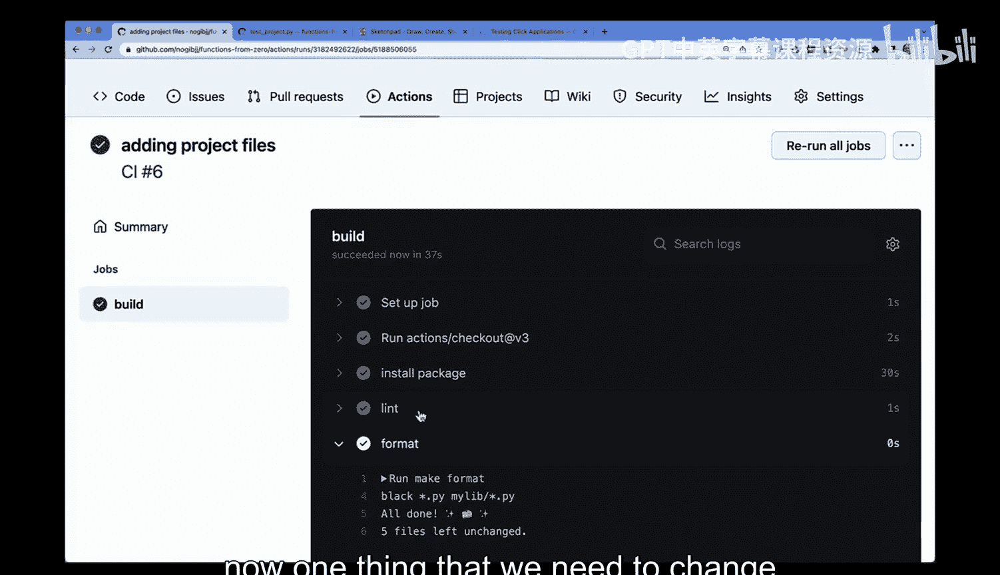

I'm going to put a step above here that says make test。So we'll say test。And we'll say run。Big test。

And let's go ahead and add that get add。tgithub。It we'll say trigger trigger test build。

 testing inside of build。And now we truly have a great start to a project， very high test coverage。

 good library， a commanding tool， and in my opinion。

 this is really how to build complex systems as you start。

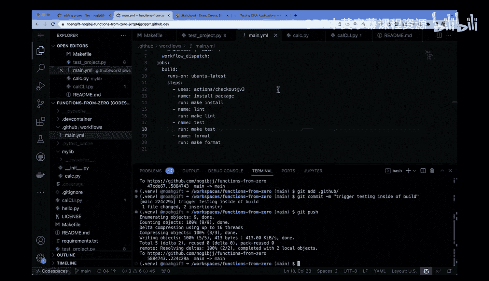

Step by step， boat little pieces into a library and then build Caman tools that do the work。So。

Let's watch this build。All right， this should run in a second here。Perfect。There we go。

We have a really nice high quality project here。With all the test passing and so this would be this would be like a job interview kind of kind of project。

 at least for an intern， right， this would be this would be a really high quality project。

That that I think would be， would be a great project for someone to build。 So。

 so now let's make things a little bit smarter here。 And so what I need to do is build a new system。

 So what can we do， Let's， let's make something a little bit。

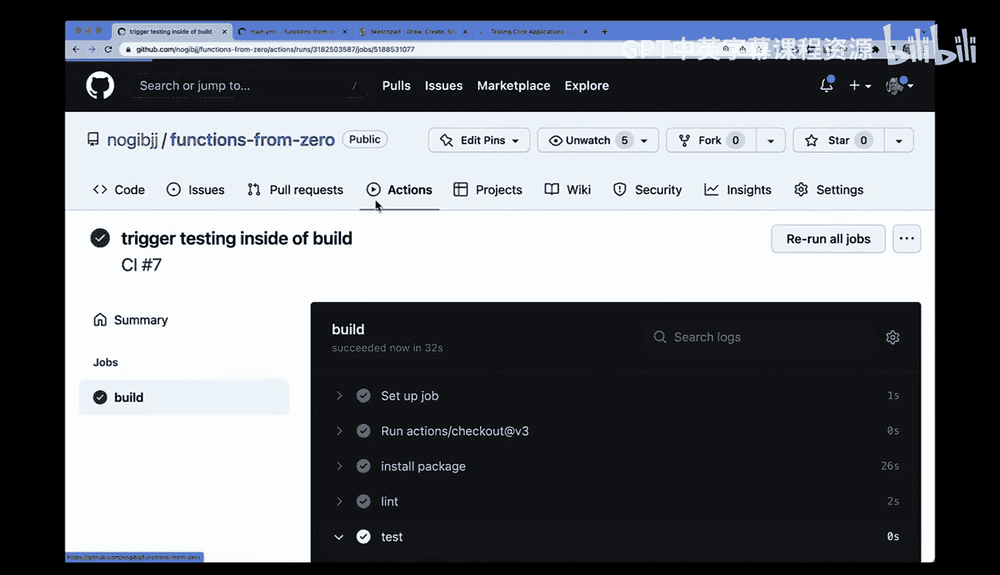

Let's make something a little bit smarter and let's see if we can build out some logistics code like let's say we're working at a logistics company。

 so I'm going to go through here and I'm going to say my lib and we'll call this logistics。Like that。

And。I believe that this library Geie。Can can be helpful。

 So I'm going to use do an installation of geopi。And we can do a make install。And we're。

 we're going to ask it to figure out things like distances between different cities and coordinates and things like that。

 So let's let's let's ask our coppi here。Or set the seed。

 we need to set the seed for the kind of work we're going to be doing。This。麻jo。Deals with。Mgistics。

And。Calculates。Distances between two points。嗯。The time it takes to travel。And other。

Logistics related questions。For。A given speed。Okay。

 so we've kind of set things up here and let's go here and we'll say imports geopi。Giopi。

And we can say。Basically。嗯。呃。Get the distance between two points。So it looks pretty good。

 And we could also say， can you build a function。That。That， that determines。The or no， first。

 first what we need to do is this。 we need to say let's。Build a。

 So this is what is' good at is building boiler plate code。 So we'll say build a list of。

Cities and their coordinates a list of 1。10 cities。In the US。And their coordinates。There we go。

 so here we have the coordinates。And it can actually basically build out these coordinates。For us。

RightAnd so this again， is what's kind of cool about。

Letting this thing build with boiler play code for us。

Is that there we go so it has like some starter code for us。 and then what we can do is we can say。嗯。

Build a function to calculate this distance between。2， to cities。There we go。 There's city1。

And we can say geoie distance between。City1 and city 2。And then。

What we can do is write a function to calculate。The time it takes。 No， what what we want to do is is。

Is basically pass in。Or call this so one of the ways you can kind of prompt it to get a little bit smarter is you say。

 like， you know， call the function to calculate。The two cities。And so we would just say cities。

Zero and cities one and。And we can just see what it does。 So let's， let's go ahead and say Python。

Let， let's。Let's say Python， my lid。Logistics。And says， oh， geoi has no attribute distance。

So we have to sometimes。Go back and forth and go back to the drawing board and and take a look at at。

 and sometimes I even will， will， will， will look at the documentation。

 So we'll look at geo Pi here and we'll say Gepi。

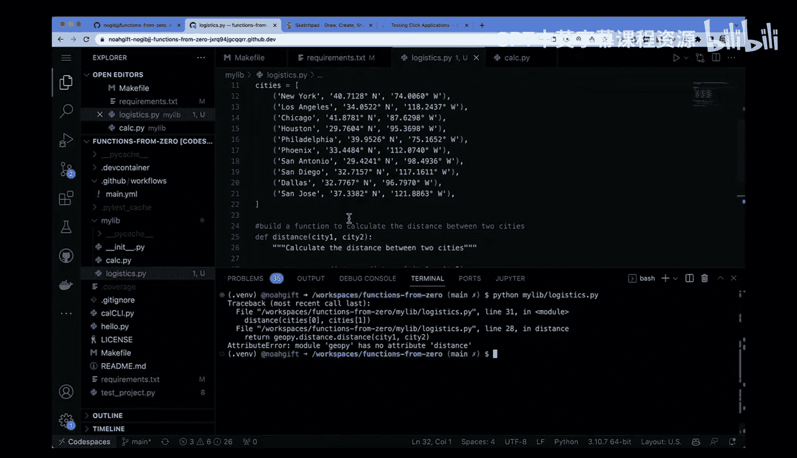

Let's look at the documentation and we can say like， here we go。 Calulate the distance。From。

And we see here that this looks like pretty good documentation。

 You would say from Geie import distance， so。So， this does look like。A pretty good。嗯。

A pretty good tool is。Is it says from geoI distance。

 let's even try it out to give it a better prompt。

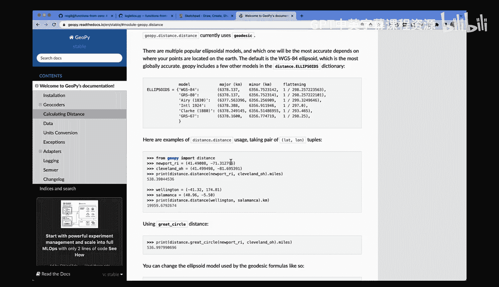

And we can even just nuke all this。Right， and we could just say from。Gopie。Import distance。And。

We can just print this， let's just get something working。And。What did I do here， I。

 I have a mistake in the code。Which is。to save results。Dis or or results。Equal to this。It looks like。

I've got one extra。Thing there。 And I can say print result。 How about that？ Does that look good。Well。

 what we can do is we can say makefactor and we can find our bugs。That says。Kenneth。Cannot format。I。

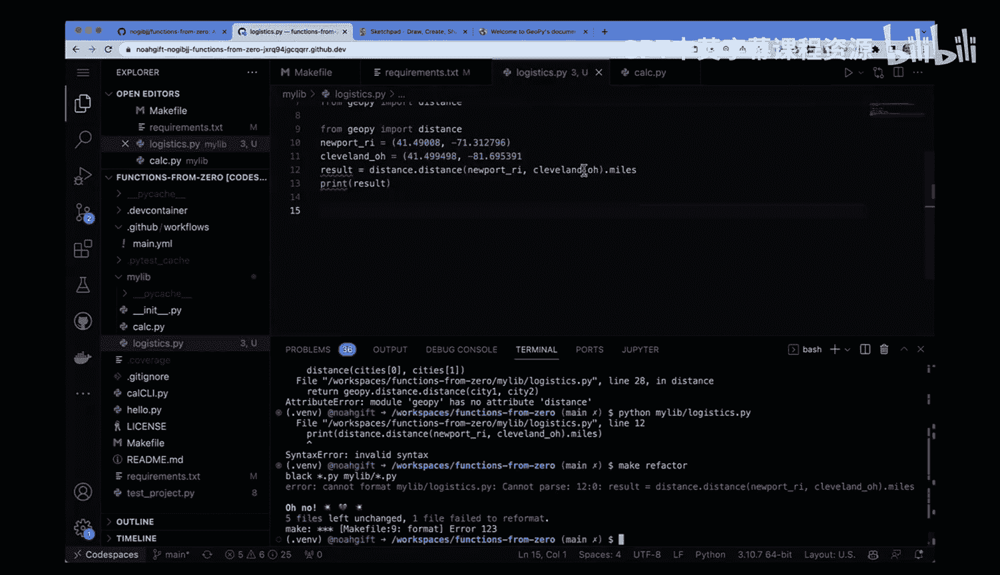

So。This we need to get a better。We need to get a better。

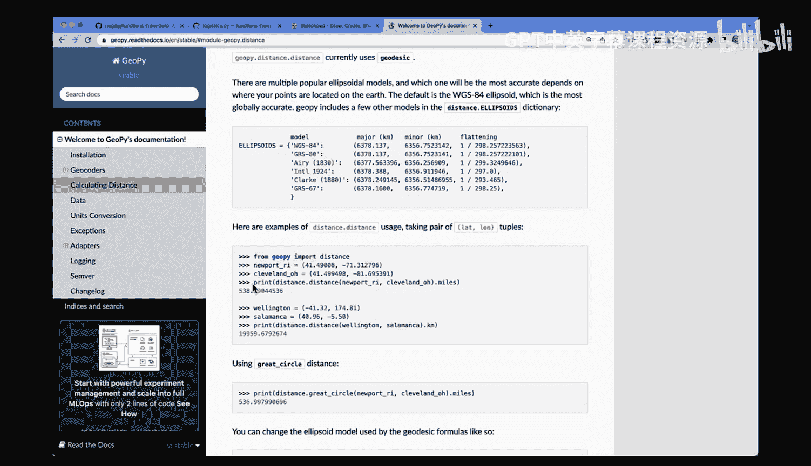

A better example here。 Let's， let's try that。 Does that look better。三支牌。

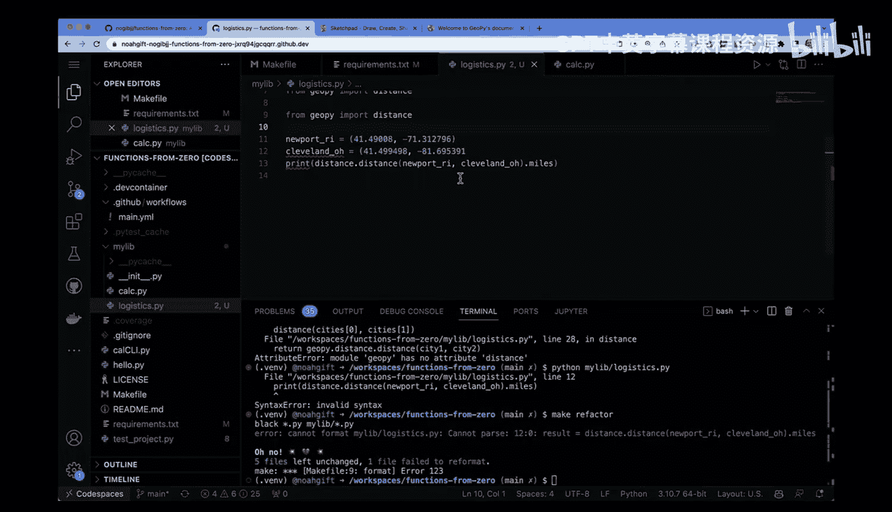

And let's look at this。Ohio。

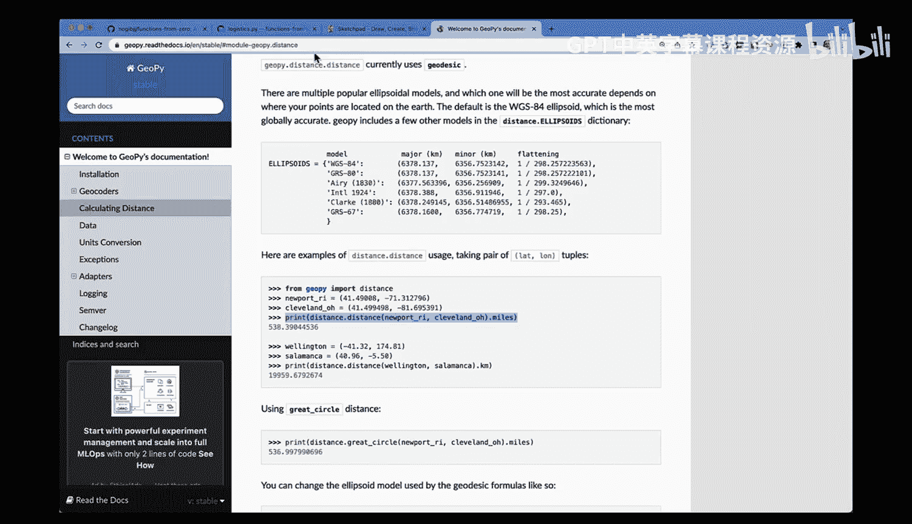

Let's close this。It looks like that should work。So what I'm going to do。Is I'm going to just do。

 do my friend at Python， which I think is is sometimes a better way to kind of get the ball rolling as。

 as I'll just type in I Python。

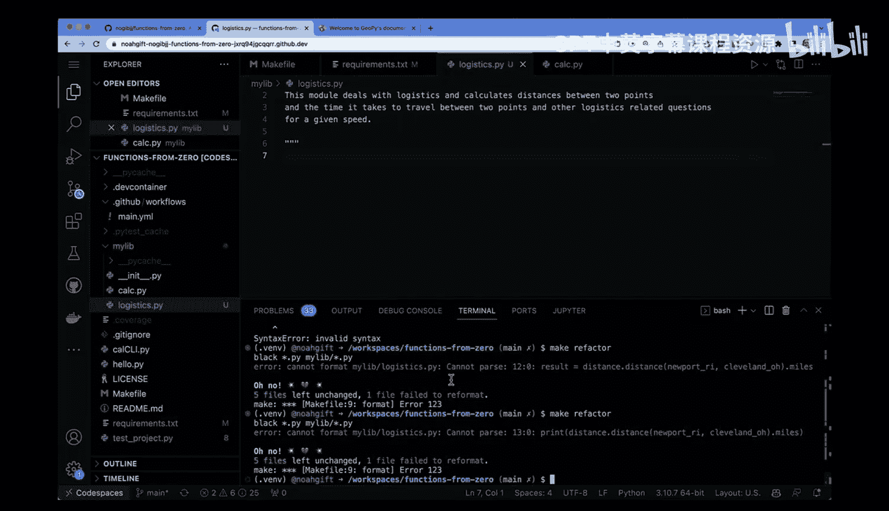

And let's just follow docks。 So let's say from G P for distance。There we go。

 and then let's see the next line of code， we'll say Newport， Rhode Island。

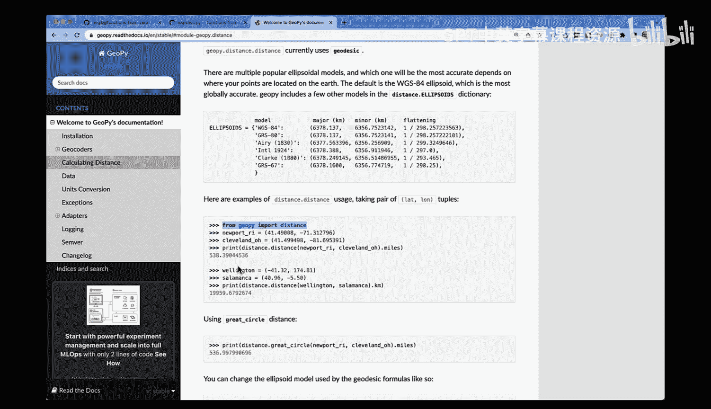

And。

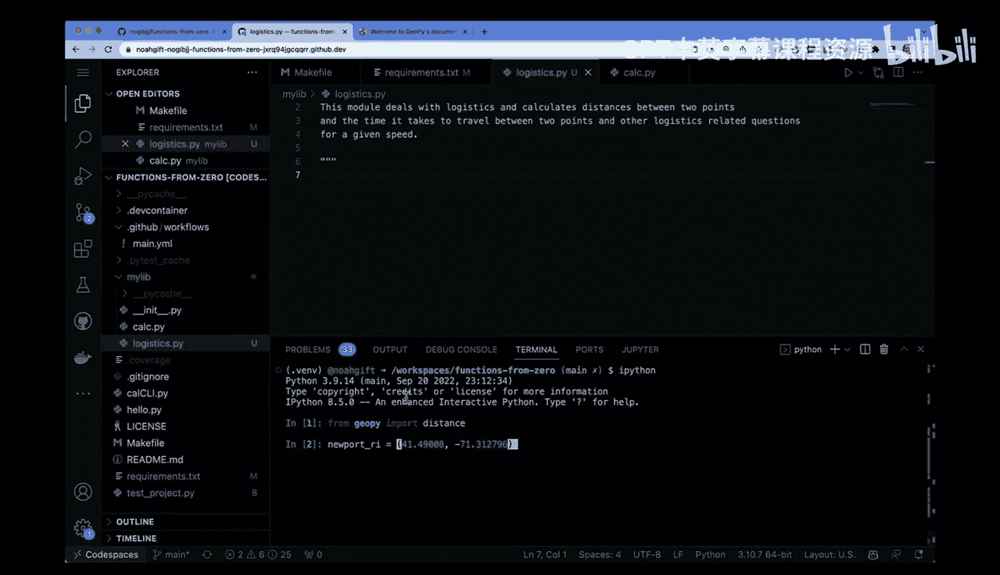

And then we'll go through here。It will say， Cleveland here。

And then let's go to the Xa code and we'll say pre the distance between。

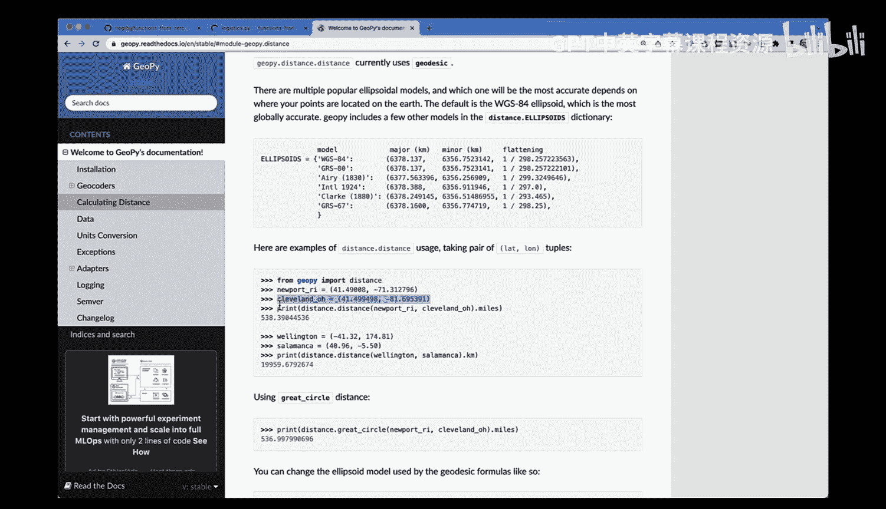

Newport， Rhode Island。C。Okay， so that worked。 so now what I could what I could do is I could even put this into the comments to see it a little bit more。

Right here， just to give it some more context。Like this， I could say， like， for example。

This calculates。This module。and then I could just kind of seed up what I'm going to build。And then。呃。

And then maybe I could even get a little bit smarter here and I could just say。From GI。

Import distance。And I could say， here's the distance between two points。

 calculate the distance between two points。And then let's see if this would work。And we could go。

Prince。Prince。Distance between two points。And let's see if that works。Refactor。

That looks like it's good。 so we know the code is logical， and now we can see a Python。I live。

 so this， I kind of just flushed out some of the bugs。That I had here， so this looks decent。

And so now I got some things cooking here that I can use。

And what I would probably do next here is now that we've got distance between two points， let's。

 let's write a function。That will will return。The coordinates。For， for。

 for maybe like search a city by coordinate。 So like we could say build a function。That finds。

The coordinates of a city。Find coordinate City。There we go。And so， in theory。

It would return back the city that latitude， city that longitude。And。We could。Build a function here。

Build 10 cities again so we can say build。A list of。Of cities。With。Their coordinates。

And so now it should be a little bit。呃。A little bit smarter。嗯。And say like make it a list。

Make it a list of cities。And let's just say， cities。Or we could even make an uppercase to clarify。

City is equal to。And now it's gonna。M New York。Los Angeles。Chicago。

 so this is now a little bit better of a prompt and we've kind of seeded our system here。To。

 to be a little bit better。Looks pretty good。There we go， Charlotte。that's good enough。E Paso。Let's。

Let's just， let's end it we got enough。What we can do is we can say。嗯。

Calculate the distance between all of the cities， right， so we can say， you know。系。CCalculate。

Calculate。The， the， the total distance。Between a list of cities。 There we go。

There's a list of cities。And we just say total is equal to Fion range， the length does cities total。

 and then we do the additions between two points。 this is this is pretty good， this is pretty good。

And so if we just do a refactor here。We should be able to clean this up。 This is enough for me。

 to build a tool。And we can just say， make。Refactor to clean it up a little bit。 There we good。

 looks pretty good。 And now I would build out logistic or we'll call this。嗯。Yeah， logistics， CI。

Like that。Logistics E I。 and then we'll do the same thing I did before。 I'll just say from。My lid。

Dot logistics。We're going to import these things here， and then I'm going to say import click。And。

IAll I need to do is we'll say build a function to calculate the time。It takes to travel。BeBetween。

 no， we want to， we want to build。ACl group。To build a click group。Here。Like that。

And we'll call this thing a logistics tool。And then we can。

 we can basically build what we'll call this distance。Here。

And this tool will just take the distance between two cities。So that's。Calculate。

 find the coordinates。And do we have this piece of code， this is fine coordinates？For city。Now。

 this one。Oh， I see。 So we would。Cities， fine Court。所以。

I think what we need to do is we need to to change this a little bit。 We need to say find。呃，的苦子。

Coordinates of a city by searching。For them in Gepi， because I think Geie has。Li。Now， like。

 I thought that they're wait or look up。Query or or。Find the latitude。I want you to a city by。

Quering。嗯。The Ge P database。Yeah， I don't。 I don't。 I don't know if it has that。 actually。

 I'm not sure if it has the ability to find。

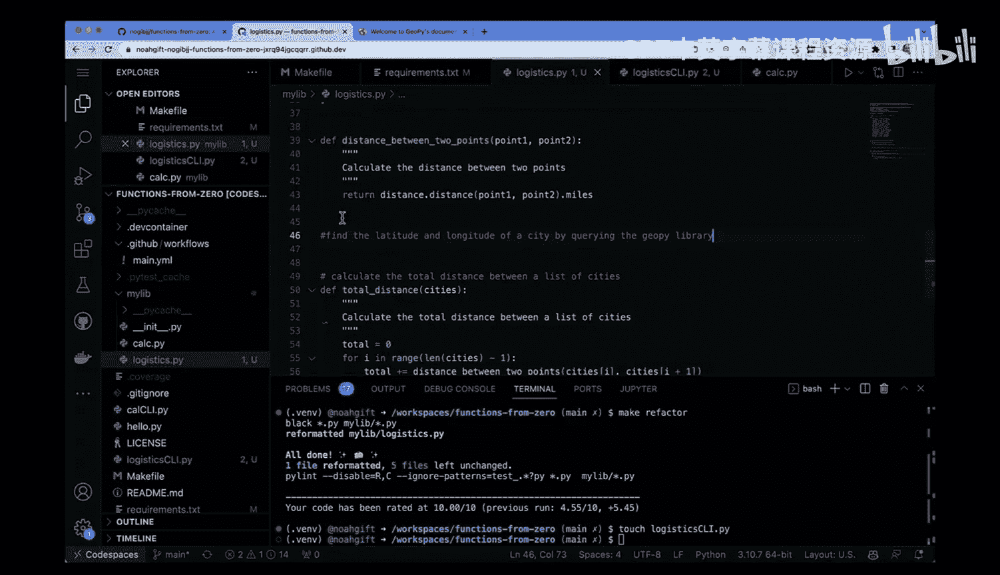

呃。TheDists support simple， arithmetic。So maybe we， maybe we just， we punt on that one for now。

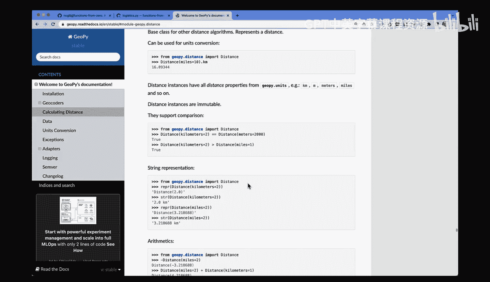

And we we don't even we just we just go with the distance。 let's lets， let's keep things simple。

 let's keep these simple for right now。And。I'm going to go back to my logistics tool here。And。What。

 what we， what we can do。Is actually。We can just say build a quick command， we can say。嗯。

Total distance。And we can say this one。Will。嗯。Will， will calculate。Deaf。Total。Find coordinates。

Calculate it。 and we we don't。 we don't want to do fine coordinates。Total distance。

We actually want to import。The the cities， so we want want to import this thing。So， we want to say。

Cities。And we'll just keep keep cleaning it up logistics tool or tool。Tool that。For calculating。

Total distance between cities。Between a list of cities， between a list of cities。

So that should prompted to be a little bit smarter。And。We， we want to say。We'll just call this total。

And we， we don't even need an argument。 We could just say deaf。Total。And we just say total distance。

Cities， right， so we're going to make it kind of dumb。Just， just for， for， for fun。

And let's now do invoke。They'll click command。There we go。 So let's see if this thing even works。

 We need to add a shippingang line here。As well。And user。你Python。Make it executable。In logistics。

 thats just help。There we go。 So let's see， can it figure out the total？Logistics。

Could not convert string to float。And。Wei。Can。Let's see。

 We can go back to our other our other logistics thing here， and we can just kind of copy。Copy this。

Which is total distance。We really just wanted do total distance。So。We just want cities。

Well we don't even need， I think we only need， we only need total cities。嗯。For a total distance。

Total distance。And。And we don't need to even pass that in。And we should。Be able to just。

 just say print。In fact， we can just copy what's in the bottom of this。Right， I think we are。

We would say， print。Total distance or something something like that。 We should。

 We should be able to do that。 Let's double check that it works。 So wed just see a Python。

I live logistics。So somehow， I， I screwed up。I screwed up。嗯。

Something here was it was It was working before。 I'm not sure what I what I screwed up。

 but the general the general gist of this is without getting into too into the weeds of this is that you get this the logic back and forth。

 map it and flush it out。 I'll just for now， just leave this here and we'll just move on。

 I'll check it in though， we'll just say。Get status。And these。And we can sake it add logistic。

And I'm going to write my test to get this code working a little bit better。

 So what are the things that we can do。Is we can actually go back to our。

Project here and I'm going to make another I'm going to make a specific test file just for this project。

 so I'm going to say touch test。Logistics。And I'm going to inside of this test file。

 I'm going to say from。My lib dot logistics。And I'm going to import the cities distance between cities。

In the the prince cities。 So what I want to do is I want to build a。I want to write a test。F。

The distance between two cities here。And let's， let's go ahead and run that first。

 So let's go ahead and say make tests。And that one。Was。Was， was not correct。It's close。

 but we can basically say。We we could do。We could do something like this。 We could say assert。That。

Let's just put the right value in。 Let's just use that。And let let's go ahead and make a test。

 there we go， and then I could also one of the things I'm going to do is build a function here that actually will just print out the city names。

And so could we could do that real quick， we could just say print cities and just。

Just double check that that works， so we'll see a Python my lid。Logistics。There we go。

 so we're able to print the cities。And I think that'll make it a little bit cleaner for me to verify that things work and I could say something like。

I can make a test that says。You know。Deaf test print cities and assert。

That maybe like one of these names。Is in。Is in print cities。嗯。In fact。

 the Prince cities we can even have it return。The the output， right。

 so we could just say like return。Yeah， we could have it printed。

We could have it printed and return it so we could through both。There we go。

 And so if we go through here and we say make。Test here。What， what we， what this test would do。

 Ra it asserted that that was in there。 Let's， let's double check that。嗯。We'll put in。I don't know。

 like。Cleveland or something。 something that when wouldn't be in there just to verify that it it will。

There we go， Yeah， see that didn't work。Or misspelled word， so we have actually a test there as well。

And。We probably don't even。Need to， to print this as well。 We can We can basically return。

 We just want to return the list of cities。Right， this would be。We will call this city list。

Cities lists。Turend the list of cities。And if we just run this。Right， that looks good。And now。

 if I just say make refactor。Again， just constantly kind of cleaning things up， cleaning things up。

 We see that there's some issues here that I now need to go back to my command tool and fix。

 So once we get get this fixed， then we then we can build out the the actual。Next thing。

 So I'm going to just start over a little bit here， because I I only need to。

I don't need to import cities， I just need to import these two functions cities lists。

 so I'm going to say build a click group。We'll say build a quick group。Quick。And。

We'll put some documentation here that says logistics。Cmeing tool。And then we will。

It loves to give me this one， that's not what I want， what I want to do is I want to say cities。

And I just wanted to print out the cities。I think that's exactly what I wanted to do is list cities。

And so。We could say example。As well。Like this。Pon。And we could even clean it up a little bit。Here。

 that looks good。And we can even say like。Use。诶。The city different with color。There we go。

Click style。Ls。List of cities。For city and cities list， there we go。

So it was able to give us a pretty good function， so we finally have something working here。

 and if I again say make refactor， there should be less bugs。There's only one bug left。

 which we'll fix in a second， but now I can call the tool。And I can say logistics CLI。

 I can say help。It says， oh， it's a logistics tool， okay？Let's go through here cities。

And it's going to just print out all the cities now that we have the cities now we can now we could the user that uses this tool could find the cities that it knows about and that it could pass those in。

 So what we would do is we build another tool here that says。Distance exactly， click city1， city2。

 that's exactly what it's going to do， it's going to calculate the distance between two cities。

 is it perfect。And now we actually have a useful tool。Right。呃。Distance between two cities， oh。

 but we need to。We need to refactor this。To be。We need to write a function。Here。

 that will return a city。So。Return。A coordinate。嗯。Calculate distance between two points。

 Let double check here。So it's going to be。嗯。Return back。Yeah， return。Return the coordinates。

Of a city。G coordinates city。For city name， coordinates and cities of city。Return back coordinates。

 I think that's what we want。And then we would go back to here。And we would say， from cities lists。

Get coordinates and now we would just tweak this a little bit here。Two， we would say， click echo。

Look style。There we go。That's what we want。So we just needed to guide it a little bit more。

So that it would get the coordinates。And now。Aha， there we go。

 So now basically we have a pretty cool tool that。We can， we can do this。 We can just say， you know。

First list the cities it knows about。In this case， this would be the cities。

Right and then now we just tell the user these are the cities that I can do things with。

 and so how about the distance between San Diego？In Los Angeles。And we go here。There we go。

 So now now we actually have。Now， 111 miles between San Diego and LA。

That seems a little bit short No I guess that is about right And then what about。

San Francisco and San Jose， right， those should be pretty close to each other。So we could do that。

So we can see San Jose。And then we find in San Francisco。

So we have the makings of a nice little tool here。There we go， yeah， it's about 40 miles。

 it sounds about， well， but the time is a different thing。So I guess what we could do is。Is。

We could write one more function here that gives us。You know， estimate。We could say estimates。

The travel time。Between two cities。By T by car。So here's the speed， the distance。

And we could we can even say like。呃。Assume。呃。Average， the speed is 60 miles an hour。

And we could even say like。speedpeed。Is equal to 60。And we just put this like speed。As the。

The default， the default speed。Is 60。So then we also could。Could的。

Could could import this into our chamean tool here。And say。What did we call this， We called it。跳不成。

Travel time。And again， I think it's good to just constantly be refactoring。

 So we'll say make refactor here。And what we can do is we can say。

Calculate distance between two cities。And then we could basically。Build another one。

 this is the travel time between two cities。Assume the speed。Travel time。

And we'll just call this travel， make it simpler city one。是超。Speed default is 60。There we go。And。

This looks pretty good。This looks like travel time。Between two cities。All right。

 so now let's try it out。And。let's run this。And now we have a pretty neat little tool。

It would be so between New York and LA it would take 40 hours， it would take a while。

 but what about LA and San Diego？Should only take maybe a couple hours。Right， yeah。

 two hours to our trip so great we have a great tool。

That is able to build some really cool stuff and we could even even say like。You know， basically。

If we wanted to format it and clean it up and all kinds of stuff， but I think basically we're we're。

呃。We're pretty good to start to the next phase， which is to build a microservice。

If I go back again to sketchket padd here， let's build out。

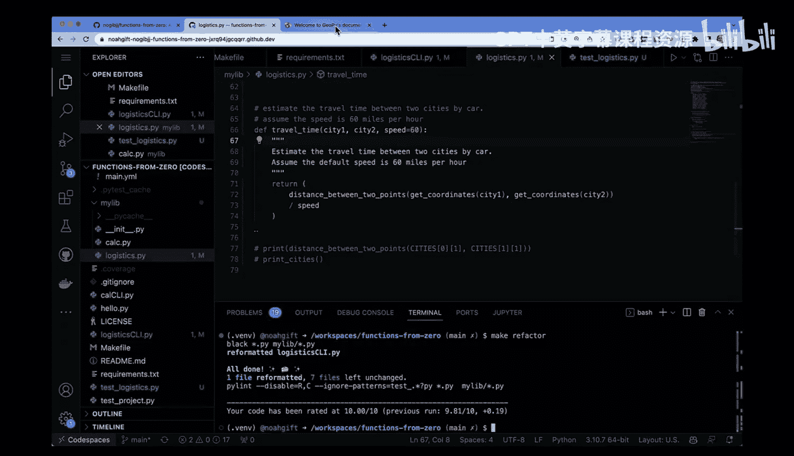

Where we would want to go to next。And so again， we have this library here and we're testing our logic out。

 but now that we've got the test we've tested the logic out it's going to be pretty pretty trivial to build a microservice because this thing can interrogate our system and build all kinds of really cool stuff here So that's what we're going to do next is're we're going to build out a。

A microservice。So let's go ahead and。

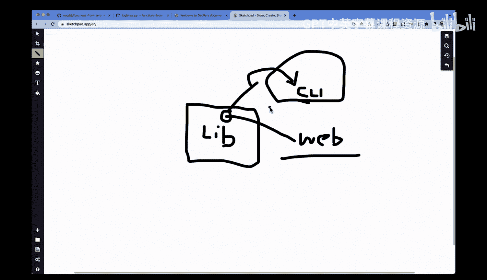

And do that， let's just check in all this code。So we'll say make status。Or it gets status。Here we go。

 we will add all this。Comit。Adding logistics。Like this。And from here， what we will do is。We will。

Be able to build out this microservice。And this microservice will start off by creating a mean file。

 so we'll call this one main like this。And。We also。Will。Most likely want to。Build out。

A little bit more of an import as well so we can we can run this and so。

What I will do is is double check。 Yeah， we have fast API。 We have this。

 I think it's pretty pretty good to go。 So， so what I can， what I can do is take a look。

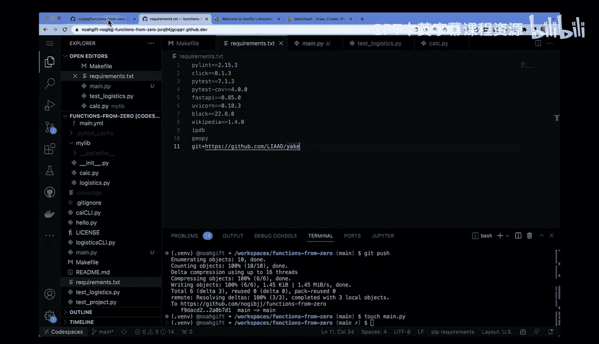

Add a previous repo here that I built earlier and steal some of the code。

And that I was building yesterday。And let' build。A microservice here。呃。Based on some of this。

 will be actually much different， though， so。Here is our mean file。And we can， we can basically。

Use this as a scaffold。Here， so I'm going to。

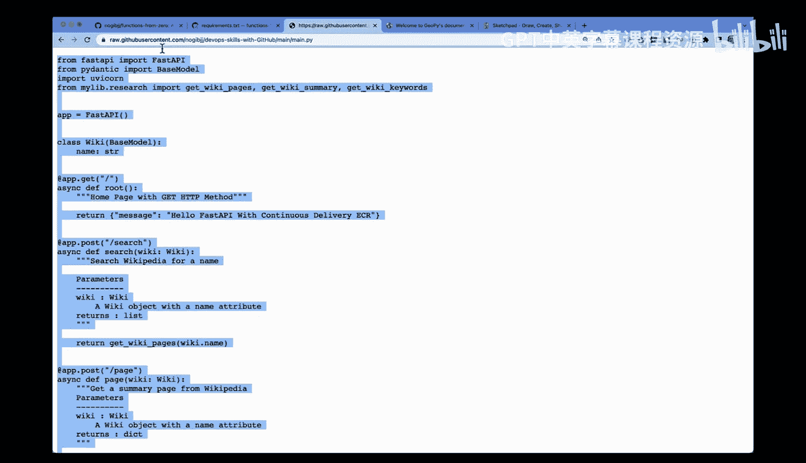

Go back to this， go to this mean file and just tweak this a little bit。 So we， we。

 we probably don't need。A lot of this stuff for now。And。What we will do is we'll say hello fast。

What's called this Hlo fast API。Or we'll call this logistics， hello logistics。Logistics， ink。

RightWe're building a logistics company from scratch here。And the model we'll call this is。Would be。

We'll call this city。And。We just need to import the right things inside of here。

And so what we want to do。Is。He is a port。The the library that we just built。

 and so I sit probably returning。A list of cities is probably a really good one to start out with。

And so what we can do is we can say from。Logistics。From my lip dot logistics。Import。嗯。Imports。

Distance between two points。We actually cities lists get coordinates。Shi。We'll do that。

We'll probably build stuff for all of those really quick。So。The first one， though。

 it will be the city's list。And so let's build a function here。

 exactly that builds back a list of cities。List cities with a get HCPE method。It returns back。

Returns。Back。A list of cities。That。Are available。To to get further information。Right。

 sore we're building this logistics company from scratch and so we can probably。Even for now。

I could even。Comment out stuff。That I'm not using。Just to make the code a little bit cleaner。

 So we're not going to use that right now。 We're not going to use that。

We'll do this and so if I say make refactor。I can just double check that everything is。

No base model and so this one。This is。

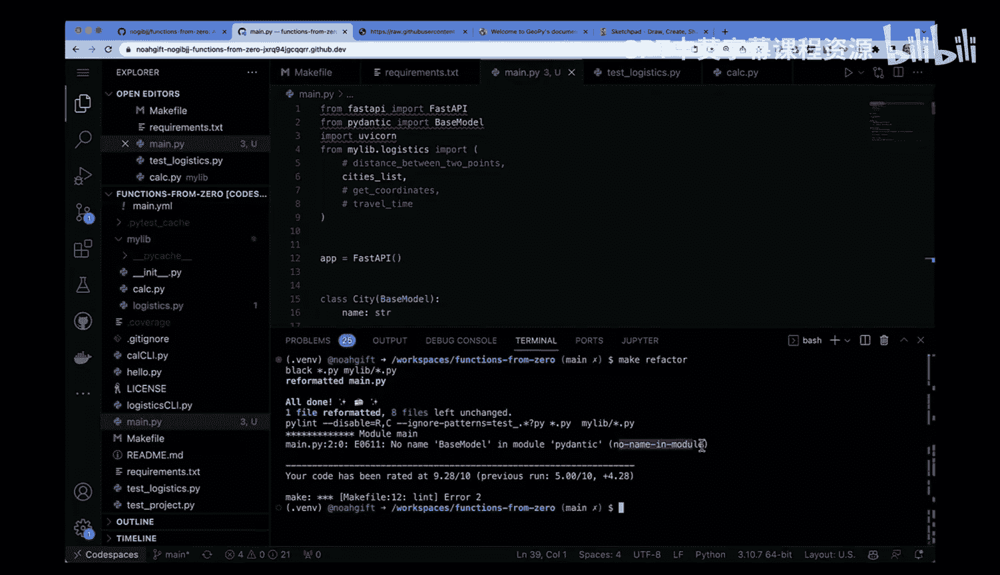

Something that I think I need to fix as well， which is a small little linting issue。 till we go to。

I record my make file here。 we can fix this。Which is。He。Step called this。

 We can just add this to our， to our code。

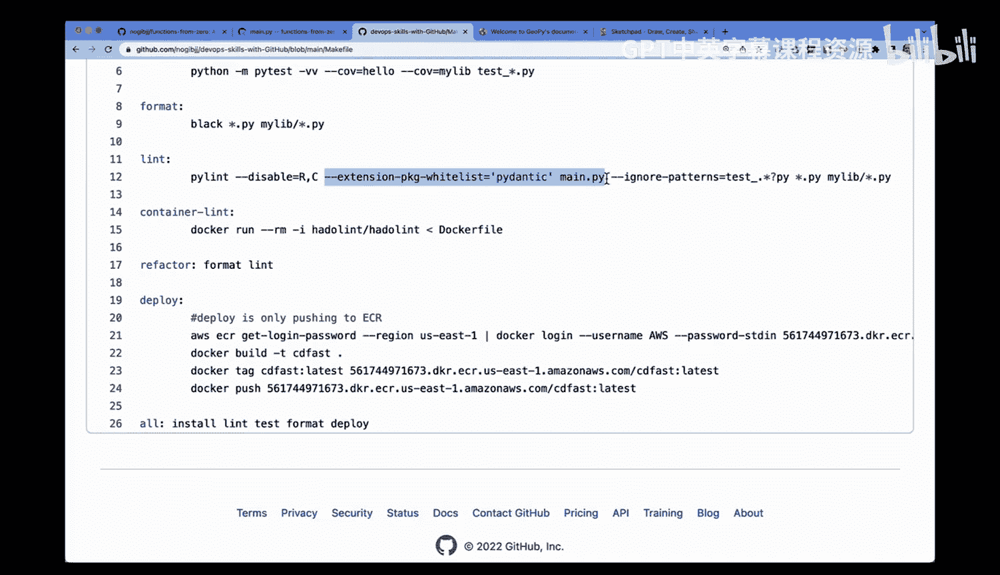

And go to。This and just put， put this， put this in。 There you go。 So now if we run this。We should。

We should be good to go。 There we go。 So we have fully lntted。 And if we say make refactor。

Everything should be cleaned up a little bit。嗯。Which is great， and if I say me tests。All my tests。

 for the most part， with we have one。Oh， cannot import print cities。Oh。

 so I need to fix that one test。Test。呃。We need to fix that real quick。Which is pretty easy to fix。

Which is。Called citiesities lists。Cities list， so we just need to fix that。

It's always good to make sure your tests are working。Citiess list， tests。嗯。Tess citiesities list。

Tests， cities list。How up that？And let's try that。嗯。And we say。Cities list。 There we go。Perfect。

 so our tests are working and so now we're actually in good shape。 We have this。

ThisThis new thing to try。 So how do we run this， We just type in Python。And we say mean。

And what this will do is it'll start this microservice inside of this GitthHub code space and all we have to do is open this inside of the browser。

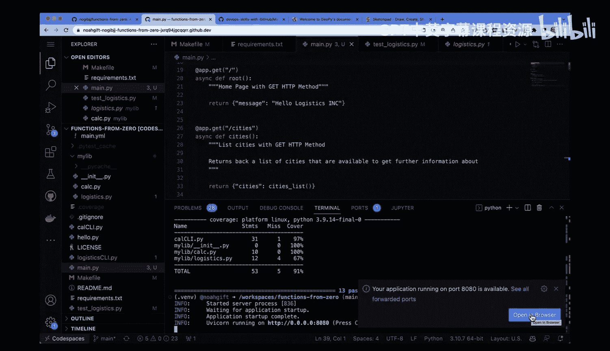

So if we open this inside of the browser。We've got this nice environment to play around with。And。

What we can do is in fact， just type in slash citiesities。

And we have a list of cities that we can work with， we also could go to the docks。That come with。

Fast API。And we could also interrogate it this way。

 and this is kind of nice because it gives us the documentation。

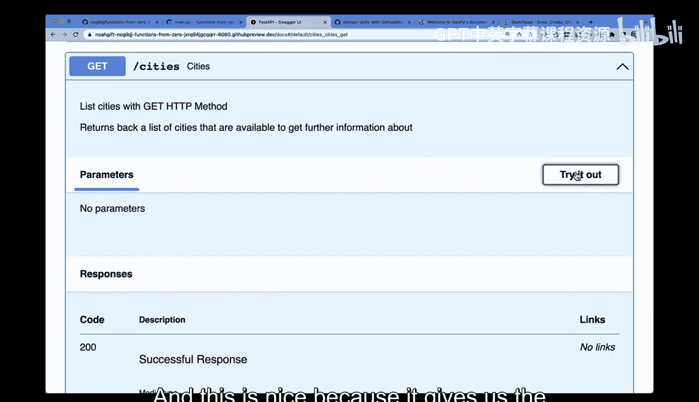

For the service and shows us all the really， really nice things that it can do so so pretty pretty useful service here。

So far， and now we can start to do a little bit more。Heavy lifting。

 So the next step is we would want to recreate some of the things that we covered in the chameleon tool。

 So as chameon tool， remember， we calculated the travel time between two cities。 So， so yeah。

 why don't we do that。So we can basically build a post method。Here that will do that。 So we'll say。

You know， build a。Fass heavy implement or build a post request。

To a post method to get the distance between two cities， that's exactly what we want。And。

And we could also build a coordinates， and we could also build a travel time。 So we。

 we now have enough stuff。 We could start to build all this stuff out。 So let's do that next。

 Let's just say。At distance。呃。And so we would want to do is put in the cities。Here。

 return back the distance between two cities and it's going to use this city class right here for that。

And it's going to return back the distance between two cities and miles。There we go。

And so we could just try that out real quick。And we could run it。

We could go to the documentation profile。Which is a great way to experiment with our microserv。

And we can look at some cities here。We could first get a list of them， so we have some to play with。

And this would be。

Execute。There we go。 So we have， let's say New York and Los Angeles。

 those are going to be the cities。 So well go down to this thing。 We would do a post request。

And we'd say， yeah， New York and Los Angeles， so you tried it out。Say New York。And。妈随便走个死。

Execute。There we go， and we have the distance done now we have an API。

That returns back distances between two cities， which is pretty cool。

So what would we do next is let's finish the rest of the functionality here。

So。I think the other two things。That we wanted to figure out where。Prob。The travel time。

 so let's do that。So， let's say。Build a。Post。Method to calculate the travel time between two cities。

By car。There we go。And。That looks pretty good。And we can go back here。

And we can go and say docs。And we can say travel。Same thing。 Try out。 And we can say Los Angeles。

In San Diego。And we can execute。And that doesn't look correct。

That it shouldn't be zero here， so we have some kind of a bug in our code。

I don don't know why that。Oh， because。we have。We have some kind of bug here that I would have to flush out a little bit。

What we could do and is this is one of the ways I would debug it was I think the thing that failed was Los Angeles and San Diego。

And so I either misspelled something。But let's double check here by using the Kimlan tool。So。

Let's try this。And this returns back 40 hours。 So now let's return。Let's go to。

The Python tool or the web service。And let's do New York and Los Angeles。

It's possible I misspelled something and that was the issue。 So let's say travel。And。

And I I'm going to literally cut and paste this。Inside。

So， we can do this。

New York。In then， Los Angeles。

And in fact， then I need to write a test for this。So that I don't get this。 is you again。And now。

 if I execute， what does it give me。So yeah， there's some kind of a weird bug here。Which。

Not sure why that's actually giving us a bug。

But。That that would need to be fixed here， I think what we could do。

Is。Is look at。The other example here。Like that。And we can go to the main function。

And if we say that travel time， it should look more like this。Let's see here。 Travel time。Siili。1。

City。Qiu。Yeah， why does that look so different here？So， this should be。Travel time， city 1， city 2。

 And if we look at our travel time， So the code is a little bit different， I think， is the issue。

 which is again， why a test is so important is。I see。 So it doesn't need gi coordinates。

 So I think the this this thing。I is not correct code， so we want to fix this。

And we want to say something like。Basically。Like。This we want to say hours。How is is equal to that？

And then we will just return back travel time。And。The speed。Wouldd。

Be something that we don't need to pass in， because we can。We can。It's the default value。Answer now。

If I run it again。We we can verify it and that what this is showing though。

 that is I need to write a test for。Our our function。Turry it out。New Yorkk。And。Pa Angeles。

And we will execute。

And。At least it's giving me。

Slightly cleaner， slightly cleaner example here。But。Still giving me weird。Weird results here。

a bug to fix， which is fine， but at least we have， and I could even put a note here that says。

 you know， fix bug。By running tests。we're given say like， you know， fix bug。Fix me。あ。Fix me。

And I think if you do Pylins， it'll actually find this。So if we say make events， I think it finds。

When when you have fixed me， oh maybe not， but basically bug。

But mostly we have things working and if we say make tests。We can come back to that one。

 but I think the thing that would be kind of fun to to do next is to add a little bit of。

Of unit testing。or web testing for fast API and so what we would want to do is actually look that up real quick so we can say。

 you know fast API test。

And so we can look at the documentation。And we can say。嗯。Something like this。

Looks like a decent way to test， so let's just kind of copy this and tweak it。

This might help us get a little bit more more logical here so we can。We can say。From fast D P。

 I import test client。 we do you want。I guess we probably do。We probably don't want that。

 we don't want that。We do。Would you want this。And we want to say from Me import app。

And then basically we just make a test client here。嗯。Which would be。You know。

 kind of a hello world task and we could do a， I guess we could save imports。TheP Pi tests。

And we could do a fixture so we could say。At pipe test fixture。Clients。Right， so this one were。

Go here and this would be。Clt。And so now if we say。

Response that Jason should be equal to and would just be whatever is in our。

Whatever is in our hello world， hello logistics， innc。Or it should be that。So if we test it。

 it should be this。There you go。So if we say make tests。We we got working testing if we。

 if we say like。We add something in here。 This would fail it。

So we have we can probably test our way out and find whatever that weird bug is。

 it should be pretty easy to do now that we've got this working so we'll just say get status。Get add。

嗯。All of this， committed。Adding logic。Or tests。For fast API。

And so then it becomes much easier to test your way out of one of these bugs is you can just write some logic and say like。

 hey， well， why？Why is this not giving me the the right result？ So like， for example， if I。

 if I want to write a test real quick for。The distance， the time travel， as I say， build。A test。

To check。2。To travel exactly， that's what we want。嗯。City one， Dallas city2， Yeah。

 so you can see it kind of gives you a nice little。A nice little example here。嗯。

If I wanted to build that out， I don't know if I necessarily want to build it。Exactly right now， yet。

But I probably do in a little bit。And I would I would put this down here， I could do that。

 like I could just throw this and I could just comment this out。For now， that could save。You know。

 like。Put up， put a little note that says。These are the web tests。Web tests。Weve application testing。

And。And we can do again， make tests。And we we have the basics of there's some little pieces that need to get cleaned up。

 we can also go to the make file and we can tell it to cover。The the app as well， right。

 so we can say。Let's show me what what is actually the coverage is and we can see that actually。

There is a little bit that's not covered， and so that could be one of the issues there could be a bug somewhere in the code。

That needs to get flushed out by a test， which is the way things go and we go here and we just add in。

This。And we say。Adding web test structure。So probably one of the last things to。

To really do would be to。Maybe write one more test。That flushes out the endpoint that does work。

And let's see if we can get a little bit closer here。We know we have two things we。

 we could test the cities。So we know that。We could do we could do that so we could say like。

And I build a test。For the city's endpoint。Right， so build that real quick， that a be。There we go。

 That's a pretty good test。 And we'll just say， and we'll just say make test here。

Let's test that out， so we've got a little bit higher test coverage。

And then the other one that we can do。Is we can say， build a。A test for the distance。

 which we don't know is in theory， supposed to be working。And。

What I don't know is if that's the right distance， but we'll find out。

Oh looks like it is the right distance， well let let's change it and let's see if it blows it up。嗯。

Response to Jason distance。Let's change this to。1，1，1，1。 And let's just see what happens。

This should blow up， there you go。That's the distance。Is。It is， is this。That's the distance。

There we go。 So so we know that that one works。 So now we have even higher test coverage。

 so it should be it should be pretty easy to to flush out this this last bit of。Of。Of， of logic here。

End。I guess what we could， what we could try to do is figure out why it's。We could write a test。

 actually for。The logic。Up here as well， so because we actually can。Can。Write a test for， for the。

Build a test for。Test for。Distance between two points for we want to do travel。Travel time。

Travel time。They'll test for travel time。Travel time。So travel time。

 now we don't want to do the travel time client， we just want to do travel time。

Unless's just double check。This， right， which should look something like this。

We can even put that in there， right， and we could say。呃。Assert travel time， L A。嗯。To New York。

 let's test that out。This。Is actually。What we could do is， we could say。嗯。Round。So we could say like。

呃。Hours is equal to。Round。Can we get round it。2。Should be like about 41。So， round。

We'll find out because put， I'll put hourss here。And we can just say。41， let's just see what happens。

And that appeared to to actually work。 So if I said。42， it should blow up。There we go， yeah。

 so it's 41。So that actually might。Might actually be maybe a better fix for this for this as well as what we could do is we could actually。

嗯。Estimate the travel time， why don't we just say hours here？We could say。Calculation。

Calculations is equal to to this。And then。The calculation would be distance between two points。嗯。

I guess。Kind of a weird。Calculation， we could say like。GetGet the coordinates， the distance。

But let's actually return the。The， the hours is equal to。Round。The distance。

And we can return back the hours。So this maybe I don't even need to round it。

 so the testing has kind of helped me flush this out a little bit。 so if I just take this out here。

Will this make my code a little bit cleaner？And。We can see that。That maybe we don't want around。

To two digits。We actually just want to do something really clean。And。What happens if we just do that？

Perfect， so so this might also help us flush things out a little bit is to add better and better testing。

It kindind of goes back and it changes the nature of the code。And so if we say make refactor。Right。

 in theory。Redefining distance from Ater scope 0。12 on logistics。Like 12。My lip。

You find a distance from outer scope or is it line 74？Were youfin distance from outer scope。

Did I have a distance？Oh， I see。Yeah， I mean。We could say， like。Total distance。Here。

 and we could say a total distance。 How about that？Now if we see me， make me factor。

We've got our our stuff here。 So so we we probably much closer to if if I say make a test here to having whatever。

 if there is a still a bug and there it's flushed out。

 it may have it may have even been flushed out from that。

 but that's how I would get myself out of a bug。 and then I could do this。Then I could add this。

Inside and say adding。嗯。Adding tests。For web。And then if we push this to the build system。

 it should go through here and build this out。 So really this is a good spot to be ready for maybe the last step。

 which is to further build some logic inside of here build some more things that build all just function。

 maybe flush out that final bug and then potentially deploy it to some kind of production environment and so again we started from zero and we're going go a little bit further here som so we're in great shape here。

 I also we're getting into the final stretch and so one thing I'm going show you real quick is that I was able to actually debug the issue that was troubling me。

And what I did and this is a good thing to just be aware of is if you want to debug let's say fast API。

 one of the ways you could do it is you could put a print message that puts all the different things in to see what's going on and it goes what the issue was was this was an object And so that was the problem is I was passing an object into something that was expecting a string And so that's why I was returning back zero。

 which is kind of a weird bug and then what I did was I used import IPDB set a breakpoint played around with it and I realized I just need to do city1 name city2 name and that will actually solve the issue And then once I did that I was able to get to work and then what I did was I went over to the unit test here and I factored it out and made it so that so it would have probably flushed it out as well the unit test and so I have。

10% test coverage now so so or close to 100% test coverage and and our code is all， you know。

 look at this it's actually fairly well covered。 So the last two things I'm going to do is I'm going add a little bit more functionality to this and then I'm going deploy it into into production。

 So if we go back here again you know again we have this kind of feedback loop here， you know。

 we're building a list of， but now now the final。

The end game here is that we're going to go to a cloud and we're going to build out a microservice and deploy this microservice automatically and。

The last thing I'll do though is add a little bit more logic now that I've got some fun stuff in here and make this more of like a true logistics tool。

 So we'll build a little more logic and then deploy this to a what we'll call this the cloud based environment here so。

What I'll do next is since this is really taking shape here。

Becoming this nice little tool that I don't know a travel agent or something could use to make decisions。

What we can do is actually add in。One more library。

 So let's let's build something that will look up information from Wikipedia about the city and then do some kind of natural language processing or or some kind of analysis around it。

 So pretty easy。 I'll just make another library in here。 we'll call this one my lib。

And we'll call this one wiki。Inside of this here， we can use the Wikipedia library to search for。

Search for web pages。And then also， we could tell it to find。Information about a particular city。

 So so I guess what we could do is we could。Start off with importing Wikipedia。

And we could build a function that says。Get build a function。To return。

The summary of a Wikipedia page。In this case， instead of saying city， we'll just say page。嗯。Here。

And then。呃。What we'll do is build a。A function to search for Wikipedia to。To。

Find the web page of a city。 So， we'll， well what probably want to do。Is。

Is build out a search for pages， so built a。呃， function。To search。Wikipedia pages。Or。A match。诶。

So search Wikipedia pages for a match。And。We can try it out real quick so we can just say I Python。

From。My lib。Dot wiki import。Search wiki pages。And we could just say search。With异议。Wiki pages。Brack。

 what happens？There we go， yeah， so this looks like this would work。And then if I pass in。嗯。

This to Wikipedia， and I say import， gett Wiki summary， it should give me the summary。Of the page。

And。And we can say。This particular page of passed this in。And let's just make sure this works。

Kit Wikipedia。Oh。Because that's not going to work yet。We have to personally import it。

And then we can call it and just make sure that it's。Will return。And there we go。

 so we got a summary here。And we could even return back the top keywords。So we could say。

So basically we could say like this we could say。Build a function。To return the the entire page。

so this would return the entire page and then if we go to this。

This thing that can extract the keywords。 We can， I think it's called。Here we can。

 we can return back keywords。Yake， there we go。 So we， we， we can say。Here。😔，From。Yike。

Import keyword extractor。And let's just say。Reach returnturn。The keywords of a Wikipedia page。我，我。

 will say the。The the。对对。Yeah， the keywords are working。 let's keep simple。And so。

We do a keyword extractor， we extract them。From a， from a page。We probably。

Want to clean this up a little bit。 I don't think this is exactly what I want。 In fact。

 I have an example of this。And so， I'm going to use。1 that I've already written。That。

Should be a little cleaner than this。That。This is what I want， I want something like this。

The keyword extractor， contents。Yes， some something like this。 This is more like what I want。

Is something like this？So return back the top 10 keywords for the content of a page。

 So we just say gi。Get a wiki page。Like that。And then this return a dictionary of the top 10 items。

 So if I go back here。And I say， I Python， and I say from。My lib。Dot wki imports。Get wki keywords。

We can now do get wiki keywords。Keywords。Now， we can say the page。Let's see where was it。

 the thing I was here we go， we want that to be the page。So we'll do this。

 We'll see at pages as we go this。And then， we'll say。Again Wiki keywords page， does that work？呵。No。

No page， Barack Obama。So we need to find the name。Of the。We need to find the search here。

Imports everything。And we need to search for that page real quick。Let's search Wikipedia pages。

Bock and what is it return back？Yeah， I thought that that would be actually this。

 and then if we scroll down here。We have get the Wikipedia page， so let let's get that。

 we'll just say get。Wki wki。嗯。Wiki page， which I haven't tested yet。If we do that。

 does it return the result。So it does， oh， I see， so content。There we go。

 That's that's our content touch。So， we would need to change。This。Dot。Content。Something like that。

And so if we exit this， we can go back in again。Real quick。And we can say。This。get。Heres's the page。

 And then this is the keywords。There we go， we've got keywords cool。

 so now we have a cool little API here。That， in theory。Would would would work for。A city。

 So if we search for。New York。New York。And we say。What happens。New York City。

 so it's going to tell us all the different New Yorks here。So it could be a little bit tricky。嗯。To。

 to get the exact。Keywords for it。Yeah， it can get a little bit tricky。

 but basically that can be fixed later， the key issue is that if we wanted to add some more stuff in here。

 for example， we could say like，From。My lip wiki and port， get wiki summary。And get pages， get。

Wiki page， get keywords， right， we could we could add， we could add more。

More more routes and more services inside inside of our code now， probably the one that I care about。

The the most， just to add one thing。Would be to just get the keywords for now。

And I don't even need to put this on a line。And so， I'll just。We'll do that。

 we'll make something that can accept keywords， and so we'll say。Keywords。

Get the top 10 keywords from the content of a page with a post。What request？And sure。

 let's let's try it out。 let's see if this works。 And so now if I go Python。

Mean。We can go here。And in theory。This should work。So if we go to docs。

We we could kind of hook these these things up in the future or something like that， but basically。嗯。

If we， if we say。

I don't know。Los Angeles。Will that work， I don't know， maybe it will work。

Keywords， I think the name has to be。That the right name。For this to work。

But， let's see。 there we go。 so apparently it does work so so now we have a city based keyword search API。

 so we've got a kind of a cool little service here。That， again。

 some logistics company could start putting more and more of these things together and building tools and machine learning systems and all kinds of stuff。

AndSo what I'm going to do now is I'm going to check all this in and start getting this into a cloud based environment。

What I can do is I can say get add。Star。Commit this， or let's actually refactor。

 so let's just say make a refactor。Like this。Looks good。 It cleaned up all our code and make tests。

 make sure all the tests work。Looks like code's pretty high quality and we can say get status。

Can add this and commit。AndWe can say adding。web service。And now。We need to deploy this somewhere。

 So where could we deploy it。 Well， one of the places that's a pretty good spot to deploy code is in fact。

EWS is not bad。 And there's a service called。EWS app runner that I think is a recommended service for doing deployments that are these kind of microservices and so what I'm going to do is I'm going to click on create service here and notice that with AWS app runner。

It has given us the ability to either use a container registry or to use a source code and it can do either one。

 so let's go ahead and pick source code。And what it'll do is it'll use my GitHub repository and it's going to link in and find all of the reos that it has access to。

And what it can do is actually deploy automatically my code directly from this repo。

 so it's going to take a second here to find this。There you go。

And if let's see what repo it has access to， does it have？There's a lot of repos in here。

 I'm going to search for the I don't remember what I called this。 Let's say， remote dashb。

Remote。Wait， get remote SV。

There we go。 So functions from 0。 Let's look for that。Functions。From 0。And。

I think this is the right one。If， hopefully。Let's see here。

This could introduce an element of surprise here because I hopefully I don't have two reoss called function from zero。

 but let's start off with this and see if it works， I might actually though。

So maybe what I need to do is make this not use source code。

 And instead I'm going to use container registry。 let's go and do that。

 And so what that means is I'm going to need to shift gears here for a second。

And I' going to need to build out a containerized version of my application， fortunately pretty。

 pretty easy to actually do this。And what I can do。

Is is I can actually take a look at a project that I built yesterday and just tweak it a little bit。

 so I already built a Docker file。And I can grab one。And here you go， it's pretty simple。

 there's not much to do， and I can just grab this other docker file here。

And we can get it working in here first and then move it over to to AWS。

 So I'm going to go ahead and say touch。Docker file。And then I'm going to paste this in。

 So we got this docker file。 So how do you build this pretty easy， You just docker image。You said Dr。

 build dot， so build it locally。And if you have a fast environment， it should build pretty quick。

And then the way to test it out would be to just verify that you can actually list the container。

localocly。Which， which I think should be pretty good。

So this will take just a second to build this container。And if this container is successful。

Then I can just run it。Here we go， now I can say Docker。Image LS。Run this。

 and I can look at a command。

I always put。Cheet， cheat sheets together when I， when I run stuff like this， I'm gonna。

Just do the same thing。I'm going to。Z。😔，This Docker run。ICom in like that。

 so I'm going to say doctor。

Docker run。Do control A so Docker run and then put in the name of the image right here。

 so Docker run SP， the port。And the host， and then the I。And if we run this。

There we go。 So it says literally the same thing I was doing earlier。 So。

 so we know this thing works， right， So， so now it it's going to be pretty easy to get this working in a cloud based environment。

 In fact， I can also demonstrate that。

If we go to the make file。I have actually a li。 I could even link my make file。

 I can link my docker file， so I can say make。Container lens， and it will pull down。Alinntten。

 nothing blew up So my docker file is also high quality。 And so now I just need to say get status。

Get add Docker file。Get commit。Adding。Doctor file。

And then let's switch over to AWS。 So pretty easy to switch over to AWS because I want to push it to a container registry。

 which is a pretty easy way to deploy and it gets rid of the issue of oh。

 do I have twonings that are the same so all I need to do。

Is I'm going to go to another environment that I've already got set up to make things go a little bit quicker because I already have SSH keys。

 So this is a good environment。 I'm going to go ahead and open this up。

 So this is similar to get up code spaces the。

The the service。That we've been using this whole time and what's nice about it is that it will allow you to build in a really similar fashion actually your code but with more of a like an AWS bent to it and so what I'm going to do is I'm just going to close all this stuff。

And I'm going to。诶。Go to this directory here。 And I'm gonna， I'm going to clone this repo。 So。

 so I just need to， to actually。

Go back here and clone this repo， real quick。And this is going to be functions from 0。

And we're going to say， local clone。Now that I've， I've got this thing。

I'm gonna say get column。There we go。And if I Cd into functions from zero。

You can see this is the repo here， I should just be able to do and make install。

Double check everything works。inside of this environmentna。We should see all the same code。

 all this stuff。This looks good so it's kind of a similar environment to GiHub。Code spaces。

 and I can also even do make all。So basically lymphicco test it。

 make sure everything is working properly， always， I think a good idea to just make sure that nothing is a surprise。

 there go， pretty pretty easy it looks like it's working。Oh， we have one。Well。To failed but。

 so some kind of really subtle。I mean。Weird error here， which is kind of annoying。

Response that distance。In fact， I guess I could just fix this real quick because it's such an annoying test that's in。

Here。😔，It would be。Clant that posts。It was this test distance。 I think this is。Yeah， this is。

 this is the one。嗯。We can， we can just say。How about this， assert。That。2，4。2，4，5，0。How about that？

I think that that could work。诶。Test travel time。 Did I do that twice。Just travel to them。

 I don't think so。Oh。嗯。But that。Let's just run this real quick。 Make sure that that fixed the bug。

So basically， I just said。Well。Oh， it's， it's a。Afloat。It's not iterable。 Well， I'm。

 I'm just gonna to， I don't care about that that test。 actually， it's kind of a crappy test。

And so I'm just going to comment it out for now。But I'm not， I'm not worried about。

This particular problem， actually。In fact。Just get rid of it and leave need it。And。

And if there's some other。I think that's the only one I care about。Oh， and then that this one also。

 anytime you do decimals like this。Like。You're going to get yourself in trouble。As well， so。We。

 we we also can just。We can just say assert。Which is basically make sure that it doesn't blow up。

So that's one way to just do kind of a there go， just just get anything working so always say get status。

And we add that。Comit， so we can fix it in another environments。And adding。Fix。You know。

 and we push this。 So now now all I need to do is is push this container to， to Amazon。

 So I'm going to go to console。

Here。And I'm going to get into the Amazon Elastic container registry Now there's a couple ways to actually create a new registry if I go here actually。

 this is kind of a neat little way to do it if I click on this I can go to the Expr and I can actually right here right click on it and I can just say create new repo and let's call this logistics。

And basically it created a new。ARepoitory for me。

Private repository。 And so if I refresh this， we should see one called logistics。 There I go。

 Now if I click on it。I can view these push commands， that's all I got to do to deploy this thing。

 so I'm going to just run these commands， all four of them。And。I would just do them step by step。

 So first， first step here。

Would be， in fact， if I want to be lazy， I can even do this。 this would be even better。嗯。

Which is I could just put them。Inside of this。

And， in fact。Use this as。The deploy mechanism。

Here。😔，小卡比。😔，Here。😔。

And then， here。Like that。

Like that。 So basically， what this is going to do。Is is basically going to。Deploy。

This is going to run all those commands and that is essentially a deploy process。

 so I just say make deploy。That should。Kf rera。AWS， ECR。Knot。Oh， I'm in the wrong environment。

 that's why I'm， I'm not in。I'm not in cloud 9， so I need to。

I need to actually copy this。And go back to my environment here。 I was in the wrong environment。

 I was like， why is this not working， So I， I just go here。And I just say hundred deploy。

 I add the steps right here。There you go。 Now， from here， I say make depoloy。 I say make depoloy。

And it'll just run those commands， and I could even put this into a build system。

And it would it would actually push these these commands as well in fact。

 well might as well even do that because it's pretty easy to actually set up。So it's pushing。

 pushing these changes。And in fact， I don't even need to go to apprunner if I don't want to。

 I can deploy apprunner once Ive pushed a container。Into the Amazon's Alaska container registry。

 I'm actually able to do deployments。Directly to。Directly from here， because it has。Hooks。

Inside of apprunner right here， so I'll show that in a second。So this is pushing the container。Okay。

 now now that was able to be pushed and now if I wanted to use this microservice framework。

Pretty easy。 I just right click on it。 Its a create service。And it's going to say， well。

 what do you want to do it， Oh， I want to credit from。Either a repo or a get a repo。

 or I want to credit from。A elastic container registry。 I'm going to click on this one。 And look。

 here's the logistics。 the 1 I just pushed。 Let's go select that。 We want to select the latest。

 and then it's going to tell me。Ask me to select which role and this would be the role that can pull a resource from ER。

 what port。We know it's running on  port880。And if there's any additional environmental variables。

 we don't have any， what do we want to call this， we want to call this logistics。And。

 and then also we'll ask for what kind of config。 we'll just say one CPU。 That's it。

 And now if we select this， we can see， look that logistics is actually on its way to to。

 to being created。And I think you can even look at the log stream。

 right and look at all the events and that kind of stuff。 And so if I go back to。

Here， this repository will have。The the image。 And if I go to app runner。

 app runner will actually be in the process of doing a deployment。 And so， so pretty。

 pretty powerful step here。In that' once you've containerize something on AWS in particular。

 and other clouds， it's very easy to push this into another location。AndOnce it's ready。

 it'll be available via encrypted endpoint as well， which is pretty nice。

One other thing to be aware of。Is that if I want this thing to do continuous delivery。

 I also could set up a build process using code build。

 And so while this is actually running and this will take you know， maybe five minutes to set up。

 what I can do is actually。Do a diagram really quick。Of。Of， of what。嗯。Of what we could build of。

Of what what is actually the process here to deploy this。 So it's essentially this is is the diagram。

 which is we have a bunch of code， libraries， all this stuff。And you put logic inside。

 we tested things out and then to do a continuous delivery。All we need to do is。

Push something to a container registry。And then it could be pushed from code build。

 it could be pushed from cloud 9， it doesn't really matter which environment。

And then if you want to set it up automatically， you can actually set up a build system to push every time there's a new change to the repository。

 it'll actually push a new container which then would trigger apprunner to do a new deploy so it's actually pretty straightforward to do that。

And I actually have a file here。That I can copy。In in this repo。

 so I'm going to go ahead and grab it， which is a build spec file and you can see here it's not much we just say build spec do Yml file so Im to I'm going to actually copy that。

Here， build spec。l， and I'm going to go back to my environments and I'm going to say touchBuild spec。

 Y is it Ymail， I think。

I think it's a double check here， it's YMl， yeah， bothpre。yMl。

And if I go back to the file。Handler here。 we can see there should be。Now， a built spec file。

And all it needs to do is do that， just say make all and then under my make file。

I would just need to。See how it actually is going to install Lint， it's going to test。

 it's going to format， and then it's going to do an actual deploy right here。Which should be very。

 very robust and exactly what I want。And so the next step， then。All I would really need to do。

Is hook this into a build system and so。I just need to push push this change。

 and so I'm going to say get status。And we're going to add a make file。

We're going to add a build spec。And then we're going to commit this。Say， adding。The build都 file。

And then we can we can push it now， now that all that's there。

 that's all that's necessary to do at deploy。 Let's first go back to our app runner app and just see if' if it's running。

It looks like it' probably running。 So let's just verify that that works and the service is functioning。

It's it's not going to take long。 I think it's almost。Almost done here。

You can see once it does a health check。I believe it's pretty close。It's pretty close to being。

 deployed。So let's just make sure this thing is fully deployed。There you go。 Hill checks performed。

 Now， it's getting the traffic。 It's getting routed。 So it should probably be alive。Yeah。

It'll take just a second。Should should be live soon。We go soon， soon。Hell check， riding traffic。

Rely traffic。Yeah。The service is created， health check is writing traffic application。

 right we can even look at all the logs， which is really nice。And。Shibi。It should be pretty close。

 here。We can have a look at the activity。We can look at metrics。That says everything that' happening。

To the service。嗯。There we go。 So it's up。 it's up。 So， so we have our service up here。 So。

 so what we can do is just test it out。 like does does our actual service。Work docs。

We have an actual publicly exposed endpoint that's。

Using encryption to to handle the the post request。 And so if we we again go to keywords。

 let's try a more complex application， we can put in Los Angeles。 so give me the。

Give me the details for Los Angeles here。

And yeah， there we go。 We are able to find the keywords about Los Angeles。Inside of Wikipedia。

 and if we wanted to find distance。

You know， or travel time between two cities。 we we could also。

 we could try that out we could we could do。Blessing angel。In New York。Right here， so。Nice。

 we have a but a fairly。So this had。There's probably some kind of configuration that needs to happen。

呃。In a course， a course configuration issue， which isn't， which isn't that big of a deal to fix。 but。

 but， but basically， the thing's working。 So the the final。

 the final step here would be to go to the build system and then get this continuously deployed。

 And so what I would recommend would be to go to。

First into IAM。And this is where we could set up a new role。

 and so a role could be specifically for the build server， and we could just say here。

 we could say for the AWS service that we want to deal with， let's go ahead and set up a new role。

And let's look at the use case， which would be code build。Right here。And。

Now we just tell it what permission to run， there's a lot of different ways to do this。

 but when I'm prototyping a build system。What I would like to do is give it administrator access temporarily。

Which in this case is is is reasonable for the kind of thing we're doing in a production environment。

 And I wouldn't do that。 I would be a little bit more careful about that。 but。

 but that's for now okay。 And we'll call this October42s or let's， let's say。2，0，2，2。October 4。Build。

Admin， something like that。 And we'll just call this。Temporary。Build， build service。Admin role。

And you can see here that that says that code build can assume that admin role to do things on my behalf。

 which which is going to be a deployment of our code。 So we have this， right。

 So we know we know that we have that。 I'm going to copy that。 Now。

 all I need to do is go over to code build。And and and create a new build project。

 So I'm going to go here。 I'm going to say， okay， let's create a new build project。

 We can say deploy logistics。Here we go。 Save this。Will deploy logistics。嗯。Microservice。

Automatically。Perfect， and then the next step would be to。We could put whatever options we want。

 but the big one would be to push change events so we would want to listen to GitHub。

And in this case。Really what's going to happen is it's going to pull the changes out of GitHub and it's going to rebuild the container each time with which it could have new files inside。

New changes， new packages， new microservice endpoints， and inside of here， we'll say。Noki。

And will'll say。Functions。From0。And we will say rebuild every time the change is made。

 right every time I make a change， I want to redeploy。And I want to take Amazon Linux。

The latest run time。The latest image。 And I do want to elevate because I want to build new containers each time。

That I'm building。And now this is the part where you do need to have the right privileges to be able to push change to wherever it is you're going to push to。

 so I've already created that role。In this case， this is 2012 or 2022 October 4th build admin role that's the and then I'm going to use the build spec file that I already created earlier。

 which does the deploy。 So if we go ahead and we take a look at this and we create this build project。

We just need to clean that up a little bit， deploy logistics。There we go。We should be able to just。

Get this working so now that this is set up。Here。Any changes that will be made will automatically trigger it。

 So if I wanted to I could trigger the the change by just pushing a file here。

 I guess I could just do that real quick just just to double check that the build works。

 we could just say like。

Dot， but， you know， and just say get status。Get add the read me。Trigger build。Tiger build。

And they will push this， and then this is what this will do。

As it will actually trigger this code build， and we should see it immediately start if I refresh and affected it。

 And so now we see what's happening。

And it's going to if we tail the logs， it'll actually build through our whole container once the container has been built。

 it will then take that container， push it to the Amazon El container repository which will then in turn trigger that deployment of the new version of the microservice right so this is pretty clever workflow here and it's a fairly robust as well because it's containerized。

And you can see here that that really what it is in a nutshell is this。Is this。Cloud9 back and forth。

And or and or the。Code spaces if it has the API keys。

And then you hook up code build and Code build will listen to GitHub。And once you've got that set up。

 it'll automatically push these changes to it。 and so this this is a fairly， I would say。

 a mainstream way to do continuous delivery for microservices and we're able to kind of get there from zero。

