# 杜克大学｜机器学习运维｜DevOps⧸DataOps、Azure、MLFlow和抱脸｜MLOps ｜ Machine Learning Operations p48 55_04_04_Amazon-CodeWhisperer与GitHub-Copilot对比.zh_en -BV1yE421c7uA_p48-

Okay， I'm live here with。52 weeks of AWS special session about AWS code whisperhi and an AI pair programming tool。

 I've used Copilate quite a bit。 and today I'm going to use the。The AWS equivalent。

 which is code whisper so what i'll do is I will start out。With first。Showing you a little bit about。

What coppir can do because that's the one I know the best。And then after I show that。

 then I'll move on to。AWS， and I'll show you how AWS does it。 I， I've only tried it for like。

 let's say 10 seconds。 So I think it'll be a good context for for me to first start with Copit。

 show some of the cool things that you can do with it and and go from there， so。😊。

I'm going to go ahead and share my screen here。And let's go here。😔。

And let's make sure that I've got things。Oh。Pretty large。😔，Here we go， lookss pretty good。All right。

 so first up here， let's go over to Copiot first because I have more familiarity with this。

 so I have this MLOps template here that I've been experimenting with and this is something that I use for doing machine learning operations because it has access to GPUs and all kinds of stuff and I think it's going to be under active development。

And I've got it all set up and it should be super fast。

 I'm going to go ahead and I'm going to use this template。And I'm going to。

Maybe I'll just even launch it since it's already got the code spaces working。

 so I'm going to go ahead and I'm going to just click this。And we'll get this running very。

 very quickly。So the idea with code spaces and one of the advantages I guess it has over the cloud9 environment is that it actually is able to preb them where your environment。

 you put all the different things you want， the extensions， etc， and those extensions are all set up。

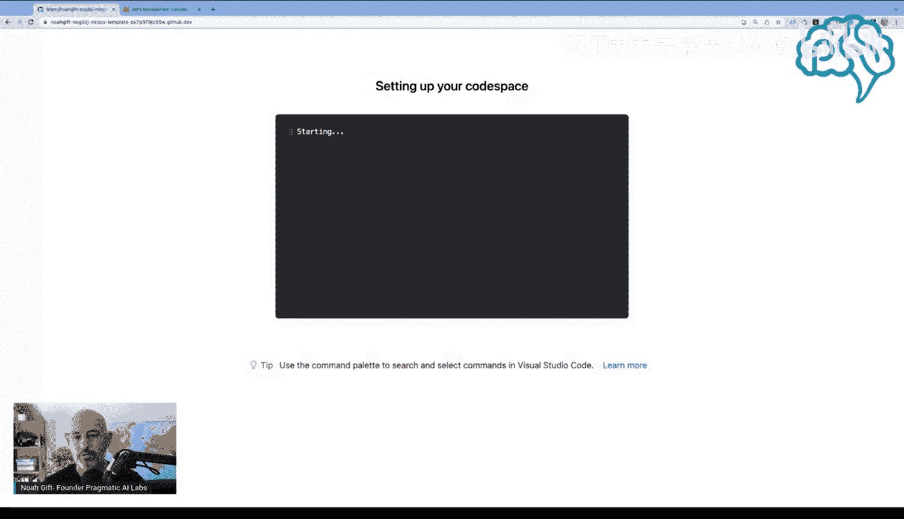

For you inside of your environment。 So you see， it's like super fast， right。

 Like that is pretty awesome。 And so what I'll do here to start off with just to。

 to give an example is that。😊。

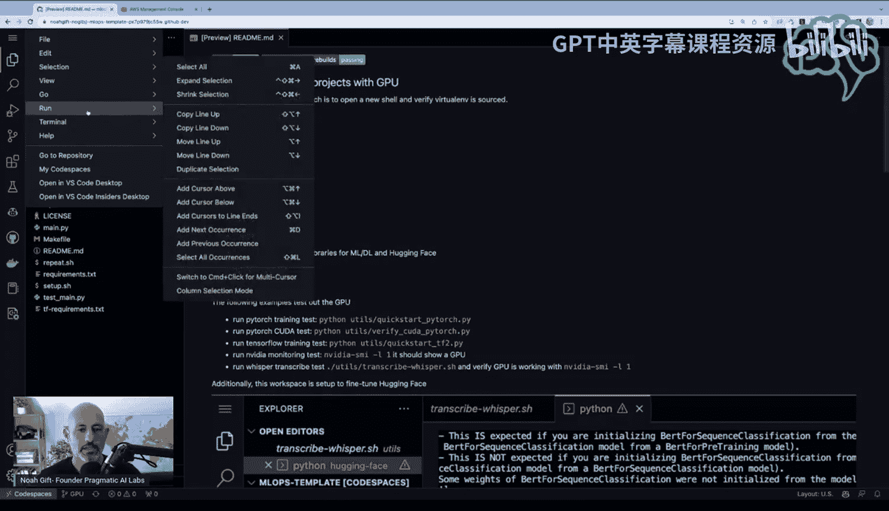

Notice that this environment will just show that it's got。

GPU access so if I go to u and I say verify by torch right you'll see that it's got。

Keep used and all that kind of stuff。 I don't know if I need him today。

 but this is just more of a fact that you do get access。 well， in this case。

 it may need to get rebooted or something。 So who I don't really need him。 So who， who cares for now。

 But what I， what I will do is I'll make a directory called。ACopi。

Instead of here and this will just give some examples of some of the things you can do with coppilot and i'll just do like a hello or something like that Now let me just kick the tires here with what coppit can do so coppit is enabled by this extension。

And it has GiHub Copit labs， which is something that allows you to explain code and translate it。

 And then it has， I also have the tools。 So let me just first show you labs。

 So if we go down to this。What is kind of cool about it is that you can actually highlight some code and it'll translate it。

 So， for example， if I seed into this coppit directory here。And I want to have Python， for example。

 create a for loop。 So let's use， let's use both。 let's use coppit labs and let's use copil。

 So I'm going to say， you know。Build a random。List of fruit。

And so what this will do is itll then sort to give me suggestions and I can use it to basically build out stuff。

We can say， you know， fruit is equal to and notice here that。

It will actually give me give me suggestions like oh in fact。

 there we go that's what I was hoping for it to do and it gave me a bunch of fruits right in fact I don't even need。

The random for now but that's one of the advantages of this tool now one thing I'll point out that I recommend probably in any environment is to have a tool to help you with it so。

Inside of this environment， I have something called refactor。

 And what I do is I format the code and l it anytime the AI assistant gives me instructions。

 And so if I say this， I say make。For， and actually， let's just double check。

That it can go into Copit。 I might need to。Tweak this。So that it can read copil it。Ho， there we go。

And we can save format。Co pilott。Here we go。A way I can link and format that directory。

 And so if I say make refactor。There you go。 notice it。 then it refactored that code for me。

 So see how it made it nice and clean。 So that's one thing I would definitely recommend when you're using these fancy tools is get the suggestion from the fancy tool。

 But then also have like some kind of formatting and refactoring step So you get the best of both worlds。

 So you get traditional software development tools and you get the new one。

 So the next thing I'll do is I'll just say like， you know， build a for loop。😊。

That prints out each item in the list right let's just keep it real simple and。

And I can just say four。There we go for F in fruit print F。I mean， we we could even。Like。

We could count so we could say， build。Build a for loop。

That prints out each foot in the list with a running。Number。And。A colon。With the fruit name。

So like example， yes， sure， that looks good。So let's do that， so we'll just say four。

And now this is one of the things that I do do with Copit a little bit is I will I will guide it just like I would be guiding。

嗯。Like just like I would be guiding like a student or somebody I'm working with， I mean。

 although I would say I wouldn't necessarily do this with somebody that was an experienced developer。

 but I do have to to give them some kind of input and feedback loop and so what I might want to do as well is I might want to say like you know use certain things use the enumary function and use。

F strings， right？So now I can just get rid of this。And I could just say， you know， four。

And so look now there is some skill involved here and and basically telling the right prompts and now if we run this。

 have I just say Python。Hello。Or what we'll call this Python pilot hello。There we go， right。

 We have unmute little script。 Now here's where the the coppi translator comes in is if I click on this。

And I just grabbed this whole script。What I can do， I could， I could say explain it， right， which is。

 which is kind of cool。 So let's ask copilt。😊，And it'll give me。Like basically documentation for it。

 which is pretty cool。Which I like， but also what we can do is we can also say that I want to translate the code and this is the part that I think is really pretty cool is I could say what about translating it to shell。

Which I think there is shell。 hopefully， there shell。Why is it not giving me bash？S H。嗯。

Wird how I don't see a shell example here。嗯。Which is kind of a bummer。

 I'm pretty sure there is a shell example。Stty is shell， Oh， shell script。 There you go， She scripts。

 And then I say ask coppi it。And there we go。 So now gives me like a shell script example of this so。

没。嗯。😊，I don't think that's the right example incorrect， so it's still beta。What we could do。

Is let's try it one more time。No， it didn't。 It。 Oh， here we go。Build a loop。 Now， that looks better。

So let's grab it and let let's see if this works。 So if I go through here and I say touch。Copit。

Hello， got S H。And I go to paste this in。Let's see if this actually worked no。嗯。

We don't want that one。Yes。Does that look like。Echo， no， that's not gonna work。

 that's not gonna work。 Yeah， so that particular feature is still a little bit beta。 I'll just。

 I'll just remove it。 But what we could do is we could translate it to to Ruby。

 I don't know if Ruby's installed on here。嗯。I always forget。Interactive Ruby， yeah， okay。

So it looks like there is Ruby and if I type in Ruby， yeah， Ruby's here， so we could try Ruby。

 that might be a better one。So what I'll do instead。Is I'll just grab this one。Back to the。😔。

But labs， and I'm going to ask it to translate to Ruby， which。Although I do see Powerhe here。

But let's， let's say Ruby。 There we go。Ask it。And let's see what it comes up with and see if it works。

ok。Did that work？yeah， for some reason， this is not working today。

 I'm not sure why I've had it work in the past， but maybe there's something about this one。

That's just， it's beta， it's a beta software but。嗯。In general， though。

 I've been pretty happy with with Copit。 So let's now go over to EWS。

 And now let's try a similar service， which is Code whisperhis。 So again。

 I've only played with it a little bit。 And so what I'm going to do is I'm to use it。

 I'm going use cloud 9。😊。

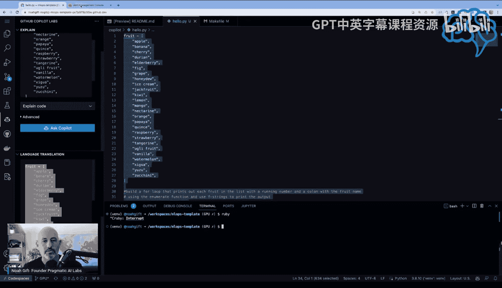

And so what I'll do here is I'll just create a new environment and we'll call this。Hoode。

 whisper live。Go demo， AWS。Code whisper。And we could go back and forth as well between thepilot and this and see which one's better but。

I think I will use a pretty powerful machine， because。In general， I like to have powerful machines。

 and let's pick。Sure， this one M54ks large and I'll use Amazon Linux， that looks good。

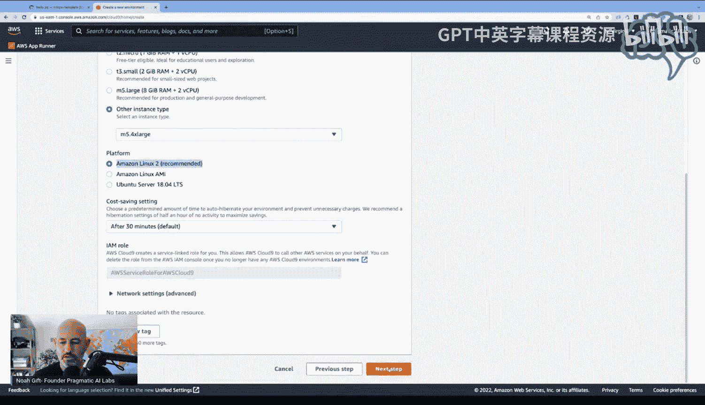

And we'll go ahead and create this environment。All right。

 so it's similar in a sense to what's going on here with Copilot。In that。

In this particular environment， it is got all the goodies installed like like again。

 codespaces has in that， you know， this is a hosting environment。 In this case， again。

 this is a hosting environment。

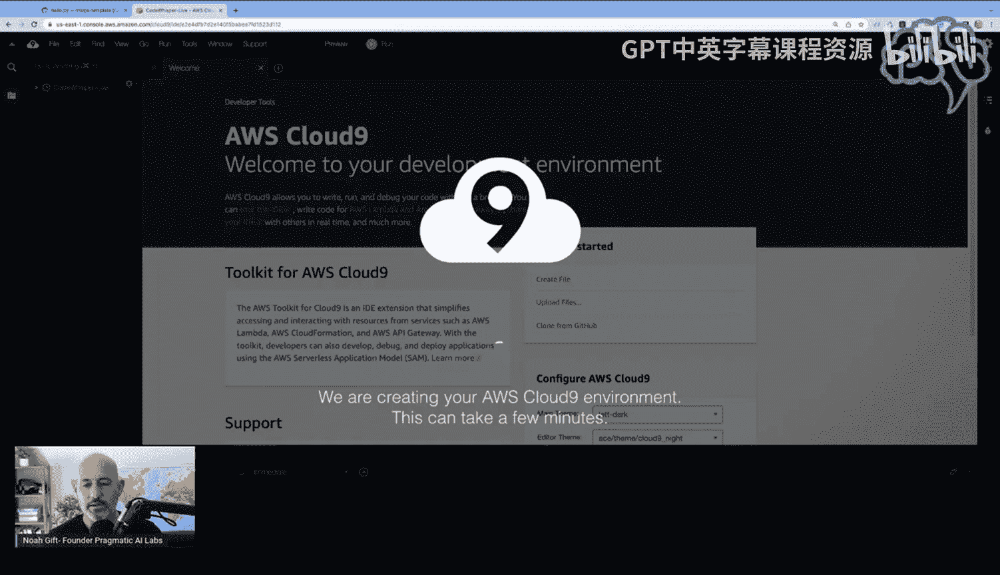

That I can use。To use copit and also has all these other tools installed on it。

 But in this particular environment， it's customized specifically for AWS。 Now。

 one thing that would be nice is if AWS cloud 9 had the concept to pre build like Github codespaces that would be pretty cool。

 but I would say that one of the things that we could do is。😊。

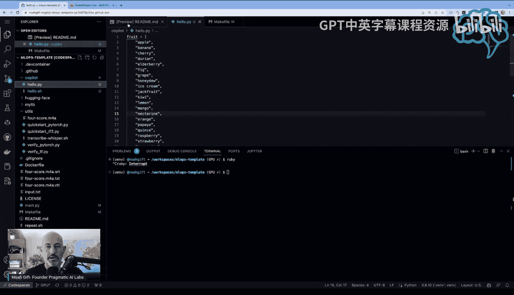

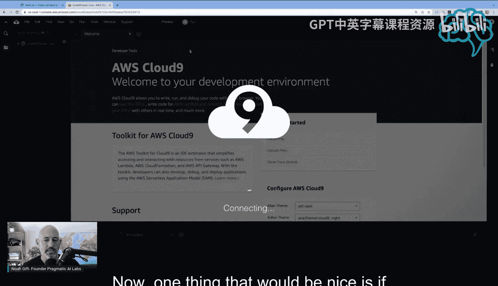

Probably create SSH keys so that can I can。

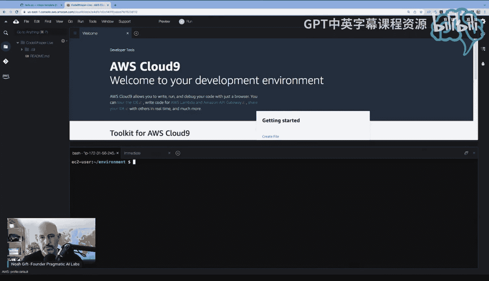

Populous and in facts。If I go to this repo here， I have a repo that Copit wrote a lot of code for me。

嗯。EWS assimilate。😔，Yes， so we go assimil。EWS assimilated AWS。

 So this repo is a lot of this was written by Copit。 So I'm going to。

I'm going to grab this code and I'm going to check it out in here。 So we'll say。

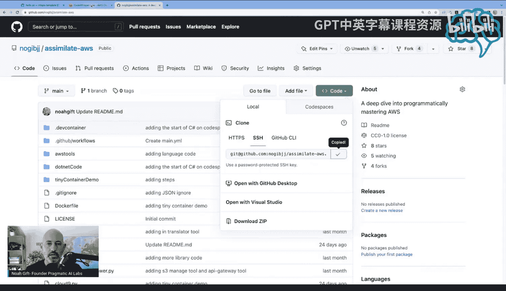

It cloned。Now this won't work because I have to create my SSA so I'll do that first SSAT。S T RA。

 now it is a bummer that I have to do all this。SsH key stuff it would be cool if there's a way to make that automated because it just gets annoying every time you create a new environment to have to to do this。

 but you know not nothing's perfect so let's go over here。

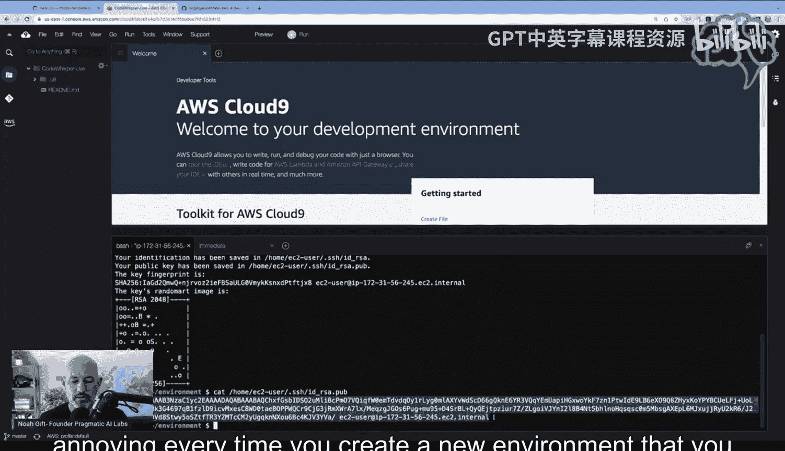

And let's go to。Settings。And we'll go to SSH and GPG keys we'll make any。

We'll call it the code whisperhi。No。Perfect。And。

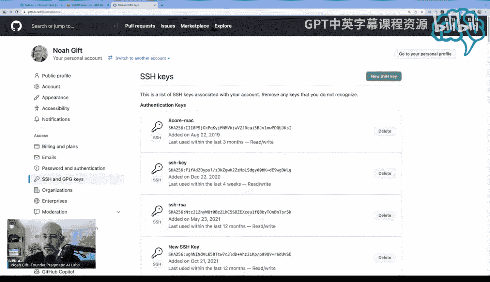

There we go。 We go back。 I got that repo there。 So now if I go。It do a get clone。It works and then。

I can even seed into that directory。Probably the other thing I would do。

 I do a lot when I'm working with code is I'll create a virtual environment。

So that I don't get weird things happening。And I'll put that into my bashRC， so we'll just say。

V Hilda ba C。Been in of here。I will say。X， I will say source。嗯。Pda do V E and V， then activate。

But this would just means that I don't have to worry。Going forward。About。We're seeing this。

I can in fact， just open up a new shell。And then it should just work， there we go。So。

The next thing to do here。Is to enable codepit I'm sorry， code code whisper。

 so I'm going to click on this。This is one of the really cool things about。

EWS Cloud 9 has got all this deep integration with EWS services， but what I'm going to do。

I I'm going to go to codeWhi preview。And notice here that， in fact。It actually， I believe。

 is already enabled because they whitelisted me。And。It looks like it's it's good to go。

 So let's try out。 So I'm going to go over here and I'm going to Cd into this assimilate AWS directory。

 And if I say make test or install。What happens， let's install some packages here。

Some'm going to install different things that are。You know， probably things I care about。

Like Bodo 3 pyinance。Some other stuff here。Okay。And what I can do is。

Is potentially created directory that specifically deals with code whisper code。

And so what I can do is I can say。Make directory code， whisper。And I can just create some stuff。

 So I would say。You know S3 tool would probably be the the first thing that's kind of a kick the tire tool for code whisperhi and so let's see i'm very curious here I haven't really tried this yet so if I go through here and I say okay I want you to write a tool that allows me to。

To communicate with S3， let's give it a prompt so。We'll even make this command line tool from the beginning。

 so user bin Python。And we'll say。You know， build。A function that。Returns。

All of the buckets in my S3 account。What's cool about this is I don't even need keys。For this。

 because cloud9 that's how it works now didn't now in this case it didn't do anything yet so maybe I have to give it more of a prompt。

So this is a little bit different than Copit。If I say deaf， what did it do， does it give me a prompt？

S3。Best。And。I guess I have to maybe pay more attention to it。Looks like what it's doing。I say death。

List S 3。Is。There we go， so I guess this is the part where it gives you the suggestion。So I see。

 so it says in import Bo of 3 S3。Well， that's pretty cool， so you just。

 it basically gives me the suggestion here so that I just put this up here。

I don't know how it's getting， it's I'm assuming it's getting。It's information。From somewhere else。

 now， now this is one problem。 see how this is kind of annoying right， is that look， it didn't。

 it didn't format the code correctly。 So this is where the refactor is so critical。Is that again。

 with these AI tools， I think it is good to have。 yeah，s see this， how I do a reractor。

 So I'm going to add。Tell it to listen to this directory。 So formats also code whisper。To whisper。

Who'd whisper Astri that he why。And then。Its。I will say code whisper。There we go。

 so now if I say make refactor。Does it fix this issue here？We're about to find out， oh。

 so I need to do an install install。So why did Python Black not get installed？😔。

Let's double check here。Do I not have it on my requirements？Oh， I don't have it。

 so we need to install that。And。哦。Allrights in in now， if I say a refactor。

Yeah see this is a nice tool to clean up your code， look see how it cleaned it up for me。

 so this is definitely something I'd recommend for people that are using peer programming tools like this for AI peer programming is definitely have a formatter and Li that are part of your tool chain。

So that looks good so far。And yeah， look， it's smart enough to know that that's what I want to do next。

And in this case。Now， I don't know how to get the next prompt。 O， you just have to wait for it。I see。

 So that's pretty good。 That's pretty good。It was smart enough to know how to do that。

And so now if I just say Python。S3 tool。It should list the buckets better in my account。好的。And。

Don't know why it's there you go。 So you can see here these these are my buckets in my account。

So worked pretty well actually， now this， we don't want that that's。That's not code I want。

And so I can just check this in and'd say get status。add make file， we made changes to that。

We'll just add everything。We go。Adding code whisperhi code。Sp code。But so far， pretty good。

 I'll need to make my。It set up work here real quick。

I guess one thing that's kind of cool about codespaces is it's faster so far。

 I would say that one big thing is the speed here is not great with code whisperhi。嗯。

And let's say get。Wish， there we go。 Now， what I'll do is I'm going to get out of this repo。

 because this is not exactly what I want。 And I'm going to go to。

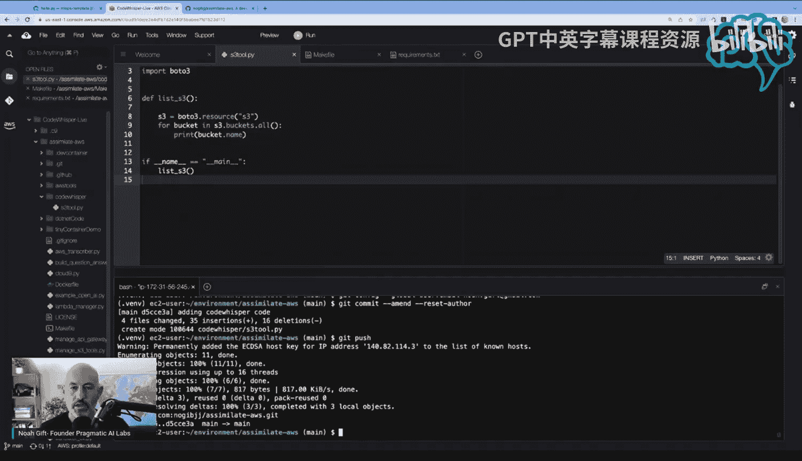

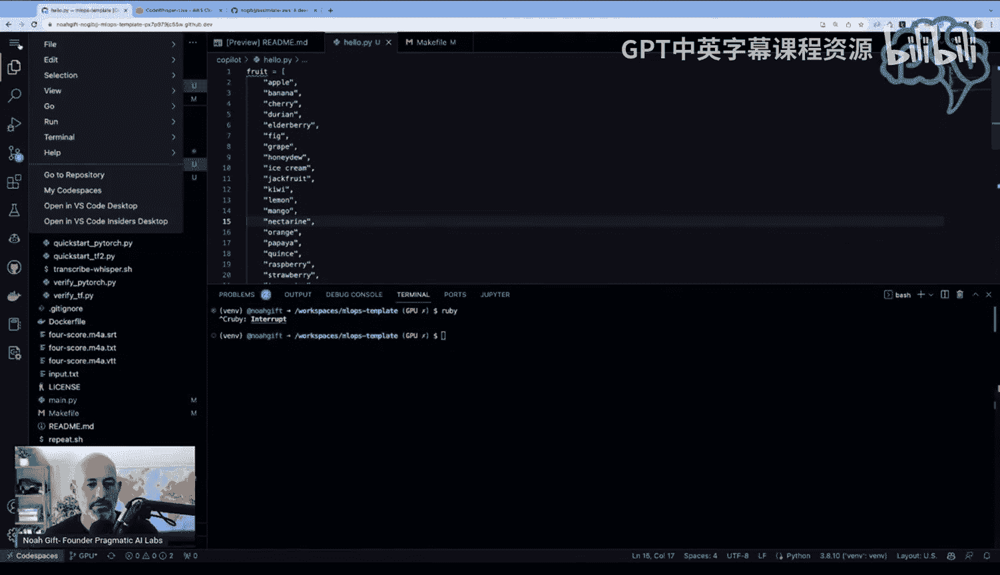

A different repo here。 I'm going to go to the assimilated AWs repo right here。 And if I click this。

Here， what I'm going to do is I'm going to。Delete this code space。And I'm going to。Make a new one。

 I'm going to make a beefy one。 I'm going to make a 16 core machine。

Let's go ahead and and so this will be a little bit more of an apples， apples comparison。

Because。In this particular scenario， we can actually compare。

The code whisper versus copit step by step， right， becauseuse again， this will be。

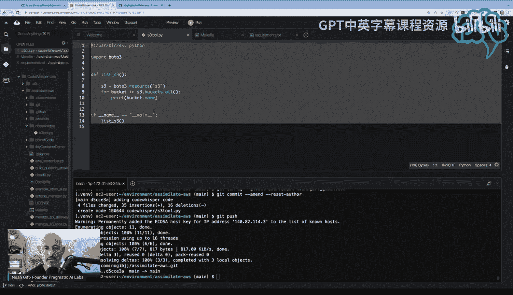

My。My coppit enabled space。Now， I believe this should be pretty fast because I think it already had the pre built container。

 but I'm not sure we'll let this go for a second。 So while that's installing or whatever it needs to do。

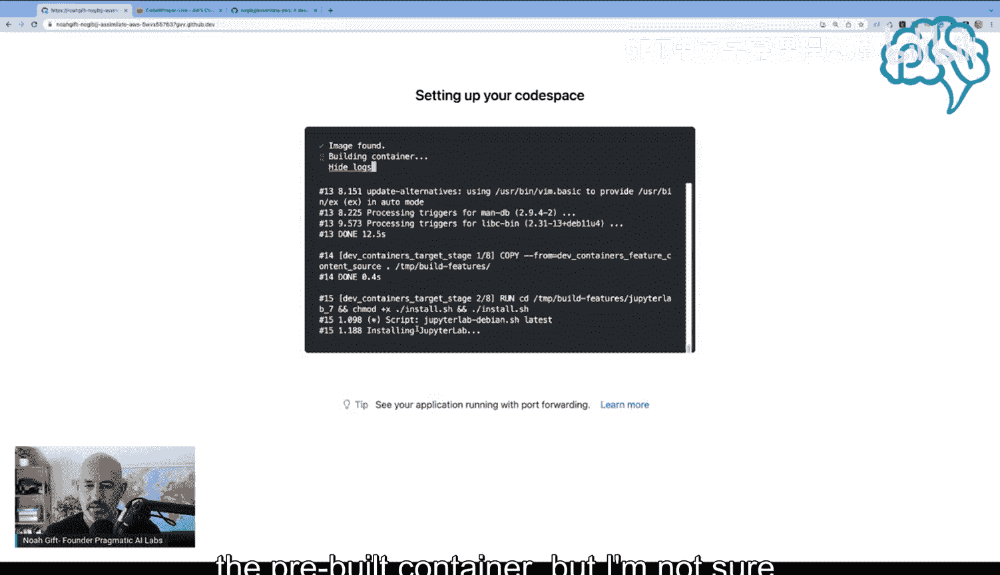

I guess the next thing I can do。Is see how it responds to non？

Non AWS code and so what we could do is try to just build like a calculator function and so to I'm going to say touch code whisper calculator calculator。

Cculator。And I guess to say who created it。Well， I'm going to say CW。So said I don't get confused。😔。

Yeah， CW calculator。Let's make it。score CW calculator。In case I need to import it。

 so I got this that one， so I would say the first thing I need to do is import click。

 which is the commandion tool that I'm going to use。Now。

 it is pretty interesting it gives me different kinds of。Different kinds of suggestions， actually。

 which is interesting。And and I'm going to say， you know。Maybe I can even set the context。

 I can say like。Here。Build a command line。Calculator。Yeah。Later， that adds into factss。Innerger。

And uses Python click library。 So is it smart enough？knowow how to do this。嗯。According to this。

 it wants me to do for math and toward this well。So the suggestion is pretty good。

So so far it it's doing pretty well。 now I don't want that want I want to say。呃。You a calculator。

And then what's going to be next here？Let's see what it does， so I'm assuming。So this is interesting。

 it doesn't， it's kind of stuck here for a second， it's like， well。

 wait from math and port square root， no we don't want， we actually don't want square root。

So that's one thing I don't know if I would warrant。And。We have， at least that's good。Okay。

 we got add， that's pretty good， that's a good suggestion。Eepubtracts。There we go。

 so it has and it created a function for me so pretty good suggestions here and very clean code。

 so it does seem like it takes a little bit of time。😊，But it builds really clean code。Now。This。

Is not a good suggestion， though， because。That's。Add two numbers。 That's， that's not what I want。

 Add， add this number， Subtract this number。um。So， so this doesn't。Really。Help helpp me too much。

 It's it's， it's， it's a little bit disjointed。 So what I can do。

As I can go back up here and I can say deaf add。And。And see that it does。Do that。

If I say de subtracts。Is it。That， so it does do that。And then。If I want to。

To change this a little bit， is it smart enough to know。See here， so。That's a little bit better。

 so that's the first number。There we go， so it does know how to respond。What's going on。

 the speed though， is is a little bit slow for me。Now in here I can do some documentation that says。

Like with's going on， I could say， you know。This is。不です。He doesn't give me the suggestion。

I have to do it myself， calculator function。And then if I say example。Well， that's pretty good。

 that's a pretty good example。Calculator， add。Okay。What about？This。Calculator。

So I guess this would be。Add。So that looks reasonable。What it came up with。

And then I could also do a。A subtract so it can say like。At is it smart enough to know。Command。

Little little sluggish。 There you go。It's a little bit sluggish for me。

 but definitely say this is something they need to get a little bit better at。And subtract here。

Let's see what happens next。嗯。This is a calculator so that's good， I mean。

 it is very high quality suggestion， though， that is a plus。😊，And yeah。But this tool is definitely。

It， it definitely seems competent。 I will definitely give it that。 There we go。 So it looks。

 looks good。 This looks like it， it was actually， the suggestions is's giving are very solid。

 Now that。Is an issue oh yeah， this indent is off so this is is something you have to really be on your toades about。

Is watching how it generates a code。 So again， I'm going to use my refactor。

Linnt it and reformat it O。N42 is an issue yeah， see it did it again so so the white space that's that is that is a little bit not good。

That it's causing white space issues。That's not， that could definitely be something to fix， no。

Function already defined。Oh， because yeah， we already we need to do。We need to call this sub。that。

And now we can reform it again。There we go。I'm the chait。Calculator line 9， did I already do。😔。

Oh yeah， line， line we already。Add。Add function or。Add it。Sit， how about that？Will do add it。😔，Sa。😔。

Saidbit， how about that。You got to be on your toes that you can't just hope it builds perfect code for you。

 which which is in horribleable， it's a little slow for me though I would say that's the big thing and I'm I'm going toma plus X。

Here， the u kills。It no， code whisper CW calculator， so if I go。To code whisper。

And then I do Cw calculator。Hello。Oh， I didn't build the Shimang line。 I was like， what。

 what's going on here。 Okay， so here we go。User band， E andV Python。OkayWell， that works。

 and and we'll do five and five。嗯。is it asking me for， oh， it's prompt true？Well， sure， let's let's。

Although I don't actually want。From。True， so。It is interesting how it gives me some things that I wasn't expecting。

Like I wouldn't have said prompts。For not to have a prompt。Let's leave that。Okay。No。😔，Oh。

 so you got to give it the x and a y。Whichch I guess makes sense。 So we see x is5。

And y is five there we go， so that works and then subtraction。We'll call this drafts。Perfect。

 all right， so this does work。 so let's let's check it in。嗯。So that looks like it's working。Adding。

 code whisper。Right， so now we's build the same thing using。Go pilot。

And so I'm going to go over here。

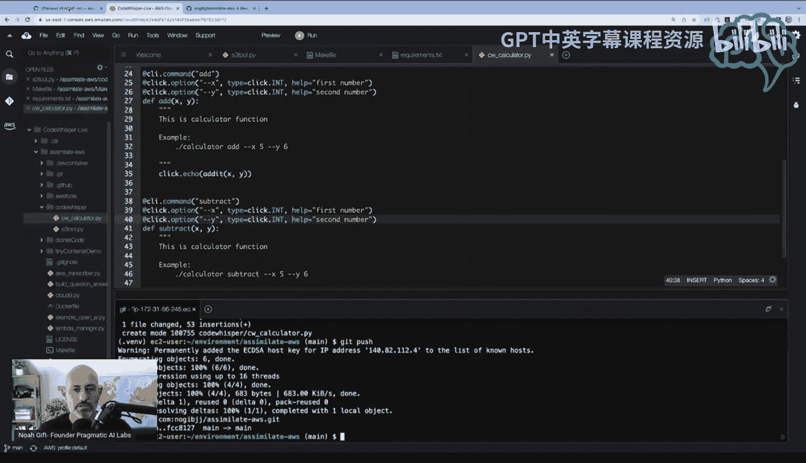

And let's just double check， we' got it installed。And yeah， we have， we have Copit right here。

 I'm not using nightly， which。I'm not sure if it matters nightly versus regular， but。For for， for。

 for now。What I'm going to do is I'm going to。Make one called coppit。

 So I'm going to make a directory called copilt， so we'll go。Make directory。😔，WellFirst。

 let's pull the code in。一方。陈面。😔，Do that。佢。😔，播。So I'm going to make a directory called Copis。😔。

also need to change this so that it also knows how to do copil。 So you can see here that。

The completion is kind of more of a natural pace。So I do think this is like it feels more natural the code completion and it actually works with makeCF。

 so that's one advantage。And then。If I go to here， let's build the same tool。

 so let's go to Co pilots。We'll call this。Ilet or C calculator。So's， let's build the same thing。

 Which one is。rety sure Copit is going to go very fast。嗯。Let's， let's go here。

 and so if I go and I say。First， let's build a shippingang line。Okay， and then I'm going to say。

 you know， here。This or build a calculator。Calculator。😔，退错。Tool that adds and some facts。

Yougene click。Package， there you go， so that's a pretty explicit instruction。Now。

We should be able to use it， so it says， yep， pretty good suggestion。嗯。And that's pretty good。Now。

 I think here is where I would I would say I may have to give it like a suggestion。

 like build an addd function。I like it usually。嗯。There we go。

 so you can see that that was lightning fast。I mean。

 way faster than code whisperhi and now once it starts when it starts going。Look， it's just， I mean。

 just speed is just easily fast。And now we can say， you know。Build a click group。

It iss a little different， it's a little different experience。Here and look， we can even say。

 you know， calculator。Example and lets us even see， like， look。Cp。😔，Pull pilot calculator。😔，Add。

Right so it even gives us a little bit of。Of a， of a hint of how it's going to build it。

 And then yeah， it just starts cranking。 And in this case。The speed is very fast here。

 So I feel a little more of a natural developer flow。I'm using this thing。Like I like this。

 it's like it's just pumping suggestions。Very quickly。Now。

 we do have to kind of prompt it a little bit。To do some things， but it looks pretty good。

And then if we want to build another one。Like it's pretty intuitive， the intuition and speed here。

Definitely feels great。And then yeah， so you can see her just very fast。So I would say。

For this particular piece of code， the speed feels a lot more natural to me。嗯。

And if I say Python Copilot。TB calculator。It's just oh， so no module named click。I just。

Just make sure I do a make install， maybe。Maybe I never installed the stuff I need on here。Okay。

All right。If we go here looks pretty good and if I say add two and2。it's tough to。

 I would say this battle。Those to coppit， I think coppit is just cranking。Right。And if I do help。

You the。Pracax。You to。So oh subject， sub subtract。that looks good now let's try to build an AWS tool because I do have my AWS keys on this particular machine so we can try an AWS tool now so what I'm going to do is I'm going to touch。

Propis and I'm going to make a let's do something not to let's make something。

A little more interesting， like， for example。啊。Look inside。Of。All of my。Buckets and find。

Something or。Maybe， I mean， that that， yeah， I think I could look for。

Maybe how about how about counts？All of the items in a bucket and return back a list。

 That looks pretty good。 So we'll call this。CP for copilos， and we'll call this S3。Bucket。File count。

So it's going to count the total number of things in a bucket in S3。And so this will be a good。

 this will this is complex enough that it should really test how smart coppi it is。

So I I'm going to put the context first， so again， we'll do this。Sa user bin en。Say build。

A chamean tool。Using click。😔，Aackage。Ats。Counts the number of files in a bucket。嗯。

Councenor files in all buckets。An AWS account， right， So we want to make it super。

So that's pretty smart， pretty smart here， so we'll do click。Yep， and we need Bodo3。

 so we need Bodo3， so it did tell me that。And so let's first build a。Get bucket lists。

 get a list of all the buckets in the account。 So again。

 it's pretty smart it's just it knows I'm going to need this。

And then it's going to say good bucket file count。So it's going to take a bucket name。

And then it's going to give me the count to the file。 That's it。

 Those are the two helper functions that I'm going to need。

And so it next should be smart enough to know I need to do a click group。

 although I could just tell it， I could just say， you know， basically build。

 exactly build a click group。嗯。Countain wow， pretty pretty smart。Like it。

This is where I think coppit， for whatever reason feels like。It reads my mind。

And like I can just I and I trusted to like， look at this，s it says get this， get this。

Get the buckets fine for every bucket。And then print it out。

 And I can even like go back and forth with it。 And I can say like this， I can say， you know。

 use click。Colors。To print。Inow count。Look and it even can like do some fancy stuff。

 like make it a little bit neater。 and wow， this was quick， I mean， just lightning quick。Wow， okay。

 so pretty impressive。 it would be tough for code whisper to to actually beat this and I'm going to cha it。

And I'm going to go to Copis CP S3， So is it good enough， let's see here Copis。

 so we'll do dot slash copis。What do you even do？The formatting。谢谢。That' three。There you go。

You help doesn't even need anything， so I don't think it does and just say count， that's it。

 It's a pretty smart tool。Now it's going through woo， there's amazing this is。I mean， this。

 this is this is like basically performance enhancing drugs for my brain like， look。

 it's crawling through all the buckets and just like finding all the different items in each bucket。

 I mean， this is actually pretty useful。 I would， I would use this tool。

I can't believe I ever thought about billness where I can see if there's buckets with nothing or buckets that maybe there's stuff in there that I care about I don't know。

 but this is a nice little tool so so now that i've got that I'm going to check it in。So get add。

 make file。😔，And putpi and we'll。I mean。A pilot example， now let's build the exact same tool。

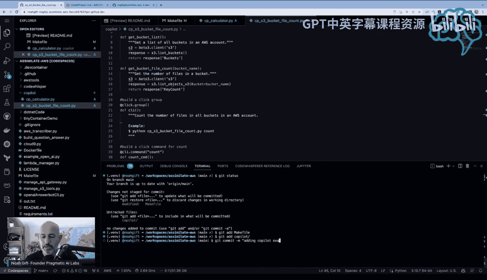

Using codeWhis， so I'm going to go back to codeWhiser now。And what I'm going to do now。

Is I'm going to。Just ask it to build the same thing。 So I will do a get。Poor。Although you know what。

 I guess to make it kind of。I don't know if I should do a git pull， but we could。

 We'll do a git pull。 I don't know which one would be a better test， but。

I'm going to say code whisperhi。And we'll call this one S3。Okay。Count。Ise。

It underscores because it just causes。P issue。 So here we go。 And now I'll do the same thing。

 I'll add the context。 we'll add this。 We'll say user bin be Python。B， I'm going to say。呃。

A message here。😔，Which is。But it is like a comment and say this is a commlan tool。

To me my tool for building。A that uses click， that uses click。To count。The number。Of files in。

All buckets in AWS account。 So， so this is， this is a minus now for this tool。

 because notice how Copit was able to autocomp and it's not auto completing。Stuff for me here。

 So that's a minus。Now that's good， it did do that， that's good， it did do that。

Now we could just see what it does let's see what it does so it says option。Me with the profile。

 and I don't want that because I why don't you know that I'm in cloud 9。

 I don't need the keys here so。I don't want this suggestion。 and in fact， what I do want to do is。

Now do I have to， how much control do I want to take over instead of code whisper。

 I guess I need to take charge here。I'm going to say。You know， death lists， buckets。Here。See。

 is it smart enough to know， there we go。Oh， that's good。 I like that。 This is good。 I mean。

 that's clean code， too。 So that's it does seem here we go count files。 This is good。

 I like what it's it's doing here。 So it does seem like there's just different behavior between the two tools。

😊，Like if you want。Ely solid and clean code here。 This is very clean code。And return this。

 so now now the indent that's killing me。 you're killing me code whisper。 I don't like that。

 So now fortunately I have this little trick where I reform formatat my code。

 although this is annoying that you would do that。We could do it again， refactor。

Annoying here that it's this。I is this。So it just it looks like code whisper。

Is for whatever reason does this weird thing with white space。 So they need to fix that。 I mean。

 again， it's beta。 So I mean， I can't blame them too much but but with you got to get Python。

White spacing。There we go refactor。 so so this is using Python black and Python Li to。To clean it up。

 So it says unused import click because。We need to now build out click。 So now is it smart enough。

 it does， It's smart enough。嗯。Let's see， name， name a bucket to count。 No， I don't want that。

 I wanted to do。 let's let's say。Build click group。There we go， that's good。We have that。No。

 we want this， so it's the little，'s they're different， they both behave differently。Example。

Could be。你 fun。Okay， I like that you did give me a good example。嗯。We don't want that。😔。

We don't want that。😔，You want that， that's essentially what I want。Although， look， see this。

 that's not the name I want。 So that that that wasn't a good suggestion。S3。Okay。Count files。

There you go， that's better。And now， is it smart enough to。2。😔。

To actually know what I need to do next。 So it is just hanging here， right， So it's like， hey。

 I did the click group。 Why don't you know how to give me this the next suggestion。

 which is a little bit annoying。Build。So I have to say at click。

I don't even remember actually so this is。Because。The other tool just worked。

 so I have to look at the EWS tools here。I' have to look at my copilot to remember what to do， right。

 so if I look at coppilot。See， like I need next this。Right， so。So， basically。

Build a click command for counts。That's what I want。Now， are you smart enough to know。Okay。

 there we go。Now， can I tell it， did it screw this up again？New， no。Well。

I would definitely say this is more beta than gopi it。It's not as， it's not as nice。 Now。

 I am curious we'll do this。 We'll say like add。You know， use click colors， what happens。

 Can you prompt it like this。Let's see。 Oh okay， well， that's cool。Use click colors。File， okay。

 well that's good so I mean， the code that it does generate。Often is very high quality。

 I do like that。And and I think it was going to tell me what the do next year I don't know if you there must be like some kind of shortcut or something you use to to ask it to prompt you。

 I don't know if I'm missing it somehow like。I have to read the documentation， but if I say。You know。

 if。I mean， it does it does appear to if under。Tt， yeah， tablet。Would you hear as well。If。

There we go。Hopefully， I don't have to use my mouse， which is kind of annoying。But and we sma it。

Plus， X。嗯。Good whisper。强。So。Let's do that。Okay， and then if we do counts。There we go。

And it was able to actually do it。 So， I mean， they both， I mean。

 I was able to do the same thing with both tools。I like the fact that copit。

D'm sorry that code whisper on cloud9 works。That is awesome because anytime I use Cloud 9。

 I obviously will use it because it's helpful。What is I don't know if I like it better than than Copit。

 I do like coppit just to be honest， I like copilt better， it feels a lot cleaner。

 I mean I am going to check this in real quick。Had。

So I would say it's definitely better than not having the tool。And I will definitely use it。

 I hope that they speed up。The the suggestions and I'm sure they will I'm sure it's beta。

 I mean AWs does make things better constantly， but I would say。If I had， know， I guess I could do a。

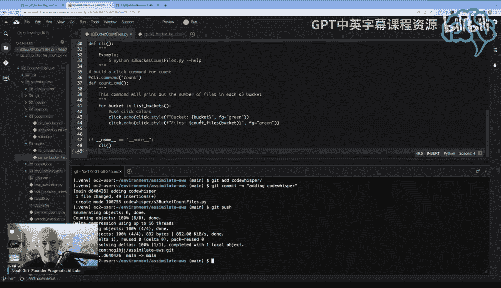

Maybe talking head here for a second about this is say so my summary because I know that I've had some people ask me about this。

 the difference between the two is that。Copi experiences， I think， much better in terms of。

It fits my brain like my brain in copit are like in sync。

 where it really feels like someone's right sitting right next to me， and I can code very。

 very quickly。 I would say code whisper is pretty good。 I mean。

 the the suggestions it gives are extremely high quality suggestions。

 which for AWS code in particular， I think， is great。😊，And so it's definitely got a lot of promise。

 I would say the things that code whisperhi needs to improve is the response time。

The white space indentation problem is fairly significant， and I think they should fix that。

Given that they would fix both of those things， I think it would definitely be a great tool I love that codepilot I'm sorry code whispers does work with cloud9 though and so yeah when I'm in cloud9 I definitely will use codeWs it's better than not having it for sure I'm a little bit spoiled though because codepit is just really intuitive。

😊，The other thing I would say was cloud 9 if they could get the same features as Github code spaces where you can prebuil it。

 so just launch it super quick。 So in general， the VM launch time't isn't great。

 And if I could customize my cloud non environment and preload a bunch of libraries and everything on it。

 So you know Id say a little more polished on the Gitthub side。

 but I'm glad that the tool is available for me on AWS and I'll definitely use it。😊，All right。

 that's it for me。