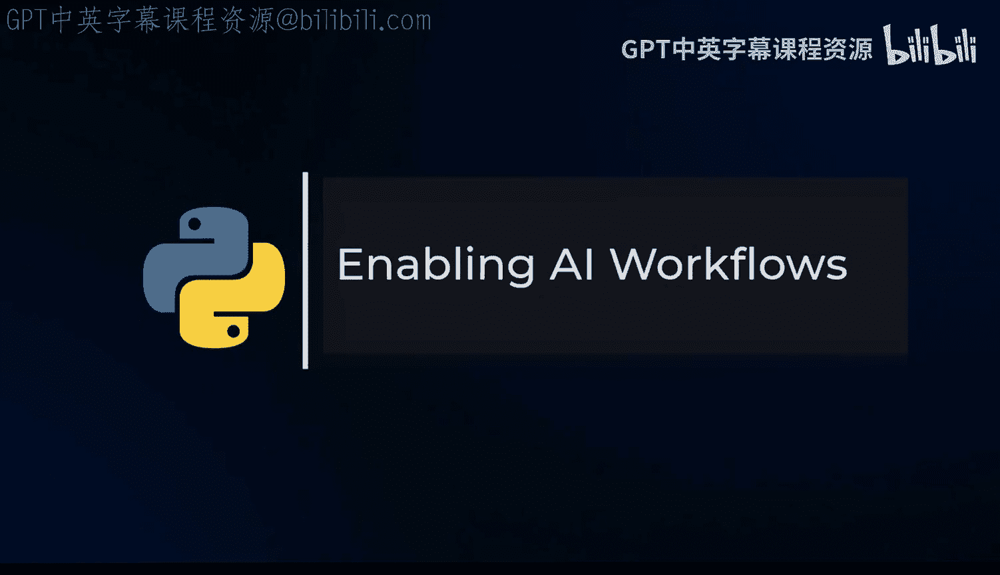
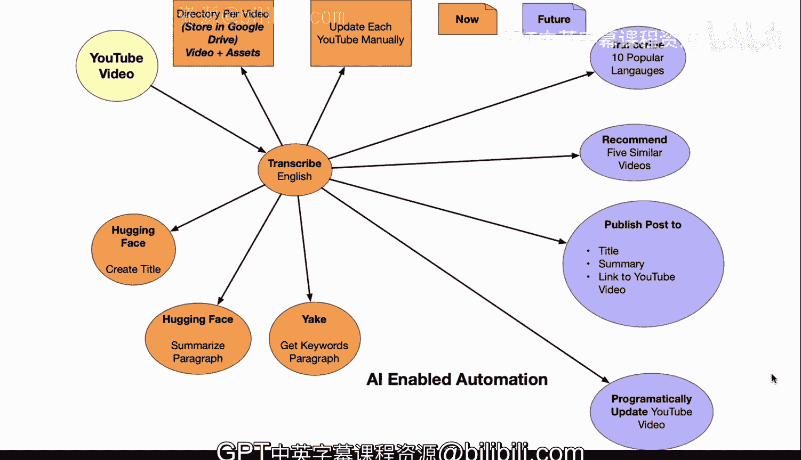

# 杜克大学｜机器学习运维｜DevOps⧸DataOps、Azure、MLFlow和抱脸｜MLOps ｜ Machine Learning Operations p49 56_04_02_启用AI工作流.zh_en -BV1yE421c7uA_p49-

Here we see an example of how AI tools including things like Hugingface， Open AI。

 all come together to build AI enabled automation。 Here's an example。

 let's say a publisher takes a YouTube video and transcribes it automatically to English。

 they could then use Huging face to summarize it and create a title。

 they could also use Huging face to summarize a paragraph。

 they could use either a zero shot classification tool from Huging face or a tool like Yaake to get keyword paragraphs and they could build all this automation up by using this offthehelf AI tool。

 they could put those into a Google Drive directory or they could upload them automatically and they could build this as their first version of the pipeline later as they could tack onto the functionality of these AI tools。

 they could transcribe to the 10 most popular languages。

 their videos are generated from they could also build their own recommendation。engineine using NLP。

 for example， to find other videos to recommend to their users。

 they could also then programmatically build all this stuff out into a title， a summary。

 a link to a YouTube video， and then you could programmatically programmatically update this to YouTube。

 So there are a lot of automation factors when you use a pretrained model like open AI or hugging face that are really kind of hidden behind the scenes。

 But when you put it all together like this， you realize that AI actually enables automation。

 and they're very complementary tools。

