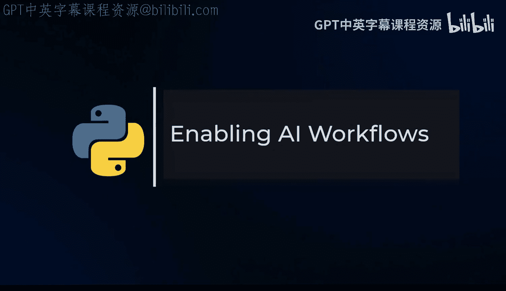
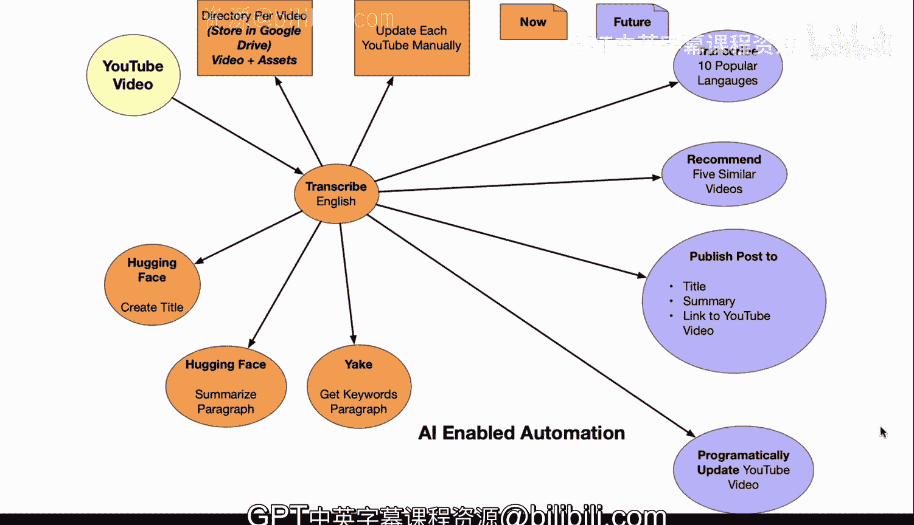

# 杜克大学｜机器学习运维｜MLOps：P49：启用AI工作流 🚀

在本节课中，我们将学习如何整合多种现成的AI工具来构建一个支持AI的自动化工作流。我们将通过一个具体的例子，了解如何将视频转录、文本摘要、关键词提取等任务串联起来，形成一个高效的自动化管道。

## 概述

上一节我们讨论了机器学习运维的基础设施。本节中，我们来看看如何利用现成的AI服务来构建自动化工作流。我们将以一个内容发布商的案例，展示从原始视频到最终发布的全流程自动化。

## AI工具整合示例

以下是一个内容发布商可以构建的自动化工作流示例。该流程展示了如何将多个独立的AI工具串联起来，完成从视频处理到内容发布的系列任务。

### 工作流步骤详解

以下是该自动化工作流的具体步骤：

1.  **视频转录**：发布商首先获取一个YouTube视频，并**自动将其转录为英文文本**。
2.  **内容摘要与标题生成**：随后，他们可以使用**Hugging Face**的模型来**总结转录文本**并**自动生成一个标题**。
3.  **段落摘要**：他们还可以利用Hugging Face为文本的特定段落生成摘要。
4.  **关键词提取**：为了获取内容的关键信息，他们可以使用Hugging Face的**零样本分类工具**，或是像**Yaake**这样的工具，来**提取关键词和关键段落**。
5.  **自动化构建**：发布商可以**利用这些现成的AI工具，构建起整套自动化流程**。
6.  **内容存储**：生成的内容（如标题、摘要）可以**被放入Google Drive目录**，或**自动上传**到其他存储系统。
7.  **流程迭代**：这可以作为他们**自动化管道的第一个版本**。后续，他们可以在此基础上**增加这些AI工具的更多功能**。

### 工作流的扩展可能性

初始流程建立后，还可以进行多方面的功能扩展，使自动化更加强大和全面。

1.  **多语言转录**：他们可以将视频**转录成10种最流行的语言**，以扩大受众范围。
2.  **个性化推荐**：他们还可以**利用自然语言处理技术构建自己的推荐引擎**。例如，通过分析视频内容，**为用户推荐其他相关视频**。
3.  **内容打包与发布**：最后，他们可以通过编程方式，将所有这些生成的内容（标题、摘要、视频链接）**打包成完整的发布物料**。
4.  **自动更新**：进而，可以**通过编程方式自动将这些内容更新到YouTube**或其他平台。

## 总结

本节课中，我们一起学习了如何构建一个启用AI的自动化工作流。通过整合如OpenAI或Hugging Face这样的预训练模型，许多复杂的处理能力被封装在后台。正如本例所示，当你将这些工具组合在一起时，你会发现**AI真正实现了自动化**，并且这些工具之间**具有非常好的互补性**。这种模块化的方法让即使是不精通底层算法的开发者，也能快速构建出强大的AI应用。

