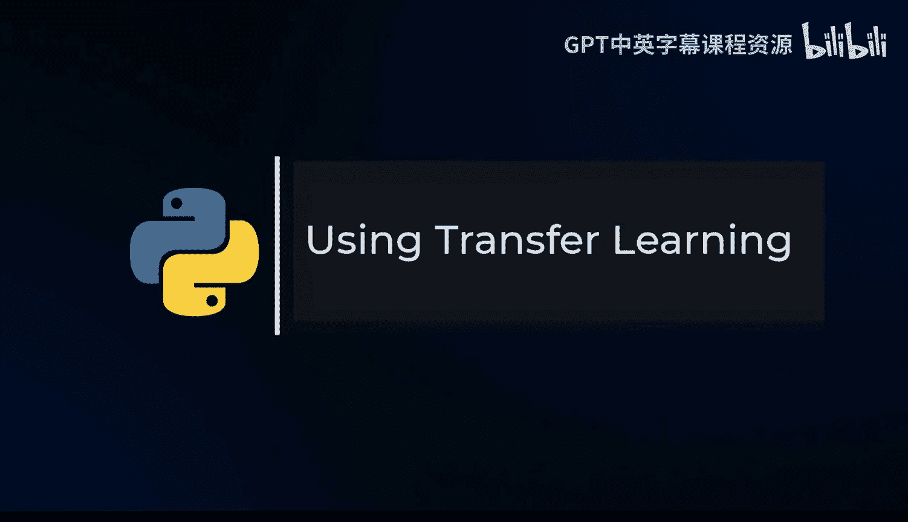
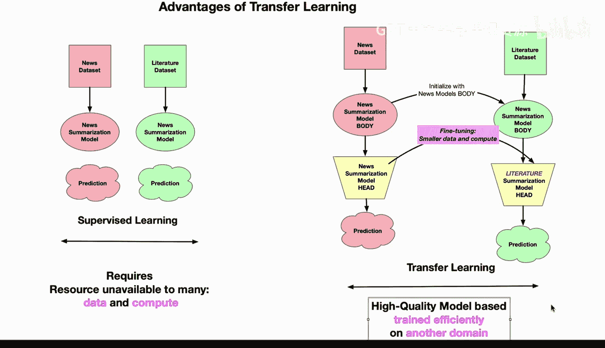
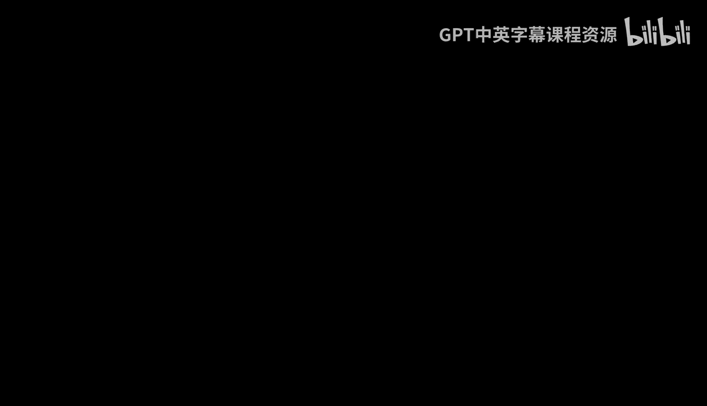

# 杜克大学｜机器学习运维｜DevOps⧸DataOps、Azure、MLFlow和抱脸｜MLOps ｜ Machine Learning Operations p51 58_04_04_使用迁移学习.zh_en -BV1yE421c7uA_p51-

Let's take a look at some of the advantages of transfer learning and why it's so different from traditional supervised learning。

In supervised machine learning， a lot of the problems come up with access to data。

 Do you have the ability to process the data， Do you have the data and also the compute。

 do you have the ability to access the compute and can you use that compute to process things If we look at a particular problem here with a news data you would go through and train it on。

 let's say a historical model and then sort out a prediction that could summarize the data Likewise。

 you would need to pick a separate data set， summarize it and then create a prediction。

 So it involves a lot of computational resources， storage resources in order to train things with traditional supervised machine learning in the NLP space one of the advantages of transfer learning is that you can take something that was trained from a different domain。

 In this case， this was a news data。And we could keep the body here so we could initialize a new model that is going to be fine tuned with a literature data set。

 and then we would tweak the head here by removing it and then actually fine tuning against some new data that had the literature information inside of it。

 This would then give us a more efficient way to do a prediction。

 So the difference here is that fine tuning allows you to take something that was developed by experts and developed with a lot of computational and storage resources and then fine tune it on your own resources。

Huggging face is one of the premier places where the fine tuning process takes place。

 and it allows you to do high quality model based training efficiently on another domain。

 So really in the future， we'll see more and more advantages of transfer learning in the marketplace and in fact。

 you can actually do transfer learning yourself and push this onto hugging face as a fine tune model。

