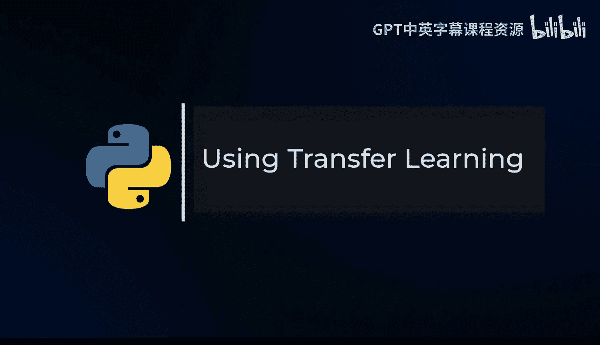
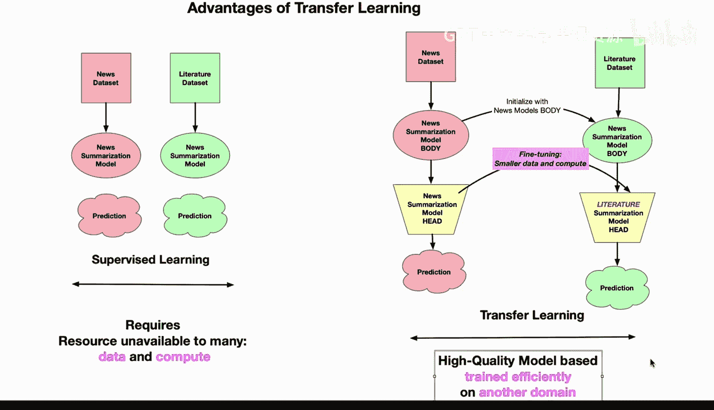

# 机器学习运维：P51：使用迁移学习

## 概述
在本节课中，我们将要学习迁移学习的优势，以及它为何与传统监督式学习不同。我们将探讨迁移学习如何解决数据与计算资源的挑战，并介绍如何利用预训练模型进行微调，以高效地应用于新领域。

---

## 迁移学习的优势

上一节我们介绍了机器学习运维的宏观概念，本节中我们来看看迁移学习的具体优势。

传统监督式机器学习面临诸多问题，这些问题主要围绕数据展开。你是否拥有处理数据的能力？你是否拥有数据以及计算资源？你是否能够访问计算资源，并利用这些资源处理任务？

如果我们观察一个特定的新闻数据问题，你需要使用历史模型对其进行训练，然后整理出一个能够总结数据的预测结果。同样地，你需要选取另一个独立的数据集，进行总结并创建预测。因此，在自然语言处理领域，使用传统监督式机器学习进行训练需要大量的计算资源和存储资源。

迁移学习的优势之一在于，你可以采用在其他领域训练好的模型。例如，一个在新闻数据上训练的模型。我们可以保留其主体部分，初始化一个新模型，该模型将使用一个文学数据集进行微调。接着，我们通过移除其头部并进行调整，针对包含文学信息的新数据进行实际微调。这将为我们提供一种更高效的预测方法。

因此，这里的区别在于，微调允许你利用由专家开发、并消耗了大量计算和存储资源的成果，然后在你自己的资源上对其进行微调。

---

## 微调实践与平台

以下是迁移学习微调过程的关键实践平台。

Hugging Face 是进行微调过程的主要平台之一。它允许你在另一个领域高效地进行基于模型的高质量训练。实际上，未来我们将在市场上看到迁移学习的更多优势。事实上，你可以自己进行迁移学习，并将微调后的模型推送到 Hugging Face 上。

---

## 总结
本节课中我们一起学习了迁移学习的核心优势。我们了解到，与传统监督学习相比，迁移学习通过复用预训练模型，显著降低了对数据量和计算资源的需求。微调使我们能够站在“巨人肩膀上”，利用现有高质量模型快速适应新任务。Hugging Face 等平台为这一过程提供了强大支持。掌握迁移学习是高效构建机器学习应用的关键技能。