# 杜克大学｜机器学习运维｜DevOps⧸DataOps、Azure、MLFlow和抱脸｜MLOps ｜ Machine Learning Operations p52 59_04_05_通过Streamlit集成OpenAI技术.zh_en -BV1yE421c7uA_p52-

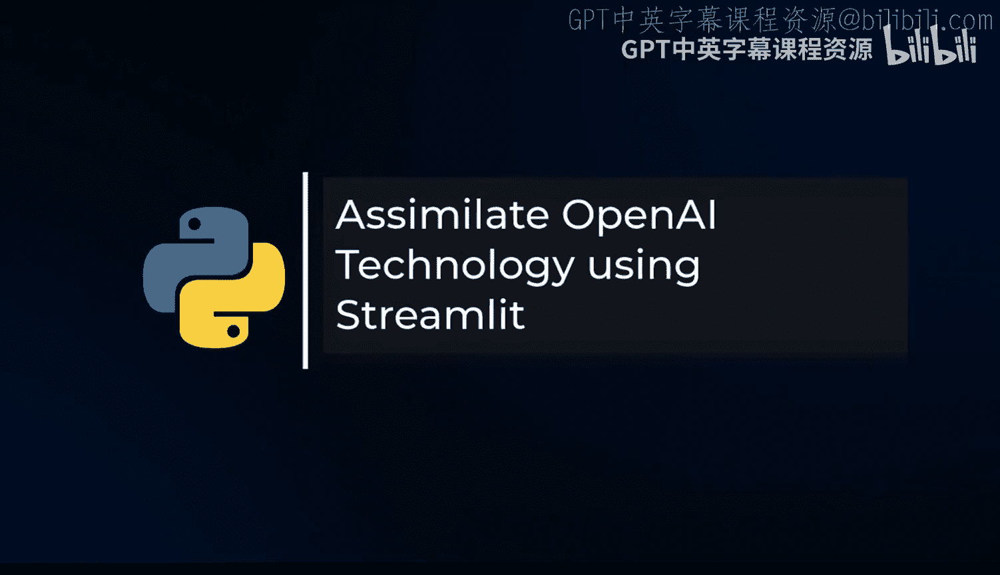

Al right， so I'm live here with assimilate open AI。

 I'm going to keep going on learning how to build tools and build them very， very quickly。

 So I'm going to share my screen here。And get into it。And to start with， I have this project。

 NoA gift assimilate Open AI。That I can actually play around with。 That's， that's one option。

 And if I go to settings here and I go to codespaces， or I go to。Seccrets。

We can see that I've put a open AI key directly inside of here。 so what I could do。

As I could actually edit this thing and use it to build code， I have another one， I think。

 which is here。Which， if I go to。To this organization。😔，嗯。And AI。Assimilates。Yeah。But this one。

Let's take a look at this one。 I think this one's a little bit ahead。

And so I might want to work out of this one and let's just double check real quick that I've got everything that I want in here。

 There we go open AI key。 So yeah， let's use this repo。

 This is the most most recent one and I'm going to go to code spaces and I'm going to launch this thing。

嗯。And let's see what kind of goodies I've got in there already。

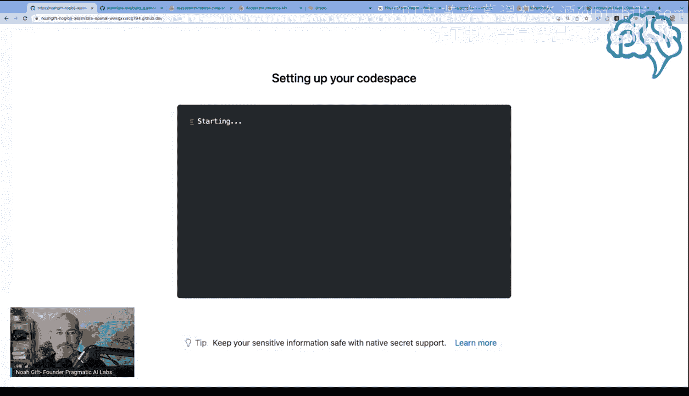

So I think the last thing that I was playing around with was that I built out this question answer。

CLI and so。Let's just double check run it again， so we'll just say question answer， CLI help and。

There we go， Python question who won the Olympics let's fix that little bit because it's a little bit messy。

 we want to do quotes here and do a question mark。And so we also want to change this toU dot slash。

Like that。And that looks good。 So I want to， I want to。Run this thing and say。U。Who is the best。

Athletes。Of the last 1 hundred years。The question？Where we get The best athlete last10 years is Michael Jordan。

 Yeah， I think he was pretty good。 He was dominant force in basketball in baseball。

 I wouldn't say dominant in baseball， but his accomplishments are unmated。

 He's the greatest player of all time and his impact on the game so well today。 pretty cool。

 interesting， interesting question answer segment there。

 So I think it would be cool to actually take this code。😊。

And also move it more into like a library structure because I think in a real world project。

 you're not going to only have command tools。 you want to have a lib。 So let's， let's do that。

 Let's build out a lib。 and let's say， make their。We'll say OA Lib， right open AI Lib。

And then I'm going to create an empty file here。So we'll say this knit。That'sY， there we go。

 touch O a Lib under under knits。And then I'm going to。Basically create a file first。

 and so we'll say OA Lib。And we'll call this。Logic or we'll call the solutions， maybe。Solutions。

 that looks at the good name， right， I want to build out some solutions here。

And let's first lnt everything and all that stuff so it's formats。

 let's make sure all of our code is good let's make sure it's all lted you know I don't know if I have continuous integration I don't think I do have this setup so let's set that up too because I'm going to be long term coding in this repo yeah。

 see there's no continuous integration let's set that up。

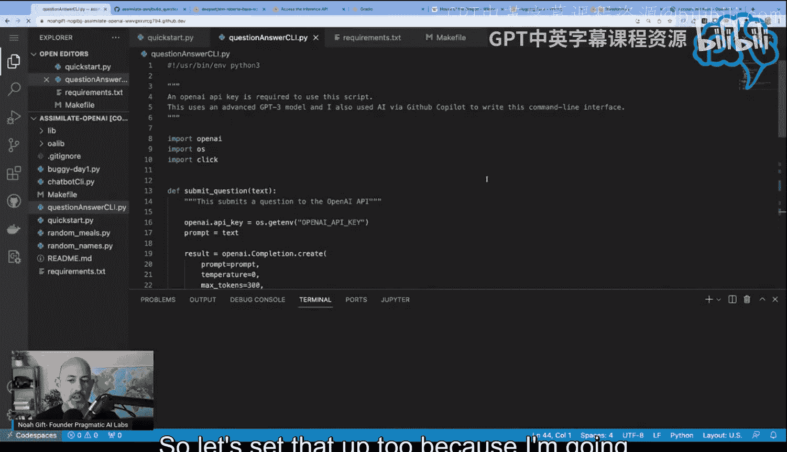

So I'm going to go to actions。And I'm going to say set up workflow。And what I can do here。

It's just grab。Something that I've done previously。And grab it here and just throw this in there。

Like this。Now， I don't remember if I've created a customized container as well。

 I guess we're about to find out。 I don't think I have， but maybe I have。 Let's see。Yep， see。

 there's no dev container。As well。 so that could be。Also， an issue。嗯。So what do I need to do。

I I need to open this up。And I'm going to copy one of my other dev container workflows here。 So。

 so I first have to open this up。 and I'm going to do shift command P。

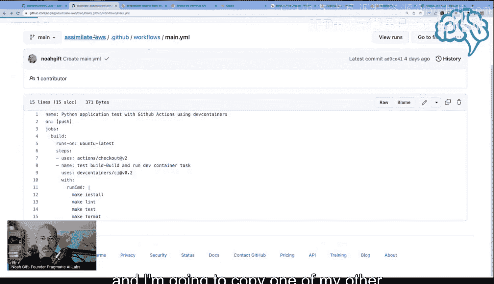

I'm going to say， dev container。Let's see here。Figure development container features。

 that's what I want。Okay， let's do that。 Let's do that。 Let's do that， none。嗯。Let's do that。Okay。

 we do now。Let's rebuild this real quick。

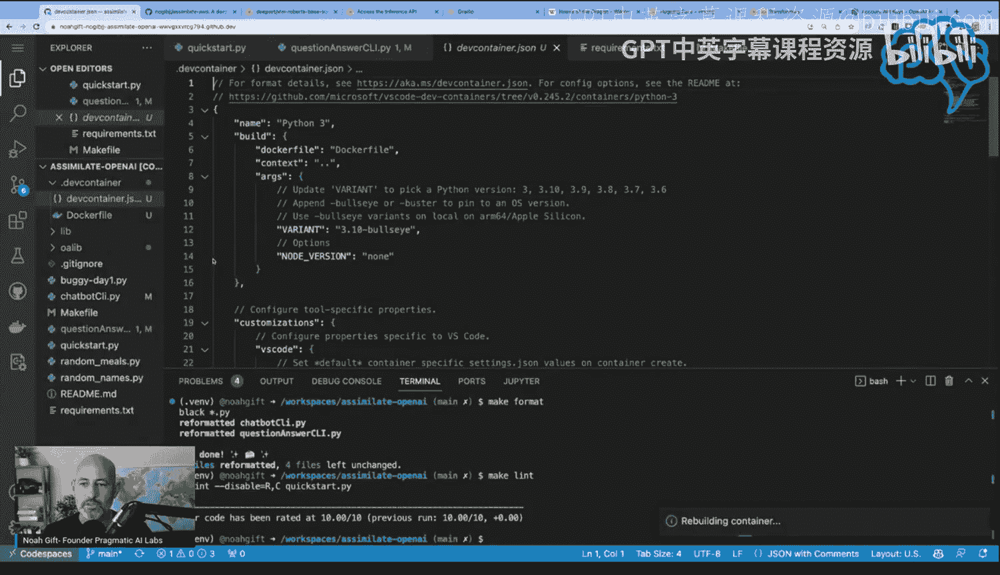

I would say， the only。😔，Other thing。😔，That I probably care about。Would be to， to maybe grab。

Like this， this copilt stuff。Shallt let me when it rebuilds。

I'm I'm going to put this copil stuff in there， but we can watch it rebuild。

 So the idea here is that I I。Have a more of an automated workflow。

And I also probably care about this， like making like a。

Making sure I activate a virtual environment so let's get all that done。Okay， it's。

 I installed AWS because I have a feeling I might need it for some of the things I'm doing with Open AI。

And it looks。Like it's about to get started。

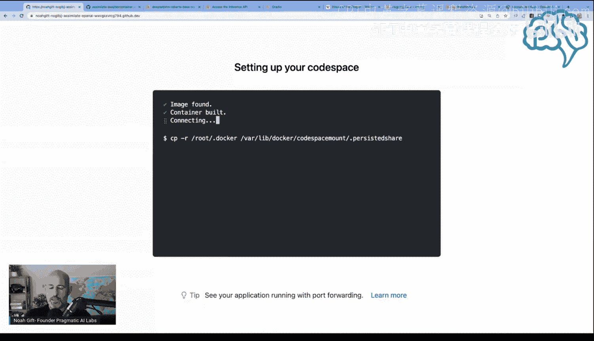

Okay， so， so we got this， I'm going。Put。啊。Okay， I'm going to put this here。😔。

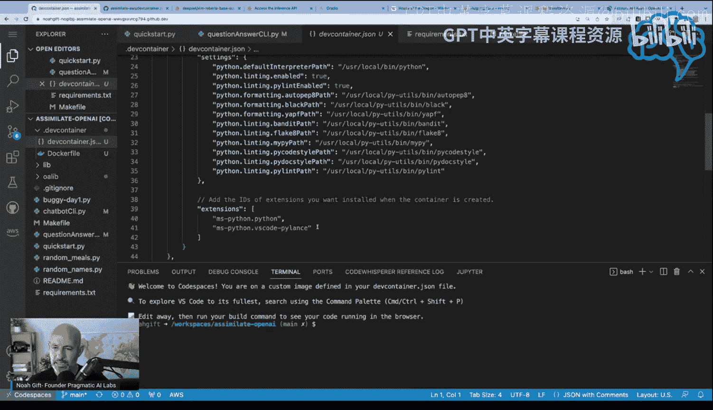

So that we also use coppit。Which is nice。 And we're going to rebuild。There。Yeah。

 I think I need to copy this command， I should have before I rebuilt it， I should have said that。

So it'll take a second to rebuild， although I wonder if it's quicker if it rebuilds it again。

I guess we'll find out。And I guess。While this is installing， let's see so it's， yeah。

 I' reinsing AWS。So so not too doesn't take too long to get all this stuff working and again。

 I'll put this。

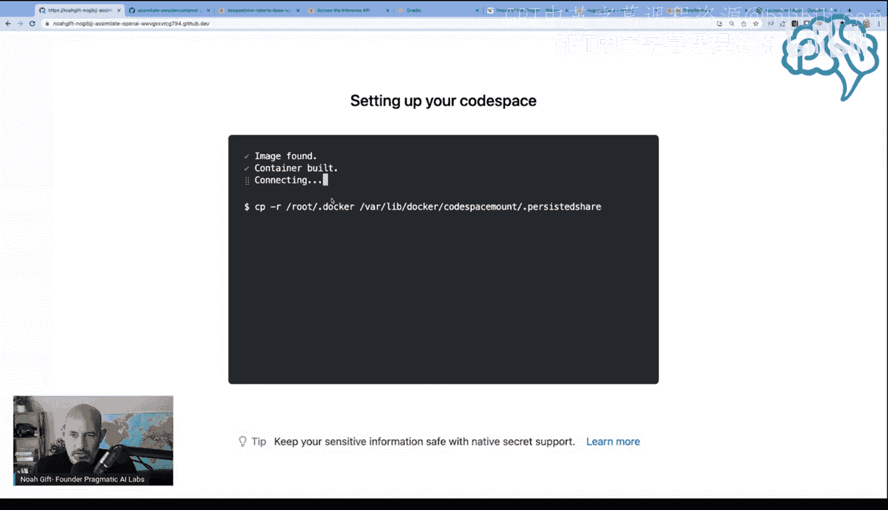

Command here。Like that。There we go， Post grantamp， yeahep， perfect。We can do that later。

Because I can just run it myself， right？I can just do that。That work？Okay。Well。

 I don't know why it didn't。Well， because we need to source the bashRC。There you go。

 and then if I say get status。Let's add。 let's add this library。You lib， let's add。All that stuff。

Because again， I'm going to be coding for a while， adding open open。Yeah， I set up。

At this we'll pull because I am going to need to pull some stuff because I did the Github。嗯。

It spaces， right？The Github actions。No， Paul。哦。Wish。At it。第。We don't care about that。Well。

 maybe I do care about that。 We'll install that。And you can also， once you install something。

 you can say add to dev container， right？So we can do all that stuff later， though， I can just do。

Andd。Yes。Minutes。Right， so behind the scenes， this should be getting all this stuff hooked up。

All right， that's that's good enough。 that's good enough。

 so Im I'm going to say make Li and just see what happens。That looks good。

 Let me look at the make file real quick。 I think I do want to change this a little bit to match another make file that I have。

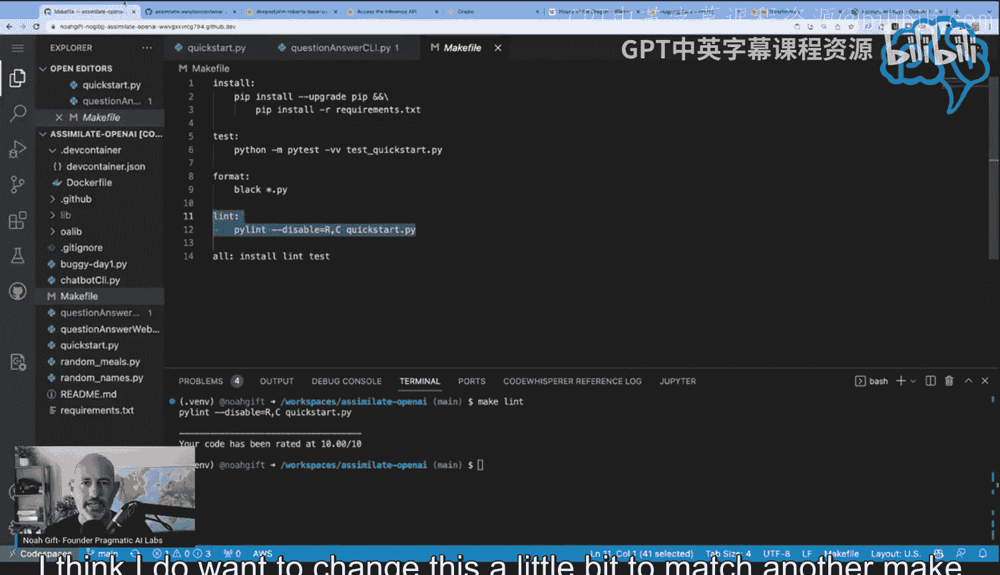

That's more like fancy。 Like， so I want to do this where I ignore test files。

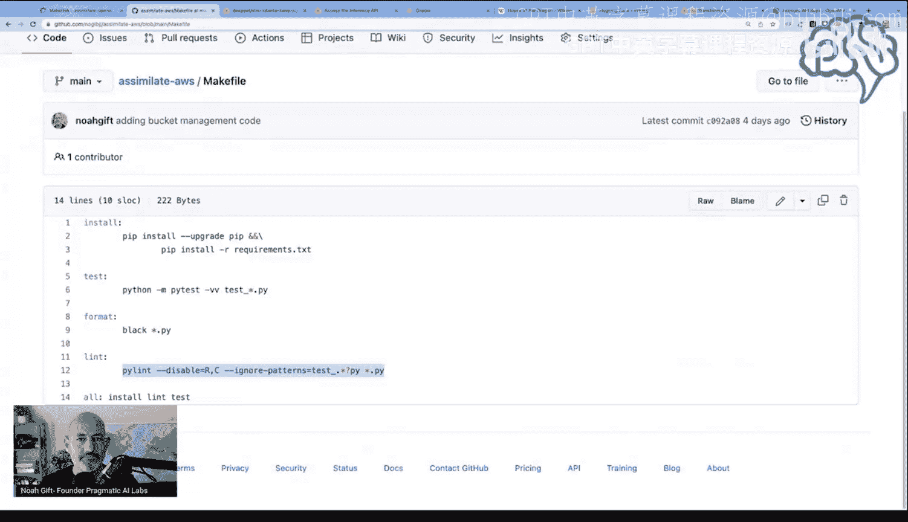

I want to do that and we want to look at all the files。

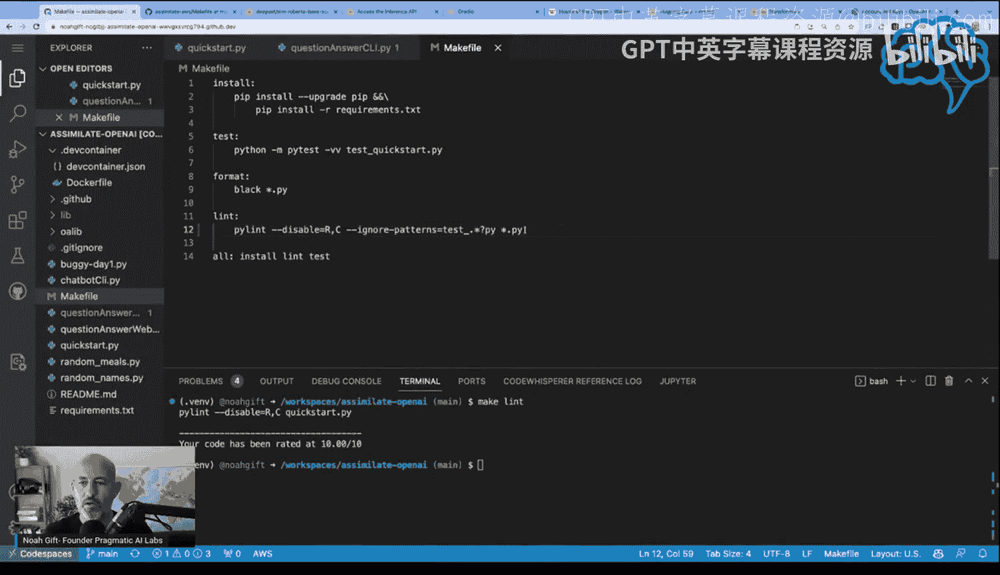

And then let's look at how I did testing here。 something like that looks good as well。

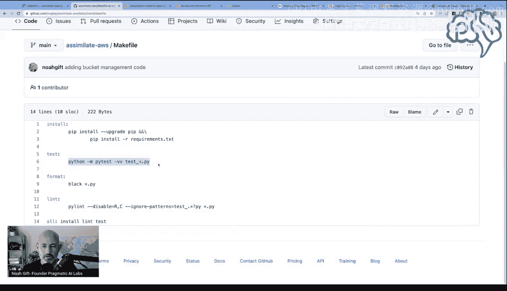

嗯。GoodOkay， so now let's do a makelin。Aha。See this one， streamlit is not installed。So。

I do want to play with Streamlit， So let's do that。But what would you mean it's not installed。

 unable to import streamlit。Well， let's let's do make install。There we go。Okay， so。

Make lengths what happens now。Weird how it won't import streamlit with question answer。Why。

 why can I not。Import streamlet。E 401， line 1。 How can it not import streamlight of installed streamlight。

I also need to install。I Python。Thats。Make can。Qu stream live。Well， that works。 so I do a lint。Oh。

 look， that's the problem， Look Pyins un installed。So byly done installed， by test is done installed。

 so this is where it's important to test all this stuff。Now， if I do make install。

 it' going it was using a lint that was a system li。

And for now I should be able to do a lint and it should be more truthful， there we go。

So now it's just telling me about。Problems with streamlit。 so I can fix this。

 and then we'll eventually get back to what I was doing before。

 So let's get everything working in our project。First， so we'll go to question answer， line 43， wait。

 no。Well， first let's look at the Web app 16， line 16。It says。

Reeffining in question from outer scope。 So， yeah， that's not good。 So we want， we want to make this。

And anytime you do a global variable， it's a good idea to do something like that。And。

Using F string that doesn't。Use interpretlate variables， yep， we don't want that。Okay。

 we want to get rid of unused imports。This is all stuff like you do。Get your code quality。

We only have。Unfined variable question line 37。Oh， because this。I'm assuming。嗯。

Is probably the big question。holl be this question？There you go。

So this will help me later when I want to build out a streamreamlit app。Like one more piece of code。

No value of text in the CI line 43。And that is in question interest， CI。😔，This one， line 43。

No value oh。😔，ThisThis is like the classic thing that click。You have to always get rid of it。There呀。

Perfect， now I got clean code。This is critical I think I think when people don't have proper Liing。

 you get yourself in some big， big trouble， but now I feel confident and so what I also want to do。

It start to put some logic together。 I want to I want to take this submit question and want to pull it out into a library。

And so I'm going to go to this Open AI library right here， OAI Lib。And I'm going to just do this。

 There we go。 Now I do need to to use the imports that it uses。

 So I'm going to need I'm going to use this and this。 So I'm going to copy that。

And and I can even put some documentation about， you know。

 basically this will be like a bunch of open AI solutions right here， perfect and I can do this。

 I can say。Library with open AI solutions or functions perfect。I'll call， I like solutions better。

Okay solutions as functions there you go。 so this is kind of like a cookbook that I can that I can mut now all I need to do to to to use this is I I can just delete a bunch of code so I love deleting code Deleting code is one of my favorite things to do。

😊，So I'm going to go through here and I'm just going to go do like that。

 look at this nice rest code that's exactly what I'm going to do as I'm going to say from。

OAlib import solutions。I think I want to do this， OAlib dot solutions。Imports。So question。

 look at that， only has to do anything different。And now I just need to link everything。

Double check that our links。Is smart enough。I don't know。

If it's smart enough to look inside of that directory， I think I'm going to have to add it。

If I remember correctly with Pi， yeah， so let's do that。

Now we don't want to do install we want to do L so's let's link our new library code did everything work excellence Now let's run our command tool。

谢来。Okay， you got us help。It's going to ask for the help the question will say like what is。Kms。

Favorite color。F color is green。 perfect。 So this works。 So what I can do now as well is I can。

 I can start。😊，Now that I got a library， I can actually test library code if I want to。

 which is one one kind of cool thing to do。 And I also can test the Kamelan tool and I I mean it really just opens up a whole bunch of cool things for me。

 I would say first， I'm going to build my first test So I'm I'm going to test the library first。

 so I'm going to say touch。😊，Testest solutions like that。

Although maybe I want to be a little more clever。And put a little bit more meaning convention on this。

Call open AI solutions， right， so that way it's I know it's the。it's the library code。

And then I just need to go into that test file， and I can actually have the copilt help me write it so we can just say。

Write a test。At。As mean。Now， we don't want to do that one yet。We want to do。From。Solution。That's。

From O A from O A Lib got solutions。That's what I want to do。

 and then I want to write a test exactly。呃。O。I mean， this is a little。

 it's a little tricky this is more of an integration test， but I mean。Let let's see。LetLet's do this。

😔，啊。Let say make。Ex。Yes。See this is this because the output from GP3 is non deterministic。

We don't we don't want to do a test like this， so it's going to be a little bit tricky to test。嗯。

So I think a better way to test this would be。Assert and is that basically。

This is a scenario where assert is actually fine， basically。

Just say like does it not blow up right and this is kind of a good way to test things it's just like look does it even work it does right if it blew up there would be a problem so now in theory if I push this I get status。

Add everything， get commit。This could trigger the build behind the scenes that we can get some stuff cooking。

Now， the the other thing that we probably want to try next now that I have。

 I have this this concept of solutions is can we come up with another。Thing that we could do。

 right so that I can build web apps and I can build command tools with。

 And so that's now now this is my next goal is， you know， let's let's let's build。A function。

That converts。呃。You know。In language。😔，P了。In Python。Or actually in code。T that。

 build a function that converts。Eguage the code， de。

I will say submit code or submit a question to the Open A API。I like this。We have the text。😔，Now。

 that's not what I want。's not let's build a function that converts。Language to Python code。K f。

Commerse language。Great prompts。I need to look at the documentation。 Here's what I need to do。

 So'm I'm going to go over to open AI real quick。

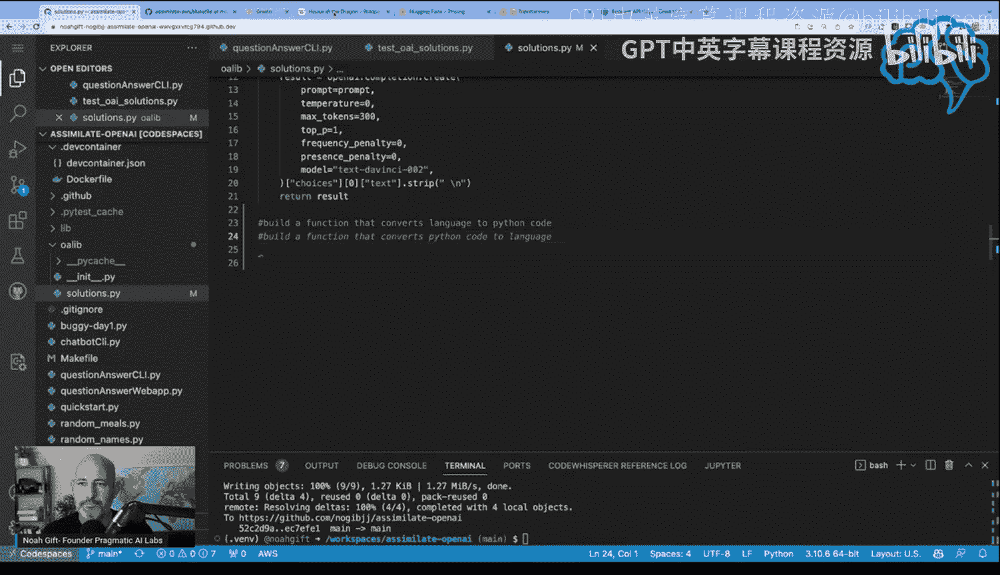

And I'm going to go to examples。And I need to look at the documentation for。Let's see here。

Coode completion， this is what I what I kind of am kind of interested and actually。

 I'm going to go to read me， I'm going to put in some we'll call this day three。

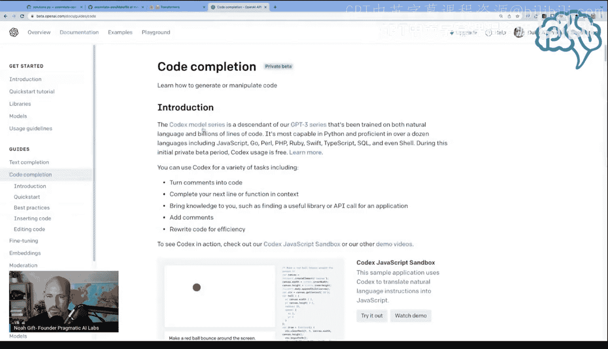

Day three and we'll see what we're doing here I think it's day three， I don't know what yeah。

 it's day three so we'll called day three。Would be。CicCD。React and refactor。

So we are going to look at this。How to build code， how to generate code programmatically。

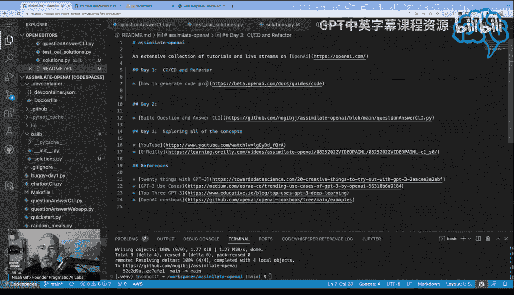

That's what we we need to do。 And so let's take a look at this。 So codec models。

 descend descendant of our G3 series that's been trained on both natural language bh blah， bh， blah。

 blah turn comments。 that's what I want。 That's exactly。 I want to turn comments into code。And so。嗯。

Saying hello。Great Rand， I love this on my Selquarian Python。 Now。

 what languages does it support again。😊，It's most。Capable in Python。But in those several languages。

Yeah， there we go。 So let's put this， let's put this docs in there。Let's just do that。

 let's just say。

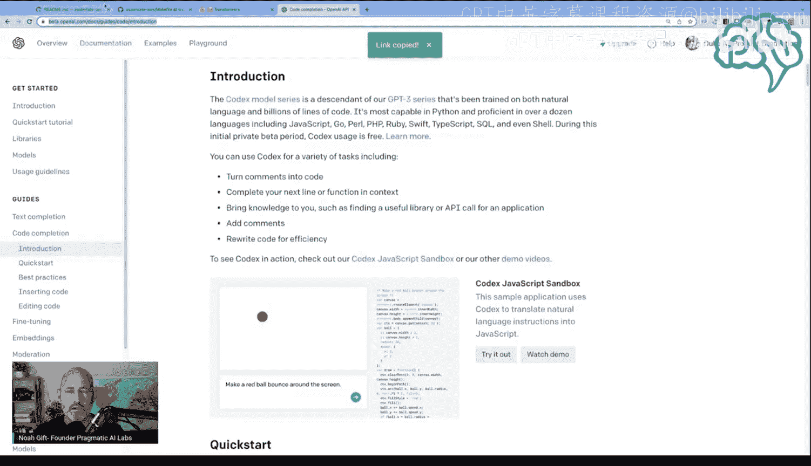

诶。Let's go back to their solutions。😔，And we can just say， you know， like。嗯。Princes。似乎。😔，In code。

There go。And。We want to build a function。That converts。Comments。Into Python， into to code in。

Language。So we're going to say deaf。嗯。Creates。Code。Say a text。Eanguage。You spun free this out。啊。

Nanguage。😔。

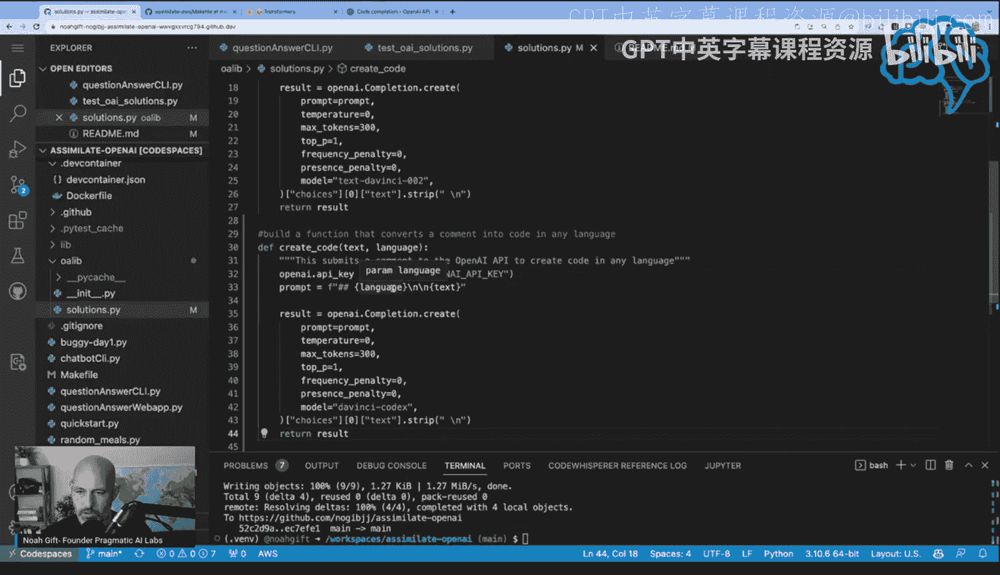

Texts， is that how this would work。Shall let's try this to a quick start。 let's try this one。

What's the prompt it's asking for？I don't want this one， I want I want some Python。Create。😔，See。

 this is wrong。 Why did it tell me the wrong one。嗯。So that might be a bug there。Start with a comment。

 Best practice。 you can experiment。Create a function。😔，And specify the language， oh， look at this。

Wow， that's I like this。So let's try that out， let's say Python 3。

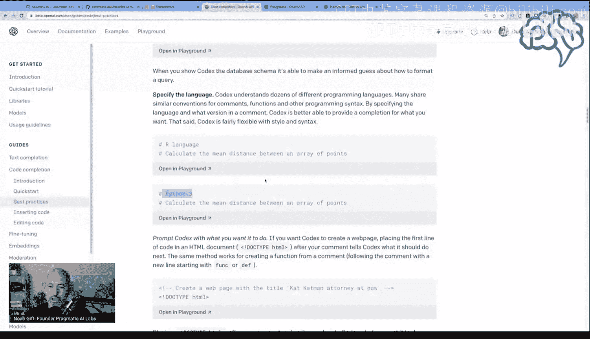

And。We'll say example。😔，Oh。Big text。WillThis work。嗯。啊。To figure out a little prompt here。

Where you would do。I don't know。 Something like。Bad， I mean， I don't know， like you。

Does that help us？A language。Text。Language。Let's try， Okay， so I really don't know what this will do。

 but。Say， from。Solutions。Ports。A precode。From。Who a lib God solutions。够了。Now， I would say。Recode。

And' well， first， let's do language。O be。😔，超。😔，嗯。So the documentation real quick。Okay。

 there's a space。 So， so the language would be Python 3。In that。An next。Would be。

What they told me in the docks。To be that， but it would be。So see we do see this language。

So it does do a little space there， which I like that。So。So we don't need to do anything， actually。

So， texts。Would just be。Would just be this。The language。二 you啊。And so we would say， text would be。

And we don't even need that。Culate the mean distance between an array of points。So let's do that。

Say create code。It's cold。P， put in。Next。Eanguage。Re。Ooh， taking a while。H interestinging now。I mean。

 it appears to work。Now， how do you print Python code， though。

 that's the part that's that's kind of kind of kind of trippy。But I mean， I like it， I mean。

 it's a cool concept。Let's try this out。Let's build a。Python helper， like a Python tutorial。

So I'm going to say cut。Python tutor。Toer。See alive。AndSo what we can do。Is。

I don't going need to do much， we just need to import click。

And then we need to say from exact no but we need to import。Re code， so。

We need to do this import create code。😔，and。We can do this。 we can say createates。Click group。

Here we go。You can save this is。Generates。Code examples。Com。In multiple languages。

Which is pretty sweet。 So we going do this text language exactly so we we can say like。You know。嗯。

Take code。 Make code。And we'll do death。code， convert comments。😔。

And let's also do the Shiang line up here。User Ben Ev Python。まれ。Let' do if。Under name， there we go。

 perfect。Let's put an example here。叫醒么。And we can do dot slash。😔，There we go。Um。But I think we。

 we want to do this a little bit cleaner where we want to say。Instead of arguments。

I think we want options， we want options。And we want to do death。

Well let let's just even have it generator for us。At click。Options。Option。Eguage， there there we go。

 That's what I want。 And then we want to do。Yes， sure， we can do a language in text that looks good。

Like that， and then we can change our example here。Kit code dash L。Yeah， I like it。

This is looking good。This is a sweet little tool。 Now I need to clean up the printing a little bit。

 I'm sure it'll。嗯，呃。MK， let's， let's， I like， let's rename it。

 So let's say M the Python tutor to M K code。Yeah， I like I like that。 That's a cool。

 cool name for a tool。Really， oh， because it needs to be dotpyY。Yeah。I mean。OkayOkay code。Oh。

 because。Don't think we need a name。Just do this。嗯。It is not to。thought it just changed。你家咁面。

Why is it？ Why is it doing that。Did I not save it？嗯。Oice generates。不。Be good。😔，It's not going to。

 it's going to be。Maybe。抵く？佢。ButLet's make this one less confusing。Toightight。It could。Thenen。

 there you go。 That looks better。Once。What is this doing line 12。Oh。

 because I'm changing the wrong file。That's what I get。As I'm screw things up here。嗯。I was。

 I was changing。Let's get rid of this one， delete it。

And then this one will just be benefit or actually let's do nothing。In 플ous。

That's why I was having such weird problems。Option dash L。MK code。😔，My dash help we got。

 what have we got？Oh， I see。Are we still。we back to this again。And rate。

 it's weird in these weird scenarios。嗯。Take could。好的好的。At。

You can get stuck in these like feedback loops that are just awful。

That it takes a while to get through。 There we go。 There we go。Pretty cool， so。

It prints out like a little Python example for us。 Whoa， this is pretty sweet。 Look at this。

 I got a little Python Python generator tool。😊，That's pretty slick。 I like this。Now。

 if I want to try。A different language。 What do I do？Bvascripts。There we go， now。Yeah。

 that's not JavaScriptscript。That's Julia， so， so I don't know why。

And look at even as the author in there and stuff was like， what's but？

At least the Python one worked。Whi is pretty cool actually， that the Python one worked。

 so I'm going to track a couple more Python examples。

So I'm going to go through here and instead I'm going to say。UmAdd two numbers。

 which's just let's just keep it really simple。Add two numbers。There we go。But talk about overkill。

 I mean， sure， that works。 But like， what's all this other stuff。 I mean， it's， it's cool， though。

 I guess。It gives you。Like you could use something like this to to kind of give yourself suggestions。

For some kind of utility you're building to to tutor students or something like that。

 but but okay cool， I mean I got something working using their API and this is in beta but here we go。

Lest you make links。Does everything work？There we go got high quality code， let to get status。

 let's add all this in。And let's go ahead and adding in code Now the other thing that I have a little bit of time to fix potentially is let's。

 let's see if I can make a stringlit app。Now， next， and so。What I could do。Is I could I could say。

Touch。嗯。Let's see， code。Web app。code， code gen。WebWe app。

So I'm going to look at this other example that my friend wrote。mWho's the author of the GPT3 book。

 and I'm going to。Do this。I'm going to say open import streamlet。😔。

And I'm going to go to codegen here。😔，嗯。And I'm going to。Look at the Cammean tool。

 that's always a good way to。To to build things out。

Is to look at a commandion tool you created before。

 and you can just use that as the basis of a web app。Here go， that looks good。

And look even it's even going to tell me the right。Goverver a comment of code into any language。

 I'm liking it。There we go。啊。There we go。Wow， is it really going to write it for me。Oh。

I'm liking this。啊，这样。8。What else do I need to do？it's kind of getting a little bit stuck。

 but it gave me some good good ideas。 let's see how this did this before so。So we can cash。This。

I don't care about that。But I want something like this。Let's take a look at this。

 what have we got submit？I see outputs in progress。😔，Reports。Smit question in progress。😔，If。😔。

If SD budget， let's， let's trend。This oh it， create code， ST writes。

I don't think I need anything else。 I think this is it。Otras is not a lot of code。Import streamlight。

Unable to import streamlight， What do you mean， No， you should be able to import it。Okay。

 so let's let's say Python code gen web app。 So did we build。Oh， you do that， is that how you run it？

Ooh， that was easy。

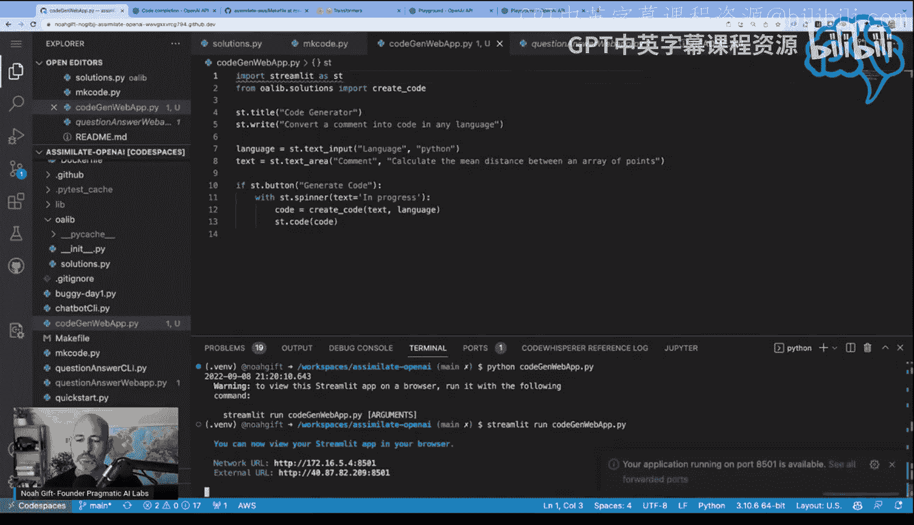

So it's taking a little bit of time。 I don't know why it's。

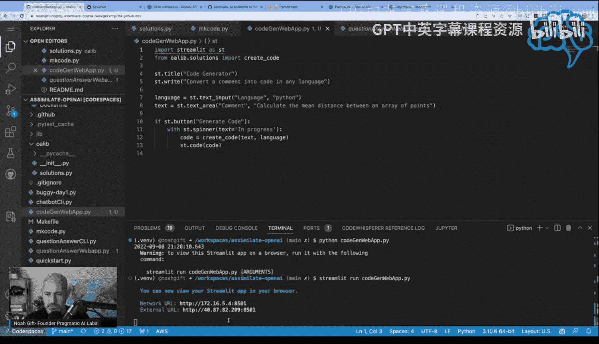

That's external。Taking， taking time， taking time， taking time。

Hm。Let's look at the other answer。 What did I have here。啊啊等真真真等等真。😔。

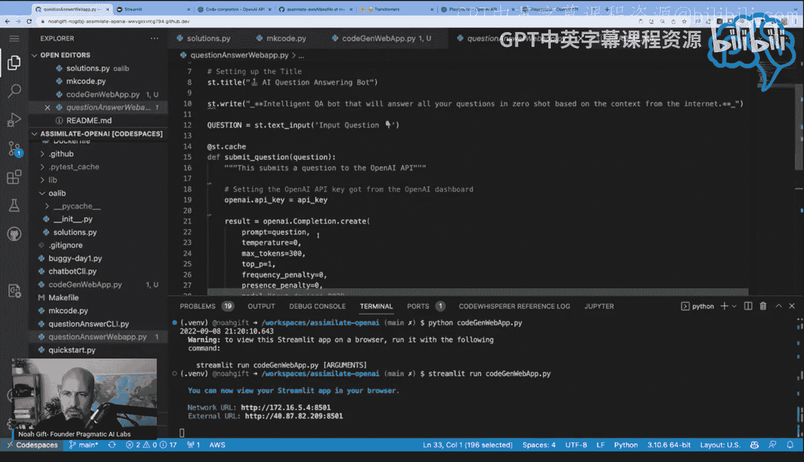

The caching seemed things kind of a cool idea， though。

But this is just not taking taking too long。 let's try again。Oh why。

Lll view streamlin in your browser。😔。

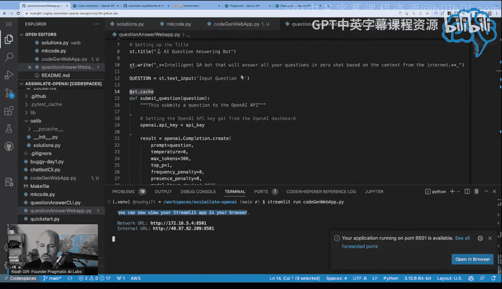

Let's look at the documentation for a streamlit。Docks。Getting started。All this weird stuff。Oh， man。

 people have all kinds of。Sure。Streamlet， oh， then you say streamlet run。The main concepts。Oh。

 I guess you can do that， but。Why are you taking so long。

 That's the question is why are you taking so long？

So what I can do to debug this thing。As I'm going to run the other one。

Which I know it worked at one point， so we can say Python or we can say streamlit。嗯。

Code or question answer web app。How does that work？

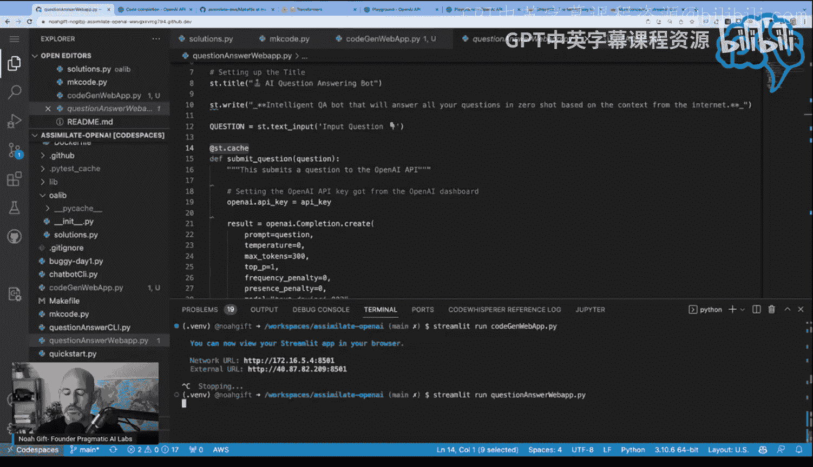

Let's spread that one。That one's waiting。Yeah嗯。Please， wait。But was Google ad。

Let's Google that streamlit。Please wait。The app never loads。Is the oh。

 if you see the most likely Copa is stream up， oh， I see。To you streamlit。Okay， well。嗯。

Server enables cores false。😔。

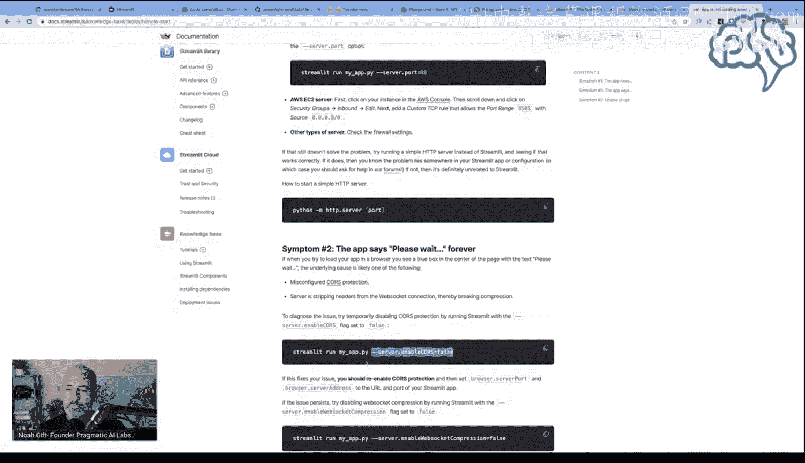

Okay， I like this。 It's， I bet you's that it's something like that。

 So it's probably like some kind of weird security bug。 So let's do that and we'll say。

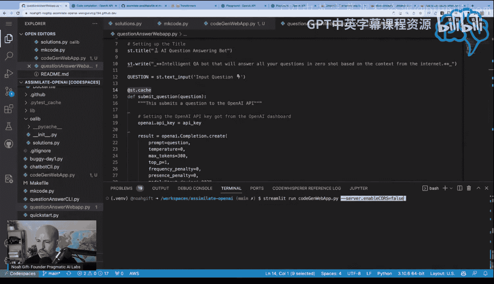

No course， no course。No。Aha， look at this code generator。Look at this。 we're。

We're cooking with gas now。 Pre cool。 Look， the author of this function is this person。Thanks。

 thanks， man。 All right。 So if I want to go and I change a language to。SQL。Lo say， creates a。这哋诶试个。😔。

Very。To。Return random fruit。Let's see what it does。Boh， look at this select star from fruits。

Create a SQL I query， look at all this Oracle MysQL。Awesome stuff， look at this， this is great。

Cool coolol stuff here。 So I've got to now a code generator web app， not not bad。 Okay。

 so I'm going to go ahead and say get status。😊。

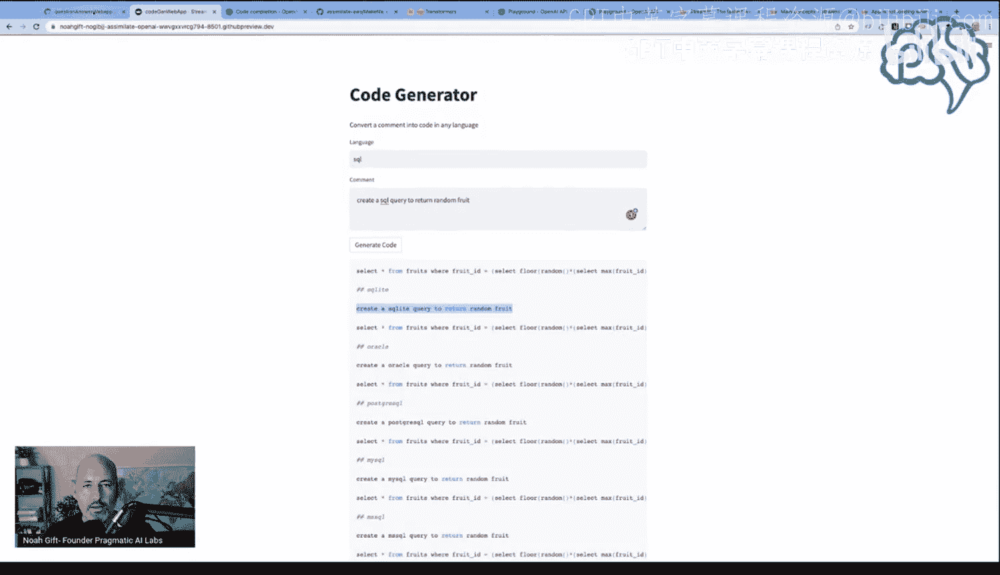

T this in。I got my little web app。Hooked up， adding working。Code generator。Web app。Or open AI。Yeah。

 really pretty， pretty awesome progress actually when you're using。😊。

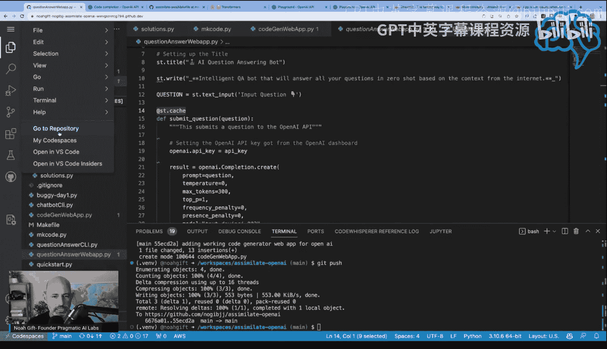

Libraries that are this powerful。 It's pretty shocking。 actually， what you can build。 Now。

 does my build system actually work， W， I'm shocked that my build system works， I'm truly shocked。

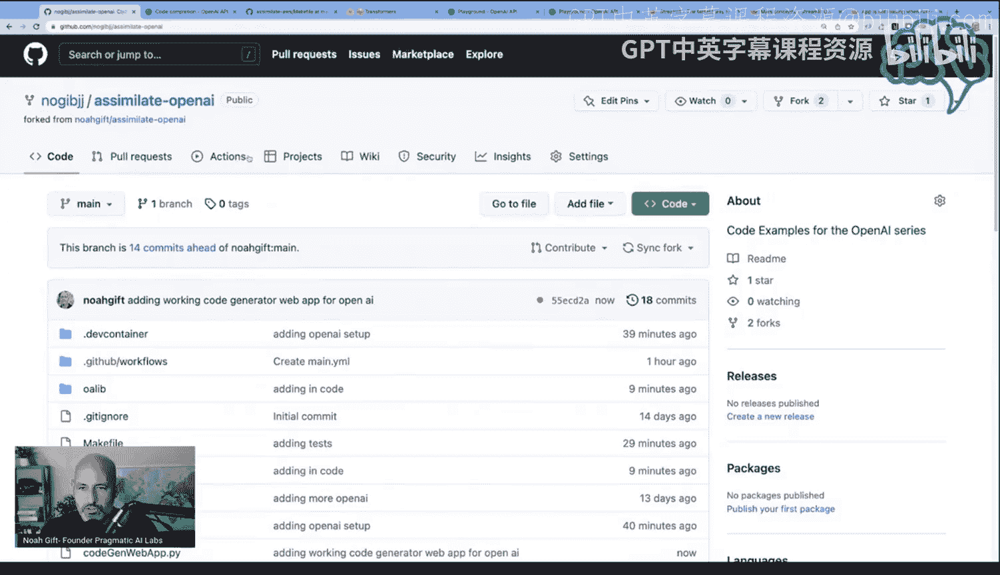

I always assume， malice。

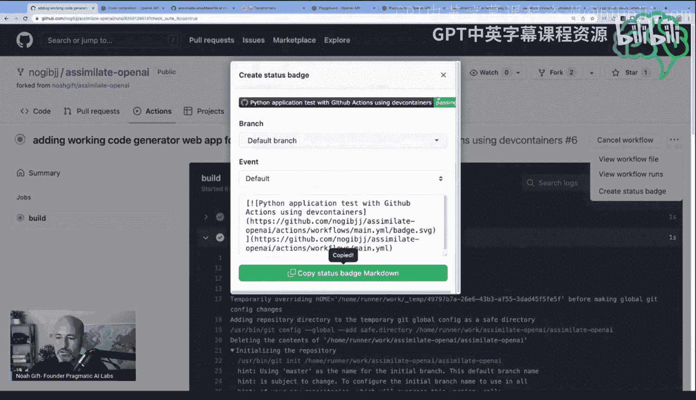

And that I've created mass chaos， but there we go， and I also and built。F。T6。App。That generates code。

So yeah， I'm making some great progress here with Open AI。There we go。

Thank you to anybody that's shut up and I'll see you next week。

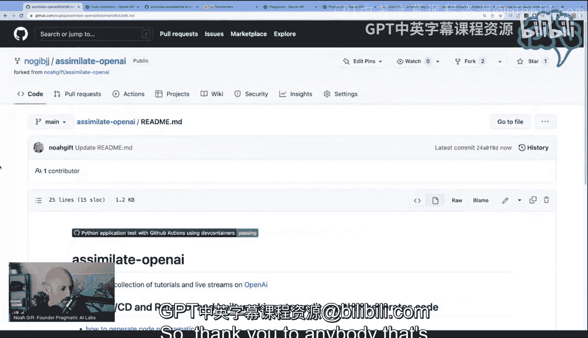