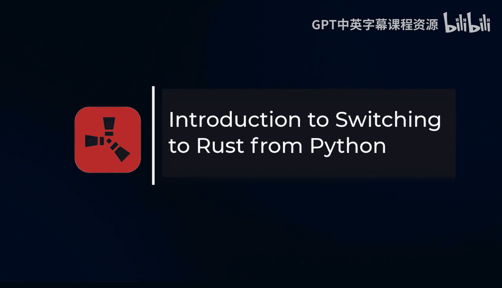

# 杜克大学｜机器学习运维｜DevOps⧸DataOps、Azure、MLFlow和抱脸｜MLOps ｜ Machine Learning Operations p53 60_05_02_Python转Rust入门.zh_en -BV1yE421c7uA_p53-

Hi， my name is Noah Gift， and I'm a frequent O'reilly author I've written several books for O'reilly。

 and I also teach cloud computing， data engineering， machine learning operations at Duke University。

 And my area of focus is really how to make machine learning operations。

 DevOs cloud computing as efficient and as productive as possible。

 And that's why this series on switching to rust from Python is such a fun and also rewarding series to do。

 So this series is going to be based on a lot of the work I'm currently doing。

 describing some of the things you can do with rust。 But from a high level。

 let me describe why I think rust is the future。 and why you should at least give it a try。

 if you're a Python programmer。 So to start out with one of the big advantages of rust is that it was built recently。

 unlike other languages that have been around for let's say decades and decades and decades。

 Ru has the advantage of learning from the best practices of those other languages。😊，In particular。

 packaging is probably the number one advantage of rust。When you use the cargobased system。

 you'll immediately realize how powerful， useful and actually a breath of fresh air it is。

 So if you're struggling with packaging and python or packaging in another language you're gonna be right at home with this series using the rust packaging。

 The other one is performance in terms of rust performance it's at really the fastest level that you can think of C plus level performance energy efficiency as well C plus plus level energy efficiency And so if you do need to really take advantage of cost savings。

 energy efficiency rust is gonna to be the great language for you Another one is the concurrency So Python has some legacy issues with the global interpreter lock and that you can't do multithreaded programming that uses all the cores and this is really a challenge for Python programmers because threaded programming can be more memory efficiency and with rust you get it by the。

Fult just a few lines of code。 you can spin up a bunch of threads in a threadpo。

 and also the compiler will protect you from a lot of the problems that can occur with multithreaded programming。

 And that leads me to the next point， which is safety。 So rust is one of the safest。

 most secure languages。 It's really been designed to be a systems programming language。

 And so a lot of the safety features in terms of cybersecurity are baked into the language。

 And that's why the Linux kernel is adopting some rust。 You see this with Google。

 they're adopting some rust。 So really the years you know2023 and beyond you're going see just a wild adoption of people wanted to use rust。

 the last thing I'll say why Ru is so awesome is that if you have a Python script and you want to give it to somebody that's nontenical。

 let's say your grandpa or grandma。😊，And he tell him， hey， here's my Python code。

Even if they have a little bit of technical background。

 they're going struggle with how to run your script with a rust binary by default。

 As soon as you compile the package， you can put that into a directory somewhere and they can run it。

 So really the delivery of binary executables from rust is a huge win that I think many people will take advantage of。

 And the last thing I'll say is that we're in a new era of using AI assistance。

 And what happens with Github Copit in particular， which I'm going to heavily cover in this course is that Github Copit adds an amazing way to develop code And all the skills you already have from Python Linting formatting。

 testing your code it directly allows you to use coppit to get up to speed with rust。

 And that's one of the things I'm going to demonstrate in this course。 So in a nutshell。

 even if you're kind of scared of rust and the syntax seems a little bit strange。

 I'm going to gently walk you through how to become a rust program ifre。😊。

Python programmer and really get this 10 x skill that can take your company， your organization。

 your personal hobby projects to the next level。 Okay， let's go ahead and get started。

