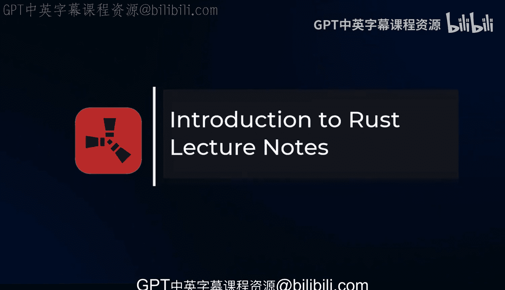
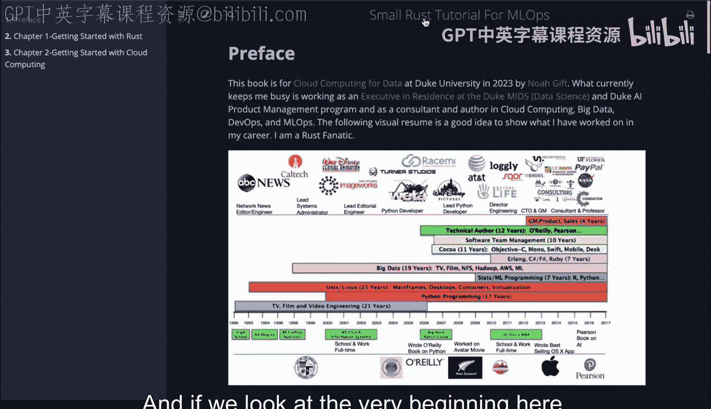
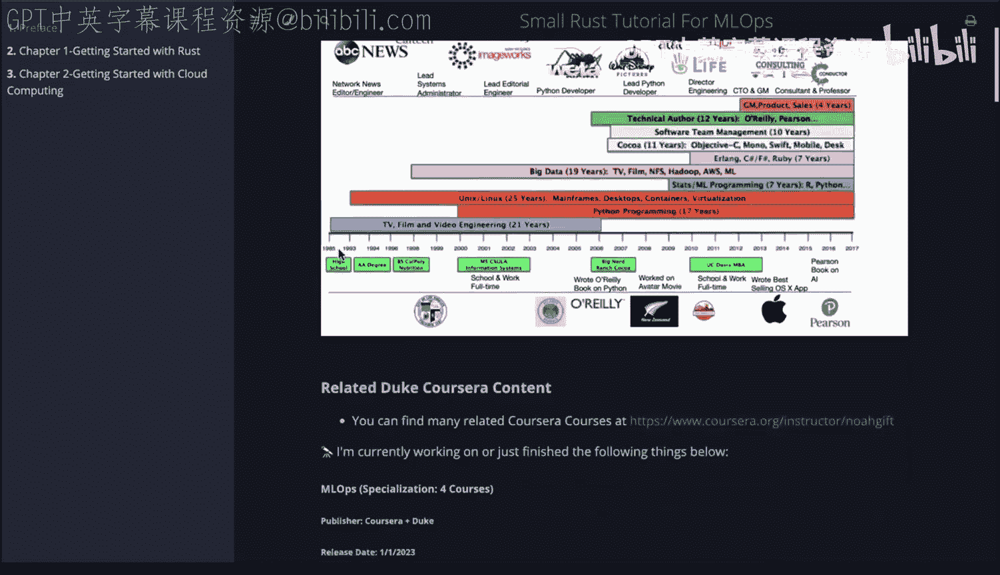
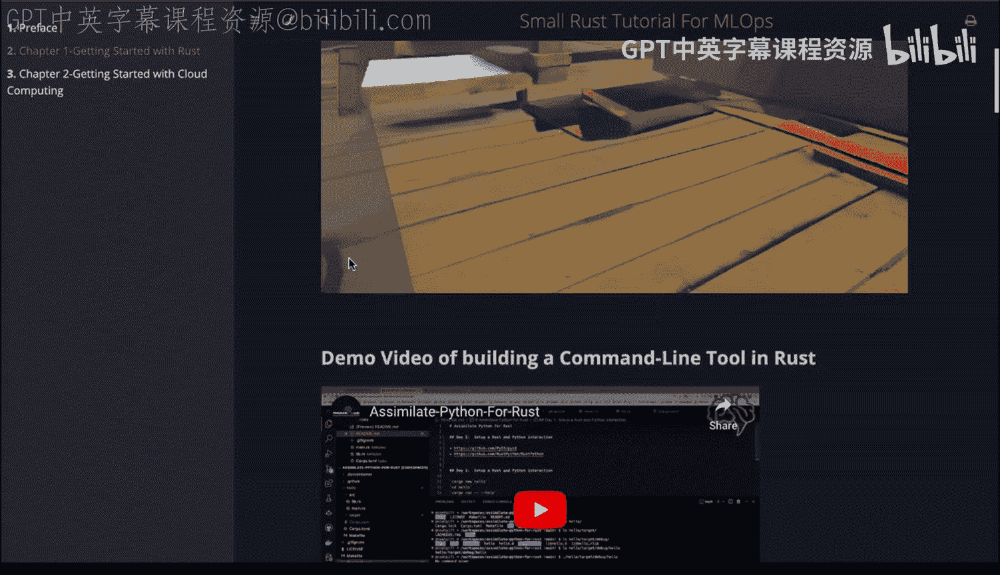
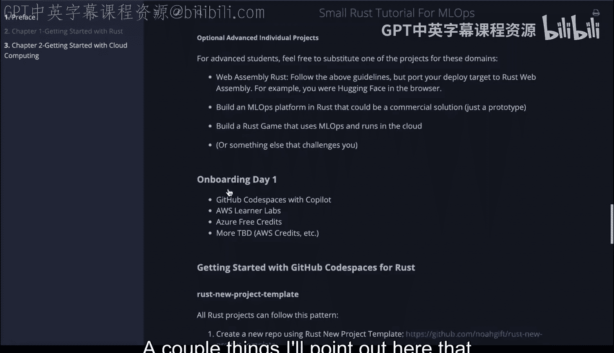
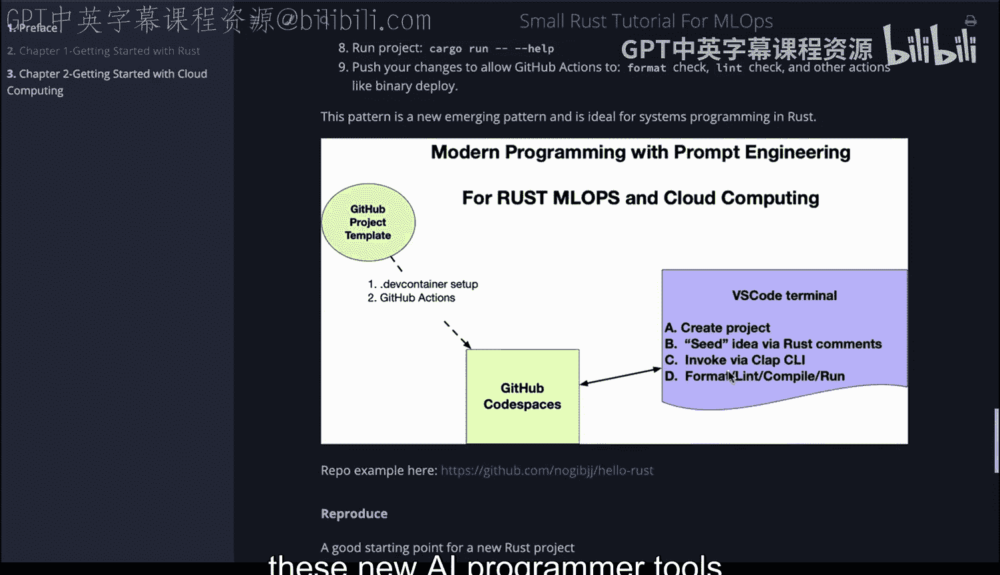
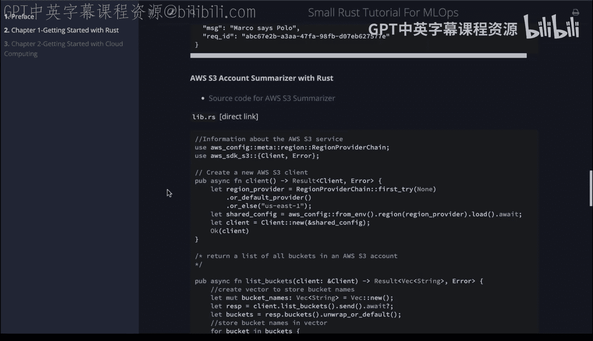

# 杜克大学｜机器学习运维｜DevOps⧸DataOps、Azure、MLFlow和抱脸｜MLOps ｜ Machine Learning Operations p54 61_05_03_Rust讲义笔记介绍.zh_en -BV1yE421c7uA_p54-

Here we have a rust book which is used with Markdown。 It's called Ru Mbook。

 and I'm using it to keep track of many of the lectures that I'm going to go over in this course。

 you can take a look at this here， I have the preface chapter 1 chapter 2 and it's at the URL in Gjj Githubo rustt tutorial。

 And if we look at the very beginning here， you can see the preface。

 my background I've got a lot of experience in building systems and you can see some additional content as well。

 But let's go ahead and start with chapter 1， and I'll just briefly talk about the content。

 And then later in additional lessons we' get into the details。 But really at the very beginning。

 the idea here is that you can go through some of these demos take a look at some of the curriculum that a graduate program would take and then finally learn how to build your own portfolio with the rust technology a couple things I'll point out here that I think are interesting in is when you first start out with。

The modern programming with prompt engineering workflow is really a game changer in 2023 and in particular。

 rust for MLOs and cloud computing， the idea is you start off with Github with a project template and I have one in my repo that I'll share later and what's nice about this is that you can use codespaces to configure a great environment that's got rust preinstalled。

 and then the idea is you create your project， you seed ideas by putting a comment in the rust language。

 it gives you a suggestion you then go through and build out your commandlan tool and this format Lint compile run cyclee is what helps control the prompt and really harness it to the ability that you want to build out a tool So this is really the secret is the traditional tools plus coppit and these new AI programr tools and here's a good example startup project if I want to run a Marco Polo commandlan tool。

Here we can go through and run the cargo command and actually make。

A project that's able to do this where I put in the word Marco and it returns back the word polo。

 You can see the code is quite simple。 And if you're familiar with Python here。

 there's not much difference， really， other than the word pub here shows that this function is exposed to another module and know the function name is fairly similar to Python and then you have to declare your types。

 but in Python， we know that you can do optional typing。 And so this is really a format。

 I think this's pretty intuitive right， you do a conditional statement that says if name is equal to Marco return Polo Likewise in the main right here。

 we use a command line library that is in many cases similar to let's say arg parse or some some other similar Python command line tool library and we actually use it to parse argument。

 So it's very simple to get started with building commandlan tools。

 and that's what my recommendation would be is to go through and build command line tools。

 you can again refer to this tutorial and I can walk you through it。

Let's talk a little bit about some of the other chapters and there'll be more as this series progresses。

 I want to get this information out as quickly as possible。

 So that's why I'm sharing it in a rough draft format。 but in general here， if you scroll down here。

 one of the things that you can do as well as you can build AWS Cammeian tools。

 So this is an example of how to deploy Lambda right inside of AWS and it's actually quite simple。

 here's again a Marco Polo Lambda function and if you scroll down and we look at the bottom here。

 you could also build a Cammeleian tool that interacts with AWS and you can see here again。

 not a lot of code pretty intuitive， if you're a Python programmer。

 don't worry you you'll be just at home with using this technology。 So that's really the preview。

 take a look at this information， you'll see frequent updates to this series and stay tuned and I'm really excited to teach you this material。

