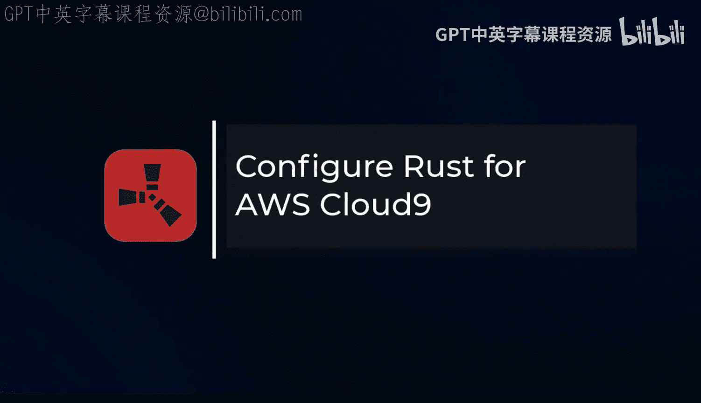
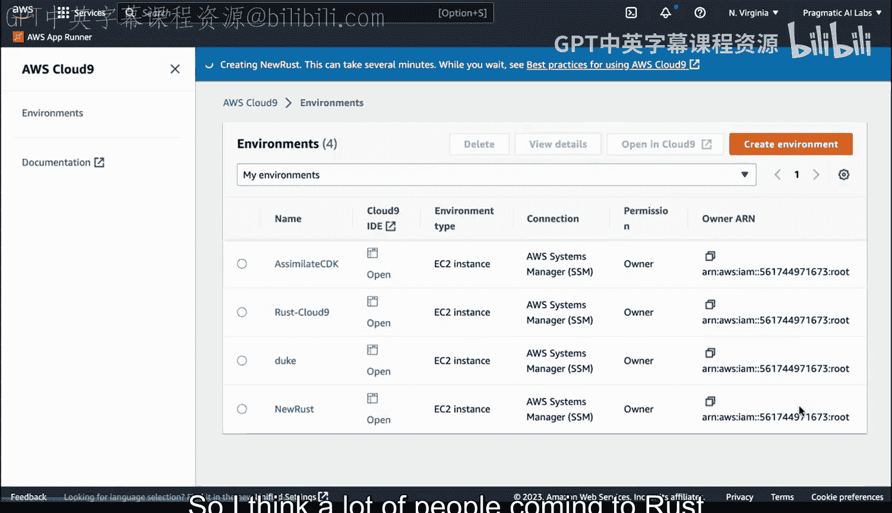
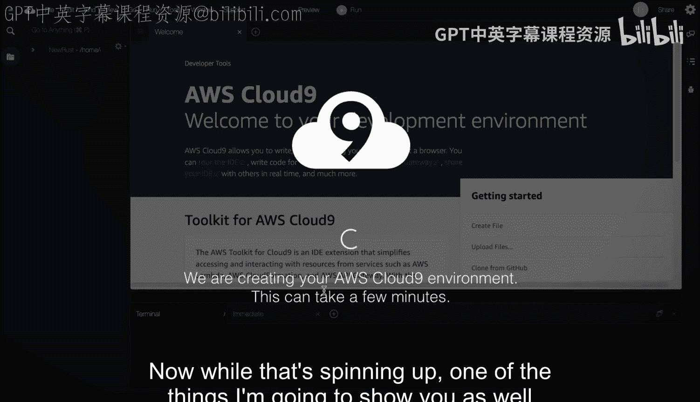
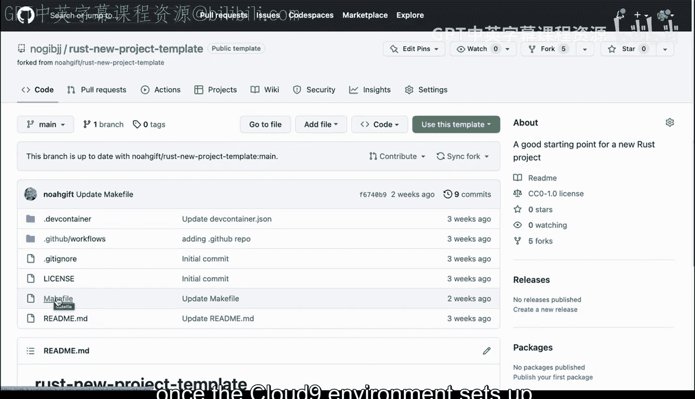
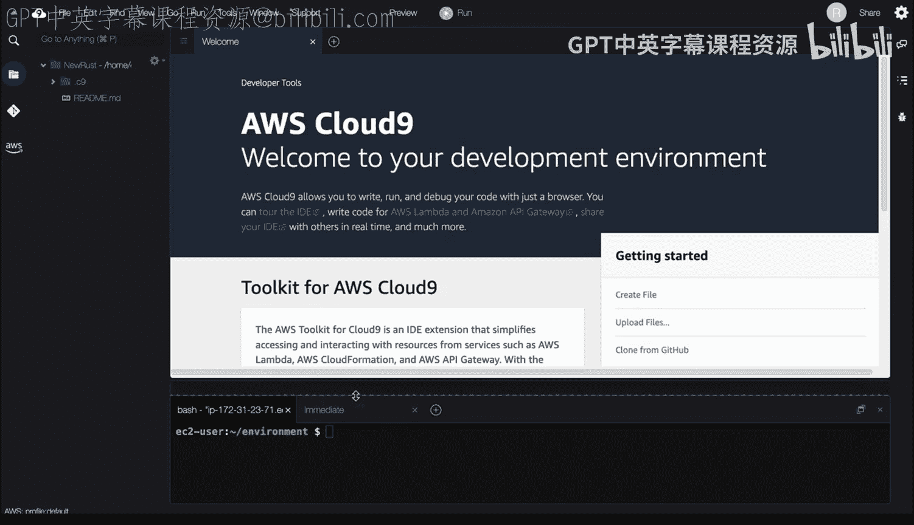
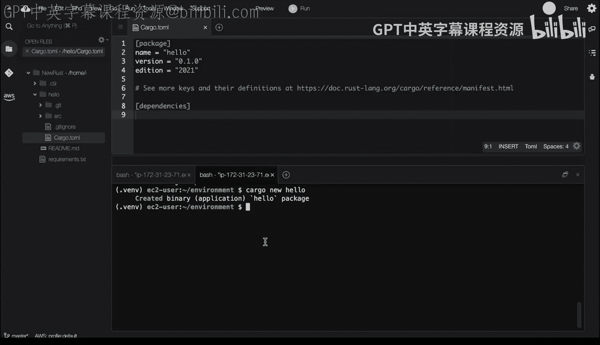
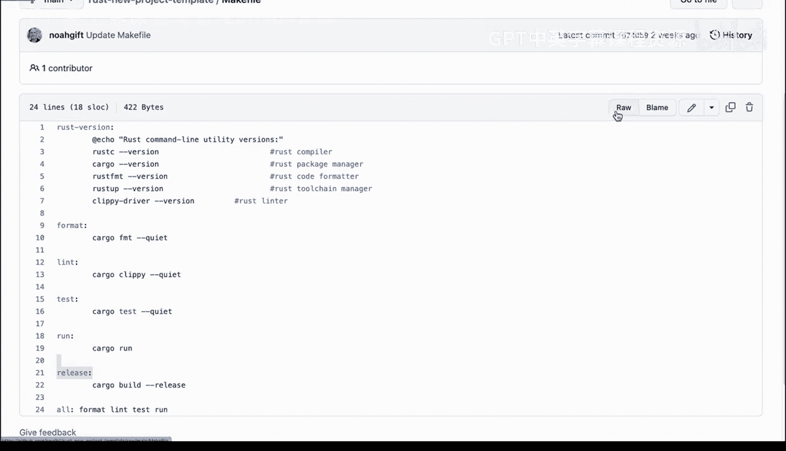
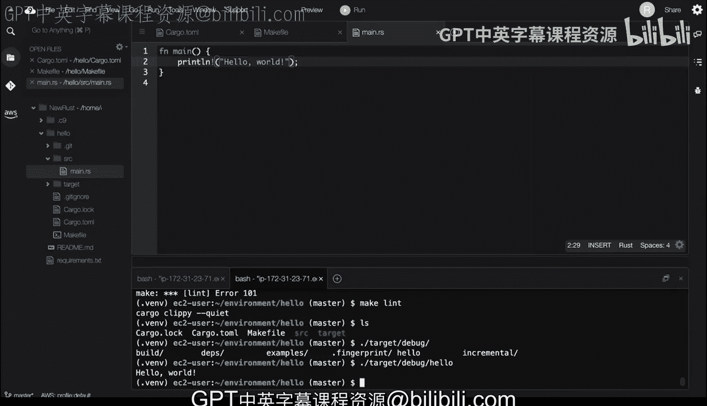

# 杜克大学｜机器学习运维｜DevOps⧸DataOps、Azure、MLFlow和抱脸｜MLOps ｜ Machine Learning Operations p55 62_05_04_为AWS-Cloud9配置Rust环境.zh_en -BV1yE421c7uA_p55-

Let's go ahead and talk about RE up， which is an installer for the systems programming language R really it's actually one of the most easy ways to get started with any language I've ever experienced。

 it's a one liner and I'm going to go ahead and use that to set up AWS Cloud9 let's go ahead and get in here I'm going to say create new environment。

Now for a Python programmer who has been using a cloud9 environment。

 really in many ways this will be much easier， what I'm going to do is compare it though to a Python programmer's experience。

 so let's go ahead and say new rust。Here and I'll go ahead and say large instance。

 here I'll just say， you know I'm gonna compare Python in rust。 there we go。

 So I think a lot of people coming to rust are going be coming to it from Python and I think this will be a good experience to show a little bit of what you would have to do to set up Python initially what is what I would typically do myself。

 what are some of the tools and then how we can compare it to rust and how it's actually a much simpler and more straightforward process to set up things for rust。

 Now while that's spinning up one of the things I'm going to show you as well is that I have a new project template for rust here and so I'm going to borrow some of the concepts of this project but if you needed to create your own project where it was able to be automatically tested and it's got a nice makefi set up for you you could actually fork this when you wanted to create a new project or even say use this template。

 that's one of the really cool things about Github code spaces。

Another cloud based development environment。 And in fact， if I go ahead and I select codespaces。

 right， I could just spin up an environment because I've done all the hard work and configured this environment for you。

 But we're not going to do that right now， all I'm going to do is copy this make file once the cloud 9 environment sets up。

 So if I go back here。

We can see it's spun up here。 And first let me show you what I would do in a Python environment。

 Now one of the downsides of Python is that it's a recommended practice to create a virtual environment。

 the two most popular our virtual environment which is built into the Python language and in fact most software engineers lean towards the virtual environment that's built into Python and there are more data scientists that are using potentially other tools like Hoda So let's go ahead and use the built-in virtual environment So we can see here Python 3m V and V and if I go ahead and I put this into the virtual environment directory and my home directory This is a reasonable practice right so I go ahead and I do that then what I would typically do is I would edit my BshRC right so this is a little bit of a tax right I mean it's not horrible but it's not great。

 I'd always have to do this for a new environment， which is one of the things that's a bit of a pain。

Python， but let's go ahead and do it， let's just say source tilde dot V E and V bin activate now。

Active。 Now one of the nice things， though， I guess is as soon as I've done this or， you know。

 we can just create a new environment here。 if I just say a new terminal。 look。

 it sources that virtual environment。 So that's okay， right， So that solves part of the problem。

 But we're still not done right if I'm going be developing for EWS。 What do I have to do use Bodo3。

 Well， let's try it out。 if I say import Bodo3， What happens， not install。 Okay。

 so now what do we do， Well， there's no structure， right， we have no config files， nothing。

 how do I actually install things， the documentation refers to Pip， It doesn't refer to Conda， right。

 there's no other tools。 So what do I have to do， Well， typically most people do this。

 They create a requirements again， the Python standard library doesn't create this for me。

 And then I have to actually go into the requirements file。

 and then I have to actually go in here and say Bodo 3 right And then。We're not done yet。

 I have to actually say Pip install dashR requirements。

 so what happens is that obviously you can use Python for packaging。

 I just did it and then if I type in the Python here and import import Bo3。Look， it works。

 But the tax， though， when when it adds up year after year after year， you realize like this。

 this is a lot of work。 So is there an alternative， Well， there is， let's try rust up。

 So I'm gonna go here， copy it， go ahead and just paste rust up。

 Now I just say return and it's trivial to install rust onto my system and it'll grab the La version and look what it's doing。

 it's puttinglinnts formatters， the packaging tool， the documentation tools。

 all of it is put in one tool and notice this， this tool cargo。It's automatically put into my ba C。

 I don't have to do anything。 And then if I wanted to create a new project， trivial。

 it's all created for me。 I say cargo new ho like that。 And guess what。 Now。

 I've got entire structure。That is ready for me to write code against。 And in fact， look at this。

 It already built a packaging system for me。 I would just add in my dependencies right here。

 So when people ask me， well， aren't they just kind of similar， no， they're not， actually。

 from the beginning， the rest ecosystem build out a production first mindset and allows you to build things so that you have binary based distributions now。

One of the things I would recommend is to use a make file to make your life a lot easier。

 So let's go ahead and do that real quick。 If I go back to this new project structure here。

 I have a make file and let's look at it。 I have some versioning stuff that just shows me what's going on。

 I allow my code to be formatted。 I can link my code， test my code， run my code。 release my code。

 All that stuff。 right， So let's go ahead and do that。 I'm going to go ahead and say。😊。

Rrab all this stuff in here， go back to my environment。 Let's go ahead and see D into hello。

 and we'll just say touch。Make file。Like that。 Let's throw that in there。And what's great。

 Let's make sure you change it to tabs here， which。Is always。

A good idea for make files or you'll have lots of problems。 But once we did this now。

 all I have to do is just say make run right now you can obviously run cargo run。

 But what I find is that it's nice to have a uniform structure when you're working with multiple languages like because I switch back and forth between tons of different languages and I like this style right。

 which is format my code， Li my code， test my code， run my code， I do the same thing for Python。

 So if I just say make run check this out， it compiles my project， hellello world。

 So basically hollowo world written for you And we take a look at the rust， nothing right。

 So it's not a very complex language。 Additionally。

 because I also do a lot of programming with with Copilot from Github。

 we can really work our way into programming with rust。

 So another thing we'll talk about too is if I go through here and I kind of mess up my code a little bit if I type in make format。

😊，Right， we also can format our code if I created some kind of a problem in my code and I type in。

 make Lnt， right， The Lier is going to go， hey， who， what are you doing， We can't do that， right？

 So even the Li is also your friends。 You have a huge。

A section of tools that help you be successful with rest。 And then finally， as I mentioned。

 from the very beginning。Right， we've got a production deploy。 right， So we have a target debug。

 And in fact， if I go to Ho。There we go right so in my opinion， for many MLlops type projects。

 gaining engineering projects， rust is a great substitute for Python。

 and this is one of many examples I'm going to show to people to get them excited about switching from Python to rust。

