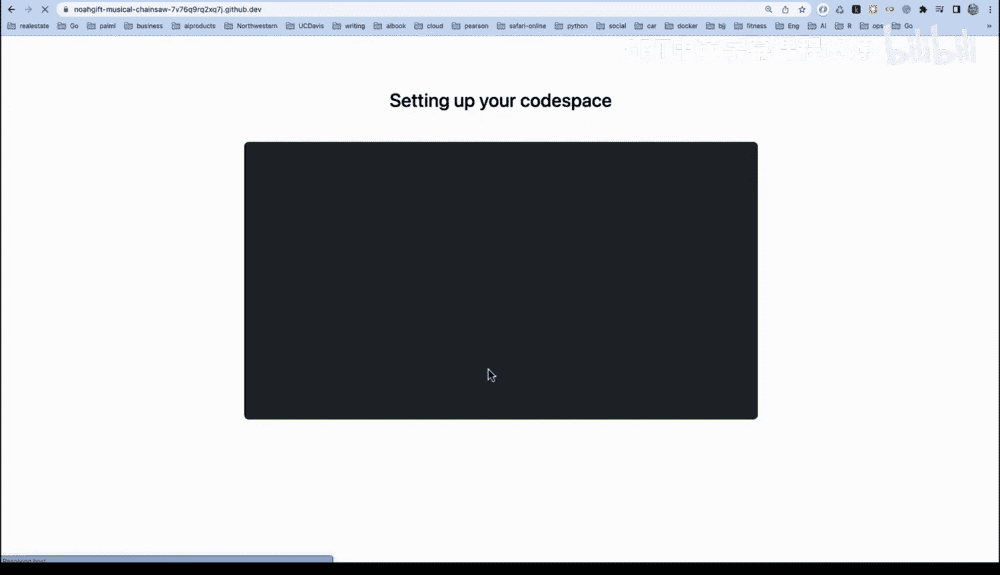
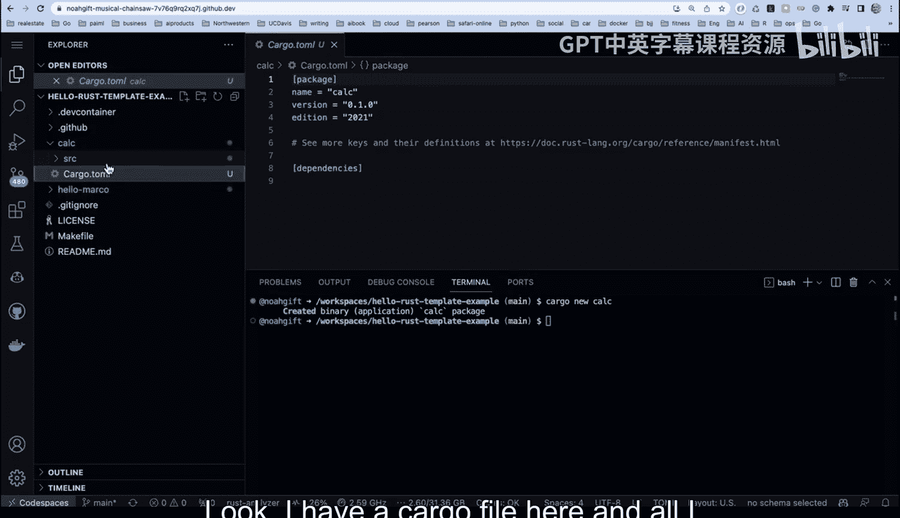
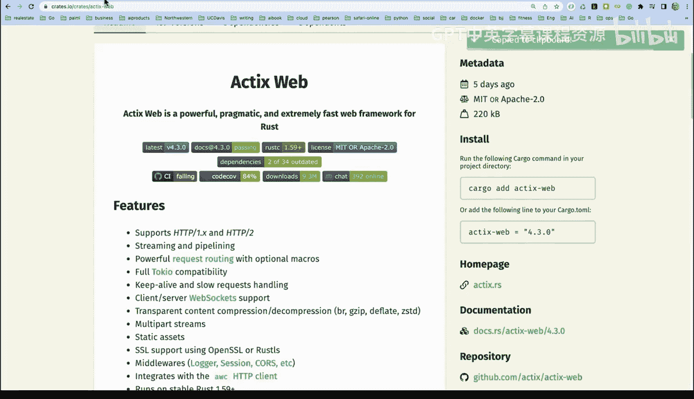
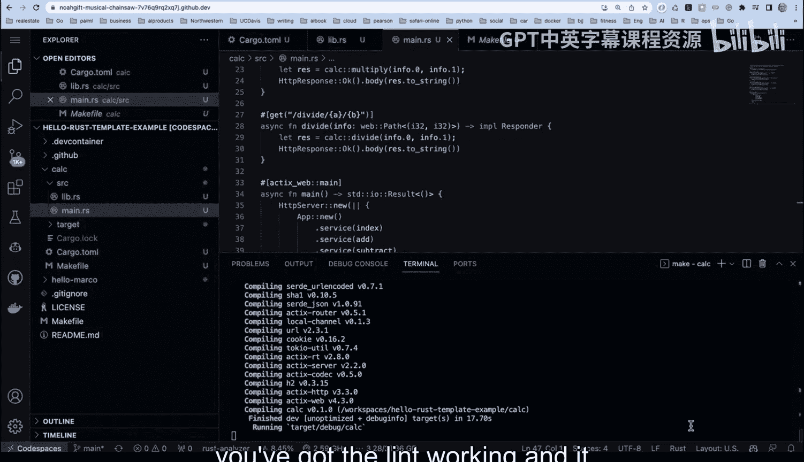
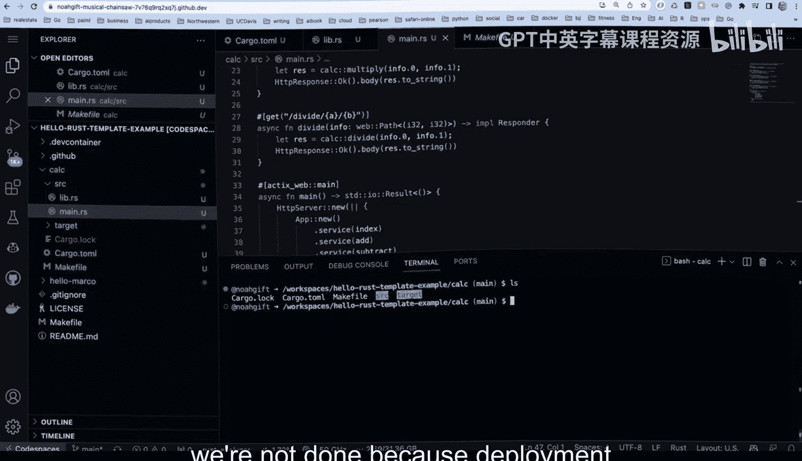
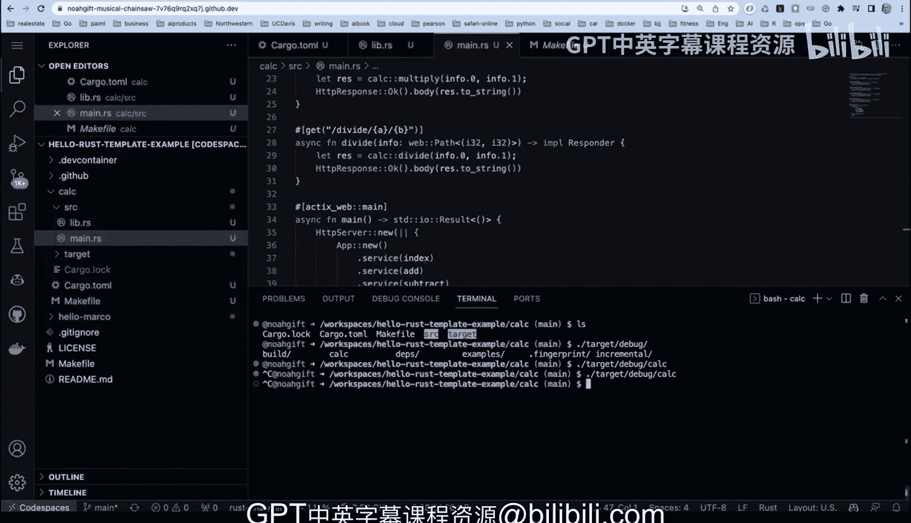

# 杜克大学｜机器学习运维｜DevOps⧸DataOps、Azure、MLFlow和抱脸｜MLOps ｜ Machine Learning Operations p57 64_05_06_使用Rust包管理进行Web开发.zh_en -BV1yE421c7uA_p57-

All right， let's go ahead and get started at leveling up from the Python packaging system。

 which has essentially many ways to do it， which is a pearl type quality。

 which is surprising since Python was a response to pearl and we're going to level up with cargo and what's nice about cargo and the crate system is that you can quickly get started with many utilities like building web microservices。

 building kmean tools， doing hugging phases， doing Pyth tours， using GPUs。

 all those capabilities are available with the rest ecosystem and it's very simple and many ways much more simple than Python and what we're going to do is use one of the world's fastest web frameworks whether it's fast this week or fast next week。

 it's kind of like if you're in a Cheevy Malibu and you drive a Lamborghini where Ferrari。

 which ones faster they're both fast it really doesn't matter which ones fast。

 but it's one of the fastest web frameworks ever created。

We're going to see how it's actually simple to install it。

 simple to build a microservice in rust and actually run it and even deploy it because the binary is created for us。

 Al right， let's go ahead and get started with leveling up with rust packaging。

One of the more troubling things about any library that you're going to use is you know is it going to be accessible in a way that's going to be a nice install path or is it going to be a really a struggle to get it working Fortunatelyly with the Ru Cate system。

 you can go to the community Cate registry and you can see here that there's tremendous growth here in the amount of crates or packages that are available and you can see here just a tremendous amount of downloads of fact。

 if we look at one of the areas of research that I've done is to look at some popular instrumentation around what are the libraries that are growing according to languages。

 we can see here that Python obviously has been doing exponential growth。

We see that Ruby is actually logarithmic， right， So we see that potentially it's going to go into a steady state or decline。

 But look at this。 We see that， in fact， cargo is maybe at the early stages of a massive exponential growth curve here。

 So there is traction that's happening。 In fact， you could even say that the exponential growth。

And the rust ecosystem is quicker than the exponential growth with Python so。

Let's go ahead and take a look at the crate system here。

 And if I wanted to use a web framework right a lot of people want to build microservices。

 One of the first thing I would do， I would go into here。

 take a look and you can see different web frameworks。

 And I think what people really would want to do is look at the downloads in recent downloads here。

 And you can see here， this is just a tremendous amount of of downloads here。 And so we can see here。

 this is a description acts web is a powerful pragmatic fast framework for rust。

 take a look at all this stuff。 and it's trivial。 If you just copy this。

 you can put it into your project， which is awesome。

 And if we look at one of the things that they they talk about here。

 in terms of the hellello world example， like trivial。 This looks just like flask or fast API here。

 So if we go back now to our gi up code spaces。 What I'm going to do is just quickly get a microservice running。

 So let's go ahead and go to code。 I'm going open up an existing。😊。

Cspace here and just get started。 cargo new。 and we're going gonna call this one Calc。 right。

 So I'm going to build a calculator based web service。 It's a nice way to kick the tires。 So again。

 what do I do， Look， I have a cargo file here。 And all I have to do is go back to this section and find the cargo2ml copy go over here and just throw it in there。

 It's trivial。 And notice that this ecosystem shows me exactly what versions of everything It's all done automatically for me。

 So now， we're almost ready to go。 All right， now all I have to do is touch a library file。

 So I'll go to source Lib Rs。😊。

All right， now that we got this library file here， let's go ahead and just add what we're going to do。

 We're going to say build calculator functions， right， And so we'll go through here and we'll say。

You know。Add two numbers。So we're going to first build that。There we go。

 So do I really need to know how to write this exactly perfectly， right， It' it's intuitive。

 My logic is clear here。 Let's go ahead and build out this function here and look。

 this exposes it to later the web service， right we want to make these public。 we can do ads。

 subtract multiply exactly， and then we also can do a divide， right， So this is。

 this is pretty intuitive， right， public， the functions and tax， the name of the function。

 these are the inputs and the types of those inputs， and this is actually the return value。 So very。

 very intuitive code here， This is almost like Python， looks slightly different。 So all right。

 now we have the main file， right， what we're gonna do is orchestrate all of the library code。 right。

 We're going to pull this in and call it and make a microservice。 And it's quite easy。

 So what do we do First up， let's go ahead and say， you know， web microservice。

For calculating the sum of。For calculating multiple types of operations。Of mathematical expression。

 is perfect。 And so now we would just go through here and we'd say use。

 and we would say active Acts web。 Now， one thing I want to add here， right。

 So the cop that isn't perfect is I want to do get methods as well。

 And then I'm going to go ahead and say get。 And I'm going to make a home page here that says how world。

And what's nice about this is I can actually riff on this a little bit。Let's say， you know。

 this is a。Calculator microservice， perfect。 Now， next up， we're going to say add exactly right。

 And I'm going to go through here and take a look。 and also it's not necessarily going to do exactly what I want。

 I might have to tweak this a little bit。 So I'm I'm going to tune it a little bit and say async function add。

And I'm going to say info right so I can make sure that I've got all of the right things here tied in and then this looks right。

 Yeah， so I have to tune it a little bit。 I have to tell it， hey。

 I want you to look at the right spot and do all this this stuff now this is not also what I want because what I want to do here is I want to use the library right so I have to watch it it can't it can't be you know left totally by itself。

 okay there we go， so let's go ahead and use the library that we build together and then from this particular example。

Let's actually recalculate。 and then we've got a good example。 So this， I believe。

 will let us build the rest quite easily。 There we go。 And let's see what it does。

 Is Copit smart enough to follow that same pattern。 Yep， now it's going start using the library。

 So this is key， right to iterate， iterate， iterate。 and I could even format， right。

 I could go through here and say make format code。 Look， there we go， we got that thing cooking。 Now。

 next step， let's go ahead and add a multiply right， And again， let's double check looks good。

 We're using the calculator library。😊，What else we're going to do divide。Looking good。 All right。

 So we're almost done now。 And what I'm going to need to do is obviously have a main method。

 Like every web framework and Python does that。 And look at this。 We got this thing all wired up。

 Those functions get added inside as a service。 And now I just need to go ahead and put in what it is that I care about in terms of you know。

 the the the host configuration。 So we're going to go 0，0，1。We're going to do 8080。

 We're actually going put both of these brackets here just to make sure it's nice and syntactically correct。

 do dot run and then do in a await because this is async super fastt framework let's go ahead and format it there we go。

 we format the code and now the magic Linting perfect right if it passes Lint very。

 very good chance that it run So we can just type in cargo run or we can do make run right because I've got that setup in the make file so let's go ahead and do you know make run here。

And if things go correctly。What will happen is it'll open this up inside of Github codespace's preview。

 and we can verify that everything is working successfully。

 And this is really one of the the great things about using rust is that once you've got the Li working and it compiles。

 you can be very confident。 There we go。 Heres Here's a microservice。 If we say addd 2 and 2。😊。

Binggo， we got four working， right， so this is this is quite impressive， you know how powerful it is。

 but we're not done。

Because deployment is already essentially done for us。 All right， Here we go。 Look at this。

 The binary that was created。 production first mindset is good to go。

 All I need to do is put in my route， add to and to bingo， we've got this working。 So in my opinion。

 again， this is one of the world's fastest web frameworks， trivial to build applications。

 super solid code because the cargo ecosystem。 And then it builds the binary where I just put the binary somewhere and I can run it。

 In my opinion， this is leveling up from the Python Web ecosystem。

