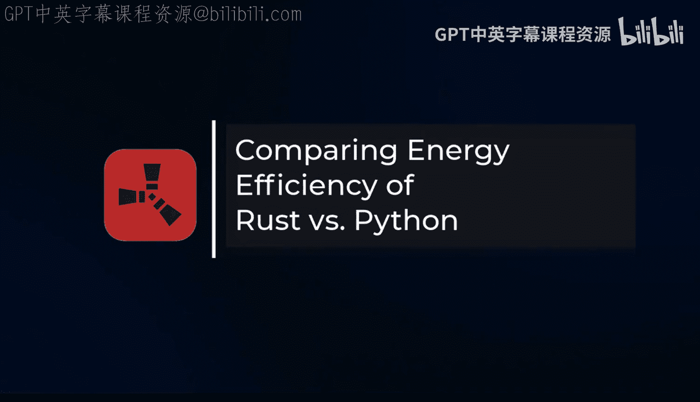
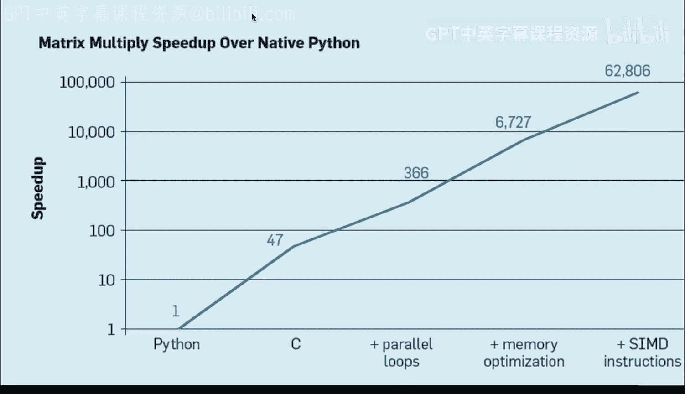
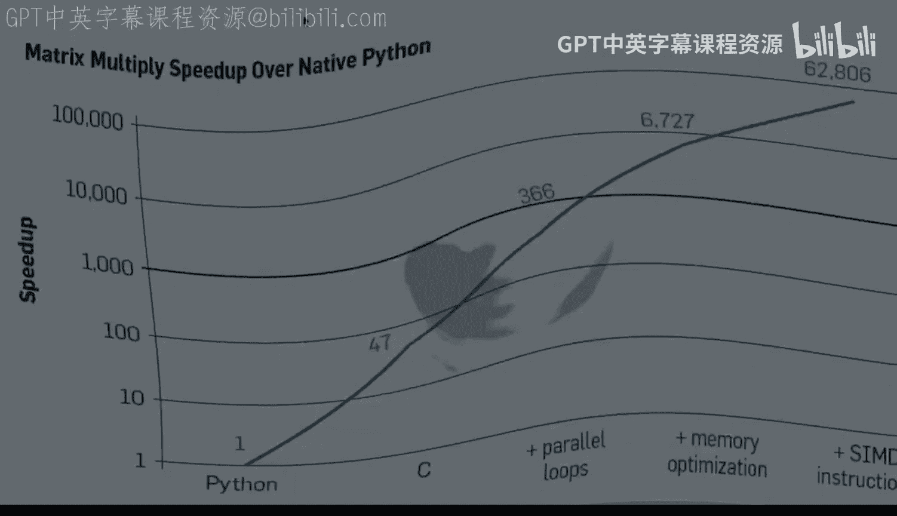

# 杜克大学｜机器学习运维｜DevOps⧸DataOps、Azure、MLFlow和抱脸｜MLOps ｜ Machine Learning Operations p58 65_05_07_Rust与Python能效对比.zh_en -BV1yE421c7uA_p58-

One of the things that is a common misunderstanding about switching from Python to rust is that hey it already works at Python。

 you know I don't want to rock the boat。 let's go ahead and stay with the language that I'm productive in。

 Well I'm going to show you a use case here where I do think many intelligent people should consider the energy efficiency of the Python language and in particular。

 I'm going to talk about two different things。 first a study that shows the energy and time comparison across languages and we're going to use C and rust really as the same thing they're basically in terms of energy efficiency。

 computational power effectively equivalent and we're also going to talk about Python in terms of where it ranks in terms of energy efficiency and also computational performance and I'm going talk about two different studies and I think what you're going to find out is that there isn't a really good reason in many scenarios to use Python for heavy computational loads。

Especially static loads where you're decializing JON back and forth like a web microservice and you should consider the carbon footprint of the code you're writing right we know definitively there is a problem happening on Earth we need to think about how we use our resources and if you can easily switch from one language to the other。

 especially with a tool like Copit， you should at least consider it and that's really the goal of this is to help you think about the problem of energy efficiency by the language you personally are using and to at least make an informed decision about what you want to do going forward All right。

 let's go ahead and get started。Here we have a very fascinating paper about ranking programming languages by energy efficiency。

 and you can see here that there's a lot of research into this area。

 and it's about comparing programming languages regarding the efficiency from an energetic。

Point of view。 And if we go ahead and get right down to the crux of it。

 you can see that the two most energy efficient languages。

 if we normalize for global results in different operations is going to be C and rust。

 So effectively they're equivalent， you can see that for all intents and purposes， if you say C。

 you say rust， they're about the same。 And then in terms of computational time as well。

 you can see the difference between C and rust are effectively the same。 Now。

 how does this compare to Python in particular， the most popular language on Earth， Well。

 we can see that， in fact， for all intents and purposes， Ruby。

 Python pearl are pretty close in terms of the energy they use and also pretty close in terms of the time they use so。

Basically， it's 70 times more energy is being used by Python。In equivalent interpreted languages。

Also， in terms of computational time， you can see here that it's about 70 times longer to do something in Python in terms of memory。

 there also are some issues in terms of Python here， you can see that if you compare it to rust。

 it's about double the memory usage and we're not even talking about multithreaded programming。

 which is something that Python is not able to do across multiple cores due to the global interpreter lock。

 and so people use multiprocess is dead， which is a memory intensive operation。 So in a nutshell。

 if you do care about energy， you do care about computational time。

 Python is one of the worst performing languages for both and from a sustainability perspective。

 this is something your organization should consider if it's easy to switch to rust， would you do it。

 And I think that's really one of the questions that organizations should ask。

 Now let's dive into another one that talks about。This this idea of computational performance。

Recently， I was at a talk from Dr David Patterson at Google。

 and he brought up this exact slide that talks about matrix multiplized speed up over native Python。

 and I was actually able to ask him a question about this slide and what he's mentioning here is that matrix multiplication。

 So depending on how you craft your code and what it is you're specifically doing could be 62000 times faster over native Python code。

 So really what we're seeing here is that。Python， in terms of computational performance。

 really isn't a great language to use and it's something that people should consider like what are the alternatives and can I do it。

 can my organization do it， can I use tools like copil it for example。

 to help me level up to a language like R and if we look at the syntax we can really see that rust isn't too different than Python and the gain you're going to get by really deeply considering speedup and deeply considering energy efficiency not only could it make an impact in terms of your budget you could maybe save 50。

70 times computational cost for a cloud provider but you also could be being thoughtful about the sustainability goals of your organization。

