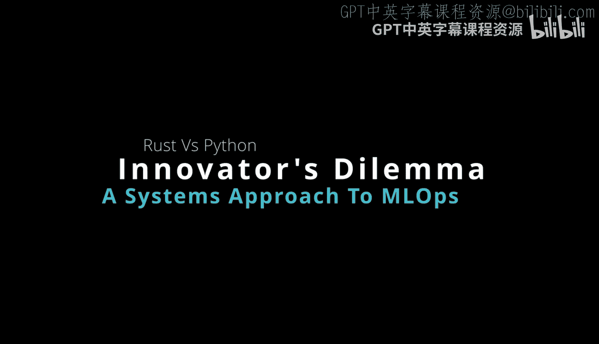

# 杜克大学｜机器学习运维｜DevOps⧸DataOps、Azure、MLFlow和抱脸｜MLOps ｜ Machine Learning Operations p59 66_05_08_Rust与Python在MLOps中的对比.zh_en -BV1yE421c7uA_p59-

Let's talk about a systems programming approach to MLOs。

 One of the things I hear a lot is a production first mindset。

 and I think it's a really great way to think about machine learning operations。

 In my opinion it's a systems programming problem First。

 let's define what systems programming is if you look at Linux for example。

 that's the classic systems programming problem where if you close a laptop。

 it'll automatically put your operating system to sleep and if you open it up。

 it'll resume these kind of lowlevel energy management type systems where performance is critical Likewise。

 with machine learning operations， performance is critical。 if you think about it。

 what we're doing when we're training machine learning models is we're taking giant data sets and giant computational farms and trying to squeeze as much as we can out of it。

 if you can't afford to spend 75 times more than your competitor。

 there's going to be a real problem if you're using a bad approach。 and that's really where。😊。

A language like rust and modern language comes into play and so let's talk a little bit about this concept of rust versus Python in a systems approach and I think first what I'll start off with is talk about the innovator's dilemma So this is a classic book from Clayton Christianen where he talks about how there's a paradox where at the very beginning。

 if you're the most innovative company。

Because you're listening to your customers， you're unaware of the emerging competitor with a disruptive technology。

 And so if we look at Python， it's a wild success。 So if you look at Python， it's a wild success。

 no one can critique that Python hasn't been successful。

 It's the number one programming language in terms of adoption。

 But just like with the innovator's dilemma， we can see some new disruptive technologies taking place。

 And in particular， this sports fan type mindset of we're number one， we're number one。

 I think isn't the right approach when you're thinking about trying to find the best solution for the problem at hand。

 in particular， with Python， what is it amazing API documentation you can't beat it in terms of readability。

 really， you can't beat it in terms of just really quickly doing some non computationally expensive operation like reading some stuff from a file and changing text and rewriting the file。

 like it's really an ideal solution。 But when we talk about the systems。

m problem I just discussed this with rust。 It's critical that we have high performance and it's critical that we have high performance inference as well。

 And one of the things that you may be asked to do if you're doing machine learning operations is to take let's say a hugging face pretrain model。

 package it together with a command line tool and then build a highper binary that is able to traverse millions in millions of documents and summarize those documents with the lowest cost possible that isn't an optimal solution for Python。

 Python isn't a language that's designed to do efficient multithted programming。

 So I think that's really one of the things to be very careful about is to look at what's important when you're dealing with the problem at hand。

 And so if we take a look at Python versus rust let's first start off with the energy efficiency。

 So Python uses the most energy of any language in relative terms plus or minus a couple rankings R uses the least energy of any。

ageRight in recent research。 What about binary deploy。

 Python doesn't have the concept of binary deploy。 It's not something that was designed to do。

 Rst has binary deploy by default。 Likewise， Python has batteries included for the standard library。

 but it doesn't have batteries included packaging。 There's many competing solutions from the Python packaging tools like virtual environment and Pip and Conda and poetry and etctera etc cetera。

 etc ce。 Rs， there's one solution。 The packaging is included Also。

 Python is one of the slowest languages in terms of computational speed。

 recent research has shown up to 70 times slower than rust R is one of the most efficient in terms of performance languages that exist。

 the other thing is software engineering productivity tools are not included with Python。

 So the Python interpreter is obviously super performant in terms of tryingout ideas。

 but it doesn't have a built-in format matter。 It doesn't have a builtin L。 It doesn'。

Have a built in compiler。 These tools do， though， come with rust。

 Rus includes all of these software performance productivity tools with the default installation in terms of threads。

 one of the things that Python。Has done is it's an amazing language。

 but it made some compromises 30 years ago。 And one of the things that it compromised was to lock because at the time。

 maybe compiler technology wasn't as sophisticated as it is today。

 and you cannot use multithreaded programming that uses all the cores。

 And now we have 10 core plus machines and that really is an issue with rust， it's trivial。

 And in fact， the compiler helps you create safe multithreaded code。

 So if you do need to do highper multithreaded programming rest is the solution that you should use and also it's very memory efficient in many scenarios。

 it's at least two times better and memory efficiency than Python。

 but in many cases even more if you use multiprocesing。 Also。

 the language safety in terms of Python is a bolt on。

 So it isn't the case that all of a sudden with Python you get safe typing and compiler and all those kinds of things。

 you can do some of those things。 but actually you have to bolt。right。

 you have to install some secondary package or the language itself wasn't designed to have strong typing。

 And you you can put those things on， but it's not designed for it。

 Rs is designed the original design of the language was for safety。

 It has an amazing typing system and has an amazing way of preventing memory leaks。😊。

That's really the design of the language。 Also Python again， It's a victim of its own success。

 wildly， wildly successful， just like Clayton Christiansson prophesized was that the leader because it's responding to customers and I think the classic thing I hear a lot of people say is that developer time is better spent than computational time that may have been the case before multicor machines before MLOs。

 but it is not the case today， In fact， sustainability is important and rust is designed as a modern language to be sustainable。

 Also a great example of systems programming is if it's in Linux is probably a systems programming approach。

 Python is not used to develop the Linux kernel rust is right so those are some of the main takeaways doesn't mean the Python's bad language is amazing language doesn't mean that Python's not an awesome success story。

 it is an awesome success story， but what was successful in the past doesn't。

Predict what is always successful in the future， and I believe rest is the correct language for MLOs。

