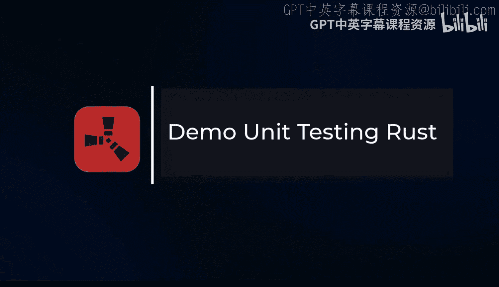
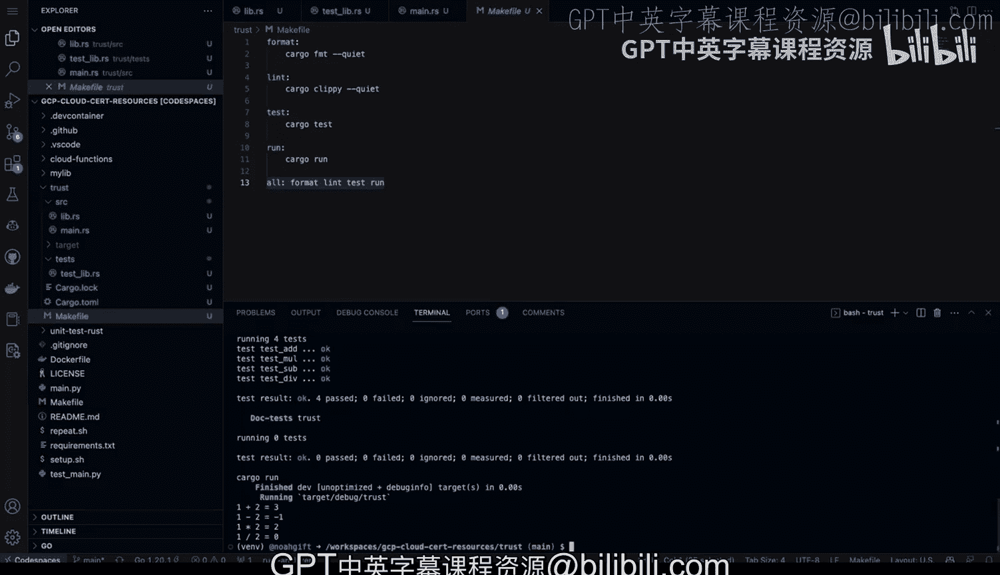

# 杜克大学｜机器学习运维｜DevOps⧸DataOps、Azure、MLFlow和抱脸｜MLOps ｜ Machine Learning Operations p61 68_05_10_Rust单元测试演示.zh_en -BV1yE421c7uA_p61-

Here we have a GiHub code space where I'm going to build out a unit test for a rust project to start out with first。

 I need to create a new rust project， so I'll type in cargo new。

 and we'll call this T rust as in test rust。Now， I'll go ahead and Cd into this directory。 Now。

 the the first thing to keep in mind here in this particular directory。

Is that I only have a main file to start with so I'm going to need to create a structure for my tests and also for my library code。

 So first up， what I'll do is I will make a directory called test。

And this is where I'm going to put in my test and I'm going to go ahead and create an empty test file there。

 So we'll say touch test and we'll call this testlib do Rs。 Also I'll need to create my library file。

 So I'll go ahead and say touch SRC lib Rs perfect。 And if I go through here and I refresh this。

 you'll see the new structure and in fact， I can also type in tree and you'll see the tree structure there as well。

 Now to start off with one of the easier things to do when you're when you're building it on a project is to build out something simple in a library。

 I think a calculator is probably a good one like add， subtract， divide those kinds of things。

 So let's go ahead and do that， I'll go ahead and do this math functions here。And we'll go ahead。

 and we'll say pub。Fn。And will to say， add。And in this particular scenario that looks about right。

 we had coppiot there， help us out， subtract， sure that looks good。

 multiply that looks good and also divide right so it's nice when you're able to get some help from coppit we'll go ahead and keep that and then in terms of the test now it's going to be pretty straightforward because of the fact that we've already got the library function created all we have to do now is go over to the test library。

And we can go ahead and say， test the SRC。Lib。Dot R S。 Now to do that， we do want to to import it。

 So in order to import it， we would just say use and we'll say tea rust。

 and we can actually go ahead and use。That library code to， to。

rite our tests and then we'll just put this macro here and we'll say test add that looks great and what's nice about things like Copit is that it works very well for a unit test generation and we can see here it's able to test everything。

We're pretty close here to being able to test this。

 What I would recommend next is to copy a file here that's a make file so that we can do things in a more of a repeatable way。

 so I'm going to go ahead and copy one that I've got from another project。

And we'll put it right here and let's go ahead and take a look at why a make fileile is helpful。

 What it does is it allows us to take the continuous integration test steps one by one here and allows us to run them in a very easy and repeatable way and later when we go into a built system。

 we can actually do the same thing。Let's go ahead and say make test here。

 if we go ahead and we say make test it's going to go through， compile the project。

 and then it will actually run the test suite and we say， oh， look， no lib in the root。 Great。

 So what we need to do is we need to change this。So that the test file is actually importing things。

How we could do this is we could just say use。And we could say tea rust。And we just say add。

Like that。And then we do the rest， subtract， multiply， and divide perfect。 Now， if I wanted to。

 I could also do make Lnt， which is nice because it'll run the Lter。

 And if the liter is able to be successful， it's usually a good sign。

 It means that you should be able to do things。 And we say， oh， look at this， we have Lib。

 we don't need that anymore because of the fact that we imported it in a different way。😊。

And this is really what's nice about doing unit testing is it clearly lets you figure out the interface for the code you're building。

 how to interact with the library， how to get past bugs， and here we go。

 we're able to see that it was able to pass all four of those tests。And so at this point。

 it's pretty close to being ready for doing continuous integration in a build server。

 the only thing that would be nice would be to go to the main file so that we can run it and let's just replace this and we can just say you know。

 runs our library。Like this。 And at this point， we would just want to build a small little main function that is able to build our code and we can just in that scenario。

 basically say FN， main。And in this case， though， we would want to use that library。

 So let's go ahead and do use the ad， use the subtract， use the multiplication。

 use the divide and actually tweak this a little bit。So that we call。

 we do something like a print here。 We can get rid of the printello world。

 but we basically invoke each of those functions。 Now we can li。Perfect。

 and we can say cargo run or make run either one。And there we go。

 So this is really the power of unit testing is it allows you to build a repeatable and reliable automation infrastructure。

 which you then can put into a build system， for example。

 Gitthub actions and then later build up a microservice on top of it that does continuous delivery and in fact。

 we can even follow this step right here， which does every single one of these components。

 we can just type in make all。So in a nutshell， it is very straightforward to unit test a rust project and take care of the quality as well by doinglinnttin and formatting and in fact。

 tie it all together with a make file。

