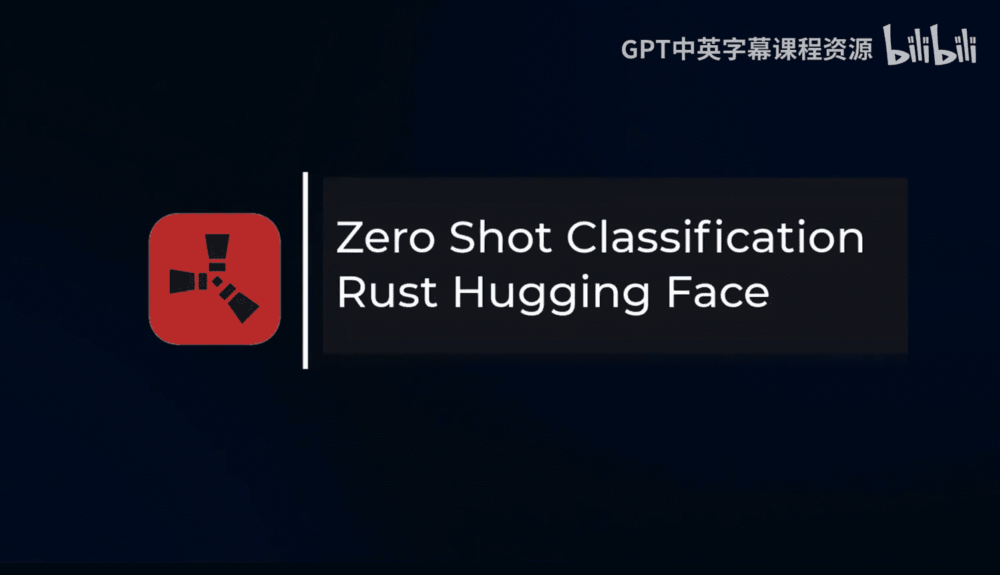
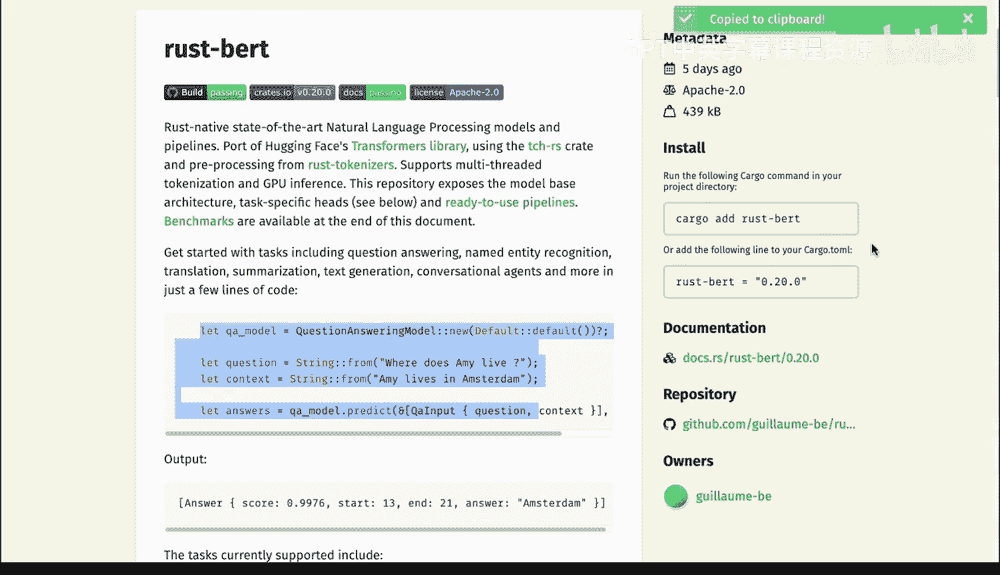
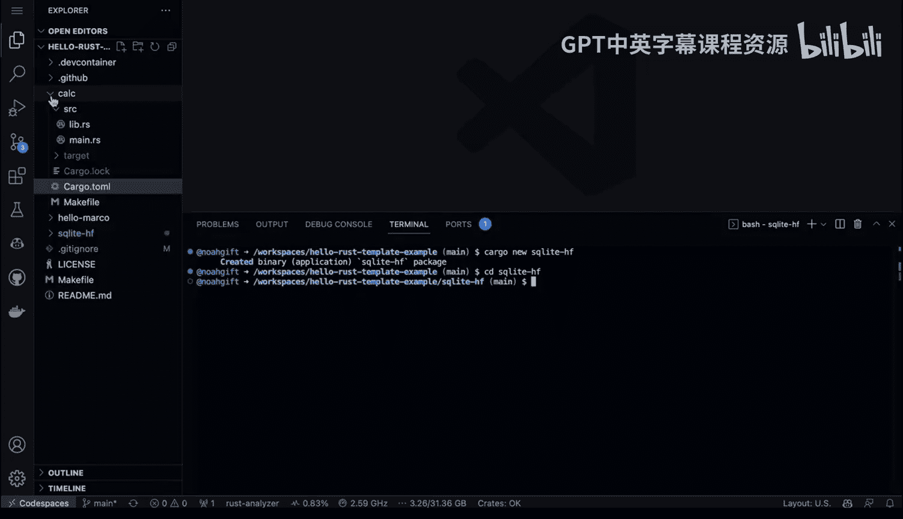
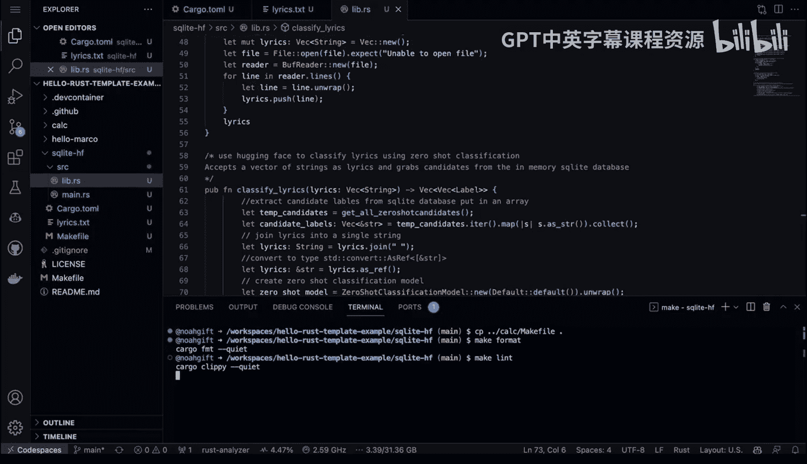
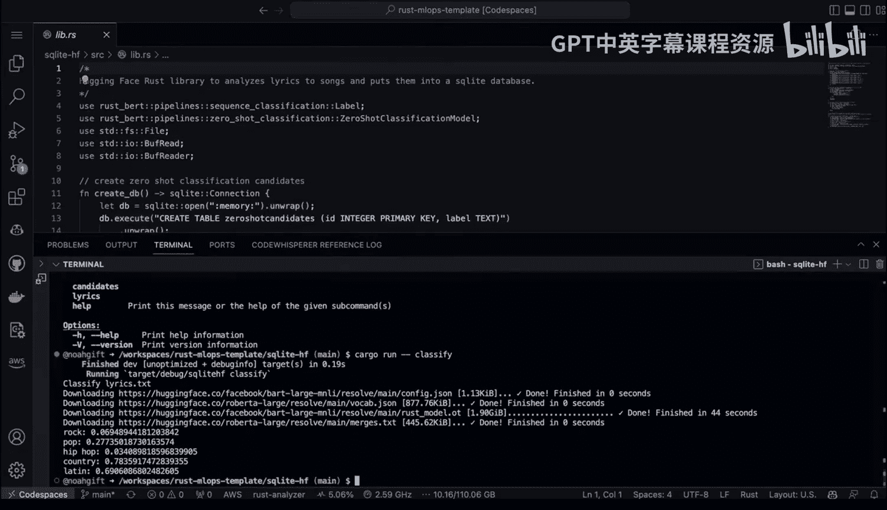

# 杜克大学｜机器学习运维｜DevOps⧸DataOps、Azure、MLFlow和抱脸｜MLOps ｜ Machine Learning Operations p63 70_05_02_Rust-Hugging-Face零样本分类.zh_en -BV1yE421c7uA_p63-

Let's talk about machine learning， machine learning operations， and also GPUs。

 One of the things that I teach at some of the top universities in the world， including Duke is MLOs。

 and what I'm personally excited about is taking machine learning models out of the notebooks where they're stuck and putting them into production。

 And so one of the things that's exciting about rust is it's the perfect language to do that。

 I've heard many people have some critiques about Rus versus Python where they talk about how Python is one of the leading languages for machine learning。

 Well， what I'm going to show you is， in fact， some of that can be debunked Rust is a amazing candidate for doing machine learning operations because it has bindings for some of the most popular things that you'd like to do。

 For example， Pytorch works in a trivial way with GPUs。 In fact。

 you can take advantage of the fact that rust can be up to 70 times faster for many operations like on average。

😊，You also can take advantage of the binary portability of rust when you build a project from the beginning its production first。

 So a lot of people talk about production first mindset with Python。 but wait。

 do you mean a model portability， Do you mean binary portability oftentimes they're saying something but the reality is it's a different scenario when you get into production。

 Rus is a production first mindset language because you can take a model package it into a binary and then push that into production。

 and that's really the advantage of using rust for things like hugging face。

 So what I'm going do now is I'm going to dive into a example of how to build a lyrics analyzer that talks to a SQL database using rust。

 and we're going to show how this can be combined into a chamean tool。 In fact。

 if a company wanted to get founded on this premise let's analyze lyrics they wanted to do this in an efficient way。

 Ru would be the ideal language versus Python because of the fact that。Uses less energy。

 it uses less computational time and also you can use multithated programming that takes advantage of all the core。

 So if you're gonna to analyze millions and millions of songs， for example。

 and you want to summarize them or do zero shot classification。

 You want to use a high performance language。 You don't want to use one of the slowest languages ever created。

 So that's really the idea here with rest is it's an amazing tool for high performance Mops。

 and I'm going to show you how to do with hugging face。 All right， let's go ahead and get started。

 let's take a look at what I would call the canonical example of why rest is so important for MLops。

 really MLops is about putting things in production。

 it doesn't matter if you train the model yourself or you're using another model。

 in this particular example， let's suppose that I'm a music company and I've got millions and millions of songs inside of my file storage system。

 and I want to use modern LLms to really classify。It's going on with my record collection and potentially make more money on it or serve it out in a recommendation engine。

 so let's go ahead and take a look at what the architecture could look like and in fact a little bit later we'll write through the code ourselves and actually have a reproducible example。

First， I would say a SQL database that has some zero shot candidates， you know， for example。

 rock pop， hip hopop country Latin， you could put whatever you want inside of here。

 but the idea here is that you have some initial categories here。 Next up。

 what you're gonna to need to do is take those millions of songs and transcribe them as quickly as possible and as efficiently as possible you don't want to be burning millions of dollars to do the transcriptions。

 and this is exactly where a rustbased approach makes a lot of sense。

 Ru has amazing performance for multithreaded code and if you wanted to crawl the file system。

 look at all the different songs there and then transcribe them in an extremely memory efficientff and computationally efficient way。

 This is the way you do that once you get those transcripts。

 and then you could go in and pass that into yet again。

 the rust bindings for hugging face and do a zero shot classification and this would be the end result and then you could。

Potentially put that back inside of the SQL database。 So this is a very real world production system。

 In fact， maybe people are doing this already， but we're going to go through and build this ourselves。

 Okay， let's go and get started。Let's take a look at how we're gonna build this out。

 We're going to have some assistance here with Copilot to allow us to leverage the power of the cargo ecosystem to really kind of supercharge things。

 First step， I'll go through， I'll build something in Github。

 I'm going to use these powerful codespace instances。

 I'm also going to use this workflow of prompt right through prompt engineering format Lnt test。

 run deploy and copilot is going to be involved prompt really prompting us and we're going to refine that by going through the traditional cargo compiler。

 All right， so let's go ahead and get started here and take a look at the rust Cate。

 you can see ready to use NLP pipelines in language models。

 And one of the things that I think is very important to point out。

 And I've heard different people talk about how there's not a lot of libraries for MLops with rust。

 but that's just not true。 If we take a look at this。

 we have a crate here that allows you to use Pytorrch。

 We also have the preprocessing from rust tokenizers And in fact。

 let's go take a look at the tokenizers here。😊，And what's the first thing they say extremely fast thanks to rust implementation。

 So rust is heavily used in hugging face because of the performance advantages right it's a key MLopps capability。

 Likewise if we go into rust Bt here。 you can see here that it's trivial right It looks just like Python in many ways or at least the syntax is as concise as Python。

 and all we have to do is just copy this and get started with it。

 So let's go ahead and build this out inside of a new directory so in order to do that what I'm going to do is I'm going to go ahead and open up a codespace environment。

 All right， we have a codespace here and I'm going to go ahead and create a new project So I'll say cargo new and we'll call this one SQL light HF right for hugging face。

 I'm going to go ahead and see the into there and it's going be pretty trivial for us to build out this structure if I go through and take a look at this。

 all I need to do is paste in the correct cargo。😊。

VionsNext up， all I need to do is also create a lib directory go ahead and do that。

 we'll go in and say touchlib Rs。 I'm also going grab some lyrics for one of my favorite songs by Man and this will be something I'll throw inside of lyrics Txt so we'll go ahead and put this inside we'll say touch lyrics Txt and then once I've got that I can actually just paste it inside and we can see these are the lyrics that I'm gonna guess we're transcribed if we had millions and millions of documents and I used whisper and I was a music company we're just going to build a simple prototype but this prototype could scale out to millions of users next up all I need to do is start building out my library code and one of the things again that I would highlight here actually this lib should be in there so let's let's move the lib to the source one of things I'm going to highlight here is the prompts are critical when you're。

Copit I'm going to develop our first prompt， and I'm going to go ahead and just say this Huging face library to analyze lyrics of songs and put them into a SQL light database。

 And then at this point， we could import the necessary libraries just to make things quick for demo。

 I'm going to import the things I know are useful。And then all I need to do here is go down and create my first zero shot candidate。

 So let's go through and do that right and you can look at the code here pretty straightforward。

 I'm going to do it in memory just again for demo in the real world， I would persist to disk。

 and I'm going to insert inside zero shot candidates like rock songs， pop songs， hip hop songs。

 and then it's surprising in fact， how simple it is to query a SQL I database and rest。

 We can just go through here。 and let's take a look at the code really quick。

 look at looks a lot like Python。 We just say get all zero shot candidates。

 return back a vector of strings， create a database， select the zero shot candidates。

 and then basically give us the results so we can do something with them。

 Now to read the lyrics from a project here。 I'm going to go ahead and do that real quick。

 let's go ahead and take a look at this。 We just say read lyrics from a file and return a vector of strings。

 So again， once you start to get the feel of it。One of the things that's kind of fun about rust is if you see this let。

 that's creating an immutable variable。 And the reason why this is so critical when you create an immutable variable is that it is actually a safety mechanism that allows your code to be more robust。

 And then finally we're almost done here。 Now we can actually build out some things by using the hugging face ecosystem。

 So what would I do， well I could just go through here and say， you know， classify lyrics。😊。

Like that。 And we're gonna say it's gonna to take a vector of strings。

 and really a vector of strings is just a mututable list。 if you're a Python person。 And inside。

 we have a bunch of strings， right so it's really a similar concept。

 and then I could just go through here and you know build out whatever the structure that I need to build。

 You can see here。 it does a great job。 we could even do a make li if we want to right and that would go through and double check that everything's working。

 There we go。 We're able to successfully classify the lyrics for this song from the Nah。 All right。

 That's it for today。😊。

