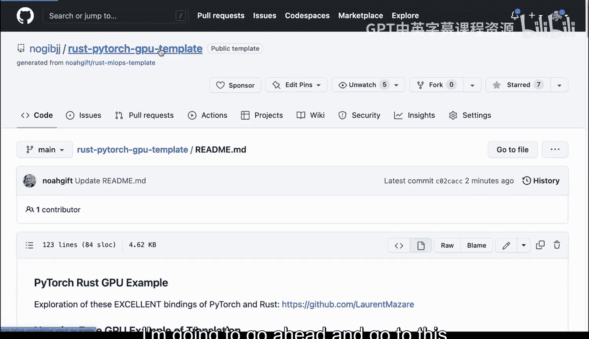
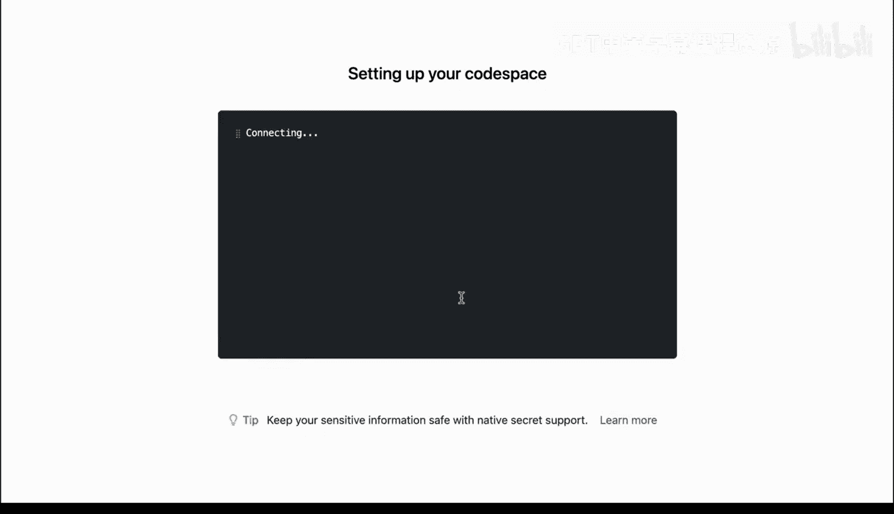
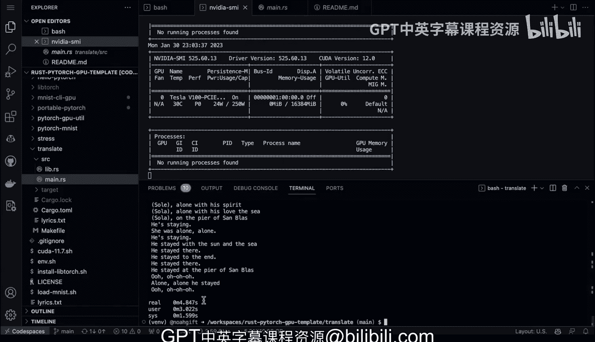

# 杜克大学｜机器学习运维｜DevOps⧸DataOps、Azure、MLFlow和抱脸｜MLOps ｜ Machine Learning Operations p64 71_05_03_Rust-GPU-Hugging-Face翻译器.zh_en -BV1yE421c7uA_p64-

One of the most powerful ways to use rust is to dive into using things like pretrain models。

 using GPU， building high performance command tools that you can do batchbased machine learning inference against what I'm going to show you is how simple it is to use Github codespaces with a GPU enable that GPU。

 build up the rust bindings for it and take a translation tool and build it out in just a few minutes。

 Okay， let's go and get started。 here I've got a repo nogi Bjj rest towards GPU template that has all the things you need to get GPs cooking in codespaces。

 And what I'm going to take a look at Here is the diagram of what we're gonna build。

 So to start with you have a coup to GPU enabled in codespaces。

 And then I'm going to go through and use the rust bindings for hugging face again。

 rust is a high performance language that allows you to build very performance tools and then we're going to put that together and use it。

To enable rust and GP plus hugging face to translate a song that's in Spanish to English。

 And it actually happens in a very short amount of time just a few seconds。

 And we're also able to see that the GP is being utilized。 So really。

 this is the dream scenario for many people that want to build batchbased machine learning tools。

 Rus plus a GP plus hugging face is a great solution。

 So let's go ahead and take a look at the crate real quick。 You can see here its rust bird。😊。

Ready to use NLP pipeline。 It takes advantage of the pre existingisting pytorch rust bindings here。

 and we're able to actually use that。 So let's go ahead and dive in。

 I'm going to go ahead and go to this environment and launch a codespace。

All right， once we go through here and launch this code space first。

 I'm going to show you the code and then we'll go through and run the code。 So to start with。

 it's actually pretty straightforward to interface with hugging face in a GPU a few things to point out when you first get started is that it's a good idea。

To actually be able to monitor the GPU。 So how would you do that， Well。

 one of the ways that you want to take a look at the GPU is run Nvidia hyphen Smi L1， right。

 This shows us if there's anything going on。 There's nothing going on with the GPU。

 So when we do actually do the inference， that's actually the step that we're going to take。

The other thing that we'll need to do is go over to a repo that I've set up here called Translate。

 And if I go ahead and I see D into translate， let's go ahead and walk through the code here。

 So first up， we have the cargo tooll。Here we have just three dependencies。 First。

 I use those Rubert by means。 Second， I use a chameian tool， and then third。

 I use this library called Anyhow。 So fairly straightforward。

 and this is the namespace that I'm going to work with。 Again， when I build out tools。 typicallyyp。

 I like to build out things with a lib and a main。 The main is the chamean tool and the lib is where I do all the work。

 Let's go ahead and take a look at how this work is actually processed。

 The first thing I do is I go through here。 and I say a library that uses hugging face to translate text。

 Here is where I use Ru Bt。 And then I build a function that allows me to read a file and return back a string。

 pretty straightforward。 something you do in Python as well。

 And I build another function that reads a file and returns an array of lines of the file。😊。

And you can see here that the reason for this is that we want to pass an array which is like a list in Python into the translator。

 Now the final piece is quite simple。 We just build a function and I expose it via pub right here so that the command line tool can get access to it and I say okay let's go ahead and build this translator let's go ahead and say that the source language is going to be Spanish and the destination language is going to be English。

 We obviously could build a more sophisticated tool that can accept different kinds of language models but just to make things simple we're going to do this and then I go ahead and I create the model Then I create a text here。

 which is a vector of strings and then I pass in the text to the model and what's nice about this again this uses this function over here is that I'm able to actually print out what all the sentences are If we go over to the main here very straightforward again a pattern I like to use over and over again as I use this command line parser and。

Map the functions inside my library to sub commandds， have a translation command。

 have a print command。To tee it all together， we just go through and we call it。 right。

 So this is a powerful， powerful pattern to use。 And then if we want to look at the text here。Inside。

 we have some lyrics。 These are the lyrics to a popular Spanish song from Mana。 All right。

 how do I get this thing running。 Pre easy？ All I got to do is invoke whatever is appearing right here。

 So I can go ahead and say cargo run dash dash help。

 This is how I first kind of kick the tires here and get things cooking。

 with what this will do is go through and invoke it and show us what the subcomds are。 Now。

 the part that I think is going to be fun is let's go ahead and go back to the bash terminal here。

 And let's actually go through and do Nvidia。😊，SMI L1。

And this is going to show us whether our tools able to utilize the GPU。 So let's go ahead and run it。

 and let's actually go through and see if I put in the path to the lyrics， how long it takes。Okay。

 it's going through。 It's invoking。 We see， in fact， it is using the CPU， the GP。

 and it ran in just a few seconds。 We're able to translate a document。

 So this really shows you the power of why it's so important to use the hugging face plus rust plus GPU combo。

 you can build batch based tools that really are going to run circles around interpreted languages like Python。

😊。

